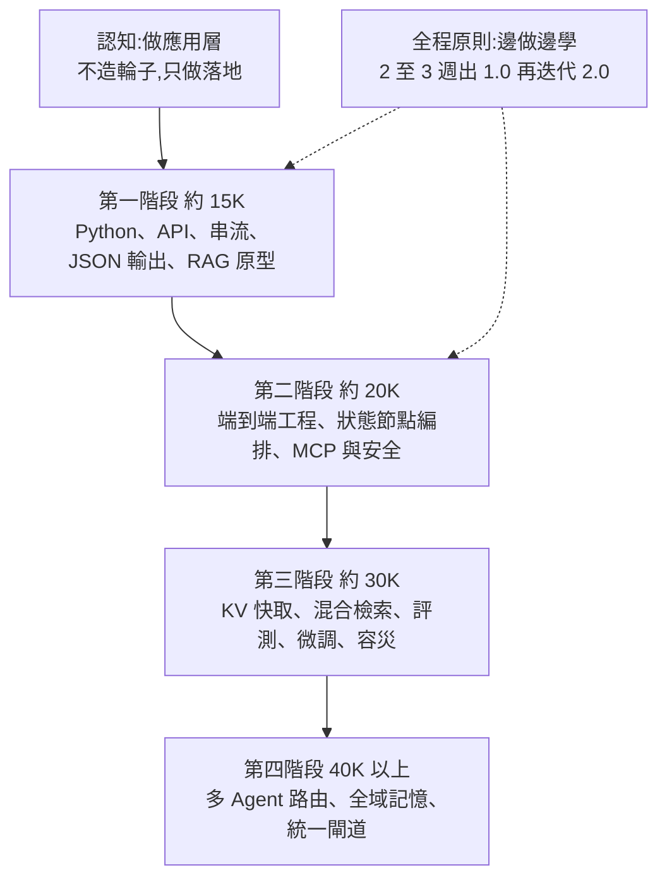

# 轉做 AI 應用開發的學習路線:從零基礎到 40K 架構的四個階段(白白說大模型 4 支影片合併)

> 整理自 YouTube 頻道 **白白說大模型** 的四支影片(簡體中文口播)。四支講的是同一件事:**不要碰訓練大模型,走「應用層」,用工程能力把模型接進業務**。差別只在切法:一支講「零基礎怎麼起步」、一支講「後端怎麼轉」、一支講「薪資階梯四階段」、一支是 Agent 入門課開場。
>
> ⚠️ **薪資、「面試官自己都沒學過」、「今年是唯一窗口期」等說法全是講者個人經驗與判斷**,影片未附任何招聘資料或統計,本文不當成事實,見文末「核實」。

---

## 一句話總結

## 1. 認知:應用開發者的定位(Wf2PZN-Ep2M)

- 常見誤區:以為做 AI 要推導公式、預訓練百億參數、調度幾千張 GPU。講者說那是演算法專家的工作;應用開發者的職責是 **呼叫模型 API、接進企業業務系統、寫好提示詞**。
- 商業落地公式:**成熟模型 API + 企業既有業務系統 + 場景資料 = 可落地的商用 AI 應用**。價值在「省下真金白銀、降重複勞動」,不在炫技。
- 應用拆成四層:前端(可用可視化/無程式碼工具快速驗證)→ 後端 API 服務(含例外處理與參數驗證)→ 模型編排(chain / agent / memory)→ 儲存(關聯式 DB 加向量 DB)。

## 2. 起步與專案選擇(Wf2PZN-Ep2M)

| 步驟 | 內容 | 講者建議 |
|---|---|---|
| 工具 | Python 資料結構、切片、函式、物件導向,約半個月;外加向量 DB、中文分詞庫、log 排查、Git 與伺服器基本指令 | 不啃進階語法 |
| 模型互動 | 理解 token 切分、上下文窗口、計費;提示詞策略(角色、少樣本、分步思考) | 「心裡要有帳」 |
| 專案 | 挑**高頻通用**場景:法律合規知識庫、跨境電商多語客服 Agent、財務數據分析助手、短影音文案工作流 | 避開醫療、軍工等冷門高門檻題材 |
| 學習法 | 不要「學完 Python、深度學習、Transformer 再做專案」;先鎖定一個場景,2 至 3 週做 1.0,再 2 至 3 週迭代 2.0 | 技術三個月就換版,且有遺忘曲線 |

進階(同片):混合檢索加重排、對重複/相近問題做快取降本、私有化微調(資料工程、輕量微調、偏好對齊、評估指標)、非同步並行與串流輸出、模型降級切換、全鏈路追蹤。架構層:統一模型調度平台(複雜推理派大模型、日常撰寫派中模型、格式化派小模型)、跨系統長期記憶、權限控管、監控大屏。

求職週期(講者說法):零基礎 4 至 6 個月、交付 2 至 3 個通用專案;現職 IT(前後端、測試、PM)2 至 3 個月。履歷三要素:**業務痛點、架構設計、量化效率提升**。

## 3. 後端轉 AI 應用的技術棧分層(0gtzVKkg3L0)

講者把學習拆成五層,對後端很直觀:認知 → 模型引擎 → 工具框架 → 業務邏輯(RAG、Agent)→ 生產部署。

- **兩條節奏**:求職窗口緊就走「快軌」(理論知道大概,直撲框架與專案);工作穩定則走「慢軌」(應用加底層原理)。
- **原理只要「技術直覺」**:神經網路演進(全連接 → CNN → RNN → Transformer 注意力);反向傳播/損失函數/優化器用「對照標準答案、回頭微調權重」理解;訓練生命週期以「管培生」比喻:預訓練(讀完圖書館)→ SFT(入職集訓)→ RLHF(日常考評);另提 MoE(綜合門診只叫相關科室)、量化與蒸餾以降成本。
- **框架選型**:Python 走 LangChain(提醒網路教學多半還在講舊版 0.x,已被重構或廢棄,重心是新版與底層 LangGraph 的狀態圖,可分支、可循環糾錯、可人工確認後繼續);Java 走 Spring AI;偏高並發輕量非同步的可看字節跳動開源的 Eino(影片字幕作「挨諾」,經核實為 cloudwego/eino,Go 語言框架)。
- **RAG 工業級細節**:離線端用語意加滑動窗口切片、選對領域向量模型;線上端先讓模型改寫模糊問題、向量加關鍵詞(倒排)混合檢索、再用重排模型精篩。需跨文件推理(多層合規文件、數百頁審計報告)時進階到 **GraphRAG**(抽實體與關係建知識圖譜)。評測不要靠肉眼,要看**忠實度(有無幻覺)、答案相關性、上下文召回**等自動化指標。
- **Agent 本質**:以 LLM 為決策引擎的動態狀態機,四模組:大腦(LLM)、規劃、記憶(短期上下文加長期技能庫)、工具(搜尋、檔案/沙箱、後端微服務 API)。兩種節奏:**ReAct**(想、做、看、再想,靈活但每步都回模型,慢且耗 token)與 **Plan-and-Execute**(先排清單、可並行,吞吐高但難臨機應變)。再往上是 Deep Research 與多 Agent 協作(角色分工、各自上下文與權限)。
- **生產防線**:入口做輸入清洗、敏感詞與提示注入防禦;呼叫端做逾時降級、備用模型秒切、限流熔斷防帳單暴衝;出口用資料驗證工具強制輸出符合業務實體格式。
- **履歷寫法**:別寫「基於某開源框架開發知識庫問答」;講者示範句型為「引入混合檢索加多階段重排,召回準確率提升 38%;設計二級快取,P99 延遲降低 400ms」。**這兩個數字是講者的示範範例,不是實測。**

## 4. 薪資階梯四階段(iy9-ab999VA)

講者自述「連跑 15 家 AI 公司,從 15K 面到 40K」。以下檔位皆為**講者個人說法**。

| 檔位 | 核心考核 | 具體內容 |
|---|---|---|
| 約 15K | 打底與單點功能 | Python;串流輸出;嚴格 JSON 輸出;結構化提示詞(角色、少樣本);RAG 像「開卷考試」(文件切段、轉向量、入向量 DB、提問時取回 2 至 3 段一起交給模型);掛一個簡單工具 |
| 約 20K | 端到端工程 | 不要把數十條規則塞進一段超長提示詞,改成「狀態節點」像流水線控制流轉;用 **MCP** 當統一接口插座連資料庫、第三方 API、本地檔案;一旦賦予呼叫能力就要做身份驗證、輸出合規過濾、防敏感資料外洩 |
| 約 30K | 底層機理與穩定性 | KV Cache 與前綴快取(重複的系統提示詞、歷史上下文預先快取,降延遲與帳單);混合檢索(純向量漏訂單號、英文縮寫,純關鍵詞不懂口語);自動化評測基準(數百上千題覆蓋邊緣場景,每次改提示詞或微調都跑量化指標);後訓練(資料採集清洗、SFT、強化學習);動態限流、熔斷、降級、分散式鏈路追蹤、結構化日誌 |
| 40K 以上 | 多 Agent 集群治理 | 工具上百個不能全塞給模型(上下文膨脹、選擇困難、成本失控),用**智能路由與動態調度**像醫院分診台只啟用 2 至 3 個服務;跨 Agent 全域記憶(避免像辦手續一樣重講一遍);統一零信任鑑權中心與審計;可觀測性與自癒 |

「認知差」論述:講者稱多數公司的面試官原本是傳統前後端、被老闆要求接大模型而臨時拼湊,自己也沒系統學過,所以現在準備一兩個月就「降維打擊」,明年面對的是科班;並以早年移動互聯網「紅利開拓期 → 競爭 → 啃底層 → 飽和」比喻四階段。另批評「一直收藏教程、問『學了能拿 2 萬嗎』」是用過度思考逃避執行,主張**以戰帶練**。

## 5. Agent 入門課開場摘要(wTO77RICB1U)

此片是講者 Agent 系列課(自稱 580 分鐘)的第一期,內容是概念鋪陳:

- 對話式 AI(2022 至 2024)被動一問一答、無法操作外部系統、知識有截止日;Agent(2024 起)是**目標驅動 + 自主循環**。
- 演進三階段(講者劃分):2023 的 Function Calling/外掛、2024 至 2025 的單 Agent(ReAct、長期記憶、規劃反思)、2026 的系統級 Agent(Computer Use、多 Agent、企業 ERP/CRM 落地)。
- Agent 四要素:大模型、記憶(短期/長期向量)、工具、反思循環。
- 對照比喻:菜譜 vs 管家下單買菜;導航 vs 自動駕駛;顧問只出方案 vs 員工自動撈資料庫、產生 Excel/PPT、寄信。
- 補一個觀察:Computer Use 實務上多半仍是走接口而非真的操作滑鼠,因為看畫面要處理的 token 太多。

## 應用案例

- **後端工程師,現職穩定**:選「慢軌」。先半個月把 Python 補到能寫 FastAPI 級的服務,再用公司內部制度文件做一個 RAG 問答:語意切片、混合檢索、重排,加一組自動評測(忠實度、相關性、召回)。履歷寫「垂直領域問答系統,召回準確率與 P99 延遲」的量化結果(用自己的實測數字,別照抄 38% / 400ms)。
- **求職窗口只剩兩個月**:走「快軌」。只做 2 個通用專案(例如跨境客服 Agent、財務分析助手),面試能講清痛點、方案、踩坑即可;用 15K 與 20K 檔的清單自測,串流、JSON 輸出、MCP 與安全能不能講完整。
- **想從 20K 衝 30K**:先找自己專案裡最痛的一個指標(帳單或延遲),用前綴快取加快取層量測前後差異,再補一個評測集,面試被問「怎麼證明改版變好」就有答案。

## 核實

- 已核實:**Eino** 為 cloudwego 組織的 Go 語言 LLM/Agent 應用框架(GitHub 頁面);**Spring AI** 為 Spring 官方專案,提供聊天/嵌入抽象、多種向量庫與 RAG(官方文件)。LangChain / LangGraph / MCP / GraphRAG 為業界通用名詞。
- 字幕還原:「Lantian」= LangChain、「挨諾」= Eino(2026-11-07 以影片畫面截圖確認:投影片寫 LangChain 1.0+ 與 Eino);「DeFi」= Dify(編排平台)、「GVM」= JVM 仍為推定。已追加到 `TRANSCRIPT-PENDING.md`。
- 未能核實(皆為講者個人說法):各檔位薪資(15K / 20K / 30K / 40K、年薪 50 萬)、「同級別薪資拉開 30% 到 50%」、「15 家公司面試」、面試官普遍沒系統學過、今年是唯一窗口、履歷範例的 38% 與 400ms、Agent 市場規模(「2025 年 113 億美元、年增 122%、2026 年 187 億、國內 310 億、超 40% 中大型企業上線」,無出處)。
- 疑點:wTO77 片中「Cybertruck 沒有方向盤、已在美國落地」疑為講者口誤(無方向盤的應是 Cybercab,且是否已量產落地未核);「Codex 與 ChatGPT 合併」「豆包手機」未核實。

## 業配與推廣揭露(未納入)

- iy9-ab999VA 片中:提供學習資料,需三連加留言「AI」領取,**未納入**。
- wTO77RICB1U:標題與口播有「附全套資料,敲 222 領取」「評論區留言『學習』打包」,講者稱免費;資料內容未納入。
- 0gtzVKkg3L0、Wf2PZN-Ep2M 無明顯業配。

## 相關筆記

- [[agent-project-resume-enterprise-grade]]:同頻道講履歷專案分水嶺
- [[production-agent-engineer-skills-2026]]
- [[over-30-developer-ai-career-switch-directions]]
- [[fde-and-ordinary-people-ai-entry-guide]]

## 來源

- 白白說大模型〈從0到1打通 AI 應用開發:零基礎小白的系統化學習路線與企業級落地指南〉(2026-09-04):https://www.youtube.com/watch?v=Wf2PZN-Ep2M
- 白白說大模型〈後端轉AI應用開發學習路線:從基礎理論、框架選型到RAG與Agent生產級〉(2026-09-29):https://www.youtube.com/watch?v=0gtzVKkg3L0
- 白白說大模型〈AI應用開發:從入行到高薪的4個階段〉(2026-10-24):https://www.youtube.com/watch?v=iy9-ab999VA
- 白白說大模型〈2026十一月最新Agent零基礎教程(第一期:AI Agent入門介紹)〉(2026-10-27):https://www.youtube.com/watch?v=wTO77RICB1U
- Eino:https://github.com/cloudwego/eino
- Spring AI:https://docs.spring.io/spring-ai/reference/index.html
- 以上四片皆無官方字幕,逐字稿以 CPU 版 Whisper 轉錄,可能有同音字誤差(簡繁混雜)。
