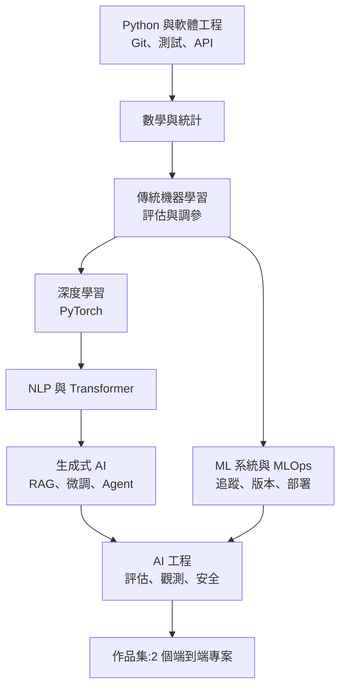
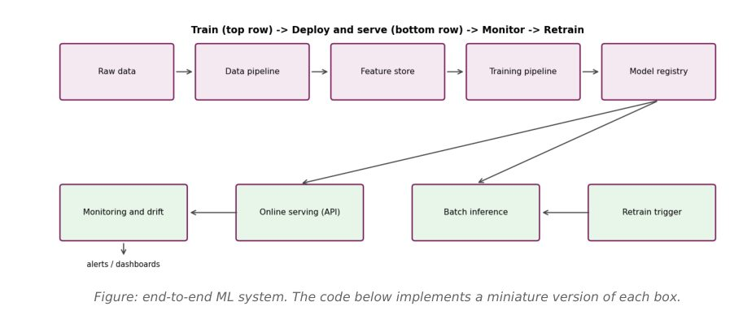
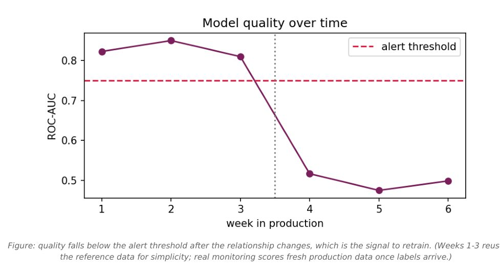

# AI / ML 工程師學習路線圖:九個職位、104 主題、24 週計畫(Anjana「AI & Tech」5 份 PDF 合併)

> 整理自使用者提供的批次素材 `new/ai-guide/`,作者 Anjana(Instagram `@aiwithanju`,「AI & Tech」)。5 份 PDF 中的 4 份屬本筆記(第 5 份 FDE 路線圖併入 [[fde-and-ordinary-people-ai-entry-guide]] 第 3 節)。
>
> ⚠️ **社群引流型素材揭露**:每頁頁尾都帶 `@aiwithanju` 連結,結尾有「Follow ... for more AI and product-management content / Follow for more AI & tech roadmaps(Instagram)」。**這 5 份 PDF 內未見付費課程、價格、「留言領取」之類導購文字**(文字層全文檢索 salary / course / paid / enroll 等字眼只命中課程名單與「paid APIs」);因此引流只有「追蹤 Instagram」一項。
>
> ⚠️ **內容性質**:這些 PDF 是「主題清單 + 資源連結 + 小段範例程式」,**不含作者自己的原創研究或薪資/就業統計**。短版 ML 路線圖第 1 頁還殘留一段生成提示的痕跡("the portrait supplied with this request ... Anjana.HEIC was not available in the accessible uploads"),顯示文件很可能由 AI 助手協助產出;長版自述「每個 Output 都是實際執行程式得到」。本筆記只當**學習地圖**用,並另外核實其中的主張與連結。
>
> 本筆記是我自己的結構化整理,不逐頁照抄原稿;原稿的程式範例請直接看 PDF。

---

## 0. 這批素材是什麼

| 檔名 | 頁數 | 性質 | 本筆記用途 |
|---|---|---|---|
| `Complete_AI_Engineer_2027_Roadmap.pdf` | 90 | 8 類 × 13 主題 = 104 主題,每主題有說明、重點、可跑程式、連結 | 第 2 節 |
| `Complete_Learning_Roadmaps_AI_Tech_Roles.pdf` | 32 | **純關鍵字清單**:9 個職位的主題樹(沒有說明文字、沒有連結) | 第 1 節 |
| `Complete_Machine_Learning_Engineer_Roadmap_and_Resources.pdf` | 63 | ML 工程師長版:8 類、約 80 個範例程式、含雲端對照與系統設計表 | 第 3 節 |
| `Machine_Learning_Engineer_Roadmap_Anjana_AI_Tech.pdf` | 18 | ML 工程師短版:8 類 + 24 週計畫 + 5 個範例 + 作品集規格 | 第 3 節(與長版合併) |
| `Forward_Deployed_Engineer_Roadmap_AI_with_Anju.pdf` | 42 | FDE 路線圖(8 節、35 個範例) | 併入 FDE 筆記 |

「2027」是封面行銷字樣;「104 主題」只是 8 × 13 的算術結果(確認無誤),**每個主題通常只占約 1 頁**,屬於「入門地圖」而非深度教材。

## 1. 九個職位怎麼分(32 頁清單版)

清單版 AI Engineer 拆成 38 個學習類別,其餘 8 個職位各拆成 8 個。我把它壓縮成「主要差異」表,並補上我的判斷(粗體為本筆記的推論,非原稿)。

| 職位 | 原稿一句話 | 比其他職位多出的核心類別 | 對在職工程師的門檻判斷 |
|---|---|---|---|
| AI Engineer | 端到端 AI 系統:ML、DL、LLM、RAG、Agent、評估、部署 | 38 類最廣:Prompt、向量搜尋、RAG、微調、推論最佳化、AI 安全、可觀測性、RL | **最寬、最容易流於表面;務必收斂到 RAG + 評估 + 部署** |
| Data Engineer | 資料平台、管線、倉儲、串流、治理 | 資料建模(星狀模型)、Spark、Kafka、Flink、dbt、資料品質 | 後端轉入最順,**與 AI 的關係是「餵資料」** |
| Data Scientist | 統計、實驗、預測模型、溝通洞察 | 實驗設計、因果推論、存活分析、時間序列、KPI 定義 | 要有統計底子,**商業溝通占比高** |
| ML Engineer | 工程化模型與訓練/推論系統 | 訓練實驗管理、模型服務(ONNX、Triton)、漂移監控、系統設計 | 軟工底子強者最有利 |
| Data Analyst | 查詢、視覺化、回答商業問題 | Excel、Power BI / Tableau、漏斗/留存/cohort | 門檻最低,**但與「AI 工程師」關係最遠** |
| Agentic AI Engineer | 會用工具、有狀態、多步驟的 Agent | 工具 schema、Agent 架構(supervisor 等)、軌跡評估、工具注入與沙箱 | 是 AI Engineer 的子集,**現階段職缺名稱混亂** |
| GenAI Engineer | LLM 應用:RAG、微調、多模態 | 與 AI Engineer 重疊最多,但少了 RL、搜尋與傳統 ML 評估 | 最貼近「應用層」 |
| MLOps Engineer | 部署、監控、安全、營運 ML/AI 基礎設施 | Linux/網路、K8s、Terraform、CI/CD、Kubeflow/KServe、GPU 基礎設施 | **偏 DevOps/SRE 轉入** |
| Forward Deployed Engineer | 整合技術進客戶現場並快速交付 | API 整合、需求工程、解決方案架構、客戶 discovery 與交付 | 詳見 FDE 筆記;**軟技能占比最高** |

清單版的結尾建議值得保留:**先打底,再用越來越真實的專案組合技能;偏工程的職位,軟體工程、系統、部署與生產可靠度要和領域知識並重。**

### 各職位共同底座與分歧點

| 技能 | AI | DE | DS | MLE | DA | Agentic | GenAI | MLOps | FDE |
|---|---|---|---|---|---|---|---|---|---|
| Python | 必 | 必 | 必 | 必 | 中 | 必 | 必 | 必 | 必 |
| SQL | 必 | 必 | 必 | 中 | 必 | 少 | 少 | 中 | 必 |
| 統計/實驗 | 中 | 少 | 必 | 中 | 必 | 少 | 少 | 少 | 少 |
| 傳統 ML | 必 | 少 | 必 | 必 | 少 | 少 | 中 | 中 | 中 |
| LLM / RAG | 必 | 少 | 中 | 中 | 無 | 必 | 必 | 中 | 必 |
| 容器 / K8s / 雲 | 中 | 必 | 少 | 必 | 無 | 中 | 中 | 必 | 必 |
| 客戶溝通與交付 | 少 | 少 | 中 | 少 | 中 | 少 | 少 | 少 | 必 |

(此表為我依清單內容歸納的相對重要度,非原稿表格。)

## 2. AI Engineer「2027」路線圖(90 頁,8 類 × 13 主題)

### 2.1 原稿的 12 個月計畫(每週 8-10 小時)

| 時間 | 階段 | 對應類別 | 產出 |
|---|---|---|---|
| 第 1-3 月 | 打底 | 程式、數學 | 乾淨 Python、Git、畫資料圖、能解釋向量/梯度/分佈 |
| 第 4-5 月 | 傳統 ML | 機器學習 | 表格模型 + 正確交叉驗證 |
| 第 6-7 月 | 深度學習 | 深度學習 | PyTorch 訓練、反向傳播、CNN、序列、正則化 |
| 第 8 月 | 語言模型 | NLP 與 Transformer | 實作 attention、用 Hugging Face、微調小分類器 |
| 第 9-10 月 | 生成式 AI | 生成式 AI | 上線一個有評估的 RAG,加工具與簡單 Agent |
| 第 11 月 | 生產化 | MLOps 與雲 | 容器化、CI/CD、實驗追蹤、漂移監控、雲端部署 |
| 第 12 月 | 總結 | AI 工程 | 一個「生產級、有評估、有安全」的 AI 產品 |

學習習慣(原稿五條):自己打程式碼、用 Git 寫學習日誌、與基準線和留出測試集比較、教別人、數學卡住時回頭補。結尾「Final Checklist」八項,各需有公開專案佐證(Python 專案、解釋梯度/分佈/假設檢定、傳統 ML + 交叉驗證、PyTorch、attention + HF、RAG 並量測、容器化部署監控、設計/評估/保護/觀測 AI 系統)。

### 2.2 八類重點、我的優先順序與在職工程師建議

優先順序:★★★ 一定要會、★★ 視職缺、★ 先知道名詞即可。這是**我的判斷**,依本庫已整理的求職資訊([[ai-app-dev-learning-roadmap-four-tiers]]、[[production-agent-engineer-skills-2026]])推得,不是原稿評分。

| # | 類別(13 主題) | 原稿重點 | 優先 | 對在職工程師的實用建議 |
|---|---|---|---|---|
| 1 | Programming(Python 基礎、OOP、進階、NumPy、Pandas、SciPy、Matplotlib、HTTP、FastAPI、Git、Linux、測試、虛擬環境) | asyncio 並發呼叫 LLM API、`lru_cache`、pytest、`pyproject.toml` | ★★★(已會則略讀) | 後端工程師只需補 NumPy/Pandas 與 asyncio;**不用重學 Git/Linux**。迷你專案「支出追蹤 API」可跳過 |
| 2 | Mathematics(線代、向量矩陣、微積分、導數、梯度、最佳化、機率、隨機變數、分佈、統計、假設檢定、貝氏、資訊理論) | 鏈式法則是反向傳播核心;交叉熵、KL 散度即損失函數 | ★★ | 目標是「看懂論文與損失函數」。**邊做邊補**(原稿也這樣說);先通梯度下降、交叉熵、餘弦相似度 |
| 3 | Machine Learning(監督/非監督、迴歸、分類、分群、樹、隨機森林、梯度提升、XGBoost、特徵工程、評估、調參、交叉驗證) | 先做基準線;驗證用 Stratified/TimeSeriesSplit;pipeline 避免洩漏 | ★★★(想做 ML Eng/DS)/ ★★(只做 LLM 應用) | 表格資料上樹模型仍是首選;**面試愛考洩漏與指標選擇**,建議做一個有誤差分析的 churn 專案 |
| 4 | Deep Learning(神經網路、激活、前向、反向、損失、梯度下降、優化器、正則化、CNN、RNN、LSTM、自編碼器、PyTorch) | 先用 NumPy 手刻反向傳播,再轉 PyTorch;AdamW 為 Transformer 預設 | ★★ | 做一次手刻 + 一個 PyTorch 訓練迴圈即可,CNN/LSTM 只需知道用途。想深入配 [[pytorch-from-zero-transformer-series]] |
| 5 | NLP & Transformers(NLP 基礎、分詞、TF-IDF、詞嵌入、Word2Vec、Attention、Self-Attention、Transformer、Encoder、Decoder、BERT、GPT、Hugging Face) | `Attention(Q,K,V)=softmax(QKᵀ/√d_k)V`、因果遮罩、KV cache | ★★★ | 這是「會呼叫 API」與「能除錯/評估」的分水嶺;跟著 Karpathy 的 GPT 影片做一次 |
| 6 | Generative AI(LLM、Prompt、上下文視窗、嵌入、向量庫、語意搜尋、RAG、RAG 評估、微調、LoRA/QLoRA、Function Calling、Agent、多模態) | 先 prompt → RAG → 最後才微調;模型從不執行程式,是你的應用在執行 | ★★★ | 求職主戰場。**RAG + 20 題手寫評估集 + 引用**一個專案就夠面試講。LoRA 原理見 [[lora-fine-tuning-explained]] |
| 7 | MLOps & Cloud(Docker、K8s、CI/CD、模型版本、實驗追蹤、MLflow、部署、監控、資料管線、三大雲、GPU、CUDA、分散式訓練) | 啟動時載入模型一次;`/health`;canary/blue-green;PSI 漂移 | ★★(CUDA、分散式 ★) | 後端/DevOps 本來就會 Docker/CI,**補 MLflow 與漂移監控**即可;CUDA 與分散式訓練不是應用工程師的必修 |
| 8 | AI Engineering(系統設計、資料工程、SQL、向量搜尋、AI API、評估、可觀測性、安全、提示注入、Agentic 工作流、多 Agent、AI 產品、生產系統) | 重試只針對暫時性錯誤、指數退避加抖動;評估集 30-100 題從失敗長出來;不要讓不可信內容觸發特權動作 | ★★★ | 這一類最接近資深職缺要求,**最值得花時間**;「支援助理」迷你專案(RAG + 工具 + 防注入 + 50 題評估 + 成本/延遲日誌)可直接當作品集 |

### 2.3 我對這份路線圖的整體評論

- **順序合理但偏「學院式」**:先 3 個月程式與數學、再一路到 LLM。若目標是 AI 應用工程師,可照 [[ai-app-dev-learning-roadmap-four-tiers]] 的「專案先行」做法,把第 5-6 類提前到前面,數學與深度學習用到再補。
- **資源品質高、更新感弱**:連結多為官方文件與經典課程(見第 5 節逐項核實),但 Agent 框架清單含已封存的 AutoGen。
- **評估與安全占比合理**:第 8 類的評估集、LLM 當裁判要與人工標註校準、提示注入「沒有完美過濾器」等觀點與業界做法一致。

## 3. ML Engineer 路線圖(63 頁長版 + 18 頁短版合併)

兩份講同一個職位,**短版是長版的「瘦身重排」並加上 24 週計畫與作品集規格**。八個類別對照如下。

| 長版(63 頁) | 短版(18 頁) | 差異 |
|---|---|---|
| 1 Programming | 1 Programming & Software Engineering | 長版含 DSA、NeetCode;短版多了 Automate the Boring Stuff、GitHub Skills |
| 2 Mathematics for ML | 2 Mathematics & ML Foundations | 同;短版加「資料洩漏與基準線」 |
| 3 Machine Learning | 3 Classical Machine Learning | 長版多 SVM、Naive Bayes、異常偵測、推薦系統、SHAP |
| 4 Deep Learning | 4 Deep Learning | 長版含 DDP 分散式範例;短版加 fast.ai |
| 5 ML Systems | 5 ML Training & Experimentation | 長版講資料管線/特徵庫/註冊/批次與線上推論/漂移;短版只講實驗設計與可重現 |
| 6 MLOps | 7 MLOps, Cloud & Infrastructure | 長版含 MLflow、DVC、K8s、Terraform、Actions 實例 |
| 7 Generative AI | (無) | **短版完全沒有 GenAI** |
| 8 Deployment | 6 ML Deployment & Serving | 長版含雲端對照表、CUDA、量化、蒸餾、成本、安全、系統設計 |
| (散在 5、8) | 8 Monitoring, Evaluation & ML System Design | 短版獨立成類:監控、漂移、生產評估、負責任 ML |

**合併後的結論**:ML Engineer 路線 = 「傳統 ML + 工程化」為主,GenAI 只是長版的一章。若你想做的是 LLM 應用,第 2 節的 AI Engineer 路線更貼近;若想做推薦、風控、預測服務,這份更貼近。

### 3.1 兩份的計畫對照

| 長版:6 個月 | 短版:24 週 |
|---|---|
| 月 1 程式與數學:資料清洗 notebook + 有測試的 Python 套件 | 週 1-2 Python 與 Git;週 3-4 NumPy/Pandas/視覺化;週 5 數學統計 |
| 月 2 機器學習:表格專案(基準線、XGBoost 調參、誤差分析) | 週 6-7 第一批模型;週 8-9 pipeline 與驗證;週 10-11 特徵工程與調參 |
| 月 3 深度學習:PyTorch 影像/文字分類器 | 週 12-13 PyTorch 小模型 |
| 月 4 ML 系統 + MLOps:容器化 API + MLflow + DVC + CI | 週 14-15 實驗追蹤;週 16-17 API + Docker;週 18-19 CI/CD 與雲概念 |
| 月 5 GenAI:RAG + 工具型 Agent | (無) |
| 月 6 部署:上雲、監控、量化/蒸餾、每次預測成本 | 週 20-21 監控與系統設計(服務指標、漂移、回滾、model card);週 22-24 作品集打磨 |

### 3.2 值得抄走的內容

- **ML 系統七問**(長版第 8 節,以即時刷卡風控為例):需求 → 指標 → 資料 → 特徵 → 模型 → 服務 → 監控。例:要求 100 ms 內決定放行、尖峰 5,000 次/秒;標籤因拒付拖數週才到;先用規則當基準,再上梯度提升;新模型先 shadow 部署;靠 registry alias 即時回滾。
- **端到端 ML 系統圖**:

圖出處:`Complete_Machine_Learning_Engineer_Roadmap_and_Resources.pdf` 第 32 頁。重點:註冊庫同時餵線上服務與批次推論,監控與漂移產生警報並回頭觸發再訓練,形成閉環。

- **漂移監控圖**:

圖出處:同 PDF 第 36 頁(模擬資料,非真實事件)。重點:警戒線(0.75)被跌破就是再訓練訊號;原稿也註明第 1-3 週為簡化而重用參考資料,真實監控要等標籤到齊才算得出品質。

- **短版的作品集規格**:A 探索式資料分析、B 表格預測(含洩漏安全前處理、交叉驗證、誤差分析、限制)、C 生產風格 ML 服務(版本化模型、API、測試、Docker、CI、結構化日誌、健康檢查、延遲量測、回滾路徑)、D 選修專精。README 清單含:問題陳述、資料來源/授權、目標定義、重現指令、基準線與最終結果、倫理與濫用考量、**不編造結果**。

## 4. 給在職工程師的實用建議(依背景)

| 你的背景 | 建議路徑 | 先略過 |
|---|---|---|
| 後端工程師(想做 LLM 應用) | 第 2 節的 5 → 6 → 8 類,穿插 3 的評估觀念;做 RAG + 評估 + 防注入專案 | 數學深挖、CNN/LSTM、CUDA、分散式訓練 |
| 後端 / DevOps(想做 MLOps) | 第 3 節的 MLflow、DVC、模型服務、漂移監控;配 MLOps 清單的 K8s、Terraform、Triton/KServe | 深度學習推導 |
| 資料分析師 / BI | 先補 Python 工程化與 Git/測試,再走 ML Engineer 前 3 類;或走 FDE 路線(見 [[fde-and-ordinary-people-ai-entry-guide]])發揮業務溝通 | Kubernetes、CUDA |
| 沒有程式底子 | 12 個月計畫逐階段做;但請參考 [[over-30-developer-ai-career-switch-directions]] 對年資與現實的討論 | — |

通用原則(原稿與我的判斷一致):**專案比證書重要**;每個階段做一個公開專案;**一律先建基準線與留出測試集**;自己打程式碼不要只讀。

## 應用案例

- **後端工程師 6 個月上手**:月 1 補 NumPy/Pandas 與 asyncio;月 2-3 看 Karpathy 的 GPT 影片並實作 attention,同時用 Hugging Face 跑文字分類並與 TF-IDF + 邏輯迴歸比;月 4-5 做公司內部文件 RAG,先手寫 20 題評估集量 hit-rate@k,再改切片大小比較;月 6 加提示注入防禦、50 題評估、結構化日誌(含成本與延遲),寫成 README。
- **想轉 ML Engineer 的資料分析師**:用短版 24 週計畫,週 8-11 做 churn 預測(基準 → 樹模型 → 閾值調整),週 16-17 把 sklearn pipeline 用 FastAPI + Docker 包起來,週 20-21 寫 model card 與漂移警報。面試時能講「為什麼用 PR-AUC 不用準確率、洩漏怎麼避免、怎麼回滾」。
- **用九職位表挑方向**:喜歡跟客戶講話、不排斥出差 → FDE;喜歡把系統顧穩 → MLOps;喜歡數字與實驗 → DS;三者都想要 → 先走 AI Engineer 路線的第 6、8 類,再依第一份工作長出專長。

## 5. 延伸閱讀與深度補充(2026-11-08 核實)

### 5.1 連結有效性(實測)

- 從 4 份 PDF(外加 FDE 份)的超連結註記共抽出 **325 個不重複網址**,逐一以一般瀏覽器 User-Agent 送出請求:**313 個回應 200**(含轉址;**200 不代表內容仍符合標題**,只代表頁面存在)。其餘 12 個逐一再查:
  - **確定失效或已搬家**:`scikit-learn.org/stable/tutorial/index.html`(404;改用 `.../user_guide.html` 或首頁)、`radimrehurek.com/gensim/models/word2vec.html`(404,未找到替代連結)、`docs.nvidia.com/cuda/cuda-c-programming-guide/`(404,加 `index.html` 後 200)。
  - **Python 請求 404、curl 帶瀏覽器 UA 回 200**:`kaggle.com/learn` 與其 intro / intermediate / feature-engineering 子頁,視為存在(擋爬蟲)。
  - **回 403 或逾時而無法判定**:`blog.palantir.com`(403)、`leetcode.com`(403)、`cs229.stanford.edu`(Python 憑證驗證失敗,curl 為 200)、`nlp.stanford.edu/IR-book/...`(逾時)、`gnu.org/software/bash/manual/`(逾時)。**未能核實**。
- `docs.claude.com/...` 的 Anthropic 文件連結現在會 302 轉到 `platform.claude.com/docs/...`,仍可用。
- 資源名單中的課程/作者實際存在且可開(皆以首頁/目錄頁確認存在,**未逐一讀完內容**):Andrew Ng Machine Learning Specialization(Coursera)、Karpathy Neural Networks: Zero to Hero(karpathy.ai)、fast.ai、Dive into Deep Learning(d2l.ai)、CS231n、Made With ML、Full Stack Deep Learning、Hugging Face LLM Course、Google ML Crash Course、MIT Missing Semester、scikit-learn MOOC(inria)。
- 小瑕疵:2027 版的「Karpathy - Intro to Large Language Models (YouTube)」超連結指向他的**頻道首頁**而非該影片。

### 5.2 技術主張逐項核實

| 原稿主張 | 查證結果 | 狀態 |
|---|---|---|
| 8.10 Agentic 工作流五種模式:prompt chaining、routing、parallelisation、orchestrator-workers、evaluator-optimiser;「優先用最簡單且可行的模式」 | 讀 Anthropic〈Building effective agents〉原文:五種模式名稱完全一致,並寫「we recommend finding the simplest solution possible, and only increasing complexity when needed」,且說多數應用只要優化單次 LLM 呼叫加檢索與範例就夠 | **已核實** |
| Agent 框架清單含 AutoGen(2027 版、清單版、FDE 版皆有) | 讀 `microsoft/autogen` README:「AutoGen is now archived and no longer maintained by Microsoft」「New users should start with Microsoft Agent Framework」 | **需修正(過時)**:新學習者不要從 AutoGen 起步;LangGraph 文件網址仍可開 |
| 7.8 「PSI 大於 0.2 是常見的顯著漂移經驗法則」 | 讀 Evidently 文章:PSI < 0.1 無顯著變化、0.1-0.2 中度、≥ 0.2 顯著,但文章只說是「practitioners 常用解讀」,未標明出處;該文自己的實驗用 0.1 當門檻 | **已核實為經驗法則**,不是統計定理,門檻要依資料調整 |
| 3.12 「隨機搜尋常勝過網格搜尋」 | 讀 Bergstra & Bengio(JMLR 2012)摘要:同樣運算量下隨機搜尋找到更好的模型,因為通常只有少數超參數重要 | **已核實** |
| 3.8 「梯度提升在表格資料上通常勝過隨機森林」;樹模型是表格資料首選 | 讀 Grinsztajn 等人 arXiv 2207.08815 摘要:在 45 個資料集、約一萬筆規模上,XGBoost、隨機森林等樹模型仍勝過深度學習。**該摘要沒有比較提升與隨機森林**,所以「提升通常勝過隨機森林」這半句未直接讀到 | 前半句(樹模型仍強)**已核實**;後半句**未能核實** |
| 7.4 「用 stages/aliases(staging、production)管理模型版本」 | 讀 MLflow Model Registry 文件頁:同時提到 aliases、tags,OSS 段仍寫「transition models between stages such as Staging and Production」;**該頁沒有寫 stages 已棄用** | 原稿說法與現行文件不矛盾;是否棄用**未能以該頁核實** |
| 5.11 「bert-base:12 層、768 隱藏維度、約 1.1 億參數」 | 抓取 BERT 論文摘要(arXiv 1810.04805):摘要不含參數量,只列 GLUE 80.5、MultiNLI 86.7、SQuAD F1 93.2/83.1 等結果 | 參數量**未能以本次抓取核實**(需讀論文本文) |
| 5.2 「約 1 token = 3/4 個英文單字」 | OpenAI 說明頁回 403 | **未能核實**(僅屬一般經驗法則) |
| 8 迷你專案參考書:Chip Huyen《AI Engineering》(O'Reilly) | O'Reilly 書頁回 403,未讀內容;連結本身以 HTTP 檢查為存在 | **未能核實書籍內容** |
| 長版範例 68 使用的模型 ID `claude-sonnet-5-5` | 本次對話環境自報的模型 ID 即此名稱,但未對官方模型清單查證 | **未能核實**;寫程式請以官方文件的當期模型名稱為準 |

### 5.3 薪資與就業數字

- **這 4 份路線圖本身沒有薪資或職缺統計**,所以沒有可「核實」的數字;下列為本次補查的官方資料,供判斷職涯規模(美國資料,不可直接套用台灣):
  - 美國勞工統計局 BLS〈Computer and Information Research Scientists〉:2025 年 5 月薪資中位數 **140,300 美元**,2025-2035 預估就業成長 **22%**,典型入門學歷碩士。來源:<https://www.bls.gov/ooh/computer-and-information-technology/computer-and-information-research-scientists.htm>
  - BLS〈Data Scientists〉:2025 年 5 月中位數 **120,230 美元**,2025-2035 預估成長 **35%**。來源:<https://www.bls.gov/ooh/math/data-scientists.htm>
  - 以上 BLS 職類是「研究科學家 / 資料科學家」,**不等於「AI Engineer」「FDE」**(BLS 無此職類),且我只讀到頁面摘要數字,未逐項讀方法說明。
- Stack Overflow Survey、LinkedIn 等其他來源本次**未查**,不下結論。

## 6. 與既有筆記的關係

- [[ai-app-dev-learning-roadmap-four-tiers]]:白白說的「專案先行、四階段」路線;本篇第 2 節是「學院式、由下而上」的對照。
- [[fde-and-ordinary-people-ai-entry-guide]]:FDE 職位的商業視角;Anjana FDE 路線圖(第 3 節)是工程視角。
- [[production-agent-engineer-skills-2026]]、[[agent-project-resume-enterprise-grade]]:進階生產級 Agent 與履歷專案。
- [[over-30-developer-ai-career-switch-directions]]:年資與轉型現實。

## 來源

- 使用者提供的本機素材批次 `new/ai-guide/`(2026-11-07 收件),檔案:`Complete_AI_Engineer_2027_Roadmap.pdf`、`Complete_Learning_Roadmaps_AI_Tech_Roles.pdf`、`Complete_Machine_Learning_Engineer_Roadmap_and_Resources.pdf`、`Machine_Learning_Engineer_Roadmap_Anjana_AI_Tech.pdf`(作者 Anjana「AI & Tech」,Instagram:https://www.instagram.com/aiwithanju/ ,社群引流型素材)
- Anthropic〈Building effective agents〉:https://www.anthropic.com/engineering/building-effective-agents
- microsoft/autogen README:https://github.com/microsoft/autogen
- Evidently AI 資料漂移文章:https://www.evidentlyai.com/blog/data-drift-detection-large-datasets
- Bergstra & Bengio,Random Search for Hyper-Parameter Optimization(JMLR 2012):https://www.jmlr.org/papers/v13/bergstra12a.html
- Grinsztajn 等,Why do tree-based models still outperform deep learning on tabular data?:https://arxiv.org/abs/2207.08815
- MLflow Model Registry 文件:https://mlflow.org/docs/latest/ml/model-registry/
- BERT 論文:https://arxiv.org/abs/1810.04805
- BLS Computer and Information Research Scientists:https://www.bls.gov/ooh/computer-and-information-technology/computer-and-information-research-scientists.htm
- BLS Data Scientists:https://www.bls.gov/ooh/math/data-scientists.htm
