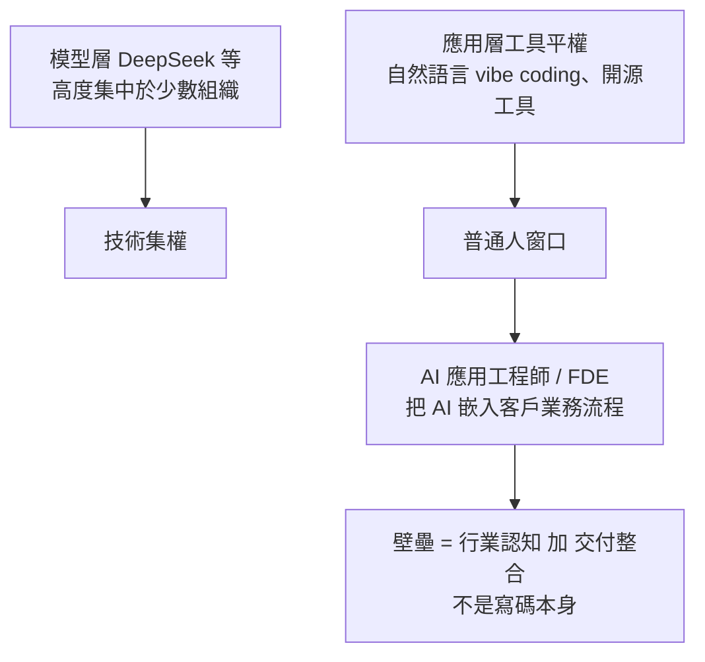

# 普通人的 AI 入局點:FDE(前線部署工程師)與應用層落地(白白說大模型 2 支影片合併)

> 整理自 YouTube 頻道 **白白說大模型** 的〈AI 時代的新「包工頭」:FDE 賽道商業變現全景拆解〉與〈面向普通人的 AI 時代入局指南〉。兩片論點相同:**普通人的機會不在模型層,而在把 AI 嵌進具體行業業務流程的應用層/交付層**。
>
> ⚠️ 年薪、單案金額、「不到一年的新賽道」「未來十年最賺」等均為講者個人判斷,未附資料;`wt2kiCU6sA0` 片中段有**付費平台推廣**,未轉述其內容。

---

## 一句話總結

## 1. 普通人的位置(wt2kiCU6sA0)

- 講者把職場人分三類:資源玩家(頂尖實驗室、巨頭高管)、無感群體(視 AI 為玩具,經驗貶值最快)、**中間的普通職場人**(只能用現成工具為業務提效)。
- 人才層級:演算法工程師與資深架構師/全端對學歷與底層經驗要求高,零基礎硬衝不現實;最底層資料標註門檻低、易被合成資料取代;**可切入的是第四層「AI 應用工程師」**。
- 產業分層:模型層(智力中樞)→ 平台層(雲廠商 MaaS、算力)→ 應用層(承載商業價值變現)→ 基礎資料層。千行百業有複雜、非標準的「最後一公里」,大廠親自下場不了。
- **該去哪種公司**:不要盲卷純 AI 研發公司(迭代以週計、開源一個新模型可能讓公司業務一夜消失),而是去傳統實體、教育、醫療等做「懂業務的落地專家」。引用**傑文斯悖論**:效率提升、成本下降,總用量反而爆增(蒸汽機提高燃煤效率,煤耗反而暴漲);過去一套智能化系統外包動輒數十上百萬,中小企業用不起,模型成本下降後需求被激活。
- 自我警告:早期 AI 部署崗位靠「早鳥時間差」,一線城市月薪 15K 以上不難,但提示詞工程等表面技巧可能兩三年內被模型進步淘汰,要高頻更新。
- 轉行三步:至少預留三個月專注期 → 做真實商業專案實訓 → 入職後交付第一個業務問題。三項自檢:認知(做落地不要想著搞底層)、行業(避開易被 AI 全流程取代的純線上輕內容行業)、心態(只要比同崗位平均數位化效率快就有優勢)。

## 2. FDE 是什麼生意(dThNVDU64ew)

- 比喻:替客戶企業「安排 AI 數位員工的工位、主管、協作流程」,像帶技術的包工頭加賽博 HR。
- 為何現在:老闆不再迷信參數與榜單,只問「能不能頂掉三道易錯工序、能不能省人工成本」;講者稱賽道成形不到一年,懂業務又懂交付的人少、無惡性價格戰。
- **與一般外包的差別**:外包是接上模型 API、能點能跑簽收結案(交付靜態工具);FDE 要重排崗位工作流、拆「哪些機器全自動、哪些必須人工複核」、算每個崗位的工作量,交付的是「變過後的業務運轉機制」。因為嵌進組織骨架,換掉你的成本高。
- **現場四步法**:①工時與負載盤點(找枯燥高重複易錯環節);②人機權責切分;③鎖定老闆真正在意的對賭 KPI(例:單據平均流轉從 4 小時壓到 15 分鐘),不用響應時間、併發量這種技術指標彙報;④把 AI 嵌進員工既有系統後台,無痛升級。
- **人機權責矩陣(風控分級)**:格式固定、規則清晰、低風險(如低價值資料提取歸檔)→ AI 全自動;格式不規範、帶少量例外的中風險 → AI 標預警、整理上下文,人最終核對;涉及重大資金調撥、核心商業條款的高風險 → AI 只出風險評估,**決策權留在人手上**。講者強調「盲目追求 100% 全自動化往往是災難」。
- **商業模式**:①指標對賭、獨立模組交付(例:產線質檢漏檢率從 3% 壓到 0.1% 以下,達標按階段結款,先派人進線兩週);②跑通多個垂直模組後升級為**全流程打包交付**(線索 → 訂單/流程 → 交付售後),講者稱單客價數十萬起、可達百萬。價值鏈:最底層代碼外包/接口對接(卷工時,利潤薄)→ 中層按業務價值收費 → 頂層端到端流程系統重構。「離客戶真實業務越近,壁壘越高」。
- **四塊能力拼圖**:軟體工程、資料分析與指標拆解、行業認知與營運經驗、全局把握的授權與專案管理。破局兩路:**長板潛入**(以垂直行業專家身分加入有技術但進不去場景的團隊)或**搭班子**(技術 + 流程 + 專案管理三人組)。

## 應用案例

- **供應鏈合約審核(影片案例)**:大宗商品企業每天上萬份非標準採購合約。傳統外包是「抽文字、轉表格」,業務仍要逐份重看。FDE 作法:先進辦公室追蹤單據經手人與蓋章,找出半年來最易引發合約糾紛的節點,問主管在意審單速度還是違約風險攔截率;之後設計矩陣:低風險欄位自動提取、含異常條款的標預警給人複核、超門檻金額只出風險報告。
- **小型製造廠質檢**:先蒐集質檢工序與歷史漏檢資料,和廠長白紙黑字約定漏檢率目標與結款節點,先交付一個質檢模組當入口。
- **有 8 年快消行業經驗但不會寫碼**:走長板潛入,找缺場景的技術小團隊,擔任需求調研與驗收指標設計,並學會用 Agent/低程式碼工具自己做原型。
- 與 [[over-30-developer-ai-career-switch-directions]] 的「企業 AI 落地顧問」一節互相對照:兩者都主張翻譯業務與技術的人最缺。

## 核實

- 已核實:傑文斯悖論(Jevons paradox,蒸汽機改善煤炭效率使總消耗增加)為經濟學既有概念,影片用法正確。「FDE」(Forward Deployed Engineer)為業界既有職稱,影片所講是自己的延伸定義,未逐一對照他處職缺說明。
- 未能核實(講者個人說法):FDE 單案「數十萬起、可達百萬」、「未來十年最賺」、賽道「不到一年」、「15K 以上不難」、質檢 3% 到 0.1% 與 4 小時到 15 分鐘(皆為舉例)。
- 字幕還原:「FD1」= FDE(2026-11-07 以影片畫面截圖確認:投影片標題「什麼是 FDE(前沿部署工程)」);其餘為推定:「大木行/木型」= 大模型;「葛式固定」= 格式固定;「彩坑」= 踩坑;「結問司備論」= 傑文斯悖論;「Must 平台」疑為 MaaS。已追加 `TRANSCRIPT-PENDING.md`。

## 業配與推廣揭露(未納入)

- `wt2kiCU6sA0` 後段提到要借助「專業的持續平台」搭橋、邀請一線研究員分享、並推薦「就業成功再付費」的合作模式:**屬付費培訓/就業服務推廣,未納入**;自行評估這類模式請另看合約條款。
- `dThNVDU64ew` 未見明確推廣。

## 來源

- 白白說大模型〈AI時代的新「包工頭」:FDE賽道商業變現全景拆解〉(2026-09-09):https://www.youtube.com/watch?v=dThNVDU64ew
- 白白說大模型〈面向普通人的AI時代入局指南〉(2026-09-10):https://www.youtube.com/watch?v=wt2kiCU6sA0
- 兩片皆無官方字幕,逐字稿以 CPU 版 Whisper 轉錄,可能有同音字誤差(簡繁混雜)。
