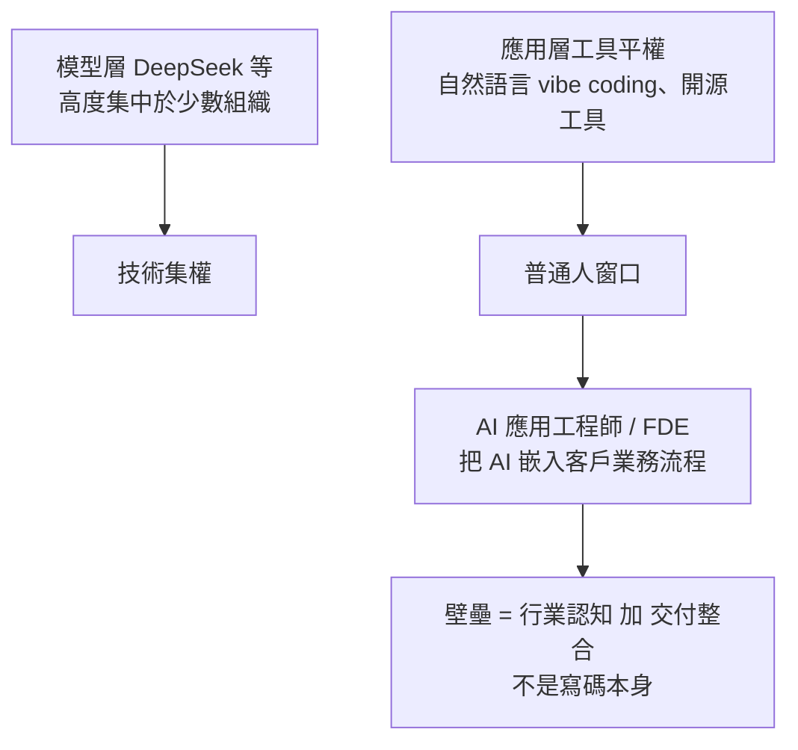

# 普通人的 AI 入局點:FDE(前線部署工程師)與應用層落地(白白說大模型 2 支影片合併)

> 整理自 YouTube 頻道 **白白說大模型** 的〈AI 時代的新「包工頭」:FDE 賽道商業變現全景拆解〉與〈面向普通人的 AI 時代入局指南〉。兩片論點相同:**普通人的機會不在模型層,而在把 AI 嵌進具體行業業務流程的應用層/交付層**。
>
> ⚠️ 年薪、單案金額、「不到一年的新賽道」「未來十年最賺」等均為講者個人判斷,未附資料;`wt2kiCU6sA0` 片中段有**付費平台推廣**,未轉述其內容。

---

## 一句話總結

## 1. 普通人的位置(wt2kiCU6sA0)

- 講者把職場人分三類:資源玩家(頂尖實驗室、巨頭高管)、無感群體(視 AI 為玩具,經驗貶值最快)、**中間的普通職場人**(只能用現成工具為業務提效)。
- 人才層級:演算法工程師與資深架構師/全端對學歷與底層經驗要求高,零基礎硬衝不現實;最底層資料標註門檻低、易被合成資料取代;**可切入的是第四層「AI 應用工程師」**。
- 產業分層:模型層(智力中樞)→ 平台層(雲廠商 MaaS、算力)→ 應用層(承載商業價值變現)→ 基礎資料層。千行百業有複雜、非標準的「最後一公里」,大廠親自下場不了。
- **該去哪種公司**:不要盲卷純 AI 研發公司(迭代以週計、開源一個新模型可能讓公司業務一夜消失),而是去傳統實體、教育、醫療等做「懂業務的落地專家」。引用**傑文斯悖論**:效率提升、成本下降,總用量反而爆增(蒸汽機提高燃煤效率,煤耗反而暴漲;⚠️ 影片「暴漲成千上萬倍」一說於傑文斯原典未見,未能核實,見下方「延伸閱讀與深度補充」);過去一套智能化系統外包動輒數十上百萬,中小企業用不起,模型成本下降後需求被激活。
- 自我警告:早期 AI 部署崗位靠「早鳥時間差」,一線城市月薪 15K 以上不難(講者口述;影片投影片 L4 層級圖標 15k-30k/月,未註明出處,未能核實),但提示詞工程等表面技巧可能兩三年內被模型進步淘汰,要高頻更新。
- 轉行三步:至少預留三個月專注期 → 做真實商業專案實訓 → 入職後交付第一個業務問題。三項自檢:認知(做落地不要想著搞底層)、行業(避開易被 AI 全流程取代的純線上輕內容行業)、心態(只要比同崗位平均數位化效率快就有優勢)。

## 2. FDE 是什麼生意(dThNVDU64ew)

- 比喻:替客戶企業「安排 AI 數位員工的工位、主管、協作流程」,像帶技術的包工頭加賽博 HR。
- 為何現在:老闆不再迷信參數與榜單,只問「能不能頂掉三道易錯工序、能不能省人工成本」;講者稱賽道成形不到一年,懂業務又懂交付的人少、無惡性價格戰。
- **與一般外包的差別**:外包是接上模型 API、能點能跑簽收結案(交付靜態工具);FDE 要重排崗位工作流、拆「哪些機器全自動、哪些必須人工複核」、算每個崗位的工作量,交付的是「變過後的業務運轉機制」。因為嵌進組織骨架,換掉你的成本高。
- **現場四步法**:①工時與負載盤點(找枯燥高重複易錯環節);②人機權責切分;③鎖定老闆真正在意的對賭 KPI(例:單據平均流轉從 4 小時壓到 15 分鐘),不用響應時間、併發量這種技術指標彙報;④把 AI 嵌進員工既有系統後台,無痛升級。
- **人機權責矩陣(風控分級)**:格式固定、規則清晰、低風險(如低價值資料提取歸檔)→ AI 全自動;格式不規範、帶少量例外的中風險 → AI 標預警、整理上下文,人最終核對;涉及重大資金調撥、核心商業條款的高風險 → AI 只出風險評估,**決策權留在人手上**。講者強調「盲目追求 100% 全自動化往往是災難」。
- **商業模式**:①指標對賭、獨立模組交付(例:產線質檢漏檢率從 3% 壓到 0.1% 以下,達標按階段結款,先派人進線兩週);②跑通多個垂直模組後升級為**全流程打包交付**(線索 → 訂單/流程 → 交付售後),講者稱單客價數十萬起、可達百萬。價值鏈:最底層代碼外包/接口對接(卷工時,利潤薄)→ 中層按業務價值收費 → 頂層端到端流程系統重構。「離客戶真實業務越近,壁壘越高」。
- **四塊能力拼圖**:軟體工程、資料分析與指標拆解、行業認知與營運經驗、全局把握的授權與專案管理。破局兩路:**長板潛入**(以垂直行業專家身分加入有技術但進不去場景的團隊)或**搭班子**(技術 + 流程 + 專案管理三人組)。

## 應用案例

- **供應鏈合約審核(影片案例)**:大宗商品企業每天上萬份非標準採購合約。傳統外包是「抽文字、轉表格」,業務仍要逐份重看。FDE 作法:先進辦公室追蹤單據經手人與蓋章,找出半年來最易引發合約糾紛的節點,問主管在意審單速度還是違約風險攔截率;之後設計矩陣:低風險欄位自動提取、含異常條款的標預警給人複核、超門檻金額只出風險報告。
- **小型製造廠質檢**:先蒐集質檢工序與歷史漏檢資料,和廠長白紙黑字約定漏檢率目標與結款節點,先交付一個質檢模組當入口。
- **有 8 年快消行業經驗但不會寫碼**:走長板潛入,找缺場景的技術小團隊,擔任需求調研與驗收指標設計,並學會用 Agent/低程式碼工具自己做原型。
- 與 [[over-30-developer-ai-career-switch-directions]] 的「企業 AI 落地顧問」一節互相對照:兩者都主張翻譯業務與技術的人最缺。

## 核實

- 已核實:傑文斯悖論(Jevons paradox,蒸汽機改善煤炭效率使總消耗增加)為經濟學既有概念,影片用法正確。「FDE」(Forward Deployed Engineer)為業界既有職稱,影片所講是自己的延伸定義,未逐一對照他處職缺說明。
- 未能核實(講者個人說法):FDE 單案「數十萬起、可達百萬」、「未來十年最賺」、賽道「不到一年」、「15K 以上不難」、質檢 3% 到 0.1% 與 4 小時到 15 分鐘(皆為舉例)。
- 字幕還原(2026-11-07 重新核對):
  - 「FD1」= FDE:**已核實**,[1:30] 處畫面為投影片「什麼是 FDE(前沿部署工程)？」,下註「業務包工頭」與「賽博 HR」。
  - 「Must 平台」= MaaS 平台:**已核實**,[4:32] 投影片寫「MaaS 平台(如火山引擎、雲服務商)」。
  - 「結問司備論」= 傑文斯悖論(Jevons paradox):**已核實**,[7:20] 為講者口述;概念與原典見下方。
  - 「大木行/木型」= 大模型:**已核實**(投影片與字幕用語皆為「大模型」)。
  - 「葛式固定」= 格式固定:**推定**;[6:31] 附近投影片第二步「明確標準化環節與高風險決策邊界」支持此解讀。
  - 「彩坑」:原標註為「踩坑」,但 2026-11-07 重新檢查現版逐字稿,全文無「彩坑」「踩坑」等詞,來源不明,**撤回**此項,未能核實原詞。

## 延伸閱讀與深度補充(2026-11-07 核實增補)

- **傑文斯原典(已核實)**:W. S. Jevons《The Coal Question》(1865)第七章「Of the Economy of Fuel」原文為 "It is wholly a confusion of ideas to suppose that the economical use of fuel is equivalent to a diminished consumption."(把燃料經濟使用等同於消耗減少,是觀念混淆)。同章另寫 "In less than one hundred years, then, the efficiency of the engine has been increased at least ten-fold."(不到一百年,蒸汽機效率至少提高十倍)。**原典未見**影片「煤炭消耗量暴漲成千上萬倍」之數字,此說**未能核實**,本筆記不採用。與影片差異:原典論點是「效率提高反而推高總用量」,並非具體倍數。來源:<https://www.econlib.org/library/YPDBooks/Jevons/jvnCQ.html?chapter_num=9>
- **Anthropic 的人機分界對照(已核實)**:〈Building effective agents〉區分 workflows(「LLMs and tools are orchestrated through predefined code paths」)與 agents(「LLMs dynamically direct their own processes and tool usage」),建議「find the simplest solution possible」,並寫明 agent「can then pause for human feedback at checkpoints or when encountering blockers」。與影片「高風險決策留給人、低風險才全自動」的分級精神相近;但該文是工程設計建議,不是就業或商業指南,不宜直接套用為影片的結論。來源:<https://www.anthropic.com/research/building-effective-agents>
- **第三步 KPI 的內部矛盾(畫面與口述不一致)**:口述 [6:26] 說「千萬不要用系統響應時間、併發量這種純技術指標向老闆彙報」,但 [6:31] 附近的投影片「交付指標錨定」列出管理層 KPI 範例為「響應耗時／錯誤率／成本」。實務解讀(本筆記推論,非講者原話):響應時間可作內部指標,但對管理層要換成業務結果,例如「單據平均流轉時間 4 小時壓到 15 分鐘」。
- **FDE 職稱起源(未能核實)**:影片說賽道「不到一年」。搜尋摘要多把 FDE 職稱歸於 Palantir,但起源年份說法互相矛盾(2005、2000 年代中、2010 年代初);Palantir 官網本次未能直接開啟,其職缺頁 <https://jobs.lever.co/palantir/8c38feb7-7ca8-429e-9643-efffe2fe0428> 回 404。因此「不到一年」較可能指 AI 大模型公司與中文市場的語境,不宜推廣為 FDE 職稱本身的歷史。
- **AI 公司的 FDE 職缺(未能核實)**:OpenAI 職缺頁 <https://openai.com/careers/forward-deployed-software-engineer-sf/> 本次回 403,無法讀取官方職責與薪資。聚合網站的薪資數字不採用。
- **層級圖薪資(未能核實)**:[4:01] 附近投影片列「L1 算法工程師 100k–200k/月」「L2&L3 資深架構師/全棧 40k–200k/月」「L4 AI 應用工程師 / FDE 15k–30k/月」,未註明出處;筆記內一律視為講者材料,未能核實。
- **對賭指標的畫面核對(已核實目標值)**:[8:55] 口述「從目前的 3% 壓到 0.1% 以下」;投影片「獨立模塊交付」畫面確認目標為「不良品漏檢率降至 0.1% 以下」,但 3% 基線僅見於口述,未能以畫面核對。
- **單案金額(未能核實)**:「數十萬起、可達百萬」為講者口述,影片未附合約樣本或統計來源。

## 業配與推廣揭露(未納入)

- `wt2kiCU6sA0` 後段提到要借助「專業的持續平台」搭橋、邀請一線研究員分享、並推薦「就業成功再付費」的合作模式:**屬付費培訓/就業服務推廣,未納入**;自行評估這類模式請另看合約條款。
- `dThNVDU64ew` 未見明確推廣。

## 來源

- 白白說大模型〈AI時代的新「包工頭」:FDE賽道商業變現全景拆解〉(2026-09-09):https://www.youtube.com/watch?v=dThNVDU64ew
- 白白說大模型〈面向普通人的AI時代入局指南〉(2026-09-10):https://www.youtube.com/watch?v=wt2kiCU6sA0
- 傑文斯 *The Coal Question*(1865)第七章原文:https://www.econlib.org/library/YPDBooks/Jevons/jvnCQ.html?chapter_num=9
- Anthropic〈Building effective agents〉:https://www.anthropic.com/research/building-effective-agents
- 兩片皆無官方字幕,逐字稿以 CPU 版 Whisper 轉錄,可能有同音字誤差(簡繁混雜)。
