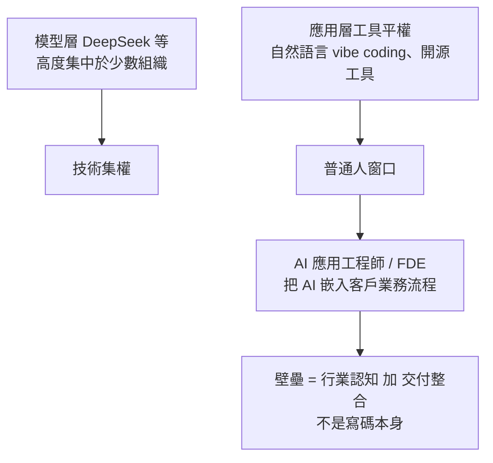
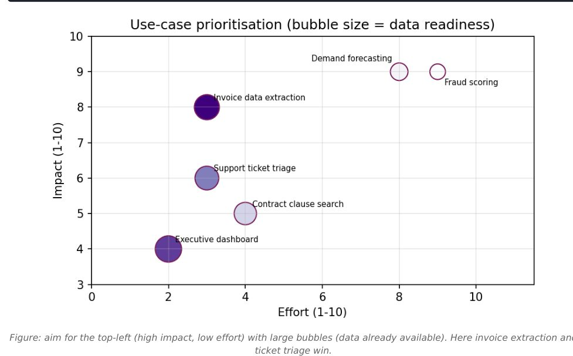
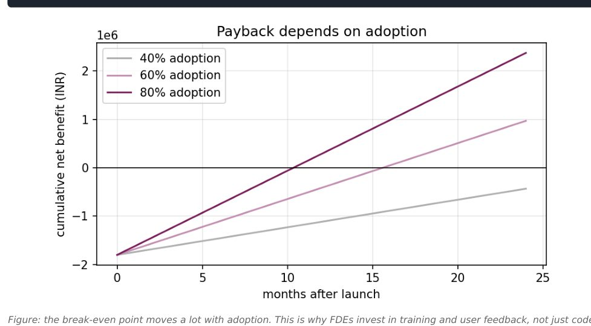
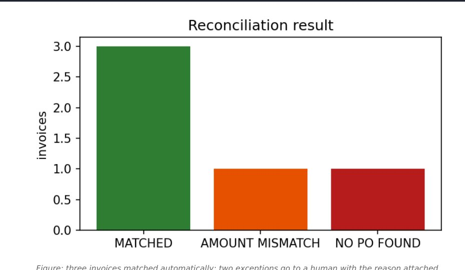

# 普通人的 AI 入局點:FDE(前線部署工程師)與應用層落地(白白說大模型 2 支影片 + Anjana FDE 路線圖 PDF 合併)

> 整理自 YouTube 頻道 **白白說大模型** 的〈AI 時代的新「包工頭」:FDE 賽道商業變現全景拆解〉與〈面向普通人的 AI 時代入局指南〉。兩片論點相同:**普通人的機會不在模型層,而在把 AI 嵌進具體行業業務流程的應用層/交付層**。
>
> 2026-11-08 增補第 3 節:使用者提供的批次素材 `new/ai-guide/` 中 Anjana「AI & Tech」(`@aiwithanju`)的〈Forward Deployed Engineer Roadmap〉PDF(社群引流型素材,見第 3 節開頭揭露)。
>
> ⚠️ 年薪、單案金額、「不到一年的新賽道」「未來十年最賺」等均為講者個人判斷,未附資料;`wt2kiCU6sA0` 片中段有**付費平台推廣**,未轉述其內容。

---

## 一句話總結

## 1. 普通人的位置(wt2kiCU6sA0)

- 講者把職場人分三類:資源玩家(頂尖實驗室、巨頭高管)、無感群體(視 AI 為玩具,經驗貶值最快)、**中間的普通職場人**(只能用現成工具為業務提效)。
- 人才層級:演算法工程師與資深架構師/全端對學歷與底層經驗要求高,零基礎硬衝不現實;最底層資料標註門檻低、易被合成資料取代;**可切入的是第四層「AI 應用工程師」**。
- 產業分層:模型層(智力中樞)→ 平台層(雲廠商 MaaS、算力)→ 應用層(承載商業價值變現)→ 基礎資料層。千行百業有複雜、非標準的「最後一公里」,大廠親自下場不了。
- **該去哪種公司**:不要盲卷純 AI 研發公司(迭代以週計、開源一個新模型可能讓公司業務一夜消失),而是去傳統實體、教育、醫療等做「懂業務的落地專家」。引用**傑文斯悖論**:效率提升、成本下降,總用量反而爆增(蒸汽機提高燃煤效率,煤耗反而暴漲;⚠️ 影片「暴漲成千上萬倍」一說於傑文斯原典未見,未能核實,見下方「延伸閱讀與深度補充」);過去一套智能化系統外包動輒數十上百萬,中小企業用不起,模型成本下降後需求被激活。
- 自我警告:早期 AI 部署崗位靠「早鳥時間差」,一線城市月薪 15K 以上不難(講者口述;影片投影片 L4 層級圖標 15k-30k/月,未註明出處,未能核實),但提示詞工程等表面技巧可能兩三年內被模型進步淘汰,要高頻更新。
- 轉行三步:至少預留三個月專注期 → 做真實商業專案實訓 → 入職後交付第一個業務問題。三項自檢:認知(做落地不要想著搞底層)、行業(避開易被 AI 全流程取代的純線上輕內容行業)、心態(只要比同崗位平均數位化效率快就有優勢)。

## 2. FDE 是什麼生意(dThNVDU64ew)

- 比喻:替客戶企業「安排 AI 數位員工的工位、主管、協作流程」,像帶技術的包工頭加賽博 HR。
- 為何現在:老闆不再迷信參數與榜單,只問「能不能頂掉三道易錯工序、能不能省人工成本」;講者稱賽道成形不到一年,懂業務又懂交付的人少、無惡性價格戰。
- **與一般外包的差別**:外包是接上模型 API、能點能跑簽收結案(交付靜態工具);FDE 要重排崗位工作流、拆「哪些機器全自動、哪些必須人工複核」、算每個崗位的工作量,交付的是「變過後的業務運轉機制」。因為嵌進組織骨架,換掉你的成本高。
- **現場四步法**:①工時與負載盤點(找枯燥高重複易錯環節);②人機權責切分;③鎖定老闆真正在意的對賭 KPI(例:單據平均流轉從 4 小時壓到 15 分鐘),不用響應時間、併發量這種技術指標彙報;④把 AI 嵌進員工既有系統後台,無痛升級。
- **人機權責矩陣(風控分級)**:格式固定、規則清晰、低風險(如低價值資料提取歸檔)→ AI 全自動;格式不規範、帶少量例外的中風險 → AI 標預警、整理上下文,人最終核對;涉及重大資金調撥、核心商業條款的高風險 → AI 只出風險評估,**決策權留在人手上**。講者強調「盲目追求 100% 全自動化往往是災難」。
- **商業模式**:①指標對賭、獨立模組交付(例:產線質檢漏檢率從 3% 壓到 0.1% 以下,達標按階段結款,先派人進線兩週);②跑通多個垂直模組後升級為**全流程打包交付**(線索 → 訂單/流程 → 交付售後),講者稱單客價數十萬起、可達百萬。價值鏈:最底層代碼外包/接口對接(卷工時,利潤薄)→ 中層按業務價值收費 → 頂層端到端流程系統重構。「離客戶真實業務越近,壁壘越高」。
- **四塊能力拼圖**:軟體工程、資料分析與指標拆解、行業認知與營運經驗、全局把握的授權與專案管理。破局兩路:**長板潛入**(以垂直行業專家身分加入有技術但進不去場景的團隊)或**搭班子**(技術 + 流程 + 專案管理三人組)。

## 3. 工程視角的 FDE 路線圖(Anjana〈Forward Deployed Engineer Roadmap〉42 頁 PDF,2026-11-08 增補)

> ⚠️ **社群引流型素材**:作者 Anjana(Instagram `@aiwithanju`,「AI & Tech」),每頁頁尾帶其帳號連結,結尾邀請追蹤;**全文未見付費課程或導購**。內容是主題清單、表格、35 個小範例與連結,**沒有原創統計或薪資數字**(文中的 ROI、發票數量等皆標明為「sample numbers」)。以下為我的結構化整理,範例程式請看原稿。檔案:`Forward_Deployed_Engineer_Roadmap_AI_with_Anju.pdf`。

**與前兩節的差別**:白白說的 FDE 是「懂行業、會交付的包工頭」(業務視角);Anjana 的 FDE 是「**會寫可上線程式的工程師,住進客戶現場把東西做出來**」(工程視角)。兩者互補:前者教你怎麼定 KPI 與人機分工,後者教你技術底座與交付紀律。

### 3.1 FDE 與鄰近職位(原稿表,我稍作濃縮)

| 職位 | 主要做什麼 | 與 FDE 的差別 |
|---|---|---|
| 軟體工程師 | 為眾多客戶做核心產品 | 少接觸終端使用者,追求通用性 |
| 解決方案架構師 | 設計方案、常屬售前 | 寫的生產程式較少,交付責任較輕 |
| 銷售工程師 | 示範與技術驗證以促成交易 | 到成交為止;FDE 對成交後的結果負責 |
| 顧問 | 建議與流程 | FDE 交付的是能運作的軟體,不是簡報 |
| 資料科學家 / ML 工程師 | 模型與實驗 | FDE 把模型當工具之一,以商業成果被評價 |
| 客戶成功經理 | 採用率與關係 | FDE 動手寫程式,CSM 多半不寫 |

典型一週:**Discover**(坐到營運團隊旁,畫出實際工作流,找一個最痛的先解)→ **Build**(以天計的原型:資料連接器、小應用、LLM 流程、儀表板)→ **Integrate**(接 ERP/CRM/資料庫/試算表/舊系統並處理髒資料)→ **Deploy & support**(上線、訓練使用者、快速修、量測成果)→ **Feed back**(把跨客戶的共通模式回報為產品需求)。

### 3.2 八個章節與難度分級([B] 入門 / [I] 中階 / [A] 進階)

| 章節 | 要學什麼 | 範例程式(節選) | 我的判斷 |
|---|---|---|---|
| 1 理解 FDE 角色 | 角色、生態、與鄰近職位差異、職缺閱讀法 | 用「影響 × 資料就緒度 ÷ 投入」給使用案例排序 | 先讀 5-10 份真實職缺,抄重複出現的要求 |
| 2 工程基礎 | Python、SQL、Git、Linux、測試、Docker、重試/逾時/冪等/斷路器、除錯 | CLI 工具加結構化日誌;指數退避重試加 pytest;Dockerfile | **FDE 與一般 AI 工程師最大差別是「脆弱環境下的可靠度」** |
| 3 資料與整合 | SQL 視窗函數、資料清洗、資料品質規則、冪等載入(upsert)、巢狀 JSON/XML、倉儲 | SQLite CTE + 視窗;髒資料標準化;驗證並隔離壞列;JSON/XML 攤平 | 客戶的資料永遠不乾淨,**多數專案成敗在這裡** |
| 4 API 與企業整合 | REST、OAuth2、分頁、限流(429 與 Retry-After)、冪等鍵、webhook 簽章驗證、SFTP/SOAP 舊系統 | 帶分頁與 429 的模擬廠商 API 與客戶端;HMAC 驗簽加重放防護;網路逾時重試但只扣款一次 | 附 HTTP 狀態碼處理表(見 3.4) |
| 5 應用 AI | 提示、結構化輸出、RAG、評估、Agent 與 MCP、護欄、成本延遲、微調決策、**「何時不要用 AI」** | Pydantic 驗證加修復迴圈;recall@k 評估;分類器逐類評分;PII 去識別與高風險動作人工核准;最小 MCP 伺服器 | 附「選哪種方法」表(見 3.4) |
| 6 在客戶環境部署 | SaaS / 客戶 VPC / 地端 / 隔離網路、密鑰、RBAC、合規、金絲雀、可觀測性、事故處理 | 關聯 ID 日誌;百分比 feature flag;AI 相依掛掉時的降級;K8s manifest(密鑰、資源限制、網路政策);事故 runbook 與無責備事後檢討 | 隔離網路與合規為進階 |
| 7 面客與產品技能 | discovery、範圍界定、POC、示範、BLUF 書寫、利害關係人、ROI、期望管理、回饋產品 | ROI 與回收期敏感度;試辦成功準則記分卡;一頁式範圍文件;BLUF 週報模板 | **這章把 FDE 和一般工程師分開** |
| 8 求職準備 | 面試形式、情境題、作品集、6 個月計畫、前 90 天 | 發票對採購單的模糊比對與例外分類(畢業專案) | 見 3.5 |

### 3.3 範例圖表三張(原稿以實際程式產生)

圖出處:`Forward_Deployed_Engineer_Roadmap_AI_with_Anju.pdf` 第 4 頁(範例 1)。重點:分數 = 影響 × 資料就緒度 ÷ 投入;需求預測與詐欺評分影響高但投入大、資料也不備,所以排後面。原稿提醒**分數是用來開啟對話,不是結束對話**:要與客戶一起挑戰數字並記錄最終選擇的理由。

圖出處:同 PDF 第 36 頁(範例 30,樣本數字)。原稿的輸出:建置成本 180 萬、月營運成本 6 萬(印度盧比),採用率 40% 回收期約 31.6 個月、60% 約 15.6、80% 約 10.3、100% 約 7.7。重點:**採用率決定回本速度**,所以 FDE 要把訓練與使用者回饋當成交付的一部分。數字全是示範,不是市場資料。

圖出處:同 PDF 第 41 頁(範例 35,畢業專案)。重點:能自動配的就配,**不確定的標原因轉人工**,與白白說的「人機權責矩陣」精神一致。

### 3.4 三張決策表(原稿原創,值得直接用)

**HTTP 狀態碼與整合行為**

| 狀態碼 | 意思 | 整合程式該怎麼做 |
|---|---|---|
| 200/201/204 | 成功 | 有 body 才讀 |
| 400 | 你的輸入錯 | 不重試,記錄 payload 並修 |
| 401/403 | 未驗證/無權限 | 刷新 token 一次,否則告警(憑證或權限問題) |
| 404/409/422 | 找不到/衝突/驗證失敗 | 不盲目重試,視為資料問題並隔離該筆 |
| 429 | 太多請求 | 等 `Retry-After` 或退避後重試 |
| 500/502/503/504 | 伺服器錯誤或逾時 | 指數退避並設最大次數 |

**選哪種方法**

| 情境 | 首選 | 原因 |
|---|---|---|
| 格式固定、規則清楚(例:驗證統編/證號) | 程式、regex、SQL | 確定性、免費、可立即測 |
| 有標籤的歷史表格資料(流失、詐欺) | 傳統 ML(梯度提升) | 表格上常比 LLM 便宜且更準 |
| 非結構文字轉欄位(發票、信件) | LLM + schema + 驗證 | 能吃各種寫法,但每筆輸出都要驗證 |
| 從客戶自己的文件回答問題 | RAG + 引用 | 以最新資料為準、免再訓練 |
| 需要一致語氣或高量小眾技能 | 先提示,再考慮微調 | 評估證明提示不夠才微調 |
| 跨系統多步驟任務 | 窄工具 + 核准的 Agent | 自主性受權限與步數上限約束 |

**部署模型取捨**:廠商託管 SaaS(最快、你控制升級,但資料離開客戶場域,受管制客戶可能不能接受);客戶雲帳號 / VPC(資料留在客戶雲,但需要權限、版本易飄移、升級慢);地端(符合資料管控,但硬體多樣、無網路難除錯);隔離網路(隔離最高,例如國防)。

### 3.5 求職與前 90 天

- **面試形式(原稿提醒各家不同,請向招募方確認)**:Coding(重資料處理多於演算法謎題)、拆解/案例(把模糊問題拆成資料、步驟、風險、指標)、系統設計(客戶系統與你的方案之間的資料流、驗證、重試、監控、回滾)、客戶情境角色扮演(不滿客戶、超範圍要求、停機通知)、行為面(STAR 故事 5-6 個)、技術深挖作品集。
- **練習情境(原稿 5 題)**:物流公司五份試算表想知道為何延遲;銀行想要 RM 助理但資料不能出網;零售夜間銷售檔晚到且重複,設計可安全重跑的管線;試辦指標達標但使用者不用,兩週內怎麼辦;客戶要求不在路線圖的功能。
- **6 個月計畫**:月 1 工程基礎 + SQL(CLI 清洗工具 + 30 題 SQL);月 2 管線與 API(帶重試與冪等的連接器);月 3 應用 AI(擷取專案 + 黃金集 + 誤差分析);月 4 部署(容器化、監控、回滾、runbook);月 5 面客(對真實或志工「客戶」做範圍文件、示範、週報);月 6 畢業專案、模擬面試、3 個完成專案與 5 個 STAR 故事。
- **前 90 天**:1-30 天學產品、跟資深 FDE 旁聽、交一個小修正;31-60 天擁有客戶專案的一塊、第一次客戶示範、第一份範圍或週報、做一個團隊可重用的腳本;61-90 天端到端帶一條工作流、對客戶報告成果、提交有證據的產品回饋。
- **範圍文件模板(原稿範例 33)**欄位:問題、目標/指標(基準 → 目標)、範圍內、範圍外、做法、資料與存取、時程(週 1 存取與資料、週 2 原型、週 3 使用者測試、週 4 對照指標檢討)、風險、決策點。

## 應用案例

- **後端工程師想轉 FDE(第 3 節)**:拿畢業專案「發票對採購單」當作品集:先寫驗證並隔離壞列的管線(章節 3)→ 用 FastAPI 包起來並加重試與冪等(章節 4)→ 加 LLM 擷取發票欄位與 20 題黃金集(章節 5)→ Docker + 健康檢查(章節 6)→ 附一頁範圍文件與 ROI 表(章節 7)。面試被問「試辦達標但沒人用」,能講出「回頭補訓練場次與使用者回饋,見 ROI 敏感度曲線」。
- **供應鏈合約審核(影片案例)**:大宗商品企業每天上萬份非標準採購合約。傳統外包是「抽文字、轉表格」,業務仍要逐份重看。FDE 作法:先進辦公室追蹤單據經手人與蓋章,找出半年來最易引發合約糾紛的節點,問主管在意審單速度還是違約風險攔截率;之後設計矩陣:低風險欄位自動提取、含異常條款的標預警給人複核、超門檻金額只出風險報告。
- **小型製造廠質檢**:先蒐集質檢工序與歷史漏檢資料,和廠長白紙黑字約定漏檢率目標與結款節點,先交付一個質檢模組當入口。
- **有 8 年快消行業經驗但不會寫碼**:走長板潛入,找缺場景的技術小團隊,擔任需求調研與驗收指標設計,並學會用 Agent/低程式碼工具自己做原型。
- 與 [[over-30-developer-ai-career-switch-directions]] 的「企業 AI 落地顧問」一節互相對照:兩者都主張翻譯業務與技術的人最缺。

## 核實

- 已核實:傑文斯悖論(Jevons paradox,蒸汽機改善煤炭效率使總消耗增加)為經濟學既有概念,影片用法正確。「FDE」(Forward Deployed Engineer)為業界既有職稱,影片所講是自己的延伸定義,未逐一對照他處職缺說明。
- 未能核實(講者個人說法):FDE 單案「數十萬起、可達百萬」、「未來十年最賺」、賽道「不到一年」、「15K 以上不難」、質檢 3% 到 0.1% 與 4 小時到 15 分鐘(皆為舉例)。
- 字幕還原(2026-11-07 重新核對):
  - 「FD1」= FDE:**已核實**,[1:30] 處畫面為投影片「什麼是 FDE(前沿部署工程)？」,下註「業務包工頭」與「賽博 HR」。
  - 「Must 平台」= MaaS 平台:**已核實**,[4:32] 投影片寫「MaaS 平台(如火山引擎、雲服務商)」。
  - 「結問司備論」= 傑文斯悖論(Jevons paradox):**已核實**,[7:20] 為講者口述;概念與原典見下方。
  - 「大木行/木型」= 大模型:**已核實**(投影片與字幕用語皆為「大模型」)。
  - 「葛式固定」= 格式固定:**推定**;[6:31] 附近投影片第二步「明確標準化環節與高風險決策邊界」支持此解讀。
  - 「彩坑」:原標註為「踩坑」,但 2026-11-07 重新檢查現版逐字稿,全文無「彩坑」「踩坑」等詞,來源不明,**撤回**此項,未能核實原詞。

## 延伸閱讀與深度補充(2026-11-07 核實增補)

- **傑文斯原典(已核實)**:W. S. Jevons《The Coal Question》(1865)第七章「Of the Economy of Fuel」原文為 "It is wholly a confusion of ideas to suppose that the economical use of fuel is equivalent to a diminished consumption."(把燃料經濟使用等同於消耗減少,是觀念混淆)。同章另寫 "In less than one hundred years, then, the efficiency of the engine has been increased at least ten-fold."(不到一百年,蒸汽機效率至少提高十倍)。**原典未見**影片「煤炭消耗量暴漲成千上萬倍」之數字,此說**未能核實**,本筆記不採用。與影片差異:原典論點是「效率提高反而推高總用量」,並非具體倍數。來源:<https://www.econlib.org/library/YPDBooks/Jevons/jvnCQ.html?chapter_num=9>
- **Anthropic 的人機分界對照(已核實)**:〈Building effective agents〉區分 workflows(「LLMs and tools are orchestrated through predefined code paths」)與 agents(「LLMs dynamically direct their own processes and tool usage」),建議「find the simplest solution possible」,並寫明 agent「can then pause for human feedback at checkpoints or when encountering blockers」。與影片「高風險決策留給人、低風險才全自動」的分級精神相近;但該文是工程設計建議,不是就業或商業指南,不宜直接套用為影片的結論。來源:<https://www.anthropic.com/research/building-effective-agents>
- **第三步 KPI 的內部矛盾(畫面與口述不一致)**:口述 [6:26] 說「千萬不要用系統響應時間、併發量這種純技術指標向老闆彙報」,但 [6:31] 附近的投影片「交付指標錨定」列出管理層 KPI 範例為「響應耗時／錯誤率／成本」。實務解讀(本筆記推論,非講者原話):響應時間可作內部指標,但對管理層要換成業務結果,例如「單據平均流轉時間 4 小時壓到 15 分鐘」。
- **FDE 職稱起源(未能核實)**:影片說賽道「不到一年」。搜尋摘要多把 FDE 職稱歸於 Palantir,但起源年份說法互相矛盾(2005、2000 年代中、2010 年代初);Palantir 官網本次未能直接開啟,其職缺頁 <https://jobs.lever.co/palantir/8c38feb7-7ca8-429e-9643-efffe2fe0428> 回 404。因此「不到一年」較可能指 AI 大模型公司與中文市場的語境,不宜推廣為 FDE 職稱本身的歷史。
- **AI 公司的 FDE 職缺(未能核實)**:OpenAI 職缺頁 <https://openai.com/careers/forward-deployed-software-engineer-sf/> 本次回 403,無法讀取官方職責與薪資。聚合網站的薪資數字不採用。
- **層級圖薪資(未能核實)**:[4:01] 附近投影片列「L1 算法工程師 100k–200k/月」「L2&L3 資深架構師/全棧 40k–200k/月」「L4 AI 應用工程師 / FDE 15k–30k/月」,未註明出處;筆記內一律視為講者材料,未能核實。
- **對賭指標的畫面核對(已核實目標值)**:[8:55] 口述「從目前的 3% 壓到 0.1% 以下」;投影片「獨立模塊交付」畫面確認目標為「不良品漏檢率降至 0.1% 以下」,但 3% 基線僅見於口述,未能以畫面核對。
- **單案金額(未能核實)**:「數十萬起、可達百萬」為講者口述,影片未附合約樣本或統計來源。

### 增補核實:Anjana FDE 路線圖(2026-11-08)

- **FDE 與 Palantir 的關係(部分核實)**:PDF 說這個職位「由 Palantir 帶起」。搜尋結果引述 Palantir 官方部落格〈Dev versus Delta〉:內部把工程師分成 Dev 與 Delta,Delta 一詞源於早期商務開發團隊以北約字母命名;Dev 是「一個能力、多個客戶」,Delta 是「一個客戶、多個能力」,並說 Delta 是直接嵌入客戶、設定 Palantir 既有平台解決難題的軟體工程師。**但我直接開該部落格頁面回 403,只讀到搜尋結果摘錄,未能讀全文**;職缺頁(jobs.lever.co)也只見於搜尋摘要。這些皆為公司自述,不是第三方驗證。搜尋結果另有二手文章提到「Echo」角色,**找不到 Palantir 一手定義,未能核實**。來源:<https://blog.palantir.com/dev-versus-delta-demystifying-engineering-roles-at-palantir-ad44c2a6e87>
- **Anthropic〈Building effective agents〉(PDF 列為資源)(已核實)**:2026-11-08 讀原文,五種工作流模式與「找最簡單可行方案、必要時才增加複雜度」的建議屬實;PDF 第 5 節「先規則/SQL/傳統 ML,最後才 Agent」的選法表與其精神一致。來源:<https://www.anthropic.com/engineering/building-effective-agents>
- **PDF 內的 Agent 框架清單含 AutoGen(需修正)**:`microsoft/autogen` README 已寫明封存且不再維護,建議新使用者用 Microsoft Agent Framework。來源:<https://github.com/microsoft/autogen>
- **連結檢查**:本 PDF 57 個不重複連結中 55 個回 200;`blog.palantir.com`、`leetcode.com` 回 403(擋自動化請求,**未能核實**內容)。Hamel Husain、Stripe、OWASP、Google SRE Book、Shape Up 等皆可開啟,**未逐頁讀完**。
- **薪資**:PDF 無薪資數字。美國勞工統計局沒有「FDE」職類,職涯規模請參考 [[ai-ml-engineer-learning-roadmaps-anjana]] 第 5.3 節的 BLS 相鄰職類數字(僅供參考)。
- 與 [[ai-ml-engineer-learning-roadmaps-anjana]] 對照:該筆記含九個職位的差異表,FDE 是其中軟技能占比最高者。

## 業配與推廣揭露(未納入)

- `wt2kiCU6sA0` 後段提到要借助「專業的持續平台」搭橋、邀請一線研究員分享、並推薦「就業成功再付費」的合作模式:**屬付費培訓/就業服務推廣,未納入**;自行評估這類模式請另看合約條款。
- `dThNVDU64ew` 未見明確推廣。

## 來源

- 白白說大模型〈AI時代的新「包工頭」:FDE賽道商業變現全景拆解〉(2026-09-09):https://www.youtube.com/watch?v=dThNVDU64ew
- 白白說大模型〈面向普通人的AI時代入局指南〉(2026-09-10):https://www.youtube.com/watch?v=wt2kiCU6sA0
- 傑文斯 *The Coal Question*(1865)第七章原文:https://www.econlib.org/library/YPDBooks/Jevons/jvnCQ.html?chapter_num=9
- Anthropic〈Building effective agents〉:https://www.anthropic.com/research/building-effective-agents
- 使用者提供的本機素材批次 `new/ai-guide/`(2026-11-07 收件),檔案:`Forward_Deployed_Engineer_Roadmap_AI_with_Anju.pdf`(作者 Anjana「AI & Tech」,Instagram:https://www.instagram.com/aiwithanju/ ,社群引流型素材)
- Palantir 部落格〈Dev versus Delta〉:https://blog.palantir.com/dev-versus-delta-demystifying-engineering-roles-at-palantir-ad44c2a6e87
- microsoft/autogen:https://github.com/microsoft/autogen
- 兩片皆無官方字幕,逐字稿以 CPU 版 Whisper 轉錄,可能有同音字誤差(簡繁混雜)。
