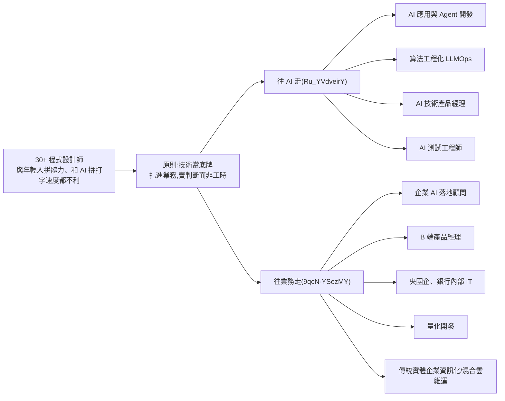

# 30 歲以上程式設計師怎麼轉型:五條出路與四個 AI 方向(白白說大模型 2 支影片合併)

> 整理自 YouTube 頻道 **白白說大模型** 兩支針對「30+ 程式設計師」的影片。**起薪、學歷門檻、「35 歲不是問題」等皆為講者個人說法**,未附統計,見文末「核實」。

---

## 一句話總結

## 1. 選賽道的四個篩選條件(Ru_YVdveirY)

1. **技術可複用**:既有後端、介面設計經驗可直接平移。
2. **業務占比高**:工作直接掛鉤營收或降本增效。
3. **行業壁壘強**:要靠長年踩坑的經驗,不是新人看三天影片能頂替。
4. **對中年友善**:看重處理複雜問題的沉穩與大局觀,不看每天工時。

反方論點:30 歲後和新人拼「誰更能熬夜、讀論文」勝算低;學術界的演算法變動大,企業要把技術做成商品,「高併發不當機、資料庫穩定、介面安全」這些工程確定性反而保值。

## 2. 四個 AI 方向(Ru_YVdveirY,以下薪資與學歷皆講者說法)

| 方向 | 適合誰 | 講者的條件/薪資 | 要學什麼 |
|---|---|---|---|
| AI 應用與 Agent 開發 | Java、C++、嵌入式、全端 | 大專可投、本科較佳;一線城市約 25K 起,缺口大 | 補 Python → 接主流模型 API(傳參、溫度)→ 向量庫與 RAG → 用編排框架串流水線;做一個私有文件客服之類的企業級專案 |
| 算法工程化(LLMOps) | 高併發、分散式、底層調優 | 本科以上;一線約 30K 起 | 應用層(開源部署框架與推理服務掛載大模型)、效能層(推理加速、顯存優化、量化、蒸餾)、基建層(容災、熔斷、限流、監控);履歷放「高調用量低延遲推理平台」 |
| AI 技術產品經理 | 溝通強、想離開一線寫碼 | 本科以上;一線約 20K 起 | 懂模型原理常識與提示詞工程、能自己寫提示詞驗證可行性;把商業目標拆成 AI 可完成的小任務;老工程師的技術文件與邊界/例外設計是優勢 |
| AI 測試工程師 | 功能/自動化測試出身 | 一線約 18K 起,講者稱加班少 | 大模型非確定性,測法改為:定量化指標評測(查得準不準、答得完不完整)、專門設計刁鑽邊界抓**幻覺**、把打分流程整合成自動化評測流水線 |

履歷改寫:不寫「負責日常增刪改查、維護舊系統」,改包裝成「複雜系統工程專家」「AI 方案落地」,強調業務價值與工程複雜度。

## 3. 五條「不離開技術」的出路(9qcN-YSezMY)

| 出路 | 核心論點 | 講者提醒 |
|---|---|---|
| 企業 AI 落地顧問/方案專家 | 市場缺的是「聽得懂老板白話又懂工具能力的翻譯官」。例:把微信客服與倉庫庫存打通,自動報價下單 | 學 API 串接、LangChain/LlamaIndex、本地 RAG(私有資料不外洩)、現成工具搭 Agent 工作流;像拼樂高接進企業系統,自動回信、抓合約風險、整理報表 |
| B 端產品經理 | 看得懂資料表結構與流程是否死鎖,和研發溝通順、不被敷衍 | 要從「怎麼實作」轉向「為什麼做、能省多少工時賺多少錢」;多與業務、財務聊 |
| 央國企/銀行/金融機構內部 IT | 信創與數位轉型,要把老系統換成國產分散式架構;缺有踩坑經驗的人當「甲方把關者」 | 看工程底子、能盯外包、有耐心寫文件;節奏比網際網路穩 |
| 量化開發工程師 | 研究員出策略,開發者負責微秒級執行(C++ 優化、繞過核心收網路封包、行情暴漲時不卡單) | 面試會把計算機底層問到底;講者稱薪資天花板高、可能分紅 |
| 傳統實體企業資訊化/混合雲維運 | 老 ERP、倉儲、財務系統維護者退休,年輕人只會輕量全端;懂 Docker、CI/CD 又能伺候舊系統的人是「定海神針」 | 薪資不如網路公司,但節奏規律、替代成本高 |

結尾心法:根本問題不是年齡,而是「靠拼命加班保飯碗」;**寫程式只是工具,值錢的是看懂生意規則、聽得懂人話、也會說人話、順手用技術解決問題**。要多了解公司怎麼賺錢、其他部門在忙什麼。

## 應用案例

- **十年 Java 後端,想留在寫碼**:走「AI 應用與 Agent 開發」。兩週補 Python,接一個模型 API,拿公司公開的產品手冊做 RAG 客服,再用編排框架加上查庫存、開工單兩個工具;面試主講「業務鏈路編排與例外處理」。
- **做過 C++ 低延遲網路的人**:兩條路擇一:量化開發(用一個簡單的行情接收加撮合模擬器當作品),或 LLMOps(把開源推理服務壓測並量化延遲與顯存)。
- **測試工程師**:替 RAG 客服做 300 題的評測集(含刻意誘導的幻覺題),跑出忠實度與召回的報告,放進履歷。
- **想離開高壓開發**:先用「業務顧問」小規模接案(幫小公司把客服與庫存串起來),驗證自己喜歡和老板溝通,再考慮轉 B 端 PM。

## 核實

- **畫面已核對(2026-11-07 截圖,共 9 張;以下秒數為截圖時間,非使用者用的時間點)**:Ru_YVdveirY 截圖 280「Agent 編排框架(LangChain / Dify)」、316「方向二 AI 算法工程化(LLMOps)、一線 30K+ 起步、本科及以上」、240「方向一 AI 應用與智能體(Agent)開發、25K+ 起步、大專起投、本科優先」、580「方向四 AI 測試工程師(AI QA)、18K+ 起步」;9qcN-YSezMY 截圖 500「QD 量化交易開發:Kernel Bypass 內核旁路、FPGA、C++ 內存極致優化」、620「傳統產業信息化與 SRE / DevOps:ERP(SAP / 用友)· CRM · WMS · MES」、140「千萬傳統企業(外貿 / 供應鏈 / 律所 / 製造廠)」、350「方向二 B 端:從 How 到 Why、ROI」、481「QR 量化研究員 vs QD 量化開發」。以上數字是**投影片上的講者說法**,畫面可證實「影片這樣寫」,不能證實市場真實薪資。
- 未能核實(講者個人說法):方向二 PM「20K 起」(未截到該頁畫面)、各方向學歷門檻的市場實況、「全國能有幾個岗位做底層算法」、「國企 30 出頭是黃金期、不卡 35 歲」、量化「薪水天花板高、拿分紅」、「實體企業老 ERP 維護者將退休」。薪資幣別影片未說明,推定為人民幣月薪。
- 與 [[ai-skills-no-raise-nash-bargaining]] 對照:該篇主張薪水是價格而非獎金,與本文「賣業務價值而非工時」方向一致,但各自是個人觀點。
- 字幕還原:「DeFi」= Dify(使用者 2026-11-07 確認,且 280 秒投影片明載「Agent 編排框架(LangChain / Dify)」,已核實);「Lantian」= LangChain(同上投影片,已核實);「LM OPS / ENA」= LLMOps(316 秒投影片,已核實);「弊端」= B 端(推定);「妙化 / 秒化 / 好秒」= 量化 / 微秒(推定,依 500 秒投影片「微秒級低延遲通信」);「Number Index」於現行逐字稿未出現,若出現推定為 LlamaIndex。
## 業配與推廣揭露

兩片未見明確的課程/社群推銷;片尾僅「點讚收藏」。

## 延伸閱讀與深度補充(2026-11-07 核實增補)

以下只寫實際讀到內容的來源;搜尋摘要未讀全文者一律標「未能核實」。

**1. 編排框架:Dify 與 LangChain**
- 影片 [4:48](https://www.youtube.com/watch?v=Ru_YVdveirY&t=278s) 說 Agent 編排可用 LangChain 或 Dify。Dify 官方 GitHub README(https://github.com/langgenius/dify)自述為 "Build Agentic workflows, RAG pipelines, with rich AI model and tool support on one collaborative workspace",授權為 Dify Open Source License(以 Apache 2.0 為基礎加附加條款)。
- 影片只說「把零件串成流水線」。README 多出的重點是:Agent 可在獨立沙箱執行指令與處理檔案、支援 MCP 工具,並可部署為聊天應用或工作流程中的一個步驟。
- LangChain 本次未讀官方文件,版本細節未能核實。

**2. 「自動評測流水線」:RAGAS 論文**
- 影片 [10:14] 談定量指標,[10:39] 談自動跑上萬題的評測流水線。一手論文為 Es 等人的 *Ragas: Automated Evaluation of Retrieval Augmented Generation*,arXiv:2309.15217(首次提交 2023-09-26,v2 於 2025-04-28 修訂):https://arxiv.org/abs/2309.15217
- 摘要讀到的重點:不需人工標準答案的 RAG 評估框架,分別評估檢索品質、LLM 是否忠實使用檢索內容、生成品質。摘要沒有數字。
- 搜尋摘要稱論文有 faithfulness、answer relevance、context relevance 三指標,但我讀的摘要頁未列出這三個名稱,**未能核實**;需讀全文 https://arxiv.org/pdf/2309.15217 才能確認。
- 影片說的「抓幻覺」,在 RAG 評估裡大致對應「忠實度」的概念,此對應為**推定**。

**3. 「3 秒變 1 秒」:vLLM / PagedAttention 論文**
- 影片 [6:29] 說把回應需 3 秒的模型優化到 1 秒內。論文為 Kwon 等人的 *Efficient Memory Management for Large Language Model Serving with PagedAttention*,arXiv:2309.06180(2023-09-12):https://arxiv.org/abs/2309.06180
- 摘要重點:KV cache 的碎片與重複浪費會限制 batch size;PagedAttention 借用作業系統的分頁概念管理 KV cache;vLLM 在同延遲下吞吐量達 FasterTransformer、Orca 的 **2–4×**。
- **與影片的差異**:論文量的是「同延遲下的吞吐量」,不是影片所說「單次回應從 3 秒到 1 秒」。影片的數字無法由此論文核實;論文也不是量化或蒸餾的論文,影片中這些手段需另找來源。

**4. 量化開發:Kernel Bypass(內核旁路)**
- 影片 [8:29](https://www.youtube.com/watch?v=9qcN-YSezMY&t=499s) 談「直接繞過作業系統內核收網路封包」,當時的投影片(截圖 500 秒)寫「Kernel Bypass 內核旁路」。讀 Databento 的說明:https://databento.com/microstructure/kernel-bypass
- 機制:應用直接與網卡的 TX/RX buffer 互動、零拷貝進應用緩衝區、常用 lock-free ring buffer;常見實作包括 Solarflare OpenOnload、AMD TCPDirect、ef_vi、Mellanox VMA、DPDK、RDMA、XDP/eBPF。
- 該頁**未提供延遲數字**。搜尋結果中「內核開銷 20–50 微秒」「2–5 微秒」等數字來源分歧,**未能核實**,不列入。
- DPDK 官方資料未讀,未能核實其細節。

**5. 畫面未見的說法**
- 9:37 逐字稿有「混合雲運維」,但 620 秒投影片只列「傳統產業信息化與 SRE / DevOps」與 ERP、CRM、WMS、MES,未出現「混合雲」字樣;此詞以逐字稿為準,畫面未佐證。

## 相關筆記

- [[ai-app-dev-learning-roadmap-four-tiers]]
- [[fde-and-ordinary-people-ai-entry-guide]]
- [[programmer-meaning-crisis-hn-thread]]

## 來源

- 白白說大模型〈30+程序員的五條轉型出路〉(2026-10-13):https://www.youtube.com/watch?v=9qcN-YSezMY
- 白白說大模型〈30+的程序員想在26年轉行,就認準這4個AI方向〉(2026-09-21):https://www.youtube.com/watch?v=Ru_YVdveirY
- 兩片皆無官方字幕,逐字稿以 CPU 版 Whisper 轉錄,可能有同音字誤差(簡繁混雜)。
