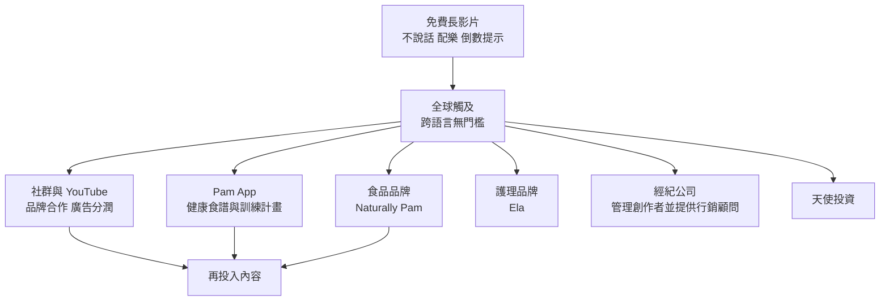

# 帕梅拉(Pamela Reif)怎麼「賺」:從健身 YouTuber 到多品牌企業主的商業模式

**主題分類:** 職涯 / 創作者經濟 —— 商業案例
**來源影片:** YouTube〈从"健身芭比"到"女企业家",帕梅拉有多会"赚"?〉(小Lin说,2026-06-05,約 29 分鐘;主持人旁白加與帕梅拉的英文對談)
**整理日期:** 2026-11-06

> **立場揭露:** 主持人慣例會在影片中插入 eSIM 等贊助。**本片我無法取得說明欄**(抓取結果為空),**逐字稿中也未見明顯的贊助段落**;是否含業配**未能核實**。本文不依賴任何廣告內容。
> **資料品質警告:** 該片僅有 YouTube 自動字幕,而英文對談被機器翻成中文後**錯得很離譜**(例如「15 億美元」「6 億美元」「Nashley Pam」「Aela」「ISDJ」)。本文只採用**英文原句清楚**的部分,數字與品牌名都另行比對外部資料。**這是商業案例整理,不構成健身或投資建議。**
> **本文分層:** 「**主持人說法**」「**帕梅拉本人說法(對談)**」「**可核實史實**」「**評析觀點**」分開標示。

---

## 0. 一句話總結

> 帕梅拉的模式是:**用「免費、不講話、可跨語言」的長期內容建立巨大觸及,再把注意力變現成多條互補的收入線(內容分潤與合作、食品品牌、護理品牌、App、經紀公司、天使投資),並以小而緊密的家族團隊控制成本。**
> 最值得學的不是「她多紅」,而是**為什麼內容形式能跨國、為什麼她不做服飾、為什麼不急著擴張**。

## 1. 時間線:主持人說法 vs. 可核實史實

| 事項 | 主持人說法 | 核實 |
|---|---|---|
| 出生 | 1996 年生於德國小城 | 維基百科:1996-07-09 生於 **Karlsruhe(卡爾斯魯爾)**。已核實 |
| Instagram | 2012 年(16 歲)開帳號,貼風景、美食、旅行 | 維基百科:**2012 年起活躍**。已核實 |
| 學業 | 高中 1.0 滿分畢業(德國前 1–2%),選擇不讀大學、All in 自媒體 | 維基百科只確認 **2014 年**高中畢業,**未提成績**,成績**未能核實** |
| 自媒體早期 | 2014 年起(18 歲)幾乎每天更新;**第一個品牌合作只有約 50 歐元,做了三四年才賺到**;高中畢業時有 50 萬粉絲 | 本人對談提到早期合作金額很低(字幕模糊);**50 萬粉絲與金額未能核實** |
| YouTube | 2016 年發第一支健身影片,長 10–15 分鐘 | 維基百科寫頻道自 **2013** 年運作;「2016 年第一支健身影片」**未能核實**(可能指健身風格的起點) |
| 榮譽 | 23 歲登上 Forbes「30 Under 30」 | 維基百科:**2020 年 Forbes 30 Under 30 DACH 排名第一**;主持人稱「封面」**未能核實** |
| 爆紅 | 疫情居家健身期間成為現象級 | 合理敘述;疫情確實推動居家健身需求 |

## 2. 商業模式拆解

### 2.1 內容形式:為何「不說話」能跨國

- **主持人說法:** 10–15 分鐘、無人聲只有節奏感強的配樂、畫面用簡單倒數提醒;在 2016 年是新鮮的;適合在家跟練、無須器材、廢話少,且有音樂與人帶領,**重複觀看有常理(慣性)效應**,播放量持續上升。
- **帕梅拉本人說法(對談,字幕模糊但主旨可辨):** 不說話是**策略性決定**:同一支影片使用者會看 20–30 次,人聲反而令人厭;而且她在 Instagram 上本來常講話,所以在 YouTube 選擇不講。
- **評析:** 無語言內容等於**天然多國版本**,這解釋了她的非英語市場(尤其中國)為何能爆量。這是推論,她本人也提到中國粉絲主要來自**網友搬運**,她起初甚至不知道。

### 2.2 市場結構(對談中英文原句,可信度較高)

- **中國是最大單一市場**:「China's the biggest, 74, 75 million in China.」(約 7,400–7,500 萬;**此數字只見於此對談與其二手整理,無第三方統計交叉,未能核實**。)
- **中國以外**:最大是 **DACH**(德國、奧地利、瑞士),其次法國、西班牙、比利時、荷蘭、波蘭;美國也不小。
- **不同市場偏好不同**:她舉例,一支初學者站姿腿 / 腹部影片在歐洲不算紅,在中國有 **2,500 萬**次觀看;她認為中國觀眾偏好**更纖細平衡、腿部線條**,歐洲與美國更想看**肩膀、手臂、腹肌的線條定義**。
- **收入結構(社群面)**:「Europe makes like 60, 70%」——**品牌合作與 YouTube 廣告**的大部分金額來自歐洲,中國粉絲雖多但變現不成比例。
- **要點:** **粉絲最多的市場 ≠ 最賺錢的市場**。這是創作者做商業規劃的重要一課。

### 2.3 事業版圖(她本人列舉)

| 業務 | 對談原話要點 | 外部核實 |
|---|---|---|
| 社群內容 | 仍是核心,每天都在做 | — |
| **Pam App** | 自己的 App,每週貼健康食譜 | 搜尋結果間接提到 Pam App;維基百科**未載** |
| **食品品牌** | 蛋白棒等;在中國試過但需要中國專屬方案,因為中國人不像歐洲人那樣常吃蛋白棒 | 品牌名為 **Naturally Pam**,維基百科:**2021 年初成立**、合作方 Goodlife Company。已核實 |
| **護理品牌** | 字幕寫成「Aela」,主持人旁白說是「髮品」 | 外部資料指品牌為 **Ela**(護膚 / 個人護理),**髮品說法無法交叉驗證**,以 Ela 為準 |
| **經紀 / 行銷公司** | 與人共同創辦,管理其他創作者,並為企業提供影響者行銷,稱「360 度行銷方案」 | 未能核實 |
| **天使投資** | 投資她看好的新創 | 未能核實 |

**營收數字警告:** 字幕出現「約 15 億美元」「6 億美元」。依外部二手整理,訪談提到 Naturally Pam 年營收約 **1,500 萬歐元**;字幕的「億」多半是「百萬」被機器翻錯,**不可採信字幕數字**。1,500 萬歐元本身也僅來自該訪談的二手整理(BigGo 財經),**未能由一手來源核實**。

### 2.4 為什麼不做服飾(本人說法,英文原句清楚)

1. 父母長期做時尚業,開過服飾店、跑時裝週,她知道**每季都要出新系列**的壓力很大。
2. 健身服要永遠有新款、新鞋、新配件。
3. 食品與保養品**只要產品夠好、人們喜歡,就能賣很久**,不用每 2–3 個月重來。
**評析:** 這是典型的「選品類依營運節奏」:她選了**重複購買、少 SKU 更新**的品類,配合小團隊。

### 2.5 組織與工作方式

- **主持人說法:** 刻意維持小團隊、不激進招人 / 融資;母親與父親是核心成員,哥哥是攝影剪輯;大本營一直在德國小城。
- **她本人說法:** 被問到怎麼能管這麼多品牌且人少,答「I just work a lot」;自述 MBTI 為 **ISFJ**(字幕誤作「ISDJ」,屬推定:對談描述為注意細節、理性、計畫周全的「judging」型,與 ISFJ 吻合);重大決定先靠**直覺**,執行時像機器人。
- **十年規劃:** 她說「我真的不知道」,沒有宏大目標,每天起床做運動、做事,走到哪算哪——與主持人結語的「靠感覺走又能執行」吻合。
- **評析:** 這與「現金流充足 + 內容業人力需求低」有關(主持人也這樣推測);但家族企業也有**單點依賴**風險,這是推論,影片未談。

## 3. 其他觀點(對談)

- **社群媒體的變化:** 十年前是靈感與好心情的地方;現在要求高度專注,前一二十秒影片必須抓人。她認為這是人們覺得社群不夠健康的原因之一;**建議自己設界線**(原話含「touch some grass」)。
- **健康生活的基礎:** 她說首先是**睡眠**(曾經長期工作到凌晨 2 點,後來意識到要改),其次是飲食與腸道健康;「想只求瘦」可能吃不夠、缺營養。這是個人經驗,非醫療建議。
- **對外貌壓力:** 她認為初始動機是「想變得像某人」也沒關係,開始運動後會變強、更有自信、更快樂。**評析:** 這是她的立場,有人會質疑這低估了身形焦慮,本文不作定論。

## 4. 可借鏡的重點(評析觀點)

1. **內容形式決定可擴展性**:無語言、無器材、可重複觀看。
2. **用數據看市場,不要只看粉絲數**:最多粉絲的國家未必貢獻最多收入。
3. **品類選擇要配合營運節奏**:避開需要頻繁出新品的賽道。
4. **小團隊 + 高信任**:核心決策者少,速度快,但要防範單點風險。
5. **本地化不是把產品搬過去**:蛋白棒在中國遇到的飲食習慣差異就是案例。

## 5. 應用案例

1. **你是知識型創作者**:想一想你的內容是否能「去語言化」或加字幕就跨國?例如用示範型教學(程式、料理、手作)取代口述。
2. **你要賣周邊**:先評估該品類是否需要「每季新品」。選重複購買、SKU 少的品類(如咖啡、保養品),比服飾更適合小團隊。
3. **分析自己頻道的受眾**:用 YouTube 後台地區報表比對「觀看數」與「收入 / 合作詢問」來源,找出像帕梅拉那樣「人多但不賺」的市場,再決定是否投入本地化。
4. **做商業案例研究**:像本文這樣把「主持人說法」「本人說法」「可核實史實」分開寫,避免把二手傳聞當事實。

## 核實狀態

- **已核實(維基百科):** 生日與出生地、Instagram 自 2012、2014 年高中畢業、2020 Forbes 30 Under 30 DACH 第一、Naturally Pam 2021 年成立與合作方。
- **需修正:** 字幕的品牌名(Naturally Pam、Ela)與營收單位;ISFJ。
- **未能核實:** 50 萬粉絲、1.0 成績、50 歐元合作金額、7,400–7,500 萬中國粉絲、1,500 萬歐元營收、Pam App 細節、經紀公司與天使投資、影片是否含 eSIM 等贊助。

## 來源

- 〈从"健身芭比"到"女企业家",帕梅拉有多会"赚"?〉小Lin说,2026-06-05:https://www.youtube.com/watch?v=7oF-JqEtWDU (該片僅自動字幕,非官方人工字幕;對談為英文被機器翻譯,誤差大)
- Pamela Reif - Wikipedia:https://en.wikipedia.org/wiki/Pamela_Reif
- 二手整理:BigGo 財經〈從健身芭比到女企業家,帕梅拉有多會賺?〉:https://finance.biggo.com.tw/podcast/e5e456979bca3c1d
