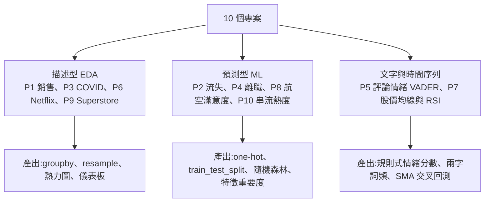
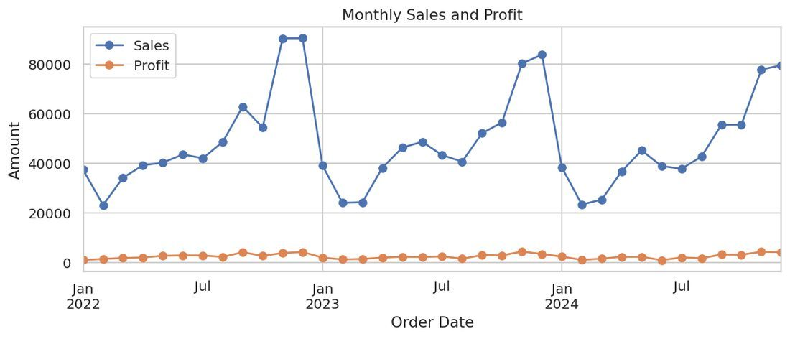
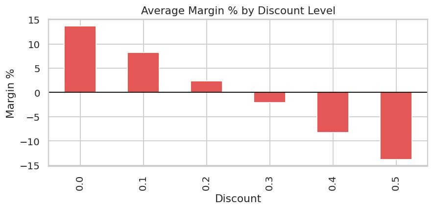
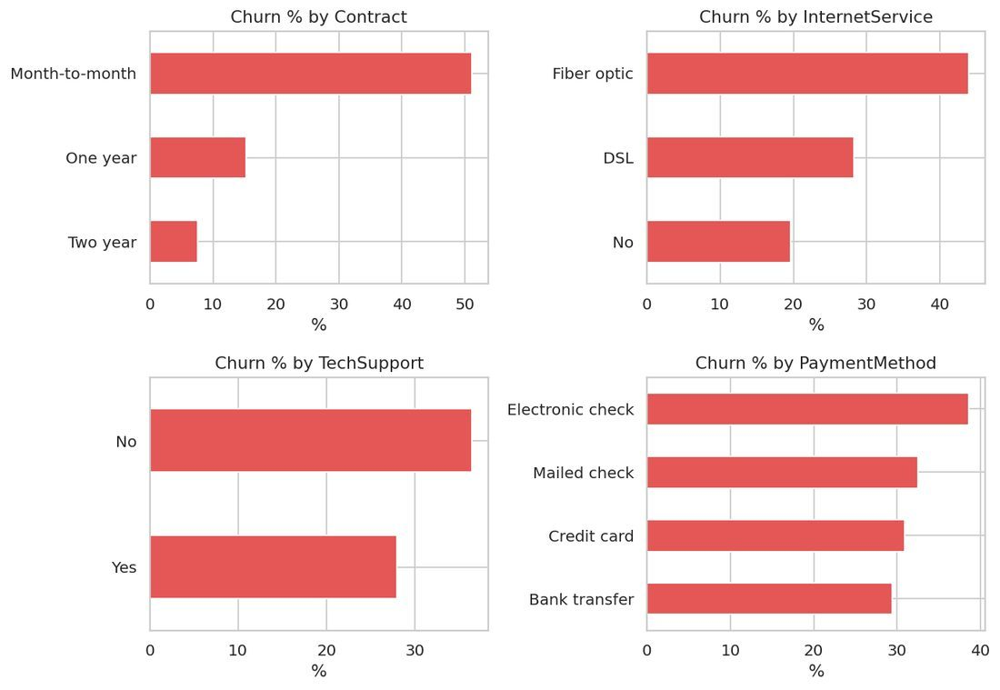
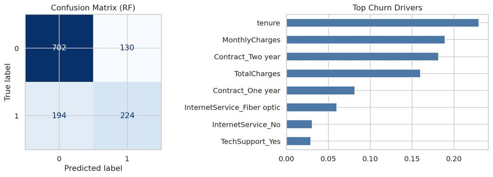
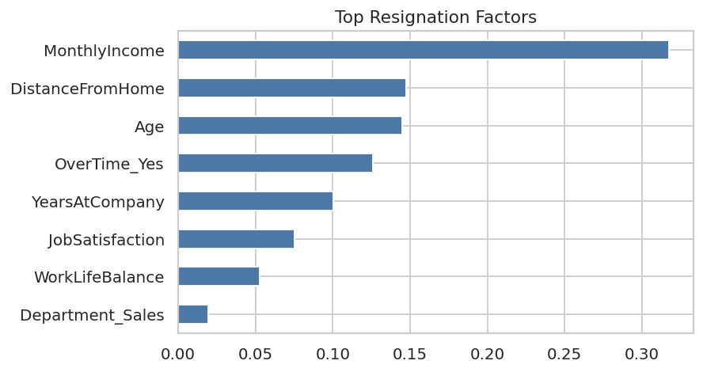
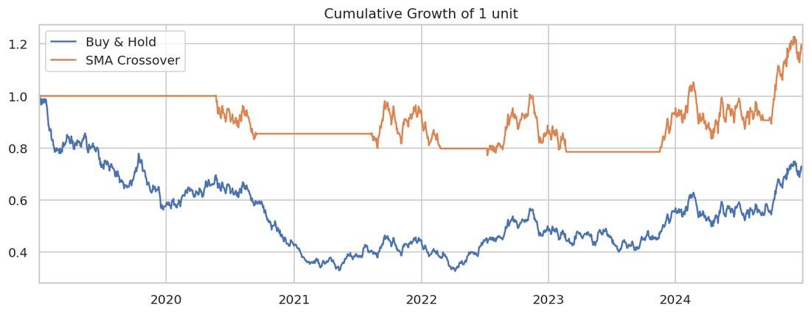
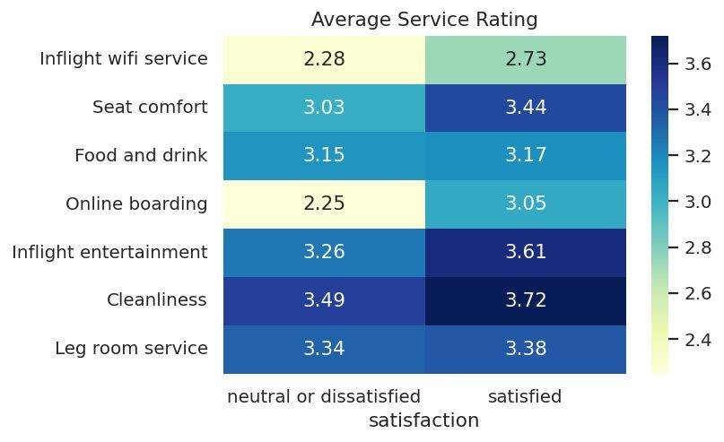
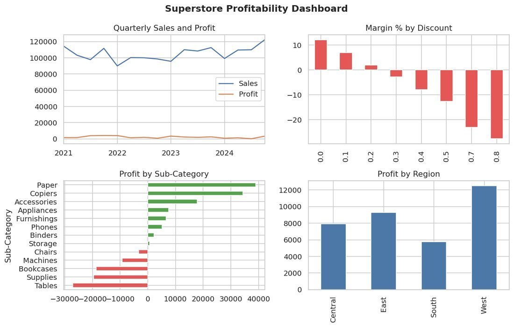

# 資料分析師作品集 10 專案:讀完原始碼、實跑 9 支後的真實評估(Anjana「AI & Tech」素材)

> ⚠️ **素材性質揭露**:本文整理自 Anjana(「AI & Tech」,@aiwithanju)的 PDF `10_Data_Analyst_Projects_Complete_Guide.pdf`(56 頁)與其附帶 zip `Anjana_DA_Projects_Source`(10 支 `.py` + `run_all.py`)。這是**社群引流型素材**:每頁帶 `@aiwithanju` 浮水印、封面與結尾導向作者的社群帳號(zip 的 README 附 Instagram 連結),本文**不轉述任何導購內容**,只整理技術部分。PDF 是第三方著作,以下為自己的結構化整理與驗證,圖表為原稿內嵌的圖(出處已標)。
>
> 一句話:**這 10 支程式「能跑、乾淨、適合練手」,但全部用程式自己生成的模擬資料,所以書中的每一個「洞察」其實是作者寫進資料生成公式的答案**。拿來學 pandas / sklearn 流程很好;拿來當作品集,必須換成真實資料並改寫結論。
>
> 相關:[[data-analyst-roadmap-2027-and-7-day-plan]](同作者的 24 週路線與 7 天速成表評估)、[[ml-practice-projects-fifteen]](同作者的 15 個 ML 專案)、[[supervised-ml-algorithms-guide]]

---

## 0. 這份素材是什麼(先看結論)

| 項目 | 實況(讀碼與實跑後) |
|---|---|
| 結構 | 每支 `.py` 以 `# %% Step N: ...` 分成 7–9 個 cell;`run_all.py` 用正規式切 cell、`exec` 後把輸出與圖存成 JSON 給 PDF 排版用 |
| 資料 | **每支腳本開頭用 `numpy.random.default_rng(42)` 生成「欄位名與真實 Kaggle 資料集相同」的模擬資料**,讀者免下載即可跑;換成真資料只要改 Step 2 的讀檔行(PDF 每個專案框內有 `pd.read_csv(...)` 範例) |
| PDF 自己的聲明 | 第 1 頁寫明「numbers come from this simulated sample, not from the real datasets」——**有揭露**,但各專案的「Key insights」文字寫得像真實發現 |
| 套件 | `pandas numpy matplotlib seaborn scikit-learn vaderSentiment`(Project 7 可選 `yfinance`) |
| 我的實跑(2026-11-08,Windows、Python 3.11、pandas 3.0.3、matplotlib 3.10.9) | **9 支 exit 0、輸出與 PDF 數字逐項一致**(churn AUC 0.811/0.801、HR AUC 0.776、航空 accuracy 0.728、串流 R² 0.397 等);**p01 在 Step 5 的 `season.plot(kind="bar")` 拋 `AttributeError: 'Index' object has no attribute 'freq'`**(pandas 內部繪圖碼);我用 int32/int64 索引單獨重現都正常,**未能釐清根因**,PDF 顯示的 pandas 為 3.0.2,可能是版本差異,標「未能核實」 |



## 1. 十個專案速覽(資料集連結為 PDF 所列,Kaggle 頁面需登入,我未逐一開啟核實)

| # | 專案 | PDF 列的真實資料集 | 方法重點 | 模擬資料下的主要輸出 |
|---|---|---|---|---|
| 1 | 銷售表現分析 | Superstore(Kaggle `vivek468/superstore-dataset-final`)、Olist 巴西電商 | `resample("MS")`、月份季節性、折扣分桶 | 12 月最旺;折扣 ≥30% 平均毛利轉負;折扣與毛利率相關 -0.637 |
| 2 | 電信客戶流失 | Telco Customer Churn(`blastchar/telco-customer-churn`) | 邏輯迴歸 vs 隨機森林、風險分層 | 流失率 33.5%;月租合約 51.1% vs 兩年約 7.5%;LR AUC 0.811、RF 0.801 |
| 3 | COVID-19 儀表板 | Our World in Data、Johns Hopkins CSSE | 7 日移動平均、每百萬病例數、14 日變化 | 四面板儀表板 PNG |
| 4 | HR 員工離職 | IBM HR Analytics(`pavansubhasht/...`) | 分組離職率、相關係數熱圖、隨機森林 | AUC 0.776;前三因素 MonthlyIncome / DistanceFromHome / Age |
| 5 | 商品評論情緒 | Amazon 消費者評論(`1429_1.csv`) | VADER compound、`CountVectorizer` 兩字詞 | 正面 68%、負面 19.8%;評分與 compound 相關 0.929 |
| 6 | Netflix 內容洞察 | `netflix_titles.csv` | 拆 genre/cast 字串、`Counter` | 國際電影最多;2021 年新增最多 |
| 7 | 股票趨勢 | `yfinance` 即時 AAPL(預設關閉,用隨機漫步) | 年化波動、SMA50/200 黃金/死亡交叉、RSI、回測 | 交叉策略 +20.4% vs 買進持有 -26.6%(模擬) |
| 8 | 航空乘客滿意度 | Airline Passenger Satisfaction(Kaggle `train.csv`) | 服務評分熱圖、延誤分段、隨機森林 | accuracy 0.728;痛點 wifi、線上登機 |
| 9 | Superstore 獲利儀表板 | Superstore | KPI、折扣趨勢線、虧損子類別、區域×客群熱圖 | Tables/Supplies/Bookcases 虧損;折扣 ≥30% 要簽核 |
| 10 | YouTube/Spotify 串流 | Spotify tracks `dataset.csv` 或 YouTube trending | 流派/年份趨勢、相關、`RandomForestRegressor` | R² 0.397;danceability 相關 0.229 最強 |

## 2. 讀碼重點與可直接複用的片段

**共通骨架**(P1,`resample` 與季節性、折扣分桶)——短片段,出自 zip 的 `p01_sales_performance.py`:

```python
monthly = df.set_index("Order Date").resample("MS")[["Sales", "Profit"]].sum()
season  = df.groupby(["Year", "Month"])["Sales"].sum().groupby("Month").mean()
bucket  = df.groupby("Discount").agg(Orders=("Sales","size"),
                                     AvgMargin=("Margin %","mean"),
                                     TotalProfit=("Profit","sum"))
```



圖:PDF 第 5 頁(`Project 1, Step 4`)。解說:圖中的年尾尖峰是 Step 2 的權重陣列 `np.where(days.month.isin([11,12]), 2.0, ...)` 直接造出來的;利潤線貼近 0 是因為 Margin 設計成「類別基底毛利 − 0.55×折扣」。



圖:PDF 第 7 頁(`Project 1, Step 7`)。解說:這條斜線不是「發現」,而是 `profit = sales * (base_margin - 0.55 * disc)` 的直接結果;「高折扣常侵蝕毛利」是常見的業務直覺,但轉折點與幅度必須用真實資料自己重算。

**P2 流失預測的兩個細節**:

- 特徵用 `pd.get_dummies(..., drop_first=True)` 後 `train_test_split(test_size=0.25, stratify=y, random_state=42)`;LR 的 AUC(0.811)比 RF(0.801)還高,這在「資料由邏輯函數生成」時合理(LR 恰好是真模型),PDF 沒解釋。
- **Step 9 的 `df["ChurnRisk"] = rf.predict_proba(X)[:, 1]` 是對「整份資料(含訓練集)」打分**,再切 Low/Medium/High 並算「風險月營收 79,445」——這是**訓練集內預測**,會高估準確度。實務應只用測試折或交叉驗證的 out-of-fold 機率。



圖:PDF 第 11 頁(`Project 2, Step 4`)。解說:月租型(Month-to-month)51%、一年約 15%、兩年約 7.5%;模擬資料中 `z = -0.9 + 1.4*(月租) - 0.9*(兩年約) + ...` 就是這個差距的來源。



圖:PDF 第 12 頁(`Project 2, Step 8`)。左:RF 混淆矩陣(702/130/194/224);右:RF 的 `feature_importances_`。解說:Churn 類別 recall 只有 0.54,若目標是「抓出會流失的人」,應調閾值或加 `class_weight`(P4 就有加)。

**P4 離職分析:特徵重要度的排名被偏誤誤導(我實測)**——PDF 第 23 頁:



圖:PDF 第 23 頁(`Project 4, Step 8`)。這張圖是**不可靠排名的好教材**:

- 資料生成式 `z = -2.0 + 1.5*(OverTime=="Yes") - 0.00035*(income-6000) - 0.04*yrs - ...` 中,**OverTime 係數 1.5 是最大的單一效應**(加班組離職率 53% vs 非加班 26%,我重算)。
- 但 `feature_importances_` 是「不純度減少量」(MDI),scikit-learn 官方範例明說它**偏向高基數(多唯一值)特徵,且以訓練集統計計算,不代表泛化**。連續欄位 `DistanceFromHome`、`Age` 因此被灌水。
- 我用同一份資料、同樣參數,改在測試集做 `permutation_importance(scoring="roc_auc")`:**MDI 前四為 MonthlyIncome 0.317、DistanceFromHome 0.147、Age 0.145、OverTime_Yes 0.126;置換重要度前四為 MonthlyIncome 0.110、OverTime_Yes 0.089、JobSatisfaction 0.031、YearsAtCompany 0.013**——OverTime 升到第二,DistanceFromHome 與 Age 掉出前四。
- 所以 PDF 的 HR 建議「遠距/交通補助」是被 MDI 偏誤引導的;**應優先看加班負荷**。

**P5 評論情緒**:VADER 門檻 `pd.cut(compound, [-1.01,-0.05,0.05,1.01])` 與 VADER 官方 README 建議的 ±0.05 一致(已核實)。但**評論文字是 6 句正面+6 句負面+4 句中性模板隨機抽 2 句拼成**、評分 ≤2 抽負面、=3 抽中性、≥4 抽正面,因此「評分與情緒相關 0.929」是循環論證;真實評論的相關通常低得多(諷刺、混合評價)。

**P7 股價均線回測**:

```python
df["Signal"]   = (df["SMA50"] > df["SMA200"]).astype(int)
df["Strategy"] = df["Signal"].shift(1) * df["Return"]   # shift(1) 避免偷看未來
```

`shift(1)` 避免 look-ahead 是正確做法(PDF 有強調)。但資料是**幾何隨機漫步**,買進持有 -26.6% 只是這條隨機路徑;SMA 交叉 +20.4% **不是策略有效的證據**(單一路徑、無交易成本、無滑價、未做樣本外)。我的重跑得到同樣數字:Sharpe -0.07 vs 0.26,最大回撤 -67.5% vs -23.0%。



圖:PDF 第 38 頁(`Project 7, Step 7`)。解說:橘線在空手期(Signal=0)是平的,看起來「避開下跌」,是因為這條隨機路徑恰好長期低於 200 日均線;換一個隨機種子結論會變。

**P8 航空滿意度**:



圖:PDF 第 41 頁(`Project 8, Step 5`)。解說:wifi(2.28 vs 2.73)與線上登機(2.25 vs 3.05)在「不滿意」組最低,是模擬資料刻意壓低的欄位;真實 Kaggle 資料的欄位為 0–5 評分,可同樣做這張熱圖。模型 accuracy 0.728、「不滿意」類 recall 僅 0.48,PDF 的建議只談痛點、沒談模型對少數類偏弱。

**P9 與 P1 重疊**:兩者都做折扣 vs 毛利;P9 加了「虧損子類別」與區域×客群熱圖,並把四個視圖合成一張「主管儀表板」(`plt.subplots` + `savefig`)。



圖:PDF 第 49 頁(`Project 9, Step 7`)。解說:Tables / Supplies / Bookcases 虧損來自 `margin = {"Bookcases": -.03, "Tables": -.09, "Supplies": -.05, ...}` 的人為設定。網路上常見的 Superstore 分析也常提到 Tables、Bookcases 等子類別虧損(此為一般說法,我未重算真實資料),但**本圖的數字是模擬值,不可當真實結果**;PDF 建議把 P3、P9 改成 Streamlit / Tableau / Power BI 互動版,方向合理。

**P10 串流**:`popularity = base + artist效應 + 18*danceability + 8*energy + 1.2*(release_year-2010) + 雜訊`,所以「danceability 最強、年份逐年上升、pop 最紅」全是公式;R² 0.397 反映的是「雜訊 σ=7」而非模型好壞。

## 3. 把作品集做成「真的」:改造清單

1. **換真資料**:各專案 Step 2 的讀檔行;欄位對不上用 `df.rename()`;P3 改用 OWID 官方 CSV(PDF 用 `covid.ourworldindata.org/...` 舊網址,我**未核實是否仍有效**,應以 OWID GitHub 倉庫 `owid/covid-19-data` 的 `public/data` 為準)。
2. **結論要隨資料改寫**:Key insights 的字串多數是寫死的(如 `"Sales peak in month {best}"` 有帶變數,但 P2 的 retention playbook 是固定文字)。
3. **預測專案補上**:交叉驗證、PR 曲線/閾值選擇、`permutation_importance` 或 SHAP、train/test 分離的風險分層。
4. **時間序列專案補上**:交易成本、樣本外、多標的、多隨機種子;並明講「教學用,非投資建議」(PDF 有這句)。
5. **每個專案寫 README**:問題、資料來源、方法、發現、截圖——PDF 結尾也是這個建議,並建議「LinkedIn 貼文先講商業發現,不講程式」。

## 應用案例

- **案例 A:用 P2 骨架做公司內訂閱產品的流失儀表**:換成自家訂閱表,保留 `groupby` 流失率 + LR 基線 + RF;把 Step 9 改成「只對測試折打分」,再把「月租+纖維」這類規則換成自家的高風險族群(如試用後第 30 天未啟用),交給客服。
- **案例 B:HR 離職診斷的正確姿勢**:拿 P4 的程式跑真實 IBM HR 資料,同時輸出 MDI 與 permutation 兩種排名;若兩者對 OverTime 的評價差很多(像我在模擬資料看到的),報告就要註明並以後者為準。
- **案例 C:面試作品集**:挑 P1(季節性+折扣)與 P9(儀表板)兩支,換 Superstore 真資料、補互動(Streamlit),README 寫「折扣 ≥X% 後毛利轉負,建議簽核門檻」——比 10 支都跑模擬資料更有說服力。

## 延伸閱讀與深度補充(2026-11-08 核實)

| 項目 | 結論 | 依據 |
|---|---|---|
| 「每個 code block 都執行過、輸出為真實」 | **已核實(9/10)**:我實跑 p02–p10 全部成功,數字與 PDF 一致;p01 在我的環境失敗(原因未釐清) | 自行在 `%TEMP%` 隔離目錄跑 zip 內腳本 |
| 「輸出來自模擬樣本、非真實資料」 | **已核實**,且比 PDF 說的更嚴重:洞察皆為生成公式的回聲 | 讀 `p0x` 的 Step 2 生成碼 |
| 隨機森林 `feature_importances_` 排名 | **需修正**:MDI 偏向高基數特徵,PDF 把它直接當「離職因素排名」。我的置換重要度重算後 OverTime 由第 4 升到第 2 | scikit-learn〈Permutation Importance vs Random Forest Feature Importance〉:https://scikit-learn.org/stable/auto_examples/inspection/plot_permutation_importance.html |
| P2 風險分層用全資料打分 | **需修正**(訓練集內預測,易高估) | 讀 `p02` Step 9 程式 |
| VADER 閾值 ±0.05 | **已核實** | VADER README:https://github.com/cjhutto/vaderSentiment ;論文 Hutto & Gilbert, ICWSM-14(2014;原論文頁面當次被 Anubis 擋,引用資訊取自 README) |
| P7 `shift(1)` 避免 look-ahead | **已核實**(邏輯正確);回測結論不可外推 | 讀 `p07` Step 7 |
| Kaggle/OWID 下載連結 | **未能核實**:Kaggle 需登入、我未逐一開啟 | — |
| p01 失敗原因 | **未能核實** | 單獨重現未成功 |

## 來源

- 使用者提供的本機素材批次 `new/ai-guide/`(2026-11-07 收件),檔案:`10_Data_Analyst_Projects_Complete_Guide.pdf`(56 頁)、`Anjana_DA_Projects_Source.zip`(10 支腳本 + `run_all.py` + `requirements.txt` + `README.txt`)。作者:Anjana「AI & Tech」(@aiwithanju),社群引流型素材。
- scikit-learn Permutation Importance 範例:https://scikit-learn.org/stable/auto_examples/inspection/plot_permutation_importance.html
- VADER Sentiment(GitHub):https://github.com/cjhutto/vaderSentiment
- Kaggle Superstore:https://www.kaggle.com/datasets/vivek468/superstore-dataset-final ;Telco Churn:https://www.kaggle.com/datasets/blastchar/telco-customer-churn ;IBM HR:https://www.kaggle.com/datasets/pavansubhasht/ibm-hr-analytics-attrition-dataset (皆為 PDF 所列,未核實可存取性)
- Our World in Data COVID-19 資料:https://github.com/owid/covid-19-data/tree/master/public/data
