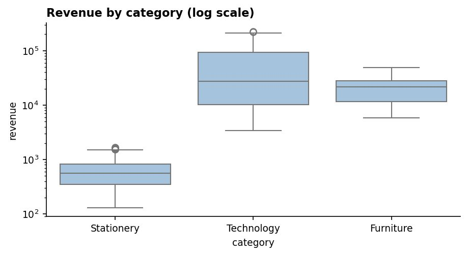
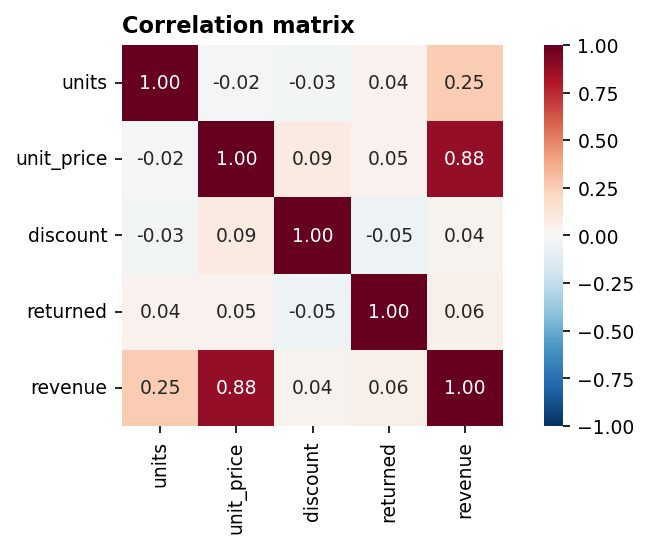
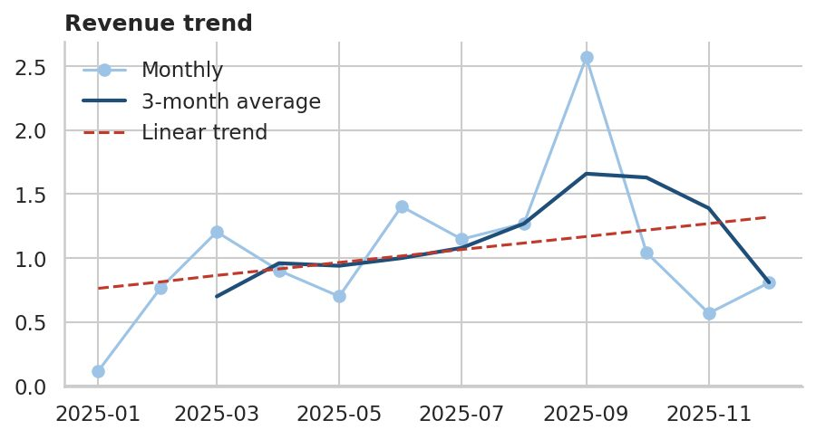
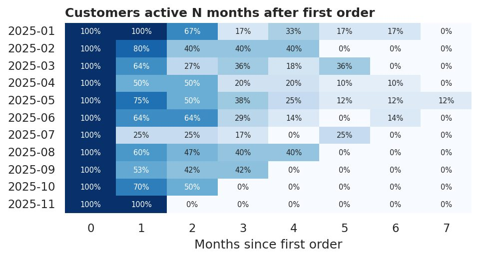
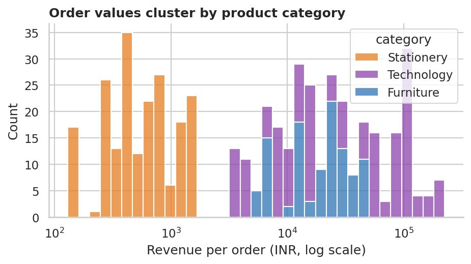
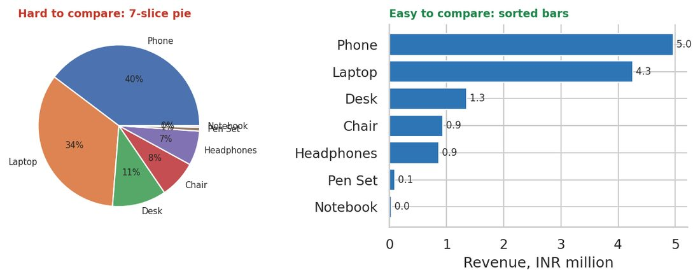
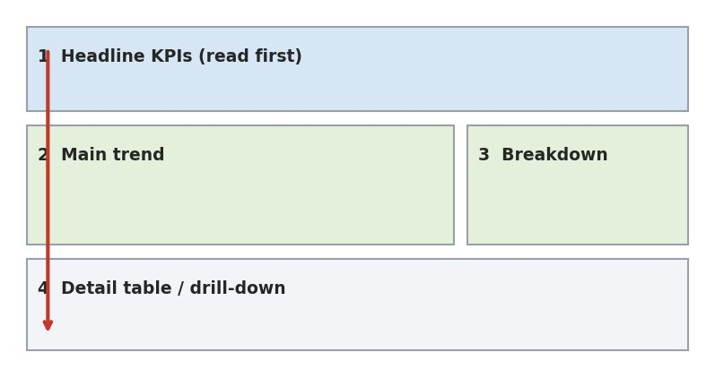
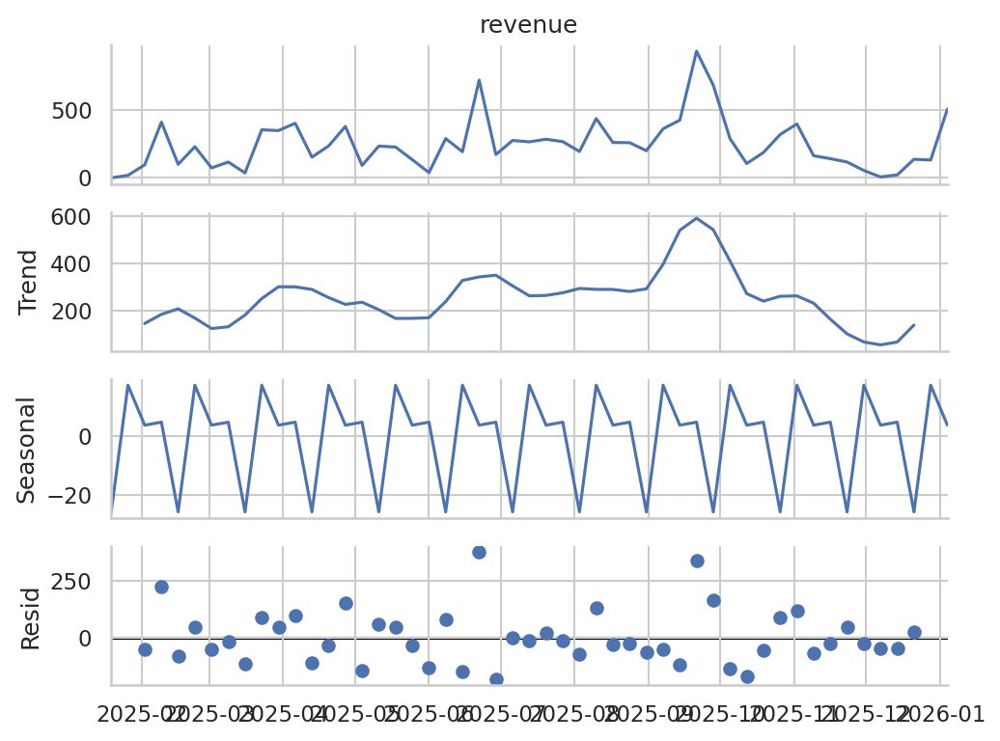
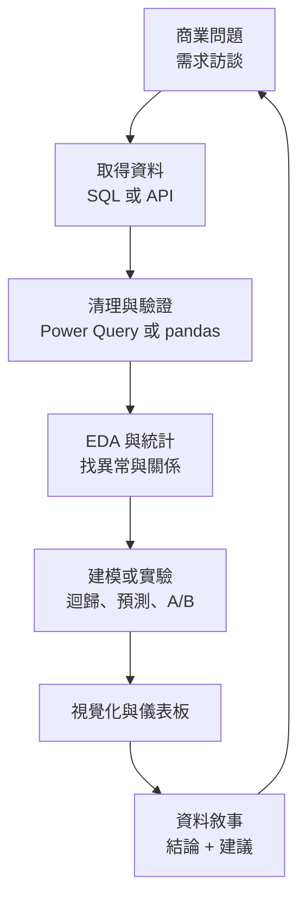

# 資料分析師學習路線:24 週完整版 + 7 天速成表的現實評估(Anjana「AI & Tech」素材)

> ⚠️ **素材性質揭露**:本文整理自 Anjana(「AI & Tech」,@aiwithanju)的兩份 PDF。這批素材是**社群引流型內容**:每頁帶 @aiwithanju 浮水印,資源頁與課程頁帶「Follow on Telegram & WhatsApp」等導流字樣,原始發布脈絡是「留言索取完整 PDF」的社群行銷。**內容本身以公開工具文件與教學連結為主,技術面大致正確**,但這是行銷型素材,不是經同儕審查的教材;本文不轉述任何付費導購內容,只整理其中的學習結構,並加上我對官方文件的核實。
> 兄弟篇:[[free-courses-and-job-search-resources-checked]](課程與求職平台逐項核實)。

## 0. 兩份 PDF 是什麼

| 檔案 | 頁數 | 定位 | 本文章節 |
|---|---|---|---|
| `Complete_Data_Analyst_Roadmap_2027.pdf` | 98 | 8 大類 × 13 主題 = 104 主題;每主題含白話說明、重點、可執行程式碼與**實際輸出**、圖、延伸連結;建議 **24 週**(每週約 8–10 小時) | 1–4 |
| `data_analyst_7_day_detailed_roadmap.pdf` | 10 | 7 天各一個主題 + 每天一個小專案 + 作品集與面試準備 | 5–6 |

兩份定位不同:98 頁版是「從零到進階的完整地圖」,7 天版是「用最快速度各工具碰過一遍並產出作品集雛形」。**兩者不是長短版關係,而是不同期望值**,見第 6 節的現實評估。

## 1. 24 週路線總覽(98 頁版)

| 週次 | 類別 | 13 個主題(PDF 原列) | 週末該做出的東西 |
|---|---|---|---|
| 1–3 | Excel | 基礎、公式、函數、IF、XLOOKUP、INDEX/MATCH、樞紐分析、條件式格式、資料驗證、圖表、Power Query、Power Pivot、儀表板 | 清理、彙總、畫圖,做出樞紐儀表板 |
| 4–7 | SQL | 基礎、SELECT、篩選、排序、聚合、GROUP BY、JOIN、子查詢、CTE、視窗函數、CASE、日期函數、查詢最佳化 | 用 JOIN/CTE/視窗函數回答商業問題 |
| 8–10 | 統計 | 平均、中位數、眾數、百分位、變異數、標準差、分布、抽樣、機率、相關、信賴區間、假設檢定、A/B 測試 | 描述資料、做檢定、讀懂 A/B 測試 |
| 11–14 | Python | 基礎、型別、函式、list/dict、NumPy、pandas、DataFrame、清理、轉換、Matplotlib、Seaborn、Jupyter、自動化 | pandas 清理轉換、畫圖 |
| 15–17 | 分析方法 | 資料清理、EDA、資料剖析、聚合、趨勢、同期群(Cohort)、漏斗、分群(RFM)、留存、客戶、營收、KPI、根因分析 | EDA、cohort、funnel、retention、root-cause |
| 18–19 | 視覺化 | 為何要視覺化、選圖、長條、折線、散布、直方、熱圖、儀表板、互動圖、Power BI、Tableau、儀表板設計、資料敘事 | 選對圖、出一個 Power BI 或 Tableau 儀表板 |
| 20–21 | 商業技能 | 商業指標、KPI、產品/行銷/銷售/客戶/財務/營運分析、需求訪談、利害關係人溝通、問題拆解、洞察產出、決策支援 | 定義 KPI、向主管溝通 |
| 22–24 | 進階 | 進階 SQL、進階 Excel、統計建模、迴歸、預測、時間序列、A/B 進階、實驗設計、自動化、API、雲端資料倉儲、Analytics Engineering(dbt)、作品集專案 | 迴歸、預測、實驗、API、作品集 |

**共用範例資料**:PDF 的「Step 0」用固定亂數種子產生 120 位客戶、500 筆 2025 年訂單(幣別印度盧比),並寫入 `orders.csv`、`customers.csv`、`sales.db`(SQLite),之後 SQL、Python、分析、視覺化全部在這份資料上跑,讀者可以逐一對照數字。這個設計很值得學:**一份資料貫穿全程,輸出可驗證**。PDF 標註的環境是 Python 3.12、pandas 3、NumPy 2、SQLite 3.45。

## 2. 各類別重點(我的結構化整理,非逐頁翻譯)

### 2.1 Excel(第 1–3 週)
- 核心心法:相對參照 `D2`、絕對參照 `$D$2`(F4 切換);用 `Ctrl+T` 轉成 Table 讓公式與圖表自動延伸。
- 必學函數約 25 個(SUM/AVERAGE/COUNT/MIN/MAX/ROUND/TEXT/LEFT/RIGHT/LEN/TRIM/UPPER/DATE…);`SUMPRODUCT` 可免輔助欄算營收;`SUMIFS/COUNTIFS` 做條件彙總。
- 查表:`XLOOKUP(查詢值, 查詢範圍, 回傳範圍, [找不到], [比對模式], [搜尋模式])` 取代 VLOOKUP;舊版用 `INDEX + MATCH(…,0)`,可向左查、可雙向查。
- 樞紐分析:Rows/Columns/Values/Filters,日期可 Group,Slicer 互動;PDF 同時示範 pandas `pivot_table(... margins=True)` 做同一件事。
- 進階:Power Query(清理流程可重播)、Power Pivot(資料模型 + DAX)。

### 2.2 SQL(第 4–7 週)——此版內容最紮實
- 查詢**邏輯順序**:FROM → WHERE → GROUP BY → HAVING → SELECT → ORDER BY → LIMIT(所以 WHERE 不能用 SELECT 別名、HAVING 才能過濾聚合結果)。
- `COUNT(*)` 算列數、`COUNT(col)` 只算非 NULL、`COUNT(DISTINCT col)` 算相異值;`AVG` 以非 NULL 筆數為分母。
- JOIN 習慣:先看 JOIN 前後列數,防止重複膨脹;`LEFT JOIN ... WHERE 右表鍵 IS NULL` 找「沒有訂單的客戶」(PDF 範例輸出為 4 位)。
- CTE 讓查詢「由上而下讀」;視窗函數:`ROW_NUMBER`(唯一)、`RANK`(同分跳號)、`DENSE_RANK`(不跳號)、`LAG`(月增率)、累計 `SUM() OVER (ORDER BY ...)`。
- 方言差異要記:SQLite 用 `strftime`、`julianday`;PostgreSQL 用 `DATE_TRUNC`、`EXTRACT`;MySQL 用 `DATE_FORMAT`。
- 最佳化:索引、避免在索引欄上套函數、用 `EXPLAIN` 看是 SCAN 還是 SEARCH USING INDEX。

### 2.3 統計(第 8–10 週)
- 平均 vs 中位數:右偏資料(營收、薪資、房價)用中位數描述「典型值」,兩者並報並解釋差距。
- 離群值經驗法則:低於 Q1 − 1.5×IQR 或高於 Q3 + 1.5×IQR。PDF 範例:營收 IQR 26,846、上界 67,829。
- 變異數:**pandas 預設樣本(ddof=1),NumPy 預設母體(ddof=0)**,Excel 用 `VAR.S/VAR.P` 區分。
- 相關係數 |r|:小於 0.3 弱、0.3–0.7 中、大於 0.7 強(僅是經驗法則,依領域而異);先畫散布圖再信 r(Anscombe 四重奏)。
- 假設檢定:p 值小只代表「在虛無假設下不太可能」,不代表效果大;多重檢定用 Bonferroni 調整;A/B 測試要事先定主要指標、最小可偵測效果、alpha=0.05、power=0.8,並看護欄指標。

### 2.4 Python(第 11–14 週)
- 分析導向:pandas `read_csv / info / describe / value_counts`;布林遮罩篩選要括號 `(a) & (b)`;`merge(how='left')` 即 JOIN;`groupby().transform()` 等同視窗函數;清理順序「型別 → 文字標準化 → 去重 → 缺值 → 離群」,保留原檔、輸出新檔。
- 視覺化:Matplotlib 用物件導向 `fig, ax = plt.subplots()`;Seaborn 直接吃 DataFrame。
- 自動化:`pathlib`、`ExcelWriter` 寫多工作表,排程用 cron / Task Scheduler / GitHub Actions。

### 2.5 分析方法(第 15–17 週)
- 一套可重用的「食譜」:資料驗證(完整性、唯一性、有效性、一致性)→ EDA 例行流程(shape、型別、缺值、分布、類別、時間、關係)→ 剖析 → 聚合(先決定「一列代表什麼」= grain)→ 趨勢(MoM 看動能、YoY 去季節性)→ Cohort → Funnel → RFM 分群 → 留存 → 客戶集中度(Pareto)→ 營收拆解(營收 = 訂單數 × AOV)→ KPI → 根因分析(先確認變動為真,再按維度拆解貢獻,最後 5 Whys)。

下面幾張是 PDF 自己用 Python 畫的圖(PDF 註明 Excel / Power BI / Tableau 的圖是示意圖,不是應用程式截圖)。

*來源:`Complete_Data_Analyst_Roadmap_2027.pdf` 第 31 頁。重點:營收橫跨數個數量級(文具約 10^2、科技約 10^4–10^5),所以 y 軸用對數;箱形圖同時給中位數、四分位與離群點,是「報百分位而非平均」的圖解。*

*來源:同 PDF 第 35 頁。重點:營收與單價相關 0.88、與數量僅 0.25,折扣與營收幾乎無關(0.04)。熱圖適合一眼找到強相關欄位,但要記得相關不是因果。*

*來源:同 PDF 第 53 頁。重點:9 月尖峰把單月數字拉得很抖,三個月移動平均能壓平一次性尖峰;紅色虛線是 `np.polyfit` 一階擬合的平均斜率,僅適合快速看方向,不等於預測。*

*來源:同 PDF 第 54 頁。重點:列是首購月份的同期群,欄是距首購月數,每格除以該列第 0 個月人數得留存率。橫著讀看單一同期群的生命週期,直著讀比較新舊同期群。*

*來源:同 PDF 第 67 頁。重點:「留存」要先精確定義(第二次下單在 N 天內),曲線在約 50 天後趨緩;未滿觀察窗的客戶要排除,否則會低估。*

### 2.6 視覺化(第 18–19 週)

*來源:同 PDF 第 63 頁。重點:七項類別用圓餅幾乎無法比較,改排序橫條立刻讀出 Phone 5.0M、Laptop 4.3M。原則:位置與長度比角度與面積好讀;圓餅/甜甜圈只用在 2–4 個部分。*

*來源:同 PDF 第 73 頁。重點:左上角先放標題 KPI,中段放主要趨勢與拆解,最下面才是明細/下鑽表;一個儀表板對應一個受眾、一個目的,約 5–9 個視覺元件。*

- 選圖看問題:比較用長條、時間用折線、分布用直方/箱形、關係用散布、組成用堆疊條。長條必須從 0 開始;折線 y 軸可截斷但要標明。
- 設計:字與背景對比至少 4.5:1(WCAG AA)、不要只靠顏色區分(色盲友善)。
- 資料敘事:圖表標題寫「結論」(如「11 月銷售下降 45%」),不是「各月銷售」。

### 2.7 商業技能與進階技能(第 20–24 週)
- 商業指標公式:毛利率 =(營收 − 成本)/營收(與加成率不同);AOV = 營收/訂單數;CAC = 行銷支出/新客數;ROAS = 營收/廣告支出;CLV = AOV × 年購買次數 × 毛利 × 留存年數;損益平衡營收 = 固定成本 / 毛利率。PDF 特別註明範例資料沒有成本欄,成本比例是假設,要換成財務部的真實數字(這點誠實)。
- 溝通:先講結論(BLUF)、用對方的語言、誠實量化不確定性(「約 5–8% 提升」)、需求訪談先問「這會改變什麼決策?」。問題拆解用 MECE issue tree。
- 進階:視窗框架 `ROWS BETWEEN 2 PRECEDING AND CURRENT ROW`、遞迴 CTE 補日期、Excel 動態陣列(FILTER/SORT/UNIQUE/LET)、迴歸(線性/邏輯)、預測(先與 naive baseline 比,以 MAE/MAPE 在時間序列保留期評估,**不可 shuffle**)、ADF 平穩性檢定、貝氏 A/B(Beta-binomial)、SRM 檢查(卡方比對實際分流比例)、API(`raise_for_status()`、timeout、分頁)、雲端倉儲(欄式儲存:`SELECT *` 很貴、日期分區)、dbt 分層(staging → marts + `unique/not null/relationships` 測試)。

*來源:同 PDF 第 91 頁。重點:把觀測值拆成趨勢、季節、殘差再建模;殘差若仍有規律,代表模型漏了東西。*

## 3. 資料分析師的實際工作流(把整套串起來)

## 4. 應用案例

1. **電商「11 月營收掉很多」**:用 SQL CTE 算月營收與 MoM(`LAG`)→ 確認不是資料缺漏(完整性檢查)→ 依產品/通路拆解貢獻(根因分析),PDF 範例發現降幅集中在 Laptop 與 Phone → 用 Power BI 做「前後月變動」長條圖 → 簡報標題寫「11 月營收下降主要來自高單價 3C」。
2. **客戶經營**:RFM 分群找出 Champions 與 At risk,cohort 熱圖看新客是否變差,再用留存曲線決定「首購後 30 天內推播」的時機。
3. **A/B 測試報告**:事先寫好主要指標、MDE、樣本量;結果先做 SRM 檢查再看 p 值與效果量,並看退貨率等護欄指標,避免「p 小就上線」。

## 5. 7 天速成表(10 頁版)重點

| 天 | 主題 | 原定產出 | 內容骨幹 |
|---|---|---|---|
| 1 | Excel | 銷售儀表板 | 表格、SUMIFS/COUNTIFS、XLOOKUP/INDEX-MATCH、清理(TRIM/CLEAN/去重)、樞紐、圖表;專案:總銷售、總利潤、AOV、各區/各產品、月趨勢 |
| 2 | SQL | 20 個查詢 | SELECT/WHERE/GROUP BY/HAVING/JOIN/CASE → 子查詢、CTE、視窗函數;專案:營收、前十大客戶、熱銷品、各城市各月營收、下單超過 5 次客戶 |
| 3 | Python | 分析 notebook | 基礎、NumPy、pandas(篩選/GroupBy/缺值/merge)、Matplotlib、Seaborn;專案:客戶銷售分析 + 3 張圖 |
| 4 | 統計 + EDA | 洞察報告 | 描述統計、均值 vs 中位數(薪資例)、分布、百分位、相關、IQR/Z-score;EDA 流程;產出 5 統計量、5 趨勢、3 離群、3 相關、5 洞察 |
| 5 | Power BI | 互動儀表板 | Power Query、星狀結構(事實表/維度表)、DAX(`SUM/SUMX/DISTINCTCOUNT/CALCULATE/FILTER/DIVIDE`)、切片器 |
| 6 | 專案 | 電商分析 | 資料集(Kaggle/UCI/data.gov)→ 商業問題 → 清理 → 至少 20 個 SQL → Python EDA → 四頁 Power BI(總覽/產品/客戶/區域) |
| 7 | 作品集 + 面試 | GitHub 專案 | 專案資料夾結構(README、data、sql、python、powerbi、images)、README 要素、SQL/Excel/Power BI 面試題(如「第二高薪資」「每類前三名」「月增率」) |

學習規則寫得不錯:**學 → 跟做範例 → 自己重做 → 解 3 題 → 做東西 → 講出來;約 30% 學習、70% 實作**。

## 6. 7 天速成表的現實性評估(我的判斷)

| 項目 | 7 天內可達成? | 說明 |
|---|---|---|
| 各工具「碰過一遍、跑通一次」 | 可以(全職投入) | 第 1–3 天的內容量對每日約 8–10 小時的全職學習者是可行的「接觸」程度。 |
| Excel 儀表板、20 個 SQL 查詢 | 勉強 | 能做出來,但是在照範例資料集操作;面對沒有教過的髒資料會卡住。 |
| SQL「視窗函數、CTE」同一天掌握 | 不現實 | 98 頁版自己給 SQL 4 週、Excel 3 週;視窗函數的框架、分區觀念通常要反覆練題才會用。 |
| 統計 + EDA 一天 | 只能入門 | 信賴區間、假設檢定、A/B 在 7 天版根本沒有(只有描述統計、相關、離群);「找出 5 洞察」需要業務脈絡,不是公式。 |
| Power BI + DAX 一天 | 只能做出能動的報表 | `CALCULATE` 與篩選脈絡(filter context)是 DAX 的難點,PDF 第 7 天面試題列了這個主題,但第 5 天沒時間教透。另外 **Power BI Desktop 僅支援 Windows**(官方需求頁:Windows 10 或 Windows Server 2016 以上),Mac 使用者要走虛擬機或 Power BI 網頁版,這在 PDF 沒提。 |
| 20 個 SQL + Python EDA + 四頁儀表板 + README 在第 6 天完成 | 不現實 | 單日塞進一個「作品集等級」專案,多半只會得到範本式作品;面試官看得出是跟教學做的。 |
| 7 天後能求職 | 不可能 | 98 頁版的 24 週、每週 8–10 小時約 190–240 小時,是更符合業界常見的準備量;7 天約 50–70 小時只夠打基礎與雛形。 |

**結論**:7 天表適合當「先體驗全貌、判斷自己喜不喜歡這行」的衝刺週,或當 24 週路線的第 0 週。真正能面試要做的是:用 24 週路線補足統計(假設檢定、A/B)、進階 SQL、一個真實髒資料的專案、與業務溝通的練習。PDF 最後一句自己也說「目標是實用流暢度與作品集雛形,不是工具記憶」,這句與其說是承諾,不如說是對期望值的軟性降級。

## 延伸閱讀與深度補充(核實)

> 核實日期 2026-11-08。方法:實際開啟官方頁面讀內文;讀不到的標「未能核實」。

| 主張(PDF) | 狀態 | 核實內容 |
|---|---|---|
| XLOOKUP 「Excel 2021 與 Microsoft 365 可用,舊版用 INDEX/MATCH」 | 已核實 | Microsoft 支援頁:語法為 `XLOOKUP(lookup_value, lookup_array, return_array, [if_not_found], [match_mode], [search_mode])`,`match_mode` 預設 0 精確比對,未給 `if_not_found` 回 `#N/A`;頁面註明 **Excel 2016 與 2019 沒有 XLOOKUP**(頁面「適用於」列表又把 2016/2019 列進去,自相矛盾,以內文註記為準);Excel 2021、2024、365 有。 |
| SQLite 視窗函數(ROW_NUMBER/RANK/LAG、`ROWS BETWEEN`) | 已核實 | SQLite 官方視窗函數頁:3.25.0(2018-09-15)起支援;內建 11 個視窗函數;支援 ROWS / GROUPS / RANGE 框架;`lag()/lead()` 忽略框架設定。PDF 用的 SQLite 3.45 沒問題;**注意 SQLite 低於 3.25 不能用視窗函數**。 |
| 7 天版 Day 2 列 `FULL OUTER JOIN` | 需補充 | 此點來自我對 SQLite 發行紀錄的既有知識(3.39.0,2022-06 起支援 RIGHT/FULL JOIN),我開啟的 SQLite 關鍵字頁沒有講版本,**官方版本號未能直接核實**;另 MySQL 本身不支援 FULL OUTER JOIN。練習環境若較舊會報錯,先 `SELECT sqlite_version();`。 |
| 「Power BI Desktop 免費,Windows」 | 已核實 | Microsoft Learn:Power BI Desktop 可免費自 Microsoft Store 或下載中心安裝;需求為 Windows 10/Windows Server 2016 以上、.NET 4.7.2、Edge WebView2;32 位元版已不再支援;每月更新、只支援最新版。 |
| PDF 提「Microsoft Learn — Data Analyst career path」 | 已核實(有更新) | 認證名稱現為 **Microsoft Certified: Power BI Data Analyst Associate**(考試 PL-300),頁面更新於 2026-11-05;考試 100 分鐘、監考式;評量面向:準備資料、建模、視覺化與分析、管理與保護 Power BI;須熟 Power Query 與 DAX;每 12 個月可免費線上續證。考試費用依國家而異,頁面未列金額,**未能核實價格**。 |
| pandas 3 / NumPy 2 / Python 3.12 環境 | 部分核實 | pandas 官方 what's new 索引顯示 **3.0.0 於 2026-01-21 發布**(目前已到 3.1.1)。3.0 的重大行為變更(預設字串 dtype、Copy-on-Write)我只由該頁的知識摘要得知,**未逐條讀 3.0.0 release notes**;舊教學的 chained assignment(`df[cond]["b"] = 1`)在 3.0 不再修改原表,照舊教材操作可能得到不同結果。 |
| roadmap.sh 資料分析師路線(PDF 推薦) | 部分核實 | 頁面可開啟(200),我只讀到它涵蓋資料收集、清理、統計、Python/R、Excel/Power BI、視覺化、預測模型與商業理解;未逐節讀。 |
| 統計經驗法則(|r| 分級、1.5×IQR、68-95-99.7、Bessel 修正) | 未能核實(通用統計知識) | 屬教科書常識,我沒有另外查官方出處;|r| 分級 PDF 自己標「僅經驗法則」,不同領域門檻不同。 |
| 「所有輸出為實際執行結果」 | 未能核實 | 我未重跑 Step 0 與各段程式;SQL 與 Excel 範例的輸出看起來自洽(例如 SUMPRODUCT 511,000 與樞紐總計 511,000 吻合),但未逐一重現。 |

**PDF 的誠實與不足**:好的一面是它標明「Not executed」的區塊、Power BI/Tableau 的圖只是 Python 畫的示意、成本是假設。不足有:沒說 Power BI 只有 Windows;7 天版沒有假設檢定與 A/B;資料集是合成的(固定亂數種子),沒有真實髒資料的處理經驗;更新風險集中在 pandas 3 的行為變更。

## 我沒做到的部分(誠實揭露)
- 98 頁 PDF 我完整讀了:封面與學習路徑、Step 0、Excel 前 6 個主題與其輸出、整個 SQL 類別(含程式與輸出)、統計至商業技能至進階各主題的說明與「重點」條列,以及所有候選圖。**Python、分析方法、視覺化、進階類別內的程式碼區塊與逐行輸出我沒有逐行閱讀**,本文只引用我看過的說明、重點與圖。
- 各主題後的「Read / Videos」連結,我只抽查了 roadmap.sh、Microsoft Learn、SQLite 文件;其餘 W3Schools、Exceljet、Mode 等未逐一開頁(Mode SQL Tutorial 現轉址到 thoughtspot.com/sql-tutorial,見兄弟篇)。
- 「資料分析 10 專案」由另一群處理,此處不連結。

## 來源
- 使用者提供的本機素材批次 `new/ai-guide/`(2026-11-07 收件),檔案:`Complete_Data_Analyst_Roadmap_2027.pdf`、`data_analyst_7_day_detailed_roadmap.pdf`(作者 Anjana「AI & Tech」@aiwithanju,社群引流型素材)
- Microsoft 支援:XLOOKUP 函數 — https://support.microsoft.com/en-us/office/xlookup-function-b7fd680e-6d10-43e6-84f9-88eae8bf5929
- SQLite 視窗函數 — https://www.sqlite.org/windowfunctions.html
- SQLite 關鍵字 — https://www.sqlite.org/lang_keywords.html
- Microsoft Learn:下載 Power BI Desktop — https://learn.microsoft.com/en-us/power-bi/fundamentals/desktop-get-the-desktop
- Microsoft Learn:Power BI Data Analyst Associate(PL-300)— https://learn.microsoft.com/en-us/credentials/certifications/data-analyst-associate/
- pandas 版本說明索引 — https://pandas.pydata.org/docs/whatsnew/index.html
- roadmap.sh 資料分析師路線 — https://roadmap.sh/data-analyst
