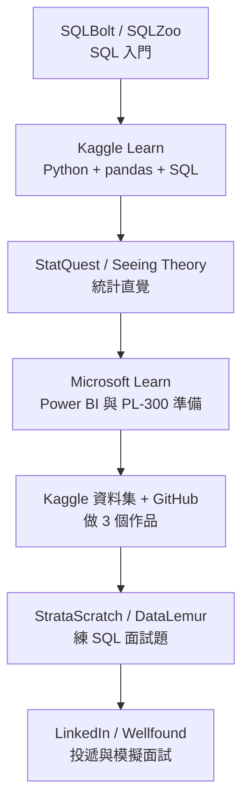

# 免費 AI 課程與求職/學習資源清單:逐項連結核實(Anjana「AI & Tech」三份清單 PDF)

> ⚠️ **素材性質揭露**:本文整理自 Anjana(「AI & Tech」,@aiwithanju)的三份清單式 PDF。這批是**社群引流型素材**:封面/頁尾帶 @aiwithanju 浮水印與 “Follow @aiwithanju on Telegram & WhatsApp” 的導流字樣;其中「Top Free 9 Courses」標題寫「免費」,但**其中至少數項實際需付費才拿證書、或連結已失效**(見下表)。本文只整理清單本身並核實連結,不轉述任何付費導購內容。
> 兄弟篇:[[data-analyst-roadmap-2027-and-7-day-plan]](資料分析師路線)。

## 0. 核實方法與標記說明

- 核實日:2026-11-08。我對 PDF 內**全部網址**用 HTTP 請求檢查可否開啟與轉址(下表「連結」欄),再對**有疑義或與標題宣稱(免費)有關**的項目實際開頁讀內文。
- 標記:**已核實**=開頁讀到內容;**連結可開**=HTTP 200 但我沒讀內頁(價格模式為一般認知,未核實);**需修正**=連結失效、轉址或宣稱與官方頁面不符;**未能核實**=被擋或讀不到。
- 注意:HTTP 403 多半是網站對自動請求的防護(LinkedIn 外的 Indeed、LeetCode、Glassdoor、Canva、Teal、Real Python、Postman Academy 都回 403),**不代表網站死了**,只是我讀不到。

## 1. 「Top Free 9 Courses…」(1 頁)

| # | PDF 寫的課程 | 提供者 | 連結狀態 | 是否免費(實查) | 適合對象 | 核實狀態 |
|---|---|---|---|---|---|---|
| 1 | Career Essentials in Generative AI | Microsoft + LinkedIn Learning | 可開(200) | **頁面未說免費**:只有「Join now / Sign in」,指向 LinkedIn Learning 訂閱;5 門課約 4 小時 | 想了解 GenAI 的非技術者 | 已核實:**不能保證免費**(多半需訂閱或試用,頁面未明說) |
| 2 | Generative AI Learning Plan(Decision Makers) | AWS Skill Builder | **失效**:原網址轉到 Skill Builder 搜尋頁並帶 “showRedirectNotFoundBanner=true” | 第三方搜尋結果稱 Skill Builder 免費、約 90 分鐘(也有說 3 小時多,有第三方代理頁標 $99,互相矛盾) | 決策者、主管 | **需修正**:PDF 連結已失效;費用以 Skill Builder 官方為準,未能在官方頁讀到 |
| 3 | Introduction to Generative AI | Google Cloud Skills Boost(現網域 skills.google) | 原網址 308 轉到 `www.skills.google/course_templates/536` | 頁面只顯示「45 分鐘、入門、完成可得徽章」,**沒寫價格**;頁面有「Subscriptions」區 | 初學者 | 已核實名稱與時長;**免費與否未能核實**(平台設有訂閱/學習點數機制) |
| 4 | Introduction to AI with Python(CS50 AI) | 哈佛 CS50 | 轉到 `cs50.harvard.edu/ai/`(PDF 的 `/ai/2024/` 已被取代) | **OpenCourseWare 免費**(七週:Search、Knowledge、Uncertainty、Optimization、Learning、Neural Networks、Language);edX 認證與哈佛學分另付費(頁面未列價) | 已學過 CS50x 或有一年以上 Python 經驗者(前置要求) | 已核實(此為清單中最扎實的一項;比 PDF 寫的「入門」門檻高) |
| 5 | AI for Everyone: Master the Basics | IBM(edX) | 可開(200) | 頁面**沒說**可否免費旁聽或證書價 | 非技術初學者 | 已核實名稱;**免費性未能核實** |
| 6 | Data and AI Fundamentals | Linux Foundation(edX,課號 LFS115x) | **失效**:`edx.org/course/data-and-ai-fundamentals` 轉到 edX 的 AI 分類頁 | 2022 年 Linux Foundation 宣布為免費課;但有第三方指出 edX 現已標示 **archived(存檔)**(未直接讀到 edX 頁) | 想認識 AI 生態系的初學者 | **需修正**:連結失效且可能已封存,**未能核實**現況 |
| 7 | Machine Learning and AI | Google Cloud | 可開(200) | 頁面是**學習路徑目錄**(Intro to GenAI、Deploy and Manage GenAI Models、Generative AI for Developers、TensorFlow on Google Cloud 等),本身不是單一課程,也沒標價;提到 GEAR 計畫可「免費領每月 35 點學習點數」 | 想入門 Google Cloud ML/GenAI 的開發者 | 已核實:是目錄不是課;免費範圍未能核實 |
| 8 | AI for Everyone(Andrew Ng) | DeepLearning.AI(經 Coursera) | **失效**:`/ai-for-everyone/` 回 404;正確頁為 `deeplearning.ai/courses/ai-for-everyone/` | **不免費**:官方 FAQ 寫「課程 $49,含 180 天證書資格」,並有 PRO 會員方案;搜尋結果稱可免費旁聽影片,但**官方頁沒有這樣寫**,旁聽條件未能核實 | 非技術管理者 | **需修正**(連結失效 + 標題「Free」不精確) |
| 9 | NVIDIA Deep Learning Institute | NVIDIA | `learn.nvidia.com` 301 轉到 `nvidia.com/en-us/training` | 頁面有「Free Self-Paced Courses」專區,同時有付費的自學與講師帶領工作坊,頁面無價格 | 想做 GPU/深度學習實作者 | 已核實:**部分免費,部分付費** |

**小結**:9 項中,**真正確定可免費且內容扎實的只有 CS50 AI**;2、6、8 的連結已失效;1、3、5、8 的「免費」須打折看(通常是內容可看、證書另付);7 是目錄。標題的「Free」是行銷措辭,不要照單全收。

## 2. 「Career Launchpad」求職網站(3 頁,6 類 × 5 站)

| 類別 | 網站 | 用途(PDF) | 連結狀態 | 備註 / 核實狀態 |
|---|---|---|---|---|
| 找工作 | LinkedIn Jobs | 專業人脈與職缺 | 200 | 連結可開 |
| 找工作 | Indeed | 職缺搜尋、公司評論、薪資 | 403 | 被自動請求擋,未能核實(知名網站,非死站) |
| 找工作 | Wellfound | 新創職缺 | 200 | 連結可開 |
| 找工作 | Remote OK | 遠端職缺 | 200 | 連結可開 |
| 找工作 | Y Combinator Jobs | YC 新創職缺 | 200 | 連結可開 |
| 履歷 | Teal | 求職追蹤 + AI 履歷 | 403 | 未能核實 |
| 履歷 | Novorésumé | 履歷範本 | 200 | 連結可開 |
| 履歷 | Kickresume | AI 履歷/求職信 | 200 | 轉到 `/en/`,連結可開 |
| 履歷 | Resume.io | 履歷與求職信 | 200 | 連結可開 |
| 履歷 | Canva Resume Builder | 設計型履歷範本 | 403 | 未能核實 |
| 面試 | LeetCode | 刷題與比賽 | 403 | 未能核實(知名站) |
| 面試 | HackerRank | 程式挑戰與測驗 | 200 | 連結可開 |
| 面試 | interviewing.io | 匿名模擬技術面試 | 200 | 連結可開 |
| 面試 | **Exponent**(`tryexponent.com`) | 產品/工程/資料面試課與模擬面試 | **301 轉到 `aced.io`** | **需修正**:官方頁寫明品牌已改為 **Aced(formerly Exponent)**,免費層為範例課程、題庫瀏覽與社群,完整課程、專家解答、無限模擬面試需付費會員;教練課另計 |
| 面試 | Glassdoor Interviews | 面試經驗分享 | 403 | 未能核實 |
| 作品集 | GitHub | 程式碼託管 | 200 | 連結可開 |
| 作品集 | Kaggle | 競賽、資料集、公開 notebook | 200 | 連結可開 |
| 作品集 | Hugging Face | 模型/資料集/demo 託管 | 200 | 連結可開 |
| 作品集 | Devpost | 黑客松專案展示 | 200 | 連結可開 |
| 作品集 | Notion Portfolio 範本 | 無程式碼作品集 | 200 | 連結可開 |
| 學技能 | Coursera / edX / DeepLearning.AI / freeCodeCamp / Udacity | 課程與證書 | 全 200 | 連結可開;**多數為「內容可看、證書付費」或訂閱制**,未逐站核實價格 |
| 練技術 | StrataScratch | SQL/Python 面試題 | 200 | 連結可開(免費題有限,完整題庫通常需付費,未核實) |
| 練技術 | Codewars | 程式 kata | 200 | 連結可開 |
| 練技術 | Kaggle Learn | 免費短課(Python、SQL、ML) | 200 | 連結可開 |
| 練技術 | SQLBolt | 互動式 SQL 入門 | 200 | 連結可開 |
| 練技術 | roadmap.sh | 社群學習路線 | 200 | 連結可開;資料分析師路線頁已看 |

**求職使用建議(整理者觀點)**:想轉資料分析,上述實用組合是 **Kaggle(資料集+Learn)+ GitHub(作品)+ SQLBolt/StrataScratch(練 SQL)+ LinkedIn/Wellfound(投遞)**;履歷工具擇一即可,免費版浮水印或匯出限制要先確認。

## 3. 「AI/ML Mastery - Complete Resources & References」(5 頁)

此 PDF 把資源分 8 區,**全是官方站或知名教學站的首頁連結**,沒有學習順序、難度或價格,頁尾還有導向 Telegram/WhatsApp 的引流句。本文只做連結檢查,並把它「重新排成學習順序」。

| 類別 | 資源(PDF 列的) | 連結檢查 | 是否免費(核實程度) |
|---|---|---|---|
| 程式與資料 | Python、pandas、NumPy、scikit-learn、Matplotlib | 官方站(未逐一請求) | 開源免費(一般認知,未核實) |
| 程式與資料 | Spark、Kafka、Airflow、dbt、Databricks、Snowflake、Power BI、Tableau | 官方站(未逐一請求) | 前三者開源;dbt Core 開源、其雲端版商用;Databricks/Snowflake/Tableau 商用;**Power BI Desktop 免費(已核實,僅 Windows)** |
| AI/ML | PyTorch、TensorFlow、Hugging Face、Transformers、LangChain、LangChain Academy、FastAPI、MLflow、W&B、fast.ai、DeepLearning.AI | LangChain Academy、Hugging Face、DeepLearning.AI、fast.ai 皆 200 | 框架多半開源;W&B 為商用 SaaS;課程站免費程度不一(未核實) |
| AI/ML | Machine Learning Mastery、Kaggle Learn、Google AI(ai.google.dev)、Google ML Course、TF/PyTorch Tutorials、Microsoft Learn | `ai.google.dev` 200;`developers.google.com/machine-learning/crash-course` 200;Microsoft Learn 200 | 官方教學多免費(未逐站核實) |
| 程式學習 | HackerRank、freeCodeCamp、Real Python(403)、Exercism、W3Schools、Codecademy、Khan Academy、Brilliant、3Blue1Brown | Exercism、Khan、Brilliant、3Blue1Brown、freeCodeCamp 皆 200 | freeCodeCamp、Exercism、Khan、3Blue1Brown 免費;Codecademy、Brilliant 有付費方案;Real Python 多為付費訂閱+部分免費文章(皆未核實) |
| SQL 與資料面試 | StrataScratch、SQLZoo、SQLBolt、DataLemur、StatQuest、Seeing Theory | 全 200(SQLZoo 轉到 `/wiki/SQL_Tutorial`) | SQLBolt、SQLZoo、StatQuest 免費;StrataScratch/DataLemur 有付費題庫(未核實);**Seeing Theory 現網址 `seeing-theory.brown.edu` 與 `seeingtheory.io` 皆可開**,PDF 寫的 `seeingtheory.io` 有效 |
| Git/DevOps | Learn Git Branching、GitHub Skills、Atlassian Git、GitHub Actions、Docker、Kubernetes、Terraform、Prometheus、Grafana、AWS、roadmap.sh | Learn Git Branching、GitHub Skills 皆 200 | Git 類教學免費;Terraform 的 PDF 寫法 `terraform.io` 為舊網域(HashiCorp 官方現在以 `developer.hashicorp.com/terraform` 為主,**此點我沒有實際開頁確認,未能核實**) |
| API 與 Web | Postman Academy(403)、MDN、FastAPI、Postman | MDN/FastAPI 官方站 | 多半免費(未核實) |

另有幾個 PDF 內嵌的轉址值得注意:**Mode SQL Tutorial**(資料分析師 7 天版推薦)已轉到 `https://www.thoughtspot.com/sql-tutorial`(Mode 被 ThoughtSpot 併購後);**OpenIntro Statistics**(7 天版統計推薦)我的請求回 406,**未能核實**。

## 4. 一條「重新排序」的學習順序(資料分析師向,整理者建議)

## 應用案例

1. **想找「免費」的 AI 入門課**:別直接信標題。先以第 1 節表為準:CS50 AI 確定可免費走完 OCW;Google 的 45 分鐘 GenAI 入門適合當暖身(價格以頁面為準);AI for Everyone 官方頁明列 $49 證書。
2. **剛轉行做資料分析師**:用第 4 節順序,2 個月內在 Kaggle 找一個真實資料集,SQL + pandas 做完分析放 GitHub,README 寫商業問題與建議,再去投履歷。
3. **整理自己的書籤清單**:任何第三方清單都先做一次「連結健康檢查」(本文第 0 節的方法):HTTP 狀態、轉址目的地、是否改名(Exponent → Aced)。清單最容易壞的是**轉址與改名**。

## 延伸閱讀與深度補充(核實摘要)

| 項目 | 結論 |
|---|---|
| 清單中失效/需改網址 | AWS 決策者學習計畫(連結失效)、LF Data and AI Fundamentals(連結失效且疑似已封存)、DeepLearning.AI AI for Everyone(舊路徑 404,新路徑 `/courses/ai-for-everyone/`)、Exponent(改名 Aced)、Mode SQL Tutorial(轉 ThoughtSpot)、CS50 AI(`/ai/2024/` 轉 `/ai/`)、learn.nvidia.com(轉 nvidia.com/en-us/training)、Google Cloud Skills Boost(轉 skills.google) |
| 標題「Free」不精確 | AI for Everyone($49 證書,官方 FAQ)、LinkedIn Learning 路徑(頁面指向訂閱)、edX 課程(證書需付費,頁面未列) |
| 確實免費且我讀過內容 | CS50 AI(OCW)、NVIDIA DLI 的「Free Self-Paced Courses」專區、Power BI Desktop |
| 未能核實 | Indeed、Teal、Canva、LeetCode、Glassdoor、Real Python、Postman Academy(HTTP 403 擋自動請求);OpenIntro(406);多數開源專案與課程站的價格細節(我只確認連結可開) |

## 來源
- 使用者提供的本機素材批次 `new/ai-guide/`(2026-11-07 收件),檔案:`Career_Launchpad_Job_Search_Resources.pdf`、`Top Free 9 Courses to Master Al in 2027.pdf`、`AI_ML Mastery - Complete Resources & References.pdf`(作者 Anjana「AI & Tech」@aiwithanju,社群引流型素材)
- LinkedIn Learning 路徑 — https://www.linkedin.com/learning/paths/career-essentials-in-generative-ai-by-microsoft-and-linkedin
- Google Skills:Introduction to Generative AI — https://www.skills.google/course_templates/536
- Google Cloud:Machine learning and AI 訓練目錄 — https://cloud.google.com/learn/training/machinelearning-ai
- CS50 AI — https://cs50.harvard.edu/ai/
- IBM AI for Everyone(edX)— https://www.edx.org/learn/artificial-intelligence/ibm-ai-for-everyone-master-the-basics
- Linux Foundation 課程公告 — https://training.linuxfoundation.org/blog/learn-the-fundamentals-of-data-artificial-intelligence-in-a-new-free-training-course/
- DeepLearning.AI:AI for Everyone — https://www.deeplearning.ai/courses/ai-for-everyone/
- NVIDIA 訓練 — https://www.nvidia.com/en-us/training
- Aced(原 Exponent)— https://www.aced.io/
- Mode SQL Tutorial 現址 — https://www.thoughtspot.com/sql-tutorial
- roadmap.sh 資料分析師 — https://roadmap.sh/data-analyst
- Microsoft Learn:下載 Power BI Desktop — https://learn.microsoft.com/en-us/power-bi/fundamentals/desktop-get-the-desktop
