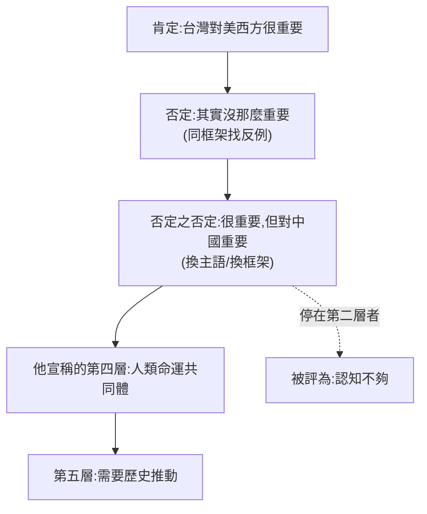

# 「肯定 → 否定 → 否定之否定」:一場即興辯論拆出的辯證思考法,與它的對照工具箱

> **來源影片:** [【全程字幕】統一的意義?!河南網友「超犀利論證」…(CTITV NEWS,影片授權 @IamJackLiu,2026-11-01,10:31)](https://www.youtube.com/watch?v=WP_uW6HiiFg)
> **性質:** 本篇的重點是**「這種思考方式的結構」**,不是兩岸立場。影片是一位自稱「務實派」的河南網友對柳傑克(YTR)的連線發言,內容屬個人政治觀點;筆記只拆論證形式、不評斷立場對錯,也不轉述成事實。
> **揭露:** 影片說明欄含「快點學」課程與雙 11 商品推廣連結(頻道方業配/分潤),與內容無關,筆記不採用。
> **逐字稿:** 該片無字幕,以 `whisper_transcribe.py`(faster-whisper `large-v3-turbo` int8,329 段)轉錄,**非官方字幕**,專有名詞可能有聽寫誤差(見末尾「字幕還原」)。

## 一、他到底在做什麼:三步走的辯證遊戲

他開宗明義說要「用肯定、否定、否定之否定的辯證法」玩兩個遊戲([從 0:50 開始](https://www.youtube.com/watch?v=WP_uW6HiiFg&t=40s),目標句 [1:00] 「否定之否定的辯證法」;[1:25] 起進入第二步「否定第一步」;[2:20] 起進入第三步「再否定第二步」)。

### 遊戲一:「台灣重不重要」(宏觀)

| 步驟 | 他的動作 | 立足的框架(誰的視角) | 結論 |
|---|---|---|---|
| ① 肯定 | 列三條:晶片產能、民主陣營橋頭堡、第一島鏈「不沉航母」 | 全球供應鏈與西方陣營 | 台灣很重要 |
| ② 否定① | 反例:先進製程被分散(美日韓陸也在追)、現代戰爭靠遠程火力不必過島、菲律賓更有地緣價值、美國無正式防衛承諾 | **同一個框架**內找反例 | 對美國沒那麼重要 |
| ③ 否定② | 換主語:對中國而言是突破島鏈的出海口、半導體整合、民族敘事 | **換成中國大陸的視角** | 「台灣很重要,但不是對美國,是對大陸」 |

### 遊戲二:「台灣對大陸人民重不重要」(微觀)

①肯定:兩千三百萬人的家、兩岸同根同源 → ②否定:大陸普通人生活不由台灣決定、投入成本與內耗、善意換冷漠 → 得出「各過各的」→ ③再否定:漢字、媽祖、閩南語是同一套「文明底層代碼」,近代傷疤未癒,守護文明完整性。

### 第三個遊戲:看山是山(從 [5:57] 開始,[連結](https://www.youtube.com/watch?v=WP_uW6HiiFg&t=347s))

他把三階段套在對台灣的態度:教科書的寶島 → 看到網路敵意而崩潰憤怒 → 看清歷史與制度後「山還是那座山」的理解。



## 二、這是什麼思考方式?——三個名字,三層含義

### 1. 辯證法(正反合)與「否定之否定」

- 「否定之否定」是**馬克思主義唯物辯證法**的三大規律之一(另兩個是對立統一、質量互變),源自黑格爾辯證法、經恩格斯整理;他說「按照高中時的唯物論」,指的就是中國高中政治課教的這套。(⚠️ 我沒直讀恩格斯《反杜林論》原文,此處為普遍教科書說法,標**未能核實**。)
- 恩格斯常舉的比喻是**大麥粒**:種子(肯定)→ 長成植株、種子消失(否定)→ 結出更多麥粒(否定之否定,回到「麥粒」但層次更高)。重點:**第三步不是回到原點,是在更高層次吸收前兩步**,黑格爾叫 *Aufhebung*(揚棄:既保留又超越)。
- ⚠️ **常見誤解(已核實的二手資料):** 「正題—反題—合題」這個三段式公式**並非黑格爾自己的用語**,是費希特的用法,經 Chalybäus 1837 年的教科書流行,Mueller 1958 年寫過〈黑格爾傳說〉(*Journal of the History of Ideas* 19(4): 411–414)拆解。見 [Philosophy Now](https://philosophynow.org/issues/42/Hegel_and_the_Trinity) 與 [SEP:Hegel's Dialectics](https://plato.stanford.edu/entries/hegel-dialectics/)(我只讀到搜尋摘要轉述,SEP 全文**未能直讀**)。意思是:今天人人在講的「正反合」其實是後人簡化版,黑格爾原意更接近「概念自己的矛盾推動自己發展」。

### 2. 「視角輪換」——他真正厲害的地方不在否定,而在換框架

仔細看表:第二步是**同框架內找反例**(經典的批判性思考);**第三步其實不是邏輯上的「否定」,而是換主語**(從美國的角度換成中國的角度、從利益換成認同)。所以聽起來像在一路推翻自己,實際上是在**輪流站到不同的位置上看同一個東西**。

這就是他「延伸得很廣」的機制:每一輪都強迫自己回答「**這句話是誰在什麼條件下說的?換一個人、換一個尺度、換一條時間軸還成立嗎?**」

### 3. 「看山是山」三階段(禪宗公案)

出自青原惟信禪師,見於《五燈會元》卷十七與《指月錄》卷二十八(據二手資料引用,原書**未直讀**):

> 「老僧三十年前未參禪時,見山是山,見水是水。及至後來親見知識,有個入處,見山不是山,見水不是水。而今得個休歇處,依前見山祇是山,見水祇是水。」

來源:[terebess.hu 收錄文本](https://terebess.hu/zen/qingyuan.html)、[五燈會元(維基文庫)](https://zh.wikisource.org/wiki/五燈會元)。注意惟信本人並沒說「三個階段」,那是後人概括。形式上同樣是 **肯定 → 否定 → 否定之否定**,但禪宗講的是**心的狀態**(不再分別執著),不是「把結論換成我這一邊」。

## 三、冷靜看:這種思考有什麼強項,影片又有什麼破綻

### 強項(值得學)

1. **強迫對立面進場:** 先把自己的立場講到最強,再主動找反例,比只蒐集支持證據可靠。
2. **區分尺度:** 宏觀(國家)與微觀(個人)分開論,避免只談大格局變成「有道理的廢話」,或只談利益變短視(他在 [9:52] 起講的這句,[連結](https://www.youtube.com/watch?v=WP_uW6HiiFg&t=582s))。
3. **分層命名:** 把「情緒反應 / 利益計算 / 底線與條件」分成不同層,討論時就知道對方在哪一層。

### 破綻(用這套方法時要自己防)

| 破綻 | 影片裡的樣子 | 如何防 |
|---|---|---|
| **結論先行** | 開頭就說「我先說結論」([0:44 起](https://www.youtube.com/watch?v=WP_uW6HiiFg&t=34s)),三步都走向預設答案 | 每一步前問:如果結果相反,我會接受嗎? |
| **換框架冒充推翻** | 第三步換成大陸視角,並沒有反駁第二步的任何一條反例(例如沒有回應「美國沒有正式防衛承諾」本身是否成立) | 換框架是好事,但要說清楚「這是新視角」,並回頭處理舊反例 |
| **層級自我加冕** | 「你不理解是因為認知水平沒到」([5:52] 原句「你不理解是因為還沒有達到這個認知水平」,[連結](https://www.youtube.com/watch?v=WP_uW6HiiFg&t=342s)),把不同意定義成層級不足 | 理論若無法被反駁就不是論證。用 §四的「鋼人論證」檢查 |
| **後面層級靠宣示** | 第四、五層(人類命運共同體、歷史推動)是宣告,沒有由前面推導出來 | 看每一層是「推導」還是「新增前提」 |
| **事實未核** | 如台積電「全球先進晶片佔比」([1:07] 一句,數字轉錄不完整)等,他沒給來源 | 本篇**未能核實**影片中的事實性數字,別直接引用 |

## 四、延伸工具箱:跟他同類的、與他相反的

下面都是「讀者想把思考延伸得更廣」時實用的對照工具(表內說明為通用知識,不特別標原文出處者皆為**普遍說法,未逐一直讀原典**)。

### A. 同類:用「否定」擴張視野

| 方法 | 做法 | 與影片的差別 | 適合 |
|---|---|---|---|
| **證偽(波普爾)** | 不找證據支持,專門找能推翻自己理論的證據 | 影片是一路否定、最後回到結論;證偽是「推不翻才暫時保留」 | 驗證假說、研究設計 |
| **逆向思考(inversion)** | 把「怎樣成功」換成「怎樣一定失敗」,然後避開 | 它否定的是**問題**,不是上一步的答案;查理·蒙格常引用的「Invert, always invert」 | 風險控管、投資、產品 |
| **事前驗屍(pre-mortem)** | 假設專案一年後失敗了,倒推原因 | 把否定提前到執行前,可得具體風險清單,見 [Klein, HBR 2007](https://hbr.org/2007/09/performing-a-project-premortem) | 專案啟動會 |
| **魔鬼代言人 / 紅隊** | 指派人專門攻擊方案 | 影片是自己攻擊自己;紅隊讓**別人**攻擊 | 團隊決策、資安 |
| **蘇格拉底詰問** | 連續問「為什麼/若不是呢」直到前提暴露 | 影片是陳述式,詰問是提問式 | 教學、需求釐清 |
| **鋼人論證(steelman)** | 把對方的論點改寫成他們最認同的版本再反駁 | 影片的「第二步」多半是**稻草人**程度的對手版本,鋼人是反向修正 | 辯論、做決策前 |
| **二階思考(Howard Marks)** | 問「然後呢?」,以及「別人都這樣想,結果會怎樣」 | 沿時間軸延伸,而非沿視角延伸 | 投資、策略 ⚠️非投資建議 |
| **中觀四句否定(龍樹)** | 不僅否定 A,也否定「非 A」「亦 A 亦非 A」「非 A 非非 A」 | 比三步更徹底,連「回到原點」也否定(此條屬佛學說法,**未直讀**《中論》) | 想打破二元對立時 |

### B. 相反:用「收斂、建構、行動」避免無限否定

| 方法 | 做法 | 什麼時候用它,而不是辯證 |
|---|---|---|
| **第一性原理** | 拆到不可再分的事實,再重新組合 | 辯證是橫向換視角,這是**往下拆** |
| **奧卡姆剃刀** | 解釋力相近時選最少假設 | 辯證容易越講越複雜,需要收斂時 |
| **Yes, and(即興劇規則)** | 不否定對方,接住再往上加 | 腦力激盪初期,否定太早會殺創意 |
| **發散→收斂(雙鑽石)** | 先發散找可能,再收斂決策 | 把「否定」放進收斂階段,不要全程否定 |
| **OODA / 小實驗** | 與其想,不如先行動拿回饋 | 資訊永遠不足、再想也不會更清楚時 |
| **滿意解(satisficing)** | 夠好就停 | 無限否定導致分析癱瘓(analysis paralysis) |
| **六頂思考帽(de Bono)** | 同一時間大家戴同一頂帽子(事實/情感/批判/樂觀/創意/統籌) | 結構化「肯定與否定」的輪流,避免一人包辦 |

### C. 一句話選擇法

- **想擴張視野 →** 辯證 + 視角輪換 + 逆向。
- **想驗證 →** 證偽 + 鋼人 + 事前驗屍。
- **想落地 →** 第一性原理 + 奧卡姆 + 小實驗 + 滿意解。

## 五、應用案例:把三步法用在你的決策上

### 案例 1:技術選型(「該不該把單體拆成微服務」)

1. **肯定:** 微服務可獨立部署、團隊自治、擴展彈性。
2. **否定(同框架找反例):** 分散式事務、可觀測性、團隊只有 5 人;**大部分問題單體 + 模組化就能解**。
3. **否定之否定(換視角,不是回到原點):** 換成「**三年後的團隊與營運成本**」視角:先做模組化單體,建立明確邊界,等**某個模組的擴展瓶頸被數據證實**再拆。結論吸收了前兩步:既保留拆分的方向,也承認成本。

### 案例 2:個人職涯(「要不要轉職做 AI 工程師」)

1. 肯定:AI 需求高、薪資好。
2. 否定:門檻在判斷與落地,不是會呼叫 API;很多人只會用工具,可替代性高。
3. 再否定:換成「**我的稀缺性在哪**」視角:原本領域的知識 + AI 工具=複合稀缺,不是全轉而是「帶著領域知識進去」。

### 案例 3:投資決策(⚠️非投資建議)

「某公司護城河會不會持續」:肯定(市占、品牌)→ 否定(競爭者追上、監管、替代品)→ 再否定(換成**時間與估值**視角:護城河變窄但估值已反映多少?)。重點是第三步不要再找一輪利多或利空,而是換一個**可量化的軸**。

### 一個可複製的提問模板

```text
①肯定:我的主張是什麼?最強的三個理由?
②否定:假如這主張是錯的,最可能錯在哪?(同框架內找反例)
③再否定:換一個主語(誰?)或尺度(多久?多大?)重新看,哪些反例其實成立,哪些不成立?
④收斂:現在我願意採取什麼行動?什麼證據出現我會改變?
```

重點在第 ④ 步:**把辯證的結果轉成「可被推翻的行動」**,才不會陷入無限否定。

## 六、延伸閱讀與查證結果

| 項目 | 狀態 | 說明 |
|---|---|---|
| 影片說「否定之否定」屬唯物辯證法 | 普遍說法,**未直讀**恩格斯原文 | 見 §二.1 |
| 「正反合」非黑格爾原話 | ✅ 二手資料一致(Philosophy Now、SEP 摘要轉述) | SEP 全文與 Mueller 原文**未直讀** |
| 「看山是山」出處 | ✅ 卷次已由二手文獻交叉(《五燈會元》卷十七、《指月錄》卷二十八) | 原書文本**未直讀**,異體字(祇/只)依版本不同 |
| 影片中的事實性數字(晶片佔比、美國承諾等) | **未能核實** | 本篇不處理,也不建議直接引用 |
| 「第四層人類命運共同體被聯合國認可」 | **未能核實** | 為影片中說法,未查證 |

## 七、字幕還原(Whisper 轉錄,推定)

| 時間 | 字幕寫法 | 推定 |
|---|---|---|
| 0:00 | 「3G嗆死人你好」 | 節目開場,聽不清,推定為主持人招呼 |
| 0:10 | 「和平池講」 | 推定「和平統一」相關上期話題,**未確定** |
| 0:14 | 「賦予完抗」 | 推定「負隅頑抗」 |
| 1:19 | 「不成航母」 | 推定「不沉航母」 |
| 3:19 | 「威觀」 | 「微觀」 |
| 5:57–6:00 | 「看三還是三」 | 「看山還是山」 |
| 7:21 | 「抽薪止肺」 | 「抽薪止沸」 |
| 9:55 | 「沈博洋的無線套」 | 「沈伯洋」(說明欄標籤),後半「無線套」**無法確定** |
| 1:25–2:30 | 「釋開的預導鏈」 | 推定與「第一島鏈」有關,**未確定** |

## 來源

- 影片:[【全程字幕】統一的意義?!河南網友「超犀利論證」…(CTITV NEWS)](https://www.youtube.com/watch?v=WP_uW6HiiFg),2026-11-01,影片授權 @IamJackLiu。**該片無字幕,逐字稿以 CPU 版 Whisper(faster-whisper `large-v3-turbo` int8)轉錄取得,非官方字幕**,可能有少量聽寫誤差。
- [Philosophy Now:Hegel and the Trinity](https://philosophynow.org/issues/42/Hegel_and_the_Trinity)(「正反合」非黑格爾原話)
- [Stanford Encyclopedia of Philosophy:Hegel's Dialectics](https://plato.stanford.edu/entries/hegel-dialectics/)(僅讀到搜尋摘要)
- [青原惟信「見山是山」文本(terebess.hu)](https://terebess.hu/zen/qingyuan.html)、[五燈會元(維基文庫)](https://zh.wikisource.org/wiki/五燈會元)
- [Gary Klein, Performing a Project Premortem(HBR 2007)](https://hbr.org/2007/09/performing-a-project-premortem)
