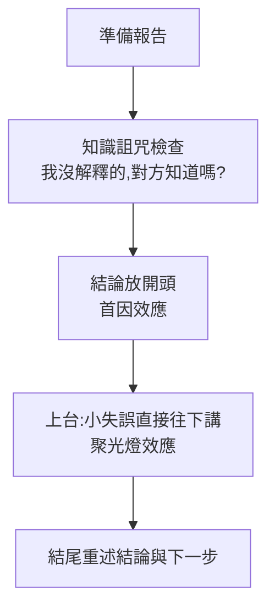

# 報告前先對抗三個認知偏誤:知識的詛咒、首因效應、聚光燈效應

> 來源是使用者貼上的一則社群貼文(作者與出處未附,**未能核實原作者**)。貼文分享「準備工作報告」的三個心法;本筆記保留原文重點,並補上三個效應各自的原始研究,標註已核實程度。

## TL;DR

| 偏誤 | 一句話 | 報告時的做法 |
|---|---|---|
| 知識的詛咒 Curse of Knowledge | 太熟就想像不到別人不懂 | 每個沒解釋的地方都自問「對方真的知道嗎?」 |
| 首因效應 Primacy Effect | 最先聽到的印象最深 | 結論放最前面,背景與理由後補 |
| 聚光燈效應 Spotlight Effect | 高估別人有多注意自己 | 小口誤直接講下去,把注意力留給重要訊息 |

收尾兩問:**對方需要先聽懂什麼?哪些小失誤可以放過自己?**

## 1. 知識的詛咒(原文重點)

- 專案從頭跟到尾,自己覺得每一步都理所當然,主管可能第二頁就跟不上。
- 做法:準備時逐頁自問「這裡我沒解釋,對方真的知道嗎?」

### 延伸查證

- 經典實驗:Elizabeth Newton 1990 年 Stanford 博士論文的「敲擊者與聽者」。敲擊者用手指敲出〈生日快樂〉等熟歌節奏,聽者猜歌名。敲擊者預測聽者約 50% 猜中,實際 120 首只猜中 3 首(約 2.5%)。——**已核實(次級來源一致)**,**未能核實**論文原文;見 [Curse of knowledge(Wikipedia)](https://en.wikipedia.org/wiki/Curse_of_knowledge)、[Brain Lessons: Tappers](https://law.temple.edu/aer/?p=2964)。
- 原因:敲的人腦中同時在放整首歌,無法「不知道」那段旋律。專案做越久,腦中補完的細節越多,同理。

### 應用案例

- 向主管報告「導入 SSO 後登入失敗率降了」:你知道 SSO 是什麼、失敗率怎麼算;主管可能只知道「登入」。第一頁加一行定義:「SSO=一組帳密登入所有內部系統;失敗率=登入嘗試中被拒的比例」。
- 自我檢查法:找一位不同部門的同事聽一遍,他卡住的地方就是詛咒發作處。

## 2. 首因效應

- 一開始聽到的內容印象較深;開場兩分鐘都在背景與致謝,最好記的位置就浪費了。
- 做法:**結論先行**——先講建議,再補背景與理由。

### 延伸查證

- 首因效應的經典來源是 Asch 1946 的印象形成實驗:同一串特質,順序不同,整體印象就不同。——**未能核實**原文,僅憑一般心理學教材認知。
- ⚠️ 補充(我的延伸,非原文):記憶研究的「序列位置效應」同時有**首因**與**近因**(結尾也好記),所以報告最後再重複一次結論與下一步,效果通常更好。這是常見教學說法,**未讀原始論文**。

### 應用案例

- 提案開場:「我建議下季把客服改成 AI 先答、真人接手複雜案,預估省 30% 工時;理由三點。」背景放第二頁備查。對比傳統開場「謝謝大家、先回顧去年狀況……」。

## 3. 聚光燈效應

- 台上講錯一個字,自己在意一整晚,台下多半沒發現。
- 做法:小地方講錯就直接往下講,不道歉、不重講。

### 延伸查證

- Gilovich、Medvec、Savitsky 2000,*Journal of Personality and Social Psychology* 78(2):211–222。實驗讓學生穿上尷尬的 Barry Manilow T 恤進房間,學生預估約一半的人會注意到,實際遠低於此(搜尋摘要為「約 20% 上下」,不同來源寫法不一,**精確百分比未能核實**)。見 [PubMed 摘要](https://pubmed.ncbi.nlm.nih.gov/10707330/)。——**已核實**研究存在與方向,數字**需讀原文**。
- 機制:作者以「錨定與調整」解釋——人以自己的視角為錨,調整不足。

### 應用案例

- 簡報中把「Q3」說成「Q4」:若不影響結論,當下不糾正;只有數字會誤導決策時才簡短更正「剛剛是 Q3」。

## 4. 報告前檢查清單

1. 每個專有名詞、縮寫:對方知道嗎?不確定就加一句定義。
2. 第一頁是結論與要對方做的決定嗎?
3. 結尾重複結論與下一步。
4. 失誤預案:小錯直接過,大錯(影響結論)才更正。

## 相關筆記

- [[sales-power-negotiation-eight-scenarios-boice-celso]]:開場靠「認知差」,與結論先行互補。
- [[ten-toxic-manager-traits]]:向上溝通的職場脈絡。

## 來源

- 使用者貼上的社群貼文(三個效應報告心法,作者未附)。
- [Curse of knowledge — Wikipedia](https://en.wikipedia.org/wiki/Curse_of_knowledge)、[Brain Lessons: "Tappers" and the Curse of Knowledge](https://law.temple.edu/aer/?p=2964)
- [Gilovich, Medvec & Savitsky 2000 — PubMed 10707330](https://pubmed.ncbi.nlm.nih.gov/10707330/)
