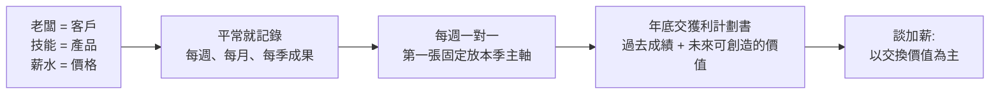
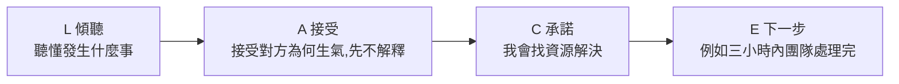
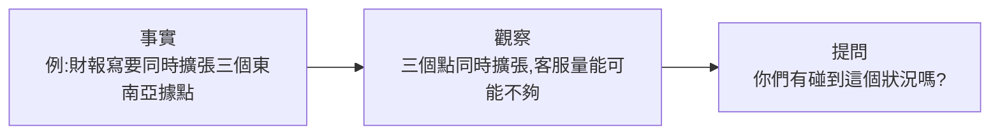

# 談判別說「我幫你爭取」:業務力八情境(西索 × Boice 林伯翰)

> ⚠️ **推廣揭露**:這支影片的結尾(36:29 起的課程介紹章節)是 Hahow 課程《業務進化力》的業配,來賓 Boice 是課程講師,說明欄與口播都附折扣碼 `CELSO500`。影片內容有一部分是課程的引子,下文會標出哪些是「經驗談」、哪些我查到了一手研究。
>
> 影片:[談判時千萬別說「我幫你爭取」!外商總經理教你高情商回擊](https://youtu.be/FnFynx60R_8)|頻道:西索 Celso|2026-11-01 上架|37:20
> 來賓:Boice(林伯翰),自述前 IBM、連續三間新創、外商總經理(經歷為自述,**未能核實**)。

## TL;DR

- 「業務力 = 影響力」:把「產品」換成自己的技能、「價格」換成薪水、「客戶」換成老闆,同一套方法通用([21:54](https://youtu.be/FnFynx60R_8?t=1304))。
- 殺價時第一反應**不能**說「我回去幫你爭取」,這句話等於告訴對方還有空間([6:39](https://youtu.be/FnFynx60R_8?t=389));改成「溫柔但堅定地說明價格帶 + 講清楚價值 + 給高低兩個方案讓客人選」。
- 開場要靠「認知差」:找到對方在意、但他還不知道的資訊,比背話術有用([3:09](https://youtu.be/FnFynx60R_8?t=179))。
- 內向不是缺點;Boice 的三個條件是「討喜、講清楚、能談判」([13:02](https://youtu.be/FnFynx60R_8?t=772))。他提到的「國外研究:E/I 取中間」我對到 Grant 2013 並讀了原文,數字見 §3。
- 客訴用 LACE(傾聽、接受、承諾、執行下一步);沒經驗的新人用「事實→觀察→提問」。

## 1. 八個情境總覽

| # | 情境 | 時間 | Boice 的核心答案 |
|---|---|---|---|
| 1 | 訊息已讀不回 | [2:20](https://youtu.be/FnFynx60R_8?t=130) | 靠首次接觸創造「認知差」並確認對方最在意的點;追不出反饋就停損 |
| 2 | 客戶嫌貴 | [5:51](https://youtu.be/FnFynx60R_8?t=341) | 不說「幫你爭取」;堅定說明價格帶;給高低方案讓他選 |
| 3 | 內向者當業務 | [9:16](https://youtu.be/FnFynx60R_8?t=546) | 關鍵是信任;I/E 不重要,「討喜、講清楚、能談判」 |
| 4 | 花小錢創造情緒價值 | [15:45](https://youtu.be/FnFynx60R_8?t=935) | 做別人沒做的:教師節致謝、產品上線紀念日 |
| 5 | 難賣的產品 | [17:41](https://youtu.be/FnFynx60R_8?t=1051) | 挑客戶、挑戰場;把「不做的代價」算清楚 |
| 6 | 談加薪 | [21:35](https://youtu.be/FnFynx60R_8?t=1285) | 老闆是客戶;平常就記錄成果;年底交「獲利計劃書」 |
| 7 | 客戶發怒 | [27:04](https://youtu.be/FnFynx60R_8?t=1614) | LACE 框架 |
| 8 | 沒背景的新人 | [29:11](https://youtu.be/FnFynx60R_8?t=1741) | 事實→觀察→提問;出門前用 AI 預演客戶痛點 |
| 加 | 一週培養即戰力 | [32:28](https://youtu.be/FnFynx60R_8?t=1938) | 第一週塞滿產品與銷售訓練,第二週上戰場 |

## 2. 殺價與定錨(情境 1、2)

### 2.1 認知差(情境 1)

Boice 的做法([3:09](https://youtu.be/FnFynx60R_8?t=179)–[4:02](https://youtu.be/FnFynx60R_8?t=232)):

1. 要找出客戶「在意、但不知道」的東西,他稱為「認知差」。
2. 不是把背好的稿講完(那是話術),而是對話中一直想:對方在意什麼、沒聽過什麼([3:43](https://youtu.be/FnFynx60R_8?t=213))。
3. 以賣車為例:先分辨客人在意安全、性能還是外型([4:19](https://youtu.be/FnFynx60R_8?t=249)),離開前再確認「這件事對你最有價值,只有我們能滿足」,並約好下一步行動([4:33](https://youtu.be/FnFynx60R_8?t=263))。
4. **停損訊號**:你精心設計的問題都沒有反饋,代表對方看不到你的價值,他可能有需求,但你的價值只剩「幫他做功課、比價」([5:13](https://youtu.be/FnFynx60R_8?t=303)–[5:40](https://youtu.be/FnFynx60R_8?t=330)),就不要強求。

### 2.2 嫌貴怎麼回(情境 2)

| 步驟 | 影片做法 | 時間 |
|---|---|---|
| 好業務的標準 | 「又會賣、又賣在好價格」,賠錢賣或毛利很低不算好業務 | [6:00](https://youtu.be/FnFynx60R_8?t=350) |
| 禁語 | 「我回去幫你爭取一下」:對方會覺得還有空間 | [6:39](https://youtu.be/FnFynx60R_8?t=389) |
| 替代說法 | 「我們的價格帶就是這樣」「很多客戶買過這個價」「你也不希望我們的服務打折」 | [6:53](https://youtu.be/FnFynx60R_8?t=403) |
| 講清楚價值 | 說明高單價的原因 | [7:28](https://youtu.be/FnFynx60R_8?t=438) |
| 遇到硬殺價 | 拆分功能:要更便宜就得捨棄某些功能,丟輕量版讓他取捨 | [7:44](https://youtu.be/FnFynx60R_8?t=454) |
| 定錨 | 同時給高價與低價兩案並寫明內容,讓對方在你的區間內討論 | [8:20](https://youtu.be/FnFynx60R_8?t=490) |
| 不要直接說不行 | 給選項,讓客戶自己決定;直接說「沒辦法」會讓客戶沒面子 | [8:52](https://youtu.be/FnFynx60R_8?t=522) |

> **口徑提醒(我的判讀)**:影片的「定錨」其實是「報價時一次給出高低兩個有內容差異的方案」。心理學的定錨效應是指先出現的數字會拉走後續估計,Tversky 與 Kahneman 1974 年發表於 *Science* 185(4157): 1124–1131;我只查到二手摘要(轉盤實驗,估計值被隨機數字拉動),**未讀原文**,所以這裡只標引用出處,不引用數字。把「高低兩案」當成定錨的運用是 Boice 的實務用法,影片沒有給成交率之類的數據,**無法核實效果大小**。

### 應用案例:報價單怎麼寫

你是接案設計師,客戶說「能不能再便宜?」。

- 不要:「我回去跟老闆爭取看看。」
- 改成:「我們目前有兩個方案。A 方案 6 萬含 3 版提案與一年維護;B 方案 4.2 萬是 1 版提案、無維護。兩個價格都是這個內容的合理區間,你比較在意哪一塊?」
- 結果:對話從「降多少」變成「要哪些內容」。

## 3. 內向者與業務(情境 3)

Boice 的論點與時間點:

- 銷售的本質是信任,喝酒交際只是堆疊信任的一種方式([9:24](https://youtu.be/FnFynx60R_8?t=554)–[9:57](https://youtu.be/FnFynx60R_8?t=587))。
- 客戶要的信任不同:終端客戶問「買了有什麼價值」,企業客戶問「安不安全、能不能升官」([10:11](https://youtu.be/FnFynx60R_8?t=601))。
- 「I 人越會觀察,越容易取得信任」([10:34](https://youtu.be/FnFynx60R_8?t=624))。
- 他提到「國外有個研究,E 和 I 應該在中間」([11:34](https://youtu.be/FnFynx60R_8?t=684))。
- 頂尖業務三要素:討喜、講清楚、能談判([13:02](https://youtu.be/FnFynx60R_8?t=772))。他年輕時靠念報紙練口條([13:48](https://youtu.be/FnFynx60R_8?t=818))。

### 我查到的一手研究(已核實,但與影片說法有出入)

影片沒說研究名稱。我推定對應的是 **Adam Grant (2013), "Rethinking the Extraverted Sales Ideal: The Ambivert Advantage", *Psychological Science* 24(6): 1024–1030**,已下載並讀完原文([Wharton 公開 PDF](https://faculty.wharton.upenn.edu/wp-content/uploads/2013/06/Grant_PsychScience2013.pdf))。這個對應是我的推定,影片未點名。

| 項目 | 論文原文 |
|---|---|
| 樣本 | 美國某外撥電話中心 807 名員工中回覆 340 人(回覆率 42.1%);71% 男性;平均年齡 19.9 歲;平均年資 6.14 個月 |
| 設計 | 20 題 Big Five 量表測外向性,之後追蹤 3 個月銷售營收 |
| 結果 | 外向性與營收呈倒 U 形;外向性剛好在中點 4.0 的人時薪營收最高(208.34 美元,全樣本平均 137.73) |
| 分組 | 中間組(3.75–5.50)平均每小時 154.77;內向組(低於 3.75)120.10;外向組(高於 5.50)125.19 |
| 三個月營收 | 中間組 16,393.05 美元,比內向組(13,226.60)多 24%,比外向組(12,401.13)多 32% |
| 效果量 | 二次項多解釋 2% 的營收變異(F(1,324)=7.60, p<.01),作者自己也說技術上屬小到中等 |

**與影片的差異**:

1. 論文的結論是「**中間型最好**」,內向組(120.10)與外向組(125.19)的信賴區間大幅重疊([96.39–143.82] vs [103.63–146.75]),看不出內向者占優。Boice 在影片中說「I 人比較適合」([11:01](https://youtu.be/FnFynx60R_8?t=651))屬於他的經驗判斷,**不是該研究的結論**。
2. 樣本是年輕的外撥電話銷售新手(平均年資約半年),不能直接外推到企業大單、長週期的 B2B 銷售。
3. 論文提出的機制是:中間型兼顧說與聽,較少顯得過度興奮或過度自信。這和 Boice 說的「更會觀察、聽」方向相近,但屬於作者的理論解釋,論文本身就把它當作待驗證的假說,後續研究建議了刻面分析。

### 應用案例:怎麼用這個結論

內向的工程師被調去做售前。不必硬練酒量,照 Boice 的邏輯:先備好專業討論的內容、用觀察決定要不要聊非工作話題。同時別高估「外向才會賣」:Grant 的資料顯示極端外向並沒有優勢。

## 4. 情緒價值:教師節與上線紀念日(情境 4)

- 年節禮物常被分送給員工,送禮人容易沒被記住([15:58](https://youtu.be/FnFynx60R_8?t=948)–[16:07](https://youtu.be/FnFynx60R_8?t=957))。
- 做法一:**教師節**。客戶是你學習產業的「老師」,不只傳簡訊,而是具體寫「謝謝你在當時告訴我什麼」([16:14](https://youtu.be/FnFynx60R_8?t=964)–[16:56](https://youtu.be/FnFynx60R_8?t=1006))。理由:市場上沒人這樣做,所以印象深。
- 做法二:**產品上線(簽約)紀念日**。一年前簽約的日子傳訊息致謝並問有沒有不習慣([17:08](https://youtu.be/FnFynx60R_8?t=1018)–[17:31](https://youtu.be/FnFynx60R_8?t=1041))。
- 這兩招屬經驗談,影片沒有給成效數字,**無法核實**。

## 5. 難賣的產品(情境 5)

Boice 的職涯賣過線上英語教育(2013 左右,[18:00](https://youtu.be/FnFynx60R_8?t=1070))、AI 產品(2016,[18:19](https://youtu.be/FnFynx60R_8?t=1089))與防詐產品([18:51](https://youtu.be/FnFynx60R_8?t=1121)),他的結論:

1. **挑客戶、挑戰場**:先定義客戶畫像,例如 AI 產品就找「有創新部門」的企業;沒有的話連陪同拜訪都不去([20:05](https://youtu.be/FnFynx60R_8?t=1195)–[20:36](https://youtu.be/FnFynx60R_8?t=1226))。他估計一定會買的人大約 15%([19:42](https://youtu.be/FnFynx60R_8?t=1172),自述推估)。
2. **算清楚「不做的代價」**:以防詐為例,他說國外法規準備規範,消費者因你的服務或品牌被詐騙,企業也要被罰([20:50](https://youtu.be/FnFynx60R_8?t=1240)–[21:00](https://youtu.be/FnFynx60R_8?t=1250))。再用試算表快速呈現「做了有什麼好處、不做損失多少」([21:11](https://youtu.be/FnFynx60R_8?t=1261)–[21:23](https://youtu.be/FnFynx60R_8?t=1273))。
   - 「國外法規要罰企業」**未能核實**:影片沒說是哪個國家、哪部法規。

### 應用案例:不做的代價試算

賣客服自動化給電商:先問「每月客服人力成本、平均回覆時間、流失率」,再做兩欄表:導入後每月省下多少人時;不導入下,客服成本每年增加與漏單的估計。數字用客戶自己提供的,而不是你的假設。

## 6. 談加薪(情境 6)

Boice 的框架([21:54](https://youtu.be/FnFynx60R_8?t=1304)–[26:59](https://youtu.be/FnFynx60R_8?t=1609)):

- 不能年底才談:老闆同時要評 8 到 10 個人,憑印象給分([22:16](https://youtu.be/FnFynx60R_8?t=1326)–[23:17](https://youtu.be/FnFynx60R_8?t=1387))。
- 年底用「獲利計劃書」:寫過去成績,更重要的是未來可做什麼,例如開新產品線、新市場、需要多少資源、營收可增加多少([23:28](https://youtu.be/FnFynx60R_8?t=1398)–[24:04](https://youtu.be/FnFynx60R_8?t=1434))。
- 每週一對一時第一張固定放主軸,快速帶過,做成「定錨投影片」,年底老闆就記得([25:29](https://youtu.be/FnFynx60R_8?t=1519)–[26:09](https://youtu.be/FnFynx60R_8?t=1559))。
- 主持人的整理:談判要用「交換」,而不是「我做了很多所以要加薪」([24:26](https://youtu.be/FnFynx60R_8?t=1456))。

> 這些是經驗做法,無對照研究可核實。相關延伸:[[ai-skills-no-raise-nash-bargaining]](從議價角度看「學 AI 卻沒加薪」)。

### 應用案例:一週一次的成果頁

每週一對一的第一張投影片固定三行:本季三個主軸、目前進度、本週新增的一個可量化成果。年底整理獲利計劃書時,直接把 12 週的第一頁串起來就是成果清單。

## 7. 客訴與新人信任(情境 7、8)

### 7.1 LACE(情境 7)

[27:20](https://youtu.be/FnFynx60R_8?t=1630)–[29:11](https://youtu.be/FnFynx60R_8?t=1741):先「像海綿一樣吸收情緒」、再「像鑽石一樣堅定推進」。

- 「E」在影片的口述是「下一步到底怎麼做」,我把它寫成「下一步」;字幕沒有給 E 的英文字,**框架出處我沒查到,不確定是否為課程自創**。
- 應用:客人說「訂單延誤,我要客訴」。L:「你是說上週五下單、今天還沒到,對嗎?」A:「這樣被延誤我也會生氣。」C:「我今天先確認出貨狀況。」E:「下午 3 點前回電告訴你確切日期。」

### 7.2 事實 → 觀察 → 提問(情境 8)

[29:22](https://youtu.be/FnFynx60R_8?t=1752)–[30:40](https://youtu.be/FnFynx60R_8?t=1830):

- Boice 的 AI 用法:出門前把客戶新聞貼進 AI,問「如果我是經營者,最擔心哪三件事、最吃力的痛點是什麼」,見客戶時點到其中一個([30:44](https://youtu.be/FnFynx60R_8?t=1834)–[31:26](https://youtu.be/FnFynx60R_8?t=1876))。
- 提醒:AI 列出的痛點是假設,見面時要用「提問」確認,不是直接當結論說出口。
- 他把未來人才比喻成「兀型」:本業專業 + AI + 銷售力([32:03](https://youtu.be/FnFynx60R_8?t=1913))。

## 8. 一週培養新業務(補充題)

[32:57](https://youtu.be/FnFynx60R_8?t=1967)–[35:09](https://youtu.be/FnFynx60R_8?t=2099):

- 第一週不熟悉環境,而是從早到晚、40 小時填滿產品與銷售訓練([33:22](https://youtu.be/FnFynx60R_8?t=1992)–[33:57](https://youtu.be/FnFynx60R_8?t=2027))。
- 給每個產品的銷售劇本,例如 8 個產品先背到 80 分([34:00](https://youtu.be/FnFynx60R_8?t=2030)–[34:25](https://youtu.be/FnFynx60R_8?t=2055)),再準備客戶最常問的 80–100 題答案([34:44](https://youtu.be/FnFynx60R_8?t=2074))。
- 下週一請新人向總經理(自己)簡報,Boice 扮客戶提問([34:53](https://youtu.be/FnFynx60R_8?t=2083))。
- 被拒絕:是拒絕產品或解決方案,不是否定人,有些人天生不在意,但也可訓練([35:58](https://youtu.be/FnFynx60R_8?t=2148))。

## 9. 口語字幕對照(自動字幕還原)

| 字幕 | 還原 | 依據 |
|---|---|---|
| 起S回生、S纏爛打、S忠鐵粉、不S降價 | 起死回生、死纏爛打、死忠鐵粉、死不降價 | 「死」字被字幕過濾或誤寫 |
| 多年底才來談 | 到年底才來談 | 語意([22:18](https://youtu.be/FnFynx60R_8?t=1328)) |
| ROWBOX | 推定是 Roblox 這類小孩常玩的遊戲 | 發音與語境,**推定,未確認**([1:25](https://youtu.be/FnFynx60R_8?t=75)) |

## 10. 驗證狀態

| 項目 | 狀態 |
|---|---|
| Grant 2013 倒 U 形、340 人、24%/32% | 已核實(讀原文),影片未點名,對應為推定 |
| 「I 人比較適合」 | 需修正:論文結論是中間型最好,內向組與外向組差異不明顯 |
| 定錨效應出處(Tversky & Kahneman 1974) | 引用出處已查到;細節只有二手摘要,未讀原文 |
| 「高低兩案」提升成交 | 未能核實(經驗談) |
| 教師節、上線紀念日效果 | 未能核實(經驗談) |
| 國外防詐法規罰企業 | 未能核實(影片未說國家與法條) |
| Boice 帶三間新創上市、培訓逾 1000 業務 | 未能核實(自述與主持人介紹) |
| LACE 框架來源 | 未能核實 |

## 來源

- 影片:[談判時千萬別說「我幫你爭取」!外商總經理教你高情商回擊](https://youtu.be/FnFynx60R_8)(西索 Celso,2026-11-01)。逐字稿:YouTube 自動字幕(zh-TW,真人語音辨識,帶時間,非官方字幕),全程已讀。
- 影片說明欄:課程《業務進化力》連結 [https://go.hahow.in/Boice/CELSO500](https://go.hahow.in/Boice/CELSO500)(推廣連結,未點入閱讀課程內容)。
- Grant, A. M. (2013). Rethinking the Extraverted Sales Ideal: The Ambivert Advantage. *Psychological Science*, 24(6), 1024–1030. [全文 PDF](https://faculty.wharton.upenn.edu/wp-content/uploads/2013/06/Grant_PsychScience2013.pdf)、[DOI 頁](https://journals.sagepub.com/doi/full/10.1177/0956797612463706)
- Tversky, A., & Kahneman, D. (1974). Judgment under Uncertainty: Heuristics and Biases. *Science*, 185(4157), 1124–1131(僅查到引用資訊與二手摘要,未讀原文)。
