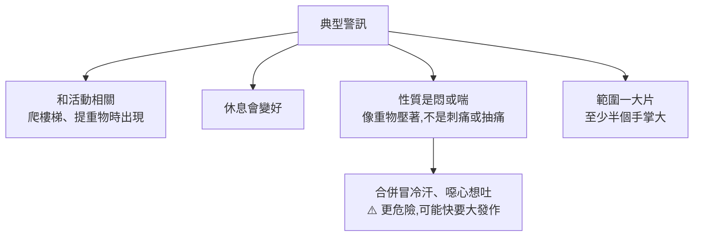
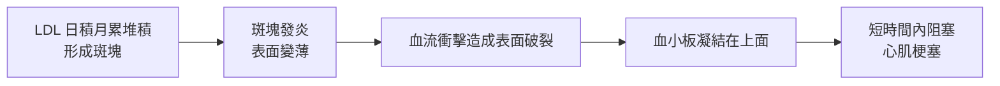

# 壞膽固醇 160 降到 55:心肌梗塞的警訊、LDL 目標值,與斑塊為什麼能縮小

> 整理自 YouTube **風傳媒《下班經濟學》第 794 集**〈[【健康】壞膽固醇160→55如何做到？台大名醫親眼見血管斑塊縮小！ft. 名醫 王宗道](https://www.youtube.com/watch?v=6jJMbqg4jbI)〉(2026-10-22,約 26 分鐘,官方繁中字幕)。主持人謝哲青、蔡尚樺;來賓為**台大心臟科王宗道醫師,台灣動脈硬化暨血管病醫學會理事長**。
>
> ⚠️ **立場揭露**:說明欄標示本集「**公益合作夥伴:台灣動脈硬化暨血管病醫學會**」,也就是來賓擔任理事長的學會。片中沒有點名任何藥品或廠牌,但大篇幅介紹針劑降血脂治療。
>
> ⚠️ **非醫療建議。** 本文是衛教內容整理;是否用藥、用哪種藥、目標值設多少,請和自己的醫師討論。

---

## 一句話總結

心肌梗塞的典型警訊是**活動時出現一大片的悶或喘、休息就變好**,不是能用手指指出來的刺痛。真正的元兇是**壞膽固醇 LDL**,目標值依血管狀況分四級(130 / 100 / 70 / 55)。治療的目的不是讓數字好看,而是**讓斑塊穩定甚至縮小**;降幅要夠大(約 30–40% 以上)才撼動得了斑塊。保健食品不能取代藥物,而口服藥最大的問題是**病人會忘記吃**,這是針劑治療的優勢。

---

## 一、心肌梗塞有前兆嗎?

王醫師說,門診常有病人描述了典型症狀,卻像在講別人的事,完全沒意識到自己血管快堵了。

### 典型症狀

**分辨重點:**

| 比較像心血管問題 | 比較像肌肉骨骼問題 |
|---|---|
| 一大片的悶、壓迫感 | 能用手指指出痛點 |
| 活動時出現、休息緩解 | 和活動無固定關係 |
| 冒冷汗像下雨、噁心 | — |

**範圍可以很廣**(因為堵的血管位置不同):

- 胸口中間偏左,往上可到**下巴、喉嚨**,有人只是**活動時牙齒痠**,其實是典型心肌梗塞。
- 往下到胃的位置。
- 往右大約到胸口右側中間;往左到**上臂內側**,但**不會到手指**。
- 背後:後頸部、左肩胛骨和脊椎中間(台語「膏肓」)。有病人是打高爾夫時後頸難受。

**非典型症狀**:有些糖尿病病人神經較退化,**不悶、只會喘**。

### 什麼時候要趕快就醫

像「小地震之後會不會來大地震」,可以觀察三件事:

1. **頻率增加**:一週發作兩次以上,即使每次只有幾秒,都算比較嚴重。
2. **更容易引發**:活動量不用那麼大就發作。
3. **發作時合併冒冷汗等自律神經症狀。**

符合這些,代表越來越接近大發作,要趕快接受治療。

---

## 二、為什麼會心肌梗塞:斑塊像血管裡的痘痘

心肌梗塞是**心臟血液供應不足、心肌壞死**,本質是**動脈狹窄阻塞的血管病**。把狹窄處切開分析,堆積的主要就是**低密度脂蛋白膽固醇(LDL,壞膽固醇)**。

**為什麼長期堆積卻突然發病?**

- 冠狀動脈很細,大約和手背靜脈一樣粗,約 **4 毫米**。原本 50% 的狹窄,再加一點血塊就可能立刻堵死。
- 膽固醇容易堆在**轉折、分岔處**。血管內壁本來很光滑,**抽菸、糖尿病、高血壓**會讓它變得不光滑,膽固醇更容易堆積。
- **血管痙攣**也是原因之一(天冷、聞到某些氣味、情緒壓力時較易發生),但痙攣通常也發生在斑塊附近。

⇒ 根本對策是**讓斑塊穩定,甚至慢慢消退**。

---

## 三、看懂抽血報告:真正的關鍵是 LDL

一般血脂檢查有四項:**總膽固醇、LDL(壞)、HDL(好)、三酸甘油脂**。

- **HDL 高能不能比較安全?** 臨床簡單原則:**總膽固醇 ÷ HDL 小於 4** 可視為較安全(例:總量 200、HDL 50 多)。但關注重點仍是 LDL。
- **只有降低 LDL** 經大型研究證明能減少心肌梗塞與死亡率;**提升 HDL 目前做不太到這個效果**。

### LDL 目標值:四級,差 30 再除 2

| 你的狀況 | LDL 目標(mg/dL) |
|---|---|
| 沒有高血壓、糖尿病、抽菸等任何問題 | **130 以下** |
| 有高血壓、糖尿病或抽菸等危險因子 | **100 以下** |
| 已經有斑塊堆積 | **70 以下** |
| 已經發病(心肌梗塞、放過支架) | **55 以下** |

王醫師的記法:130 → 100 → 70 每級差 30;最後一級是 30 ÷ 2 = 15,70 − 15 = **55**。

> ⚠️ 這是王醫師在節目上的**簡化版**。正式的台灣指引與健保規定是依 ASCVD 風險分級,實際分級與數字以醫師評估為準(見第八節)。

**重點是達到目標,不是吃多少藥。** 膽固醇不抽血完全不知道數字。

### 降太低安不安全?

有人擔心膽固醇是細胞膜和荷爾蒙的成分,降太低會出問題。王醫師從兩方面回答:

1. **嬰兒的 LDL 只有 30–40**,而且正在腦部發育,生物學上推論這個數字對發育沒有影響。
2. **大型臨床試驗**(針劑或口服)中,有人降到十幾、二十,依試驗要求不停藥繼續觀察,**一樣獲益,沒有增加風險**。

---

## 四、斑塊真的會縮小

用**心臟電腦斷層**可以看到斑塊。王醫師說:「你如果降得夠低,我親眼見到很多例子,斑塊能夠縮小。」

- **鈣化不會減少,但體積會縮小** ⇒ 斑塊是**可逆的**。
- 會不會完全消失?不敢講。有些人可減少 30%–50% 的體積,**平均大約 10% 左右**。
- 縮小幅度和 LDL 降幅有關:**LDL 要降 30%–40% 以上,才能真正撼動斑塊。**
- 所以降到目標後**不能就停藥**,真正的目的是讓血管健康。

---

## 五、飲食:有用,但只占一部分

**膽固醇約 80% 是人體自己合成**(體質、遺傳)。王醫師舉例:有位吃素的出家人也來看膽固醇問題,而且真的沒偷吃葷。極嚴格的飲食控制大約能降 **20%** 左右,效果有限。

但飲食對血管的影響**不只在膽固醇**(還有飽和脂肪酸、反式脂肪),整體血管風險管理中飲食的影響約占 30%–40%,所以還是要吃得健康。

**三個方向:**

| 類型 | 例子 | 建議 |
|---|---|---|
| ① 肉眼可見的油脂 | 和牛油花、雞皮等皮下脂肪,動物性油脂為主 | 不是不能吃,**適量**,用抽血檢驗你的「適量」合不合理 |
| ② ⚠️ **肉眼不可見的油脂(更危險)** | 加工食品裡的**飽和脂肪酸**(椰子油、棕櫚油)、**反式脂肪**(部分三合一飲品) | 高風險;喝咖啡選黑咖啡 |
| ③ 糖與澱粉 | 太甜的水果、精緻澱粉 | 會讓三酸甘油脂升高、HDL 下降;三酸甘油脂高、HDL 低或糖尿病的人特別注意 |

**椰子油與防彈咖啡**:王醫師說以前做動脈硬化動物實驗,在兔子飼料裡拌椰子油,**一個月血管狹窄就非常明顯**。要讓血管快速堵塞,就是吃這種東西。⇒ **不建議心血管病患喝加椰子油的防彈咖啡。**

**蛋黃**:主持人提到美國新飲食指南說蛋黃蛋白都可以多吃。王醫師的建議是**一天不超過兩個蛋黃**,蛋白沒有問題。

---

## 六、什麼時候用藥?保健食品可以取代嗎?

### 開藥的判斷

1. 先看**血管健康程度**:有沒有斑塊、有沒有發病。
2. 再看**危險因子**。

- 有疾病、有斑塊、有危險因子 ⇒ **較早用藥**,同時改善生活型態;有症狀的更要加強。
- 什麼都沒有、只是檢查數字偏高 ⇒ 看總膽固醇 / HDL 比例,或例如 LDL 130 以上,**先飲食控制 3–6 個月再說**。
- 開始治療後,建議**至少吃半年到一年**。血中膽固醇一個月就會降下來,但真正目的是血管健康。

王醫師說他不用問就知道病人有沒有吃藥:**一看抽血數字沒降就知道了**。追蹤十幾二十年的經驗,大約以十年為界,穩定很久後又發作的,**都是沒控制好的**;控制好的會像健康人一樣。

### 保健食品(魚油、紅麴、燕麥)

- **不能取代藥物。** 它們沒有經過萬人等級的大型研究,也沒有觀察到心肌梗塞減少、死亡率下降這類數字。
- 最重要的是**不要因此延後正規治療**,尤其是已有血管病的人。
- ⚠️ **紅麴和口服降膽固醇藥可能衝突**,吃了其中一個就不要吃另一個。

---

## 七、正規治療:口服藥與針劑

### 口服藥

- 經由降低 LDL,讓**心肌梗塞減少約 20%–30%**,也減少死亡與中風。
- **最大的問題是病人不會天天吃。** 王醫師說健保資料分析顯示,**一年後還規律吃藥的人不到兩成**。醫師容易有錯覺,因為回診的都是乖乖吃藥的人。
- 他的比喻:流感、COVID 打一次疫苗就好,但我們被制約成慢性病就要天天吃藥。

### 針劑

- 現在已有**兩週一次**、甚至**半年一次**的降 LDL 針劑。王醫師希望有一天高血壓也能打針甚至有疫苗。
- 實際觀察:LDL 降下來後,**做心導管、放支架的人真的減少**。

### 各療法的預期降幅(王醫師口述)

| 療法 | LDL 降幅 |
|---|---|
| 口服藥(主流降膽固醇藥) | 約 30%–40% |
| 口服抑制吸收的藥 | 約 20% |
| 針劑 | 約 50%–60% |

個體差異很大:有人吃原本只降 20% 的藥卻降了 50%,也有人打針降了 70%。

### 停藥會反彈嗎?副作用呢?

- **會反彈。** 口服藥每天吃,停兩三週數字就回來;針劑回來得慢一點。
- **肌肉痠痛**:長期吃口服藥的人約 10% 多到 20% 會發生,通常只能停藥或換藥。王醫師有病人全身無力到不能走路、以為得了不治之症,停藥後完全恢復。
- **基本原則:吃任何長期用藥有不舒服就該停,不要忍著吃**(癌症用藥除外),回診和醫師討論換藥。

### 降血脂藥會導致失智嗎?

- 王醫師**確實遇過**吃了口服降膽固醇藥後記憶力變差的病人,停藥就好、再吃又出現。比例不高,但真的有,這種人就不適合吃那個藥。
- 但**大型研究看到的是相反的**:十幾二十年後看,失智比例反而較低。原因是很多失智來自**腦部微小血管堵塞**,血管健康了,失智風險也下降。
- 他的結論:這是個人化的、可逆的,可以被辨識與控制。

---

## 八、核實與補充

**✅ 已核實:**

- **健保給付已和國際接軌**(影片說「終於將治療原則跟國際接軌,看到 70 跟 55 的數字」):健保署依 9 個醫學會共同擬訂的「2025 台灣血脂管理臨床路徑共識」,自 **2025-09-01** 起改依 ASCVD 風險等級訂 LDL 起始治療值與目標。急性冠心症等極高風險、非常高風險患者原本 **LDL 70 以上**才給付,放寬為 **55 以上**就給付、目標降到 **55 以下**;最低風險(0 項危險因子)族群起點從 190 放寬到 160,但需先有 3–6 個月生活型態改善。估計約 105 萬人受惠。
- **PCSK9 抑制劑(血脂針)**同步放寬:起始治療值從 135 下修到 100,每次核准使用期間從 6 個月延長到 12 個月。
- **20 歲以上高血脂盛行率約三成**:衛福部引用國民營養健康調查為 3 成 1(另有 2017–2022 年 25.6% 的較舊數據)。國健署也指出**高血脂的自知率只有約 23%**,遠低於高血壓與高血糖。

**⭐ 補充(影片沒講):**

- 王醫師說的「130 / 100 / 70 / 55」是節目上的簡化記法。台灣 2022 年初級預防指引與 2025 臨床路徑共識是依 ASCVD 風險細分,初級預防另有 115、160 等級距;實際目標以醫師依你的風險分級為準。
- 影片沒有點名藥品。依常見分類:主流口服藥是 **statin(他汀類)**,「抑制吸收」的是 **ezetimibe**,兩週一次的針劑是 **PCSK9 單株抗體**,半年一次的是 **siRNA 類(如 inclisiran)**。實際可用與健保給付以醫師處方為準。
- **紅麴與 statin 衝突的原因**:紅麴含 monacolin K,化學結構與 lovastatin 相同,一起吃等於重複用藥。

**⚠️ 未能核實:**

- 「健保資料一年後規律吃藥不到兩成」:沒找到原始分析。
- 斑塊體積「有人減 30–50%、平均約 10%」、「LDL 要降 30–40% 以上才撼動斑塊」、肌肉痠痛「10 多到 20%」:為王醫師口述的臨床經驗與研究概述,未逐一對照原始研究。不同研究對 statin 肌肉症狀的發生率差異很大。
- 兔子餵椰子油的動物實驗為王醫師自述經歷。
- 「一天不超過兩個蛋黃」是王醫師個人建議;美國 2025–2030 飲食指南的實際措辭本筆記未核對。

---

## 九、應用案例

### 案例 1:把症狀對照成「該不該現在就醫」

| 情境 | 判讀 |
|---|---|
| 爬兩層樓梯胸口一大片悶,停下來兩分鐘就好,這週第三次 | ⚠️ **典型且頻率增加**,盡快看心臟科 |
| 打球時後頸緊、牙齒痠,休息後消失 | ⚠️ 位置非典型但**和活動相關、休息緩解**,不要忽略 |
| 胸口某一點刺痛,手指按得到,轉身時更痛 | 比較像肌肉骨骼問題,仍不放心就就醫 |
| 胸悶合併冒冷汗、噁心 | 🚨 **可能快要大發作,立即就醫或叫救護車** |
| 糖尿病長輩最近走路容易喘,但說不會痛 | ⚠️ 糖尿病可能只有喘,要提高警覺 |

### 案例 2:拿到抽血報告後自己先對照

情境:52 歲、有高血壓、沒抽菸、沒做過心臟電腦斷層。報告:總膽固醇 230、HDL 45、LDL 150、三酸甘油脂 170。

1. **總膽固醇 ÷ HDL** = 230 ÷ 45 ≈ 5.1,大於 4 ⇒ 不在安全範圍。
2. 有高血壓 ⇒ 依王醫師的簡化記法,LDL 目標約 **100 以下**,目前 150 超標。
3. 若做檢查發現已有斑塊 ⇒ 目標變成 **70 以下**,需要降約 53%,單靠飲食(約 20%)不夠。
4. 三酸甘油脂偏高、HDL 偏低 ⇒ 特別注意糖與精緻澱粉。
5. 帶著這些問題回診:我的風險分級是什麼?目標值多少?需不需要用藥?

### 案例 3:評估「先吃保健食品看看」的想法

| 想法 | 王醫師的觀點 |
|---|---|
| 「我先吃紅麴,不想吃藥」 | 紅麴和口服降膽固醇藥可能衝突,不要兩個一起吃;已有血管病的人**別因此延後正規治療** |
| 「魚油、燕麥可以取代藥嗎?」 | 沒有大型研究證明能減少心肌梗塞與死亡 |
| 「吃藥會不會傷身?」 | 有不舒服就停藥回診、換藥,不要忍著吃;但長期吃能減少心血管事件與死亡 |
| 「數字達標了可以停藥嗎?」 | 停兩三週就反彈;目的是讓斑塊穩定、縮小,不是數字好看 |
| 「我老是忘記吃藥」 | 可以和醫師討論針劑選項(兩週或半年一次) |

---

## 相關筆記

- [[chronic-inflammation-four-enemies]]:慢性發炎的四個敵人,其中超加工食品與內臟脂肪也是血管風險的一部分。

---

## 來源

- YouTube:風傳媒《下班經濟學》794〈【健康】壞膽固醇160→55如何做到？台大名醫親眼見血管斑塊縮小！ft. 名醫 王宗道〉 https://www.youtube.com/watch?v=6jJMbqg4jbI (2026-10-22,官方繁中字幕;公益合作夥伴為台灣動脈硬化暨血管病醫學會)
- 衛生福利部,降血脂藥健保給付放寬新聞稿: https://mohw.gov.tw/cp-16-87716-1.html
- 中央社,降血脂藥健保放寬給付報導(2025-08): https://www.cna.com.tw/news/ahel/202508030114.aspx
- TVBS 健康 2.0,〈血脂針給付放寬 5 千人受惠〉: https://health.tvbs.com.tw/nutrition/362084
- 衛生福利部,高血脂盛行率說明: https://mohw.gov.tw/cp-16-81454-1.html
- 2022 Taiwan lipid guidelines for primary prevention(J Formos Med Assoc): https://doaj.org/article/68eb9f30b3c841468608cb1aa51a1009

> ⚠️ **再次提醒:非醫療建議。** 本文整理節目內容與公開資料,個人用藥與目標值請和醫師討論。
