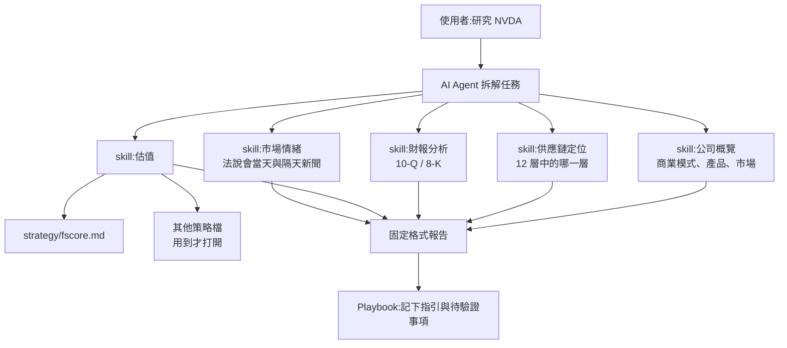
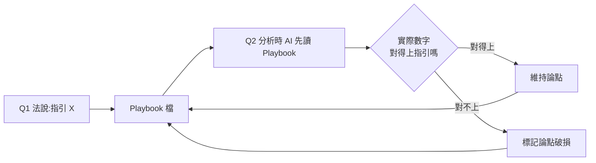
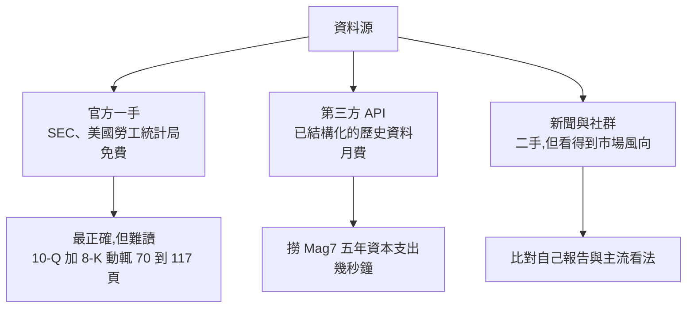

# 用 AI Agent + Skill 讀財報、做估值:為什麼 AI 分析股票常出錯

> 整理自 YouTube 頻道 **財女珍妮**〈[為什麼AI分析股票常出錯?用 AI Agent 讀財報、做估值 ft. CodeGym 創辦人 Ryan](https://www.youtube.com/watch?v=DhZ2F9DI7PY)〉(2026-10-14,約 38 分鐘)。來賓 Ryan(CodeGym 創辦人,軟體工程背景,現居日本)。
>
> ⚠️ **本集是課程推廣集**:主持人片中明說「今天主要當然還是想要來推廣 Ryan 的 AI Agent 投資系統實戰課」,說明欄附 Hahow 課程連結與專屬優惠碼(88 折),屬**導購 / 合作推廣**。本文只整理片中**公開講出的方法論**,不轉述任何付費課程內容,也不推薦購買。
>
> ⚠️ **非投資建議。** 片中個股數字只當作「AI 研究流程能挖出什麼」的示範。
>
> ⚠️ 該片無中文字幕(只有誤判成英文的自動字幕),逐字稿以 CPU 版 Whisper(faster-whisper small)轉錄取得,非官方字幕,專有名詞可能有聽寫誤差(例:Skill 常被聽成「SQL」、FinMind 被聽成「FIMITE」)。

---

## 一句話總結

> ⭐⭐⭐ **AI 分析股票會出錯,通常不是模型笨,是流程沒固定:** 資料從哪來沒規定、步驟每次不同、輸出格式會漂移、上次的結論沒留下來。解法是 **AI Agent(會拆任務、自己去抓資料)+ Skill(把步驟、資料源、格式寫成結構化文字檔)+ Playbook(把「管理層說過的話」存檔,下次接著追)**。

---

## 一、問答式 AI vs AI Agent:差在「拆任務」

| | 問答式(ChatGPT 一問一答) | AI Agent(Claude Code、Codex 等) |
|---|---|---|
| 資料 | 從模型已知的東西組答案(可能過期) | 先問自己「去哪找資料」:SEC、第三方 API、新聞 |
| 流程 | 一次一問,你要自己複製貼上 prompt | 拆成多步:抓資料、解析表格、計算、寫報告 |
| 穩定性 | 「叫它記住格式」,第三次就開始變形 | 讀 Skill 檔,每次照同一份步驟與格式 |
| 典型錯法 | 「NVIDIA 能不能買?」只要一個結論 | 給的是可檢查的數字與來源,你只負責確認與判斷 |

主持人點出的常見錯誤:**直接問 AI「給我幾檔標的」「這檔幾塊可以賣」**。這種問法拿到的是無法驗證的結論——你不知道它抓的數字對不對,又得一個一個回頭查。

---

## 二、Skill 是什麼、為什麼能讓 AI 聽話

- Skill 就是**純文字檔**(Markdown),Anthropic 2025 年 10 月推出。特點是**可結構化、可互相參考**;Agent 會自己判斷這次該打開哪一份。
- 一份投資用 Skill 通常寫:
  1. **目的**(這份 skill 解決什麼問題)
  2. **資料源規定**(只能用權威機構,例如 SEC 原始申報)
  3. **步驟**(先做什麼、再做什麼)
  4. **分析策略**(例如 F-Score 怎麼算)
  5. **輸出格式**(報告固定的章節與表格)
  6. 必要時夾帶**底層程式碼片段**
- 來賓舉 Salesforce 的例子:它在 Dreamforce 發表能讓不同模型(Claude、OpenAI)存取 Salesforce 資料的產品(聽寫為「AI Force」,名稱未查證),先前法說會也公布約 200 份 skill。用意是讓業務**用自然語言跟資料對話**,不必自己寫 SQL。
- **拆細的原則**:8-K 分析一份、財報分析一份、估值一份;估值底下的不同策略(如 `fscore.md`)再拆成獨立檔。理由是**省 token**:有 20 種策略時,Agent 只打開這次要用的那一份。這跟寫程式不會把整個系統塞進一個檔案是同一個道理。



---

## 三、來賓的研究流程(五步 + Playbook)

1. **看公司在供應鏈的位置**:錢是跟誰拿的。例如 NVIDIA 的營收跟雲端廠、AI 實驗室的資本支出連動。
2. **同層比較**:毛利、估值只跟**同一層**的公司比;跨層比較沒意義。
3. **讀財報細項**,不只看賺不賺錢(見下方 NVIDIA 存貨例)。
4. **讀法說會逐字稿**:「財報是上季的成績單,法說會講的是未來」。另外抓**法說會當天和隔天的新聞**,看市場怎麼解讀,不要關起門來自己研究。
5. **估值**:現價合不合理。
6. **(來賓自創)Playbook 檔**:把「管理層說了什麼、要追蹤什麼」寫進檔案。下次分析時**給 AI 讀**,不是給自己讀,AI 就能接續上一季或上個月的故事線。總經數據(CPI 每月公布)也適用。估值偏高、暫時不買的公司,也放進 Playbook 等機會。



### 財報細項示範:NVIDIA 存貨(本文已用 SEC XBRL 驗證)

來賓說 NVIDIA 存貨半年增加快五成,但拆開看:原料成長兩倍、成品降兩成,代表一直在進料、做好就趕快出貨。查 SEC 申報數字(FY2026 年底 2026-01-25 到 FY2027 Q2 底 2026-07-26):

| 項目(US-GAAP XBRL) | 2026-01-25 | 2026-07-26 | 變化 |
|---|---|---|---|
| 存貨總額 `InventoryNet` | $21.40B | $31.57B | **+47.5%**(來賓說「快五成」✓) |
| 原料 `InventoryRawMaterialsNetOfReserves` | $3.81B | $11.34B | **約 3 倍,+198%**(「成長兩倍」✓) |
| 在製品 `InventoryWorkInProcessNetOfReserves` | $8.82B | $13.38B | +52% |
| 成品 `InventoryFinishedGoodsNetOfReserves` | $8.77B | $6.86B | **−21.8%**(「降兩成」✓) |

> 解讀限制:原料暴增也可能是**預先鎖料**(供應吃緊時常見),不必然等於需求強。成品下降是「出貨快」還是「產能卡在前段」,要搭配營收與法說會一起看。另外來賓說「NVIDIA 首次給下一年度營收指引 +7 成、隔天股價漲 8.7% 後又回到原點」,**本文未查證**。
> 延伸:同一套數字也是 [[memory-50-year-cycle-three-signals]] 提到的「存貨放大器」的觀察點。

---

## 四、AI 供應鏈為什麼拆 12 層

- 目的:**讓同一層的公司可以互相比財報**。
- 例子:黃仁勳口中的「晶片」層混了台積電和日本化學材料廠(聽寫為信越化學、住友化學)。拿化學廠跟台積電比毛利、估值不公平;化學廠彼此比才有意義。
- 業界也有別的切法:美國半導體協會(SIA)切 6 段;GICS/MSCI 把半導體分成「半導體」和「半導體材料與設備」兩個子項。來賓的 12 層是從投資人比對的角度切。
- 他自己的收穫:看出**國家差異**。材料與化學品幾乎由日本包辦,於是他順著這條線研究日股。
- 他引用蒙格「財報是起點,不是重點」:過去一般人沒能力把財報當起點,有了 AI 可以,而且可以一次跑多種估值模型做比較。

---

## 五、資料源三類與成本



| 類型 | 例子 | 費用(來賓口述) | 用途 |
|---|---|---|---|
| 官方 | SEC EDGAR、BLS 非農 | 免費 | 最正確;AI 不會讀到第 50 頁忘了第 5 頁 |
| API(美股) | FMP(Financial Modeling Prep) | 基本方案約月付台幣 500–600 | 長期序列,免得逐份讀申報 |
| API(台股) | FinMind | 約月付台幣 500 上下 | 同上 |
| 新聞 / 社群 | 一般媒體 | 免費到付費 | 股價常跟情緒走,要知道風向 |

來賓舉的頁數:Salesforce 的 8-K 加 10-Q 約 69 頁、Google 77、Microsoft 102、Oracle 117。

> ⚠️ 來賓說「AI 很客觀」。這要打折:AI 也會引用錯數字、選擇性摘要。所以才需要第一節的「只用權威源」規定,加上第六節的驗證步驟。

---

## 六、應用案例

### 案例 1:把「NVDA 能買嗎」改寫成可驗證的流程

❌ 「NVIDIA 現在能買嗎?」
✅ 在 Claude Code 裡用一份 `skills/earnings-review/SKILL.md`,內容寫:
```markdown
## 資料源
- 財報數字只能用 SEC XBRL companyfacts API(data.sec.gov),不可用新聞轉述數字
## 步驟
1. 抓最近 4 季 InventoryNet 與三個子項,算 QoQ / 半年變化
2. 抓營收、毛利率,同層(GPU/加速器)公司並列
3. 讀最新法說會逐字稿,列出「管理層量化指引」
4. 讀 playbook/NVDA.md,逐條比對上次指引是否兌現
## 輸出
- 表格 + 每個數字附來源 URL;結論只寫「論點維持 / 破損 / 待觀察」
```
上方存貨表就是用第 1 步的 API 實際跑出來的。

### 案例 2:Playbook 追蹤管理層承諾

`playbook/NVDA.md` 裡寫一行:`2026-08 法說:下年度營收指引 +70%(來源:法說逐字稿 URL)`。一年後跑 skill 時,AI 先讀這一行,再拿實際營收比對。這等於把「黃仁勳說過什麼」從人腦外包成檔案。做法跟 [[always-on-agent-grok-bot-lee-robinson]] 的「狀態存在對話外面」是同一招。

### 案例 3:同層比較抓出不能比的對照組

研究日本化學材料股時,讓 skill 先判定公司屬於 12 層的哪一層,**只拉同層的同業**做毛利 / EV/EBITDA 比較。如果 AI 把台積電放進對照組,skill 規定它要報錯,不能直接算平均。

### 案例 4:不需寫程式,但要會驗收

來賓說新一代流程「連叫 AI 寫程式都不用,它需要時自己寫、用完就丟」,也不需要 n8n 這類自動化工具。但使用者仍要做兩件事:**檢查數字來源**(每個數字附 URL)和**自己下判斷**。這跟 [[using-ai-for-stock-analysis]] 的提醒一致。

---

## 七、批判與補充

- **推廣集的資訊密度**:方法論(拆 skill、資料源分級、Playbook)是可以獨立實作的通用做法,不需要買課;12 層的具體清單與 skill 檔案才是課程內容,本文不涉及。
- **「AI 很客觀」有風險**:模型會幻覺數字、挑資料。務必規定一手來源並附 URL,本文的存貨表就是這樣驗證的。
- **Playbook 的價值**在於累積可驗證的歷史紀錄,也能用來檢討自己:上次看錯在哪裡。
- 相關:[[ai-algo-trading-claude-jesse]](策略回測的驗證紀律)、[[humbled-trader-claude-tradingview-pipeline]](Claude 串行情工具)、[[building-claude-skills]](Skill 怎麼寫)。

---

## 來源

- 財女珍妮〈為什麼AI分析股票常出錯?用 AI Agent 讀財報、做估值 ft. CodeGym 創辦人 Ryan〉:https://www.youtube.com/watch?v=DhZ2F9DI7PY(該片無中文字幕,逐字稿以 CPU 版 Whisper 轉錄取得,非官方字幕)
- SEC EDGAR XBRL companyfacts — NVIDIA(CIK 0001045810):https://data.sec.gov/api/xbrl/companyfacts/CIK0001045810.json(存貨數字查詢日 2026-10-18)
- Financial Modeling Prep:https://site.financialmodelingprep.com/
- FinMind:https://finmindtrade.com/
- 揭露:說明欄課程連結(Hahow,含優惠碼)為導購連結,本文不收錄
