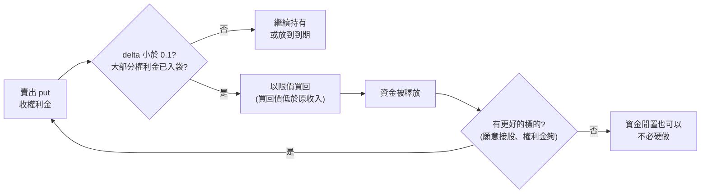

# Sell Put 不必放到到期:提前買回、把資金換到下一張合約(Nick 美股咖啡館)

> 整理自 YouTube 頻道 **Nick 美股咖啡館**〈[(高含金量)我靠一個簡單策略收入2x:公開現金流翻倍的秘密!](https://www.youtube.com/watch?v=UG_IiOPAWng)〉(2026-10-20,約 22 分鐘,官方 zh-TW 字幕)。
>
> ⚠️ **非投資建議。** 選擇權賣方有實質下檔風險,本文只整理作者的操作邏輯與一般性機制說明。
>
> ⚠️ **立場揭露:**
> - 說明欄與片頭、片尾都附 **IB 盈透證券推薦連結**。作者明說點擊後「IB 會幫我的便當加一根雞腿」,也就是點擊或開戶作者會拿到回饋。片中下單畫面也是 IB。
> - 作者另外販售 Excel 估值模型與 nickvischool 課程;本集沒有推銷課程。
> - 片中所有損益數字都是**作者自己的帳戶截圖、自述**,本筆記無法獨立核實;所列標的(NVDA、AVGO、AMD、TSLA、META、AMZN、SOFI、GOOG、COST、DUOL)作者自稱是「本來就願意長期持有」的公司,屬作者有部位或有意建倉,有利益關係。
> - 本集是系列第二集;第一集「柬埔寨一週賺 1,000 美元」那支本庫沒有收錄。

---

## 一句話總結

賣出 put(sell put)不一定要等到到期:當合約已經賺到大部分權利金、**delta 掉到 0.1 以下**,就花一點錢買回、把被綁住的資金拿去賣新的 put。作者自述同一段 9/9–9/25 期間,「放到到期」可賺 1,245 美元,「適時提前結束再換約」賺到 2,520 美元。⚠️ 代價是每次換約都**重新承擔一份風險**,而且那幾週剛好是上漲行情。

---

## 一、前情:賣 put = 當保險公司

作者沿用第一集的比喻:

| 角色 | 選擇權 | 保險 |
|---|---|---|
| 買方 | 買 put(避險) | 投保人 |
| 賣方 | 賣 put、收權利金 | 保險公司 |

**為什麼財報週權利金特別厚?** 財報可能爆雷也可能超預期,股價波動大,等同「已經快發病的人才來投保」,保險公司只能收更多錢(選擇權世界不能拒保)。作者 9/1 那週賣 NVDA 一週到期的 put 收到約 1,239 美元,下一週賣 AVGO 與 AMD 收到 900 多美元,都是**財報週加持的特例**。

> ⭐ 財報前隱含波動率(IV)偏高、財報後「IV crush」是一般性機制。賣財報波動率的系統性回測與尾端風險,見 [[selling-earnings-volatility]]。

**沒財報時呢?** 作者 9/9 賣 TSLA ×2、META ×1,到期日 **9/25**,總共只收 1,245 美元——兩三週才賺這些,遠不如財報週的「一週 1,000」。

---

## 二、核心技巧:提前買回 + 換約



### 兩個前提條件(作者原話整理)

1. **時間上划算**:以 META 為例,原本放到 9/25 可賺 530 美元。9/15 花 64.8 美元買回,實得約 464 美元——**6 天賺到 464 vs 三週賺 530**,剩下兩週的期望收益只有 64 美元。
2. **要有更好的標的**:買回 META 釋放的資金,拿去賣 AMD put 收 335 美元。等於「花 64 換 335 的機會」。

### ⭐ 作者自己強調的風險

> 「如果這兩個禮拜什麼都不做,這 64 塊是**非常穩**的 64 塊……那 335 塊賺更多沒錯,但是**比較不穩**。」

也就是說,提前結束舊合約 = 放棄一筆幾乎確定的小錢,換一份新的、完整的接股風險。

---

## 三、作者自述的連續操作(9/9–9/25)

| 日期 | 買回(成本) | 新開(權利金) | 作者說法 |
|---|---|---|---|
| 9/15 | META(64.8) | AMD put(335) | 多賺約 270 |
| 9/17 | AMD(115) | AMZN、SOFI put(376) | 多賺 200 多 |
| 9/18–19 | TSLA ×2(220)、AMZN(約 68) | AMD、GOOG ×2(571) | 多賺約 300 |
| 9/22 | AMD、GOOG(78) | COST put(360,當週財報) | 多賺 200 多 |
| 最後一週 | SOFI ×10(18) | GOOG、DUOL put(216) | 多賺約 200 |

- 所有新合約的到期日都維持 **9/25**,作者用這點說明「沒有多花時間」。
- 結果:**劇本一(放到到期)1,245 美元;劇本二(適時換約)2,520 美元**,約 2 倍。
- 金額為作者口述、未計 IB 手續費,本筆記無法核實(數字可能與截圖有小出入,例如 530 − 64.8 = 465.2,作者說 464)。

---

## 四、什麼時候適合提前結束:看 delta

作者的「偷懶」用法:**delta ≈ 合約被行權的機率**。

- IB 下單畫面:點合約 → `Close Position` → 看 delta 欄位。
- **0.17 時不買回**:例子中已實現獲利只有 38.7 美元,太少,「多此一舉」。
- **低於 0.10(0.09、0.08、0.07…)才考慮**:這時大部分權利金已入袋,買回成本低。
- **一定用限價(作者說「現價」),不要市價單**:選擇權買賣價差大,市價可能被「狙擊」。買回價必須**低於當初收的權利金**(例:收 148.96,就要設在 148.96 以下),否則是賠錢平倉。

> ⭐ **補充(一般性知識,非影片內容):**
> - delta 嚴格說是選擇權價格對股價的敏感度;把它當「到期價內的機率」只是**近似值**(風險中性測度下的粗估),不是真正的被行權機率。
> - 美式選擇權賣方隨時可能被**提前指派**,尤其深度價內、或臨近除息時。
> - 業界常見的「賺到 50% 權利金就平倉」規則與作者的「delta 小於 0.1」是同一個想法:**剩餘的期望收益很少,卻仍掛著全部的尾端風險。**

---

## 五、作者沒講、但必須知道的風險

1. **上漲行情的倖存者偏差**:作者自己承認「這幾週能放大獲利,是因為股價在上漲」。下跌時每張新合約都可能接股,換約越頻繁,暴露次數越多。
2. **每次換約 = 新的完整風險**:舊合約剩下的風險很小(delta 0.1 以下),新合約通常 delta 更高,整體部位的下檔風險其實**變大**了。
3. **資金規模**:cash-secured put 每口要預留「履約價 × 100」的現金。作者一次賣 10 口 SOFI、多口 TSLA,本金遠大於多數人。作者也說「本金更少,要達到這個數字就比較困難」。
4. **手續費與滑價**:作者明說沒算 IB 手續費;頻繁平倉再開倉,每一輪都有買賣價差成本。
5. **財報週 ≠ 免費午餐**:COST 那張剛好是財報週,權利金厚是因為風險高,不是因為策略聰明。
6. **接股後怎麼辦**:作者說會在後續影片講 sell call(即「輪子策略」wheel 的另一半)。本集沒有交代。

---

## 六、應用案例

### 案例 1:用期望值判斷要不要提前買回

情境:你賣了一張某股 put,收 300 美元,還有 12 天到期,現在買回價 25 美元,delta 0.07。

- **不動**:剩下最多再賺 25 美元,但仍掛著整張合約的接股風險。
- **買回並換約**:付 25 美元,資金拿去賣另一張 12 天到期、delta 0.20、權利金 180 美元的 put。
- 判斷順序:①新標的你**願意接股嗎**?②180 美元配上 delta 0.20 的風險,你能承受嗎?③兩題都是「是」才換;否則讓舊合約安靜到期。

### 案例 2:限價買回的掛單方式

情境:原收 148.96,現在 bid 0.95、ask 1.25(每股)。

- 市價單可能以 1.25 甚至更高成交。
- 改掛中間價約 1.10(每口 110 美元)的限價單,沒成交再小幅往上調。
- 底線:**買回總價必須低於 148.96**,否則是虧損平倉。

### 案例 3:記錄成「劇本一 vs 劇本二」

每次提前結束都記一行,一季後回頭看:

```text
日期  | 買回 (成本) | 若放到到期還能賺 | 新合約 (權利金, delta) | 新合約最後結果
09/15 | META 64.8  | 64.8            | AMD 335, 0.2x         | 到期作廢 / 接股
```

看的重點不是賺多少,而是**「換約後接股」的次數與損失**有沒有吃掉多出來的權利金。

---

## 來源

- YouTube:Nick 美股咖啡館〈(高含金量)我靠一個簡單策略收入2x:公開現金流翻倍的秘密!〉 https://www.youtube.com/watch?v=UG_IiOPAWng (2026-10-20,官方 zh-TW 字幕)
- 字幕專名還原:「broadcomb / Bracon / Avago」→ Broadcom(AVGO)、「MD」→ AMD、「metal / Mac / Mate」→ Meta、「狗狗」→ Google、「朵Lingo」→ Duolingo、「調查值 / 貂蟬值」→ delta 值、「CELLPUT / SELFOOD」→ sell put、「clothes per諮詢」→ Close Position、「Sofi 手法」→ SOFI 合約。
- 選擇權 delta 與指派機制一般說明:OCC《Characteristics and Risks of Standardized Options》 https://www.theocc.com/company-information/documents-and-archives/options-disclosure-document
- ⚠️ 片中帳戶截圖與損益數字為作者自述,未能獨立核實。
