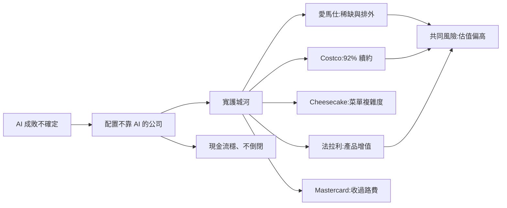

# 不靠 AI 也能穩的五家公司:愛馬仕、Costco、Cheesecake Factory、法拉利、Mastercard(Nick 清單與核實)

> 整理自 YouTube 頻道 **Nick 美股咖啡館**〈受夠AI了嗎?分享五家「無視AI」也能照樣稱霸的公司:現在買入!?〉(2026-09-30,約 30 分鐘,影片 ID `XUQo8M5NnAE`,官方 zh-TW 字幕,**自動字幕品質,錯字多**)。
>
> ⚠️ **非投資建議。** 作者在片中明說「不是要你現在就去買」。
>
> ⚠️ **利益揭露**:作者提到自己是 **Grab 股東**(與本片五家無關);片頭尾推廣 **IB 盈透證券**連結(聯盟連結,點擊作者有回饋),**不轉述推廣內容**。作者未表明持有這五檔,**但也未聲明沒有**。
>
> ⚠️ 影片發布於 2026-09-30,數字是當時的;下文「核實」欄標示的是後續公司公告。

---

## 一、前提:AI 到底成不成,沒人有把握

作者開頭整理當時的分歧:Anthropic CEO Dario Amodei 發表文章主張前沿 AI 發展應該放慢(他描述為「現在有點失控」),Sam Altman 隔天表態同意;川普與黃仁勳則稱這類說法是 hoax、別有用心(ulterior);馬斯克說「值得冒險」。(⚠️ 這些人物發言本筆記**未逐一核實**,僅轉述影片。)

作者的結論:**既然 AI 成功率不是 100%,把 100% 資產放在 AI 公司「半夜睡不著」的話,就該配一些「有沒有 AI 都能活」的公司。** 他的篩選條件:Morningstar 給**寬護城河**(最高級)、財報沒有倒閉風險、現金流穩定。

作者也提醒:**護城河評級只是參考**,例如 Berkshire Hathaway 被評為「窄」、Texas Roadhouse 也是窄,但不代表比 Costco 差(Berkshire 由寬降為窄:✅ Morningstar 2024 Economic Moat Review 核實;其餘評級本筆記**未能核實**,Morningstar 評級會隨時間更新)。

## 二、五家公司

| 公司 | 作者看的重點 | 影片數字(9/30) | 核實 |
|---|---|---|---|
| **Hermès(愛馬仕,RMS)** | 比 LV 更排外、客群更緊密;但營收年增率只剩約 1.61%(畫面圖表標 Quarterly,口徑需修正,見延伸閱讀節;「HESAY Revenue Growth (YoY) – Quarterly」,HESAY 為愛馬仕 ADR 代號,使用者 2026-11-07 聽原片確認口徑),最大區域亞太(不含日本)約佔四成,成長最慢;CEO 把中國需求疲弱歸因「豬肉價格太低」(以宴席需求為領先指標) | 一年跌約 35%;P/FCF 約 31 倍,低於 3/5/10/15 年平均 | ✅ H1 2026 公司稿:亞太(不含日本)約 +2%(固定匯率,另報導 +2.4%),佔集團營收約 43%;集團固定匯率約 +6%。影片「1.61%」:畫面圖表標 Quarterly,但 6/30/2026 柱值與 H1 集團報告年增率 +1.6%(€8,163m vs €8,034m,本筆記據公司稿計算)相符,旁白也說「半年」⇒ **需修正:「單季」應為「半年(H1)」口徑,待使用者再確認**。與 H1 固定匯率集團 +6%、亞太 +2% 為不同口徑。「豬肉價格」說法未核實 |
| **Costco(COST)** | 護城河無疑問;**會員續約率(renewal rate)是人數不是金額**,美加達 92.3%,比軟體公司的 retention 更難得(軟體靠漲單價撐 retention);每年穩定開新店 | 市值約 4,000 億美元;P/FCF 約 47 倍(近 3–5 年不算貴,10–20 年平均持平);作者說跌到 40 倍以下是「非常好的機會」 | ✅ FY2026 Q4 美加續約率 92.3%(全球 89.8%,畫面 [13:32] 投影片已核對);FY2026 開 28 家(含 3 家遷移)、淨增 25 家,**與影片「25 個」吻合**;FY2027 計畫開 33 家(含 5 家遷移,淨增約 28),影片說「再多 20 多個」略低估。引自 Costco 10-K 與財報電話會議 |
| **Cheesecake Factory(CAKE)** | 餐廳卻有護城河:**菜單廣度難複製**(數百道菜;影片稱「被寫成研究」,實為 Business Insider 2026 年 5 月的商業報導〈How The Cheesecake Factory runs one of America's biggest menus〉,非學術研究);營業利益率由 2023 年約 2% 升到約 6%;營收成長由 2% 升到約 7% | 股價約 104 美元,一年漲近 100%;市值約 52 億;約 25 倍估值,成長不到 10% 不算太便宜;短期負債偏高但現金流穩 | ✅ Q3 2026 8-K 新聞稿(13 週止 2026-09-29)營收 10.334 億美元(+13.9%)、營業利益率 7.2%(去年 4.1%)、Cheesecake Factory 品牌同店銷售 +15.2%;**比影片數字更強,影片已過時** |
| **Ferrari(RACE)** | 最高寬護城河(Morningstar 以愛馬仕對比,而非 GM/豐田);**車價不折舊反而增值**;毛利率超過 50%、ROE 約 45%,日美歐大廠加總不及其一半 | 年初至今約 −23%;P/FCF 近 50 倍,但近 3/5/10 年平均約 60 倍,「從來不便宜」 | ❌ 毛利率、ROE 與倍數**未能核實**(2025 年公開數字見延伸閱讀節,為二手報導)。折舊對比:法拉利 488 Pista Spider 台灣 2019 新車含標配總價 NT$2,220 萬、認證中古車頁面 NT$32,100,000(✅ 畫面核對,即 3,210 萬,影片口述「3,200 萬」)；賓士 2019 新車 380 萬→約 148 萬(**未能核實**,僅作者口述)。屬單一個案,**不可代表整體** |
| **Mastercard(MA)** | 與 Visa 雙頭壟斷;毛利率近軟體公司;「專門收過路費」;**加值服務(防詐騙、資安等)佔營收超過 40%,是五家中最可能受 AI 影響(含正面)者** | 市值約 5,000 億美元;P/FCF 約 31 倍(曾到 35 倍以上);營收成長 10% 以上;加值服務成長約 20% | ✅ Q3 2026(SEC 8-K 新聞稿):淨營收 9,807 百萬美元(+14%)、支付網路 +11%、加值服務與解決方案 +19%;加值服務金額 4,058 百萬與佔比 41.4% 為 PPC Land 二手計算。⇒ 影片「超過 40%」「+20%」其實是**2026 年第二季**投影片(7/30 發布:加值服務 3,826 ÷ 總額 9,277 ≈ 41.2%,GAAP 成長 20%)。⚠️「毛利率 100%」:Mastercard 不單獨揭露銷貨成本,未核實 |

## 三、作者的選股邏輯與取捨

1. **「好公司合理價」勝過「爛公司好價」**,但他也承認多數入選者估值貴(Costco、法拉利),所以給了「倍數門檻」而非立刻買。
2. **便宜要有理由**:愛馬仕跌 35% 是因為最大區域(亞太)成長停滯;作者說「便宜有理由」,是否反彈取決於中國需求,他自己因為不是奢侈品客戶而不碰。
3. **用自己的消費經驗篩**:他優先考慮自己用過的公司(如 Mastercard),沒開過法拉利就不選。
4. **誠實標示例外**:Mastercard 的加值服務與 AI 有關,所以不是「完全無關 AI」。

## 四、我的核實與疑點

- 關於「Costco 續約率比軟體公司 retention 更厲害」的比較:兩者定義不同(人數續約 vs 金額留存),作者自己也指出這點,不能直接比大小。
- Cheesecake Factory 的菜單論點是質性論述;**餐廳業整體競爭激烈,單家被模仿風險不為零**,作者只給「窄」護城河。
- 這是「多只估值偏貴的優質股」清單。若讀者採此邏輯,關鍵變數是**進場估值**而不是公司品質。

## 應用案例

- **情境:你的持股 80% 是 AI 晶片與軟體。** 可以用這份清單的篩選條件(寬護城河 + 現金流穩 + 營收來源與 AI 周期脫鉤)檢查缺口,而不是照抄這五檔。
- **情境:想買 Costco 但覺得貴。** 作者給了明確條件:P/FCF 跌到 40 倍以下才算「非常好的機會」,47 倍「難下手」。你可以改寫成自己的條件(如 P/FCF 區間),先設好再等待,避免追高。
- **情境:看到「續約率」數字。** 先確認是人數還是金額、是美加還是全球(Costco 美加 92.3%、全球 89.8%)再比較。

---

## 字幕還原(自動字幕品質差,以下為推定)

| 原字幕 | 推定 | 依據 |
|---|---|---|
| Ms、m城、Hermes 的「髮尾狼」 | Hermès(愛馬仕,RMS)/ 部分段落的「Ms」也出現在 Amazon 影片,為同一 ASR 誤聽 | 前後文談奢侈品、LV、包包 |
| 70K factory、程式碼 k 的 70K factory | Cheesecake Factory(CAKE) | 菜單與股價 104 美元;「程式碼」= 代號(ticker) |
| 程式碼 raised Ferrari | Ferrari(RACE) | ticker |
| 488 Pizza Spider | Ferrari 488 Pista Spider(使用者 2026-11-07 聽原片確認) | 法拉利車款 |
| 賓士 GL1450 | Mercedes-Benz GLE 450 4Matic(使用者 2026-11-07 聽原片確認) | 車款 |
| 寬 / 窄 | 寬護城河 / 窄護城河(Morningstar) | |
| 本一筆 | 本益比 | |

車款已由使用者 2026-11-07 確認。**1.61% 口徑**:先前經使用者確認,但本次核實顯示數字與旁白皆指「半年(H1)」,與「單季」標示不符,待使用者再確認(見延伸閱讀節)。

## 延伸閱讀與深度補充(2026-11-07 核實增補)

**核實方式**:讀帶時間逐字稿;以 `transcript_tools.py find` 定位時間點;截取 5 個畫面(見下方各點);再讀一手來源(SEC 8-K、公司稿、Morningstar)。

1. **Hermès 1.61% 口徑(需修正)**:[8:14] 旁白說「最新這個半年」只剩 1.61%,畫面圖表標 Quarterly、6/30/2026 柱值 1.61%([連結](https://www.youtube.com/watch?v=XUQo8M5NnAE&t=484s))。H1 2026 集團報告營收 €8,163m vs €8,034m,計算為 +1.6%;亞太(不含日本)H1 報告 −1.2%、固定匯率 +2.4%,佔集團 43.3%。**結論:此數字較可能是半年口徑,「單季」一詞需修正,待使用者再確認。** 來源:<https://www.mfn.se/one/a/hermes/hermes-international-2026-half-year-results-be9f20c4>(已讀全文)。
2. **Costco 續約率**:[13:32] 畫面 Q4 Highlights 投影片確認 US/CN Renewal Rate 92.3%、Worldwide 89.8%。定義為**會員續約人數比例**,與軟體 retention(金額口徑)不同,不能直接比大小。來源:同上 10-K 條目。
3. **Cheesecake 菜單「研究」**:影片 [18:36] 畫面為 Business Insider 2026 年 5 月報導〈How The Cheesecake Factory runs one of America's biggest menus〉(作者 Bethany Johnson)。二手摘要稱菜單超過 250 項、以現做為主;**原文未能直接讀取**,細節未能核實。
   - 同段業績:Q3 2026 8-K 見上表。
4. **Ferrari(二手,需以年報核對)**:2025 年營收 €7.146 十億(+7%)、EBITDA €2.772 十億、EBITDA 利潤率 38.8%、EBIT 利潤率 29.5%;2026 年目標營收約 €7.5 十億、調整後 EBITDA 利潤率至少 39%、約 €3.5 十億多年期回購。來源(二手):<https://www.dukascopy.com/swiss/pl/marketwatch/market-news/Stock-Analysis/154287/>。**毛利率 >50%、ROE 約 45% 未能核實**;Morningstar 寬護城河評級**未能核實**(僅見其文章提及品牌為 Ferrari 護城河主因)。
   - 折舊:[22:36] 段畫面為台灣經銷商頁(Modena Motori Taiwan),2019 年 488 Pista Spider 新車含標配總價 NT$2,220 萬、認證中古 NT$32,100,000。
5. **Berkshire「窄」護城河**:Morningstar 2024 Economic Moat Review 將其由寬下調為窄(✅ 已讀 PDF)。注意這是 2024 年評級,影片是 2026 年口述,之後可能已變。<https://assets.contentstack.io/v3/assets/blt4eb669caa7dc65b2/bltd14df878b75435fa/67eab8650ebeb9b5ab7b26ea/2024_Economic_Moat_Review.pdf>
6. **Mastercard 加值服務**:[27:22] 旁白說加值服務超過 40%,畫面為 2Q26 投影片(VAS $3,826M vs $3,188M,+20% GAAP;總額 $9,277M)。Q3 2026 新聞稿 total 淨營收 $9,807M(+14%)、VAS +19%(新聞稿:<https://www.sec.gov/Archives/edgar/data/0001141391/000114139126000122/ma09302026-exx991xearnings.htm>);VAS 金額與佔比 41.4% 為二手(<https://ppc.land/mastercard-revenue-gains-14-to-9-8bn-as-services-rise-19/>)。

**仍未能核實**:Costco FY2027 開店計畫數字(本次未重新查)、Ferrari 毛利率與 ROE、Mercedes 2019 殘值 148 萬、CEO「豬肉價格」說法、Morningstar 對 Costco/Hermès/Cheesecake/Ferrari 現行評級。

## 來源

- Nick 美股咖啡館〈受夠AI了嗎?分享五家「無視AI」也能照樣稱霸的公司〉(2026-09-30)https://www.youtube.com/watch?v=XUQo8M5NnAE (官方 zh-TW 字幕,自動字幕品質)
- Costco FY2026 10-K:https://www.sec.gov/Archives/edgar/data/0000909832/000090983226000093/cost-20260830.htm ;財報電話會議摘要:https://www.marketbeat.com/instant-alerts/transcript-costco-wholesale-q4-earnings-call-highlights-2026-09-24/
- Hermès 2026 上半年:https://www.mfn.se/one/a/hermes/hermes-international-2026-half-year-results-be9f20c4 ;https://pulse2.com/hermes-h1-2026-revenue-reaches-e8-2-billion-as-operating-margin-holds-at-41/
- Cheesecake Factory Q3 2026 8-K:https://www.sec.gov/Archives/edgar/data/0000887596/000110465926119176/tm2628239d1_ex99-1.htm ;https://stockstory.org/us/stocks/nasdaq/cake/news/earnings/the-cheesecake-factorys-nasdaqcake-q3-2026-sales-top-estimates
- Mastercard Q3 2026 10-Q:https://www.sec.gov/Archives/edgar/data/0001141391/000114139126000124/ma-20260930.htm ;https://ppc.land/mastercard-revenue-gains-14-to-9-8bn-as-services-rise-19/
- 同作者相關:[[google-amazon-q3-2026-selloff-nick]]、[[viking-holdings-river-cruise-moat]]

> 2026-11-07 增補:Hermès 半年報、SEC 8-K 已直接讀取;Ferrari 2025 數字僅來自二手報導,毛利率與 ROE **未能核實**;⚠️ 非投資建議,數字以公司公告/SEC 為準。
