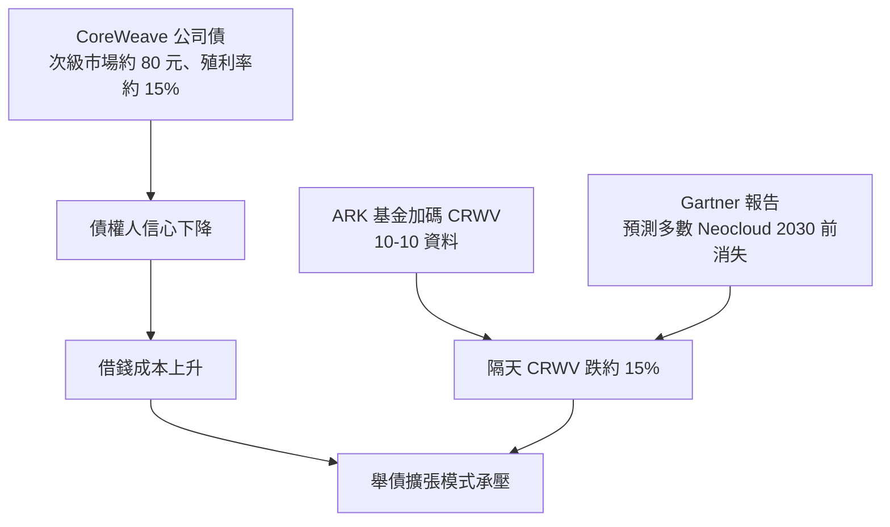
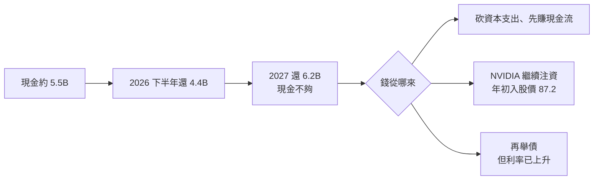

# CoreWeave 跌 50%:Neocloud「十倍股」的債務壓力測試(2026-10)

> 整理自 YouTube 頻道 **Nick 美股咖啡館**〈[投資人公認最具「十倍潛力」的股票:暴跌50%後機會真的來了?!](https://www.youtube.com/watch?v=sr3y1-iQ1vI)〉(2026-10-16,約 24 分鐘,官方 zh-TW 字幕)。
>
> ⚠️ **非投資建議。** 作者明言「不會投資 CoreWeave」,偏好 Nebius 或電力股(Constellation Energy)。
>
> ⚠️ **立場揭露**:說明欄附 IB 盈透證券推薦連結(點擊作者可得回饋)與 Seeking Alpha 聯盟連結;作者另販售 Excel 估值模型 / nickvischool 課程。
>
> ⭐ 片中 CoreWeave 財報數字已用 **SEC XBRL(2026-06-30 10-Q)** 逐項核實,見第三節。

---

## 一句話總結

> ⭐⭐⭐ **Neocloud 的成長(backlog 破千億)是真的,問題在資本結構。** CoreWeave 靠舉債買 NVIDIA GPU 再出租:流動負債是流動資產的 2.2 倍,本金到期表一年要還 4–6B,手上現金約 5.5B,本身還在虧錢,客戶(OpenAI、Anthropic)也還沒賺錢。所以它的生存取決於**債市還願不願意借錢**和**NVIDIA 還願不願意輸血**。債市的折價訊號,就是「十倍股」敘事的壓力測試。

---

## 一、Neocloud 是什麼

- **大雲端**(AWS、Google Cloud、Azure):算力加上整套建模、資料、分析服務。
- **Neocloud**(CoreWeave、Nebius 等):**只做一件事**,把 NVIDIA GPU 買來變成算力,租給 OpenAI、Anthropic 這類需求方。
- 正好搭上算力短缺(片中引 Sam Altman「有多少算力全包」),所以被很多人視為最有機會十倍的產業。

---

## 二、為什麼跌 50%:三個觸發點



1. **Gartner 報告**:片中說報告預測 2030 年前會有高比例 Neocloud「蒸發」。邏輯是 2030 年前要回收 AI 資本支出,需要的營收遠高於能賺到的 3.6 兆美元,而且這部分營收大多流向大雲端。⚠️ 報告原文與比例本文**未核實**。
2. **公司債折價**:Microsoft、Amazon、Meta 的債在次級市場約 100 元(面額附近),CoreWeave 的債約 **80 元**,殖利率被推到約 **15%**(原本約 7–8%)。⚠️ 數字出自片中引用的推文,本文**未核實**。
3. **ARK 加碼的反指標效應**:片中用 Cathie Wood 基金五年落後 S&P 500 約 100 個百分點來調侃。這屬於情緒面,不構成分析依據。

> 觀念:**債權人信心直接反映在利率上。** 對照組:片中提到 Hims & Hers 曾發行 0% 可轉債,代表債權人搶著借;CoreWeave 卻要 15% 才有人接手。

---

## 三、財報核實(SEC XBRL,CoreWeave 2026-06-30 10-Q)

| 項目 | 片中說法 | SEC XBRL | 判定 |
|---|---|---|---|
| 流動資產 `AssetsCurrent` | 約 9.5B | **$9.52B** | ✅ |
| 流動負債 `LiabilitiesCurrent` | 字幕不清(約 20B) | **$20.92B** | ✅ 約 2.2 倍於流動資產 |
| 現金 | 約 5B | **$5.52B** | ✅ |
| 本金到期:2026 下半年 | 4.4B | **$4.41B** | ✅ |
| 2027 | 6.1B | $6.18B(XBRL 標記為未來 12 個月) | ✅ |
| 2028 | 4.4B | $4.42B | ✅ |
| 2029 | 2.4B | $2.42B | ✅ |
| 2030 | 3.2B | $3.22B | ✅ |
| 之後 | 約 14.8B | XBRL 未單列 | 未核實(合計約 35B,與片中「35B 本金」相符) |
| 獲利 | 由盈轉虧 | 2026 Q2 淨損 **−$0.63B**,上半年 −$1.37B | ✅ |
| Backlog(RPO) | 去年約 30B,現在超過 100B | 2025-12-31 $60.7B,2026-06-30 **$103.7B** | ✅(超過 100B) |
| 營收成長 | 超過 100% | 2026 Q2 營收 $2.58B | ✅ 量級相符 |
| 資本支出 | 今年 30B 以上 | 上半年 PP&E 支出 **$14.12B** | 量級相符(全年指引未核實) |

> ⚠️ 本金到期表**不含利息**。在債市要求 15% 殖利率的環境下,新借款的利息負擔會再加重。



---

## 四、三個結構性風險(作者觀點)

1. **槓桿開到最大**:舉債 → 買 GPU → 出租;擴張越快,債越多。
2. **客戶自己也沒賺錢**:OpenAI、Anthropic 尚未獲利;片中嘲諷「扣掉研發成本就有賺錢」的說法。如果客戶付款能力出問題,壓力會往上游傳。
3. **算力取得方式可能改變**:大客戶不會永遠被「算力房東」綁住,可能自建資料中心,或和大雲端深度綁定。
4. **NVIDIA 左手賣 GPU、右手給錢**:NVIDIA 是 CoreWeave 大股東。片中稱 NVIDIA 年初加碼的入股價約 $87.2,高於現價約 $61–65。這種「供應商融資」能撐多久,是市場擔心的點(⚠️ 入股價本文未核實)。

---

## 五、作者的替代選擇

| 選項 | 作者理由 | 注意 |
|---|---|---|
| **Nebius(NBIS)** | 流動資產約 4.7B 對流動負債約 1.5B,債務輕得多、業務較分散 | 估值比 CoreWeave 貴(市場給財務體質溢價);有俄羅斯背景,部分投資人有疑慮 |
| **電力股(Constellation Energy, CEG)** | 「算力的盡頭是電力」;算力取得方式可能變,但電力來源短期難替代 | 見 Nick 另一支內部人買股影片(CEG 有董事買入、20 年核電長約) |
| CoreWeave | 仍有十倍可能(算力稀缺) | 作者:「最能幫你賺錢的策略,絕對不是最好的策略」,要衡量自己的血壓 |

---

## 六、應用案例

### 案例 1:用三個數字快速做「高槓桿成長股」體檢

對任何靠舉債擴張的公司(Neocloud、資料中心 REIT、電動車新創),先從 10-Q 拉三個數:
```text
流動比率 = AssetsCurrent / LiabilitiesCurrent        → CRWV 0.46(低於 1 就要追問)
現金覆蓋 = 現金 / 未來 12 個月到期本金               → CRWV 5.52 / 6.18 ≈ 0.9
獲利狀態 = 最近一季 NetIncomeLoss                    → CRWV −0.63B
```
三個都亮紅燈的話,成長故事再好,也要把「融資管道」當成主要風險來監控。上面的數字是用 data.sec.gov 的 companyfacts API 實際拉出來的。

### 案例 2:債市是股市的領先指標

追蹤公司債次級市場價格或 CDS。債價從 100 掉到 80、殖利率翻倍,代表債權人在重新定價違約風險,股價常常還沒完全反映。可以搭配 [[oil-price-pass-through-inflation-checklist]] 第五節的四大雲 vs CoreWeave CDS 對照一起看:個別公司的信用風險有沒有外溢到同業?

### 案例 3:倉位分層

[[memory-50-year-cycle-three-signals]] 的回測顯示,過熱訊號適合用來**縮倉位**,不適合當排除規則。CoreWeave 這類「高成長 + 高槓桿 + 客戶未獲利」的標的,即使看好,也適合放在衛星倉位、設停損或用選擇權限制下檔。不要因為跌 50% 看起來便宜就重壓。

### 案例 4:供應鏈互相綁定的辨識

NVIDIA 同時是供應商、股東與資金來源。這種「互相捆綁」的結構,在 [[ai-capital-web-factions-and-mutual-binding]] 有系統性整理。投資其中一家時,要把整條資金鏈的風險一起算。

---

## 七、批判與補充

- **Backlog 與債務的錯配**:RPO 103.7B 代表未來營收能見度高,但營收要等合約履行才會進來,債務本金卻是固定時點到期。這個**時間錯配**才是核心問題,作者講到了但沒量化。
- Gartner 報告、公司債 80 元與 15% 殖利率、NVIDIA 入股價,本文都**未獨立查證**。
- 作者偏好 CEG 是他的個人選擇。CEG 的估值假設(2029 年合理價約 443)見另一支影片,本文未收錄。
- 相關:[[us-stocks-rate-hike-risk-2026]](升息對高槓桿股的衝擊)。

---

## 來源

- Nick 美股咖啡館〈投資人公認最具「十倍潛力」的股票:暴跌50%後機會真的來了?!〉:https://www.youtube.com/watch?v=sr3y1-iQ1vI(官方 zh-TW 字幕)
- SEC EDGAR XBRL companyfacts — CoreWeave(CIK 0001769628):https://data.sec.gov/api/xbrl/companyfacts/CIK0001769628.json(查詢日 2026-10-19)
- 揭露:說明欄 IB 盈透證券與 Seeking Alpha 為推薦 / 聯盟連結,本文不收錄
