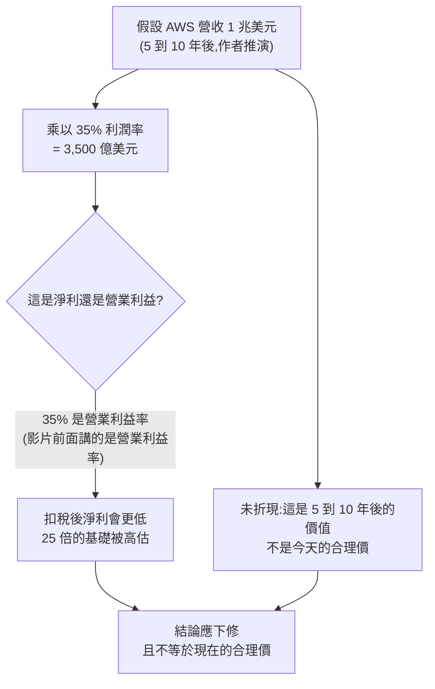

# Google、Amazon 財報後大跌:Nick 的「加碼 15 股」邏輯與我的核實

> 整理自 YouTube「Nick 美股咖啡館」〈最擔心的還是來了!Google, Amazon 財報裂開暴跌:認真考慮賣出?|澳洲旅居要花多少錢?〉(2026-11-01,約 17 分鐘,影片 ID `FOmXeN_KQ6s`,官方 zh-TW 字幕)。
>
> **立場與利益聲明:** ① 作者**自述持有** Google 與 Amazon,並在影片所述的財報後各加碼 15 股,**有利益關係**;② 說明欄與片尾固定導流盈透證券(IB)推薦連結,片尾請觀眾「有收穫再點」當作贊助;③ 他另外販售估值模型與課程。以下只整理公開論點,並獨立核實數字。
>
> **⚠️ 非投資建議。** 作者本人也在片尾說明不是要說服任何人買或賣。

---

## 一句話總結

作者的主張:**Google 與 Amazon 的下跌是「市場擔心」而非「基本面壞掉」,他認為長期仍被低估所以加碼;若連投資這類頂級公司都睡不著,就該買大盤。** 我的核實:事實面大多站得住腳,但他給 Amazon 的「AWS 一兆營收 → 市值超過十兆」估值推演有兩處算法問題(見第 3 節)。

---

## 1. Google:搜尋營收增長不如預期,是 AI 模式在稀釋變現嗎?

| 作者說法 | 核實 |
|---|---|
| 搜尋營收「只成長 12%」,未達標 | **屬實**:2026 年第三季 Google 搜尋營收約 633.5 億美元,年增 12%,但與上一季大致持平 |
| 搜尋**量**創歷史新高,但營收沒跟上,因為很多人改用「AI 模式」 | **管理層有承認**:商務長 Schindler 說 AI Mode 的變現低於傳統搜尋,是營收成長慢於查詢量的原因之一。**但管理層沒有給差距數字,也沒說相對什麼基準**。Pichai 說 AI Mode 查詢平均長度約為傳統搜尋的 3 倍 |
| 「這批人沒流失,只是模式改變,只要把這批人變現就好」 | 這是**作者的信念**。管理層的說法與之呼應(多數 AI Mode 查詢是增量、正在擴大 AI Overviews/AI Mode 廣告;Schindler 稱贊助項目點擊率與自然結果相當),但能不能追平傳統搜尋的變現,**目前沒有數據證明** |
| 雲端成長遠超預期,「三位數」 | **屬實**:雲端營收約 307 億美元,年增約 103% |
| 自由現金流連兩季下跌 | **方向屬實**:本季單季資本支出約 514 億美元,自由現金流約 −91 億美元(轉負) |
| 本益比十年新低 | **未能核實** |
| 財報後「跌 10%」 | 取決於口徑:盤後約 8–10%;**10/29 收盤跌幅有報導為 12.6%**。另一個口徑差異:EPS 約 2.12 美元,低於預期,受股權投資損失約 87 億美元影響 |

> 這也修正了我另一篇(美投君)筆記裡我先前引用的跌幅,見該篇的更正段。

---

## 2. Amazon:作者說「反而都是好消息」

| 作者說法 | 核實 |
|---|---|
| AWS 2027、2028 年營收成長率「40% 朝上」 | **屬實**:Jassy 指引 AWS 2027、2028 年成長率皆超過 40% |
| 第三季 AWS 成長是近年最快 | 核實:AWS 營收約 459.8 億美元,年增 39%,近五年最快;未完成訂單約 5,780 億美元,是去年同期的兩倍以上 |
| AWS 利潤率「三十幾%、逼近 40%」 | **未能核實**(本次查到的來源沒有分部營業利潤率) |
| 股價為何跌? | 影片沒講清楚。查到的是:**資本支出**—Amazon 說 2027 年資本支出「顯著高於」2026 年約 2,200 億美元;另有 EPS 依口徑可能略低於預期。盤後約跌 7%(各來源說法不一) |
| 目前市值約 2.5–2.6 兆美元 | **未能核實** |
| AWS「5 到 10 年內營收突破 1 兆美元」 | **未能核實**,看起來是作者的推演,不是官方指引 |

---

## 3. 作者的估值推演,兩處要小心

作者算法:AWS 營收達 1 兆美元 × 35% 利潤率 = 3,500 億美元「淨利」× 25 倍本益比 = 8~9 兆美元,所以 Amazon 市值「絕對超過十兆」。

1. **混用了營業利益與淨利:** 影片前面說的是 AWS「operating margin」逼近 40%,算式卻直接把 35% 乘出來的數字當成「淨利」。營業利益要先扣稅才是淨利。
2. **沒有折現:** 5 到 10 年後的市值,不能直接等同「現在的合理價」。作者算的是未來的終點價值,要拿回今天比較需要折現,也需要考慮增發股數與資本支出。
3. 另外前提(1 兆營收)本身未獲官方確認。

結論:這是一個「樂觀情境的粗估」,有助於理解他的信念,但不該當作估值。

---

## 4. 方法論:「睡不著就買大盤」

作者的實用規則:**若投資 Google、Amazon 這類全球最賺錢的公司都會讓你因單季財報下跌 10% 而睡不著,就不該買個股,買大盤。** 邏輯是個股風險遠高於大盤;他覺得買 SoFi、Nubank 這類小型股睡不著情有可原。

### 應用案例

- 持股前先問自己:「這檔下跌 20%,我會不會被迫賣出?」若會,倉位過大或該改買指數。
- 他的操作紀律:澳洲時區半夜才開盤,所以**不盯盤**,財報後想清楚理由再下單,各加碼 15 股(小額分批,屬作者個人部位,非建議)。

---

## 附:前半段的「旅居花費」(生活雜談,僅摘要)

- 作者自述在墨爾本一個月含機票共約 NT$235,100(長途搭商務艙,單程近 NT$10 萬;身高 187 公分;短途搭最便宜經濟艙;住獨立 Airbnb)。
- 他用複利算:若不花這筆錢而是投入 S&P 500,年化 10%、到 65 歲約變成 NT$800 萬,所以他說「不是虧 23 萬而是虧 800 萬」。**10% 年化是歷史名目報酬的粗略假設,不是保證。**
- 他的觀點:二十幾歲的 23 萬價值遠高於七十幾歲時的 23 萬(呼應《Die with Zero》);旅居最大收穫是人際連結,並說旅居不是長期常態、「流浪不是終點」。

---

## 字幕還原

字幕整體清楚,少量用詞:「貴夭」→ 辛苦/累人(指半夜才開盤);「趴」= %;「馬西臭嘎並軌」為無法辨識的口語,不影響內容。沒有股票名稱需要送查。

## 來源

- Nick 美股咖啡館〈最擔心的還是來了!Google, Amazon 財報裂開暴跌…〉https://www.youtube.com/watch?v=FOmXeN_KQ6s (官方 zh-TW 字幕)
- Alphabet 第三季搜尋營收與 AI Mode 變現:https://www.relevantaudience.com/google-ads-en/alphabet-q3-2026-search-revenue-ai-mode-monetization/ ;https://tech-insider.org/google-ai-mode-lower-monetization-ads-search-63-4b-2026/
- Alphabet 財報股價反應與雲端、資本支出:https://www.xtb.com/en/market-analysis/alphabet-disappoints-wall-street-despite-record-results-shares-plunge-over-8-and-test-300 ;https://pasqualepillitteri.it/en/news/28390/alphabet-stock-falls-12-6-ai-mode
- Amazon 第三季:https://aiweekly.co/alerts/amazons-aws-growth-hits-39-in-q3-as-capex-guide-jolts-stock ;https://www.constellationr.com/insights/news/aws-q3-revenue-growth-surges-39-capex-stings-amazons-cash-flow

> 數字均來自二手媒體整理,**沒有直接讀 SEC 8-K 與財報新聞稿**(本次未取得);下單前請對照 Alphabet 與 Amazon 的 IR 官方發布。⚠️ 非投資建議。
