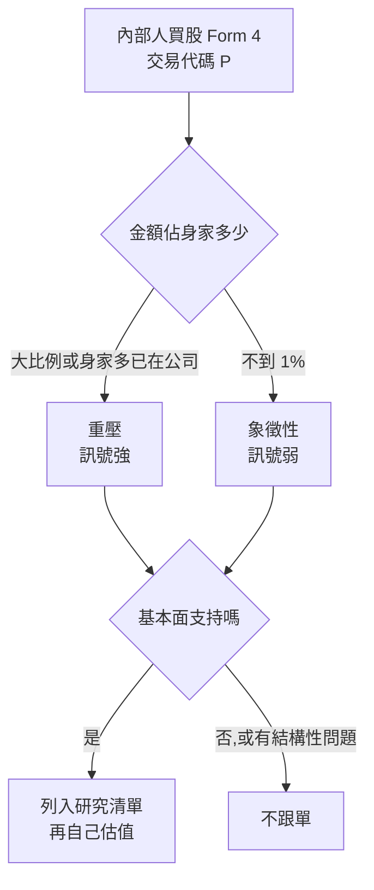

# 內部人買股是訊號不是保證:五家公司的 Form 4 實查(2026-10)

> 整理自 YouTube 頻道 **Nick 美股咖啡館**〈[內部人士正在默默炒底!大舉買入「這五家」公司:準備暴漲?](https://www.youtube.com/watch?v=6Nyqv3XZ-ek)〉(2026-10-06,約 26 分鐘,官方 zh-TW 字幕)。
>
> ⚠️ **非投資建議。** ⚠️ **利益揭露**:作者自述**持有 SoFi(並跟著加碼)與 Grab**,曾持有 Celsius(七個月前約 50 多元賣出、獲利約 73%)。
>
> ⚠️ **立場揭露**:片頭與片尾都在推廣 IB 盈透證券推薦連結(點擊作者可得回饋);說明欄另售 Excel 估值模型。
>
> ⭐ 五家公司的內部人買入,全部已用 **SEC EDGAR Form 4 原始申報**逐筆核實(第三節)。

---

## 一句話總結

> ⭐⭐⭐ **「They know something we don't」的重點是:你還是不知道。** 內部人買股只代表管理層有信心,不代表公司會成功(Intel 前 CEO、Nike CEO 都大買,股價照跌)。判讀時要看兩件事:**買入金額佔他身家多少**(信念強度),以及**基本面有沒有跟上那份信心**。

---

## 一、判讀框架



- **賣股的雜訊多**:嫁妝、買房、繳稅都可能是理由。**買股的訊號比較乾淨**,通常代表「我有信心」。
- **反例**:Intel 前任 CEO 上任時大買,2024–2025 年股價重挫;Nike CEO 每季都買,股價從約 100 元跌到約 30 元。
- **只買很小的金額,不構成訊號**。要看買入佔身家的比例。

---

## 二、五家公司

### 1. Celsius(CELH):有買,但不重壓

- CEO John Fieldly 5/22 與 9/10 兩次買入,合計約 $743K,作者估計不到他身家的 1%。而且他有在高點大量賣股的「黑歷史」。
- 股價一年跌 50% 以上。原因是主品牌 Celsius 銷量疲弱,靠收購的品牌撐場。另外 Alani Nu 要進入 PepsiCo 經銷系統:營收是在 Pepsi 進貨時認列,不是賣給終端時認列,所以會出現「有一季沒一季」的波動,當年 Celsius 本身就是這樣跌的。
- 估值處在歷史低點(片中 P/OCF 約 13 倍)。但作者認為**便宜有理由**,不買。

### 2. Constellation Energy(CEG):本集主角

- 一位董事買入。
- **邏輯類比 Micron**:Micron 因為 HBM 長約讓記憶體從「有一陣沒一陣」變成有定價權,市場改變了幫它定價的方式。電力也一樣:過去離峰時甚至要**貼錢賣電**(負電價),現在和 Amazon、Meta、Microsoft 簽 **20 年核電長約**。
- 公司指引:2029 年前 EPS 年增約 13%(字幕不清),之後 10% 以上;2028+2029 自由現金流合計約 12B。
- 作者 DCF:假設 2029 年 FCF 約 7B,之後三年 10% 成長,得出 2029 年合理價約 **$443**,相對約 $250 的股價有約 72% 上檔(三年)。⚠️ 這是作者的假設,本文未驗算。

### 3. Uber(UBER):CEO 大手筆,但不確定性高

- CEO Dara Khosrowshahi 9/10 買入約 **$10M**。
- 股價一年跌約 30%。主因是 Waymo 合約 2028 年到期後高機率自立 app,市場擔心 Robotaxi 讓 Uber 被繞過。
- 作者看法:如果 Robotaxi 業者各自開 app,會陷入削價競爭,整個產業利潤率受損;如果走合作路線,Uber 的通路價值還在。Uber 也在擴張訂房業務,CEO 是前 Expedia CEO。估值約 13 倍 P/OCF,但不確定性高,作者不急著買。

### 4. SoFi(SOFI):身家已在公司、繼續加碼

- CEO Anthony Noto 2026 年持續買入。作者強調:Noto 身家約 80% 已經在 SoFi,再加碼代表**更重壓**。這和 Celsius CEO 同樣買約 750K、卻只佔身家一小部分,意義完全不同。
- 股價一年跌約 48%,作者歸因於升息預期。片中說 10 月升息機率從 70% 降到 18%。
- 作者粗估:今年 EPS 約 $0.6,營收成長約 40%,保守給 30 倍本益比,合理價約 $18(片中股價約 $15.77)。**作者已跟著加碼。**

### 5. Grab(GRAB):最大手筆

- CEO Anthony Tan 買入約 **$30M**,是五家中金額最大、佔身家比例也最高的。
- 隔天在公司聚會上說「I have put my money where my mouth is」。
- 作者仍持有並看好(股價約 $3 以下)。但他列出反面論點:密集收購可能整合不良;實體店營收拉低平台的比重。
- 插曲:GoTo 股價自 9/25 起約一個月跌 40% 多。作者推測是市場認為 Grab 收購太多家、沒錢併購 GoTo 了(推測,未核實)。

---

## 三、Form 4 實查(SEC EDGAR,交易代碼 P = 公開市場買入)

| 公司 | 內部人 | 交易日 | 股數 | 均價 | 金額 | 片中說法 | 判定 |
|---|---|---|---|---|---|---|---|
| CELH | John Fieldly(CEO) | 2026-05-22 | 8,475 | $29.36 | **$249K** | 250K | ✅ |
| CELH | John Fieldly(CEO) | 2026-09-10 | 18,000 | $27.44 | **$494K** | 約 500K,合計約 750K | ✅ 合計 $743K |
| CEG | Roger W. Crandall(董事) | 2026-08-11 | 1,500 | $278.62 | **$418K** | 一位董事 | ✅ |
| UBER | Dara Khosrowshahi(CEO) | 2026-09-10 | 141,000 | $70.96 | **$10.0M** | 約 10M | ✅ |
| SOFI | Anthony Noto(CEO) | 2026-05-08 / 05-11 / 06-16 | 15,878 / 15,545 / 13,888 | 約 $15.7–18.1 | **$250K + $249K + $251K = $750K** | Q2 約 750K | ✅ |
| GRAB | Anthony Tan(CEO) | 2026-09-21 | 10,350,000 | $2.89 | **$29.9M** | 30M | ✅ |

**片中沒講、但 Form 4 查得到的**(補正):

- **Celsius 不只 CEO 在買**:董事 Damon DeSantis 9/14–15 買約 $1.0M(兩筆合計),董事 Hal Kravitz 5/22 約 $250K、9/15 約 $336K,President & COO Eric Hanson 5/21 約 $218K。**多位內部人同時買**,訊號比片中描述的「只有 CEO 象徵性買」更強一些。
- **SoFi CEO 第一季買得更多**:3/2 約 $1.0M、3/17 約 $501K。2026 年累計約 $2.25M。
- **Uber**:同期另一位高管 Andrew Macdonald 9/4 買約 $5.3M(兩筆合計)。
- **Grab**:同日 President & COO Alexander Hungate 也買了約 $867K。Grab 雖是外國發行人,但有自願申報 Form 4。
- **CEG 的交易價是 $278.6**,高於片中估值所用的約 $250 股價(錄影時股價已回落)。

---

## 四、應用案例

### 案例 1:自己拉 Form 4(免費、一手)

```python
# data.sec.gov submissions API → 每筆 Form 4 XML → 篩 transactionCode == "P"
url = f"https://data.sec.gov/submissions/CIK{cik:010d}.json"   # 需帶 User-Agent(含聯絡 email)
# 每筆 accession 的 XML:https://www.sec.gov/Archives/edgar/data/{cik}/{acc}/{doc}.xml
# 解析 <nonDerivativeTransaction>:transactionCode / transactionShares / transactionPricePerShare
```
本文第三節就是用這個流程跑出來的。⚠️ 交易代碼 **P** 才是公開市場自掏腰包買入;**A**(獎酬授予)、**M**(行使選擇權)不算訊號。

### 案例 2:「信念強度」評分

| 指標 | 弱 | 強 |
|---|---|---|
| 金額 / 身家 | 不到 1% | 大比例,或身家已大半在公司 |
| 人數 | 只有一人 | 多位高管、董事同期買(cluster buying) |
| 時點 | 股價創高時 | 大跌後、利空出盡時 |
| 頻率 | 每季固定(如 Nike CEO) | 罕見的一次性重壓 |

Celsius 依第三節補正後,從「一人象徵性買」升級為「多人同期買」。這正是自己查 Form 4 的價值。

### 案例 3:接到研究流程

把「近 90 天有 cluster buying(交易代碼 P,大於等於 2 人)」當成**候選清單的入口篩選**。之後仍然要走 [[ai-agent-skill-stock-research-workflow]] 的同層比較、財報細項、估值與 Playbook 流程,不要直接跟單。

### 案例 4:CEG 的「定價方式改變」邏輯可遷移

找「商品化 → 長約化」的公司:原本景氣循環、價格波動大,因為 AI 需求簽下長約而有了營收能見度,例如記憶體(HBM)和核電。這類公司的估值方法可能從「循環股 P/B」轉成「DCF」,重新定價空間大。但要和 [[memory-50-year-cycle-three-signals]] 一起看:長約能不能真的熬過下一次循環?

---

## 五、批判與補充

- **倖存者偏差**:內部人買股之後大漲的案例常被傳頌,買了之後照跌的(Intel、Nike)較少被提。作者主動舉反例,值得肯定。
- **作者持倉**:SoFi 與 Grab 段落是持有者觀點,反面論點雖有列出,仍要打折看。
- 作者對 SoFi 的「40% 成長配 30 倍本益比」是粗估。CEG 的 $443 合理價依賴公司指引與作者自設的成長率。
- 相關:[[coreweave-neocloud-debt-stress]](同作者認為「算力的盡頭是電力」,偏好 CEG)。

---

## 來源

- Nick 美股咖啡館〈內部人士正在默默炒底!大舉買入「這五家」公司:準備暴漲?〉:https://www.youtube.com/watch?v=6Nyqv3XZ-ek(官方 zh-TW 字幕)
- SEC EDGAR submissions API(查詢日 2026-10-19):
  - Celsius:https://data.sec.gov/submissions/CIK0001341766.json
  - Constellation Energy:https://data.sec.gov/submissions/CIK0001868275.json
  - Uber:https://data.sec.gov/submissions/CIK0001543151.json
  - SoFi:https://data.sec.gov/submissions/CIK0001818874.json
  - Grab:https://data.sec.gov/submissions/CIK0001855612.json
- 揭露:說明欄 IB 盈透證券為推薦連結,本文不收錄
