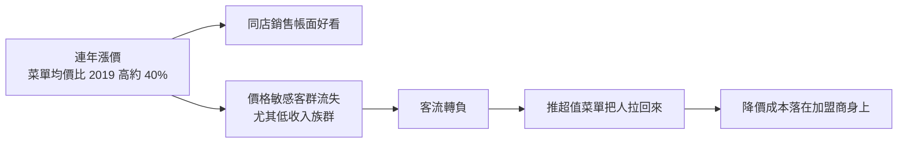
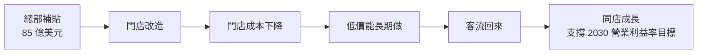
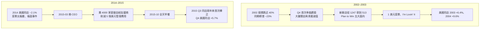

# 麥當勞跌三成是一生一次的機會嗎?客流、加盟商與兩次歷史翻身

> 整理自 YouTube 頻道 **美投君 / 美投讲美股**〈[最稳的麦当劳跌了30%？一生一次的买入机会？没看懂这点，先别急着抄底！](https://www.youtube.com/watch?v=PQj7cB4sqG4)〉(2026-10-25,約 20 分鐘)。
>
> ⚠️ **立場揭露**:
> - 片頭自述作者回國探親,**本片使用 AI 合成聲音**,內容是先前在付費平台「美投 Pro」發布的個股研究轉貼。
> - 07:00–08:00 與片尾是**「美投選股訓練營」(US$19.99)的招生廣告**;說明欄另推「美投 Pro」付費訂閱。本筆記不收錄廣告內容。
> - 作者對麥當勞的結論是「短期不宜大倉位、長期有信心、可建小觀察倉」,屬作者個人觀點。
>
> ⚠️ **非投資建議。** 本文僅整理影片論點並核對公開數據,不構成買賣任何證券的建議。

---

## 一句話總結

麥當勞這輪下跌不是「防禦股被錯殺」,而是**美國客流長期靠漲價撐、自己還輸給同業**,再加上**殖利率被無風險利率超過**。公司在 2026-09-23 投資人日拿出 **85 億美元補貼加盟商**做門店改造,方向合理,但成本從 2027 年進財報、回本要等到 2030 年前後。作者對照 2003 和 2015 兩次翻身:**股價真正的大漲都跟著「美國同店轉正」一起來**,所以建議等客流確認回升再加碼。

---

## 一、跌了多少

| 時點 | 收盤價(Yahoo Finance) |
|---|---|
| 歷史高點 2026-02-27 | **US$341.06** |
| 投資人日前一天 09-22 | US$250.35 |
| 投資人日 09-23 | US$238.32(**−4.8%**) |
| 一年低點 10-07 | **US$230.88** |
| 本片上傳前最後交易日 10-23 | US$248.46 |

- 高點到低點約 **−32%**;到 10-23 約 **−27%**。
- ⚠️ 影片說「從 2 月底約 335 跌到 235、天天創 52 週新低」:高點實際約 341;而且 10 月中以後已從低點反彈約 7–8%。**影片內容是較早在美投 Pro 發布的,價格描述有時差。**

---

## 二、問題出在美國,不在國際

影片先說明:國際業務收入約占六成、美國約四成,但**國際市場穩、美國出狀況**,所以主要分析美國。

**2026 年 Q2 同店銷售(官方財報,2026-08-04):**

| 板塊 | 同店銷售 |
|---|---|
| 美國 | **+0.8%** |
| 國際直營市場(IOM) | +1.5% |
| 國際授權發展市場(IDL) | +1.9% |
| 全球 | +1.3% |

⚠️ 字幕在 02:05 說美國 Q2「−0.8%」,05:53 又說「增長 0.8%」;**官方數字是 +0.8%**,而且是**客單價上升、來客數下降**。

> 「同店銷售」只算開業滿 13 個月的門店,排除新開店的貢獻,最能反映門店本身生意好壞。

---

## 三、量比價重要:麥當勞的客流是靠漲價撐的

作者的框架(先前分析星巴克時提過):品牌最終落在**量和價**兩個指標上,而**量比價重要得多**:

1. 價格公司自己能決定,量是市場決定的。
2. 量的增長會帶來長期複利,漲價通常只有一次性效果。

**麥當勞美國的軌跡(影片數字):**

- 2022、2023 年每年漲價約 10%,客流只小幅成長,2022 Q1 甚至是負的。
- 到 2024 年,菜單均價比 2019 年高約 40%。
- 2023 Q3 客流轉負,之後同店一路放緩;2024 Q2 出現疫情後第一次同店下滑;2025 Q1 跌到 −3.6%。
- 最近 10 季客流為正的只有兩季,而且一次靠 5 美元套餐(客單價下降換來),一次靠大型行銷活動。**還沒出現靠產品本身帶來的自然回升。**

### 不只麥當勞,整個快餐業都這樣

- 影片引用 Black Box 的產業數據:美國快餐業 2019 年與 2022–2025 年每年客流都是負的;2026 年 Q1 客流 −1.4%,4–8 月每月約 −1.3% 到 −2.4%。
- 管理層自己也說:只要通膨還在高位,產業客流就很難成長。(CEO Chris Kempczinski 在投資人日的說法是:**預期自營市場的產業客流在通膨高企期間持平**。)

### 但有同業在搶客

| 連鎖(最近一季客流) | 影片數字 |
|---|---|
| CAVA | +5.3% |
| 星巴克美國 | +4.2% |
| Texas Roadhouse | +3.0% |
| Dutch Bros | +1.7% |
| Chipotle | +1.0%(剛轉正) |
| **Wendy's** | **客流 −12.5%、客單價 +5.6%、同店 −7.0%** |

✅ Wendy's 三個數字與其 2026 Q2 財報一致。其他同業數字本筆記未逐一核對。

**作者的判斷**:產業環境確實差,但**麥當勞自己也沒跑贏同業、沒搶到份額**,這才是市場不滿的地方。以前給麥當勞高估值,是相信它在任何環境都能比同行做得好,現在這點被質疑。

### 宏觀壓力:殖利率被無風險利率超過

- 麥當勞一向被當成類債券的防禦股,目前股息率約 3.3%,**已低於 10 年期美債殖利率**,估值自然被壓縮。
- 影片說 10 年期美債 9 月底約 5.2%、10-08 盤中一度 5.35%。⚠️ 本筆記只查到 10-01 收盤 5.24%,10-08 的數字未能核實。

---

## 四、麥當勞的解法:85 億美元補貼加盟商

**問題鏈:**

1. 推出更便宜的超值菜單(含 3 美元以下產品)把客流拉回來。
2. 要長期做低價,門店成本就得降 ⇒ 推新一輪門店改造(新廚房設計、得來速車道、AI 營運系統)。
3. 但**麥當勞約 95% 是加盟店**。超值菜單的降價成本、今年 1 月起統一定價的新加盟標準、上漲的食材成本,**都壓在加盟商身上**。
4. 加盟商沒錢,改造又要加盟商出錢 ⇒ 改造推不動。

**加盟商的處境(加盟商組織 NOA 的調查):**

- ✅ 95% 說 2026 Q1 門店利潤下降。
- ✅ 近八成說現金流不夠支撐必要的再投資。
- 報導另提到:97% 說目前的計畫沒有改善現金流;除 3% 外都說定價權被削弱或取消。

**投資人日(2026-09-23)的方案:**

| 項目 | 內容 |
|---|---|
| 總額 | 到 2036 年約 **85 億美元**加盟商支持 |
| 2030 年前 | 約 **50 億美元**(影片:其中 15–20 億直接出資改造、30–35 億為減租與裝修補貼) |
| 加盟商回本 | 算上補貼約 **4 年** |
| 每家美國門店 | 改造後每年多出約 10 萬美元現金流(公司估算) |
| 麥當勞自己回本 | CFO 說 **5–6 年**(字幕誤轉為「75 到 6 年」) |

### 市場為什麼不買帳

1. **短期利潤放緩**:麥當勞利潤大頭是向加盟商收的租金,這是利潤率最高的收入;減租就是直接少收。補貼從 2027 年陸續落地,影片說 JPMorgan 因此把 2027 年 EPS 預估下修約 9%,預估 2027 年 EPS 只成長 1.8%。
2. **回本慢**:公司自己 5–6 年回本,看到回報要等到 2030 年前後。市場一致預期未來 5 年 EPS 年增只有 5–8%。

✅ JPMorgan 目標價從 280 下調到 260(維持加碼評等);BTIG 從 350 調到 295,BMO、Evercore 也下調。

**作者觀點:這筆錢有必要花。** 加盟商不先渡過難關,超值菜單和改造都推不下去;而同店成長正是 2030 年營業利益率目標最重要的一環。但這 85 億解決的是「加盟商有沒有錢改造」,而且是中長期的事。

---

## 五、估值便宜可能是假象

- 影片:股價大跌後估值來到近 5 年低點,2027 年預估本益比約 17 倍。
- ⭐ **作者的提醒**:如果客流遲遲不回來,市場對業績的預期還會繼續下修。**分母(EPS)變小,本益比就沒有看上去那麼便宜**,下季業績下修後估值反而可能比現在貴。所以現在還不是大倉位買進的時候。

---

## 六、歷史上兩次翻身

**兩次的共同點**:一是收縮門店、把結構理清;二是推出**爆款**把客流帶回來。

**加盟商的態度決定成敗**:

- 2003 年不再讓新店搶老店生意,還派約 900 名營運人員下店幫加盟商,加盟商和總部站在同一邊。
- 2015 年加盟商對總部的評分一度跌到 **1.48 分的歷史低點**(✅ 與 Kalinowski 2015 年調查一致),全天早餐上線時很多加盟商抱怨廚房忙不過來,但產品真的把客人拉回來,加盟商也就接受了。

**對照現在的 NEXT 計畫:**

| 2003 / 2015 做過的 | 2026 的對應 | 狀態 |
|---|---|---|
| 品質與服務(2003) | Make it Golden | 有 |
| 提高加盟比例、壓縮管理費用(2015) | 加盟比例提高到 98% | 有 |
| **把客流拉回來的爆款** | 雞肉、飲料(手工裹粉雞肉還在測試,沒有上線時間) | ❌ 還沒出現 |
| **加盟商配合** | 3 美元以下超值菜單只有 60–65% 門店執行 | ❌ 還沒完全配合 |

### 股價什麼時候真的漲

- **2003**:股價 3 月見底,比美國同店轉正早約兩個月,但那時整個美股也同時見底;真正跑出超額報酬是 5 月同店轉正之後。3 月底到年底麥當勞漲 72%,同期標普約 31%。
- **2015**:新 CEO 上任、公布轉型計畫,股價橫盤整整 7 個月;直到 10 月全天早餐上線、Q3 美國同店兩年來首次轉正,一個月內漲 14%,之後一路走高。

⭐ **結論:市場大概率要先看到客流真正轉正,股價才會有像樣的反轉。**

---

## 七、作者的觀察點與結論

**兩個觀察點:**

1. **11 月初的 Q3 財報**:美國同店會不會比市場預期的約 −1% 更差。
2. **明年初公布的新入門價超值方案**,以及有沒有推出新的雞肉產品。

**情境推演:**

- 明年上半年客流轉正 ⇒ 市場才願意等改造的長期回報。
- 客流還是負的,補貼成本又從 2027 年進財報 ⇒ 股價可能還要繼續承壓一段時間。作者認為**這個可能性比較大**。

**作者結論:**

- 現在不是好的大倉位買點,往上往下的機率差不多,性價比不夠好。
- 更好的時機是等基本面確認反轉,哪怕那時股價已漲了一些,因為賺錢的確定性更高、也不用陪市場熬。
- 長期仍有信心:每個年代都遇過麻煩(90 年代後期擴張過快、2014 年菜單臃腫與食安事件),每次都找到辦法走出來。
- 看好長期價值的話,可以先建**小的觀察倉**慢慢累積。
- 反轉可能比星巴克快:快餐比咖啡更偏日常剛需。歷史上 2003 年拯救計畫後 4 個月同店轉正、2015 年新 CEO 上任約 7 個月轉正;星巴克從 2024-09 換 CEO 到交易量轉正用了一年多。
- 麥當勞的業務幾乎不會被 AI 顛覆,也和 AI 主題無關,**適合想分散、不想全部押在 AI 股上的人**。

---

## 八、應用案例

### 案例 1:用「量價拆解」看任何消費股的同店銷售

情境:某連鎖咖啡公布同店 +3%,要判斷是好是壞。

| 同店 +3% 的組成 | 解讀 |
|---|---|
| 客流 +3%、客單價 0% | 最健康,品牌在搶客 |
| 客流 0%、客單價 +3% | 中性,看漲價能撐多久 |
| **客流 −4%、客單價 +7%** | ⚠️ 帳面成長,但客人在流失;麥當勞 2023–2025 就是這個模式 |

做法:財報新聞稿通常只寫同店銷售,**客流和客單價的拆分常要到法說會或 10-Q 才有**。拆不出來就把「同店好看」打折看待。

### 案例 2:「本益比便宜」先檢查分母會不會變

情境:某股票跌到 2027 年預估本益比 17 倍,近 5 年最低。

- 現價 248、2027 預估 EPS 14.6 ⇒ 本益比約 17 倍。
- 如果下季客流仍負,分析師把 2027 EPS 再下修 10% 到 13.1 ⇒ **同樣股價的本益比變成約 19 倍**。
- 也就是說,股價沒動,估值就從「近 5 年最便宜」變回「普通」。

原則:**基本面還在惡化時,用預估本益比判斷便宜要很小心**;等預估數字止跌再看估值。

(⚠️ 上面的 EPS 是為了示範計算假設的數字,不是實際預估值。)

### 案例 3:轉機股的分批節奏

情境:看好麥當勞長期價值、但同意作者「短期不確定」的判斷,預計投入 10 萬元。

| 時點 | 觸發條件 | 投入 |
|---|---|---|
| 現在 | 建觀察倉 | 1–2 萬 |
| Q3 財報(11 月初) | 美國同店沒有比 −1% 更差 | 再 2 萬 |
| 明年上半年 | **美國客流確認轉正** | 主力 4–5 萬 |
| 未轉正、補貼成本開始拖累 | 不加碼,重新評估 | 0 |

這就是把作者「等基本面確認、就算貴一點也沒關係」的觀點,轉成可執行的條件單。⚠️ 純屬示範,非投資建議。

---

## 九、核實與補正

**✅ 已核實:**

- 股價:2026-02-27 收盤高點 341.06、10-07 收盤低點 230.88、投資人日當天 −4.8%(Yahoo Finance 日線)。
- 2026 Q2 同店:美國 +0.8%、IOM +1.5%、IDL +1.9%、全球 +1.3%(官方財報)。
- 投資人日:到 2036 年 85 億美元、2030 年前約 50 億、加盟商約 4 年回本、CFO 說公司 5–6 年回本、CEO 預期通膨高企期間產業客流持平。
- JPMorgan 目標價 280 調到 260。
- NOA 調查:95% 說 Q1 門店利潤下降、近八成說現金流不夠再投資。
- Wendy's 2026 Q2:美國同店 −7.0%、客流 −12.5%、客單價 +5.6%。
- 2015 年 Kalinowski 加盟商評分 1.48 的歷史低點。
- 10 年期美債 10-01 收盤 5.24%(與影片「9 月底約 5.2%」一致)。

**⚠️ 需補正:**

- 高點是約 341,不是 335;影片「天天創新低」已過時,10-07 低點後已反彈。
- 美國 Q2 同店是 **+0.8%**,字幕前段的「−0.8%」為誤。
- 投資人日當天收盤跌約 4.3–4.8%(盤中一度 −6.5%),影片說「大跌 5%」大致相符。
- **單店改造成本**:影片說傳統得來速店一輪升級約 100 萬美元;加盟商相關報導估計是**每家 40 萬–70 萬美元**。兩者口徑可能不同(是否含車道改建等),本筆記無法判斷,兩個數字並列。

**⚠️ 未能核實:**

- 2026 年 1 月 Kalinowski 調查加盟商評分 1.37(只查到 2015 年的 1.48)。
- 10 年期美債 10-08 盤中 5.35%、股息率約 3.3%。
- JPMorgan 下修 2027 EPS 約 9%、2027 EPS 成長 1.8%、未來 5 年 EPS 年增 5–8%、2027 預估本益比 17 倍。
- Black Box 產業客流數字、CAVA / 星巴克 / Texas Roadhouse / Dutch Bros / Chipotle 的客流數字。
- 50 億美元內「15–20 億直接出資、30–35 億減租補貼」的拆分;每店每年多 10 萬美元現金流。
- 2002–2003 與 2014–2016 的歷史數字(同店、新開店數、EPS 成長率、股價漲幅)為影片引述,本筆記未逐一對照當年財報。

---

## 相關筆記

- [[us-stocks-three-risks-detox-trigger]]:同頻道的美股風險框架,也提到麥當勞。
- [[viking-holdings-river-cruise-moat]]:同頻道另一篇消費股研究,「新聞稿不會寫的風險在法說會」。

---

## 來源

- YouTube:美投君 / 美投讲美股〈最稳的麦当劳跌了30%？一生一次的买入机会？没看懂这点，先别急着抄底！〉 https://www.youtube.com/watch?v=PQj7cB4sqG4 (2026-10-25;片中為 AI 合成聲音,內容轉自美投 Pro;含美投選股訓練營廣告)
  - 該片無字幕,逐字稿以 CPU faster-whisper 轉錄、非官方字幕。
  - 已還原的誤轉:「美肤/肯票/谷票」→ 美股/股票、「铜店/铜电/铌电」→ 同店、「刻流/克刘」→ 客流、「加盐商/加盆商/家门商」→ 加盟商、「国陆/国陌业务」→ 國際業務、「投赃者日」→ 投資人日、「75 到 6 年」→ 5 到 6 年、「Triptle」→ Chipotle、「卡法」→ CAVA、「克林诺斯基」→ Kalinowski、「Planet to Win」→ Plan to Win、「福喜」→ 上海福喜食品(Husi Food)。
- McDonald's,〈McDonald's Reports Second Quarter 2026 Results〉(2026-08-04): https://mcdonalds.mediaroom.com/2026-08-04-McDONALDS-REPORTS-SECOND-QUARTER-2026-RESULTS
- 247 Wall St.,〈McDonald's Falls 4% as Investor Day Sets $8.5B Franchisee Support Plan〉(2026-09-23): https://247wallst.com/investing/2026/09/23/mcdonalds-falls-4-as-investor-day-sets-8-5b-franchisee-support-plan-wendys-dips-yum-brands-holds-steady/
- Capital.com,〈McDonald's falls as CEO warns on weak traffic growth, unveils $8.5 billion franchisee plan〉: https://capital.com/en-au/news/mcdonald-s-falls-as-ceo-warns-on-weak-traffic-growth-unveils
- CoinCentral,〈McDonald's (MCD) stock slides after price target cuts from JPMorgan and BTIG〉: https://coincentral.com/mcdonalds-mcd-stock-slides-after-price-target-cuts-from-jpmorgan-and-btig/
- L'Express Franchise,〈McDonald's franchisees flag falling profits as remodel costs loom〉(NOA 調查): https://lexpress-franchise.com/en-us/news/mcdonalds-franchisees-flag-falling-profits-as-remodel-costs-loom/
- The Wendy's Company,〈Reports Second Quarter 2026 Results〉: https://www.franchising.com/news/20260807_the_wendys_company_reports_second_quarter_2026_results.html
- Yahoo Finance,MCD 歷史股價: https://finance.yahoo.com/quote/MCD/history

> ⚠️ **再次提醒:非投資建議。** 文中的觀點屬影片作者;數字以官方財報與公開報導為準,未核實項目已另列。
