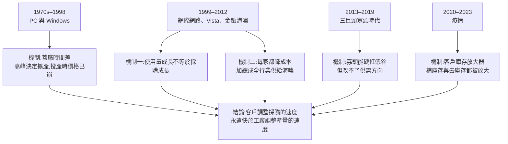
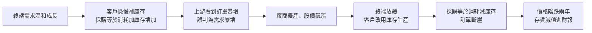
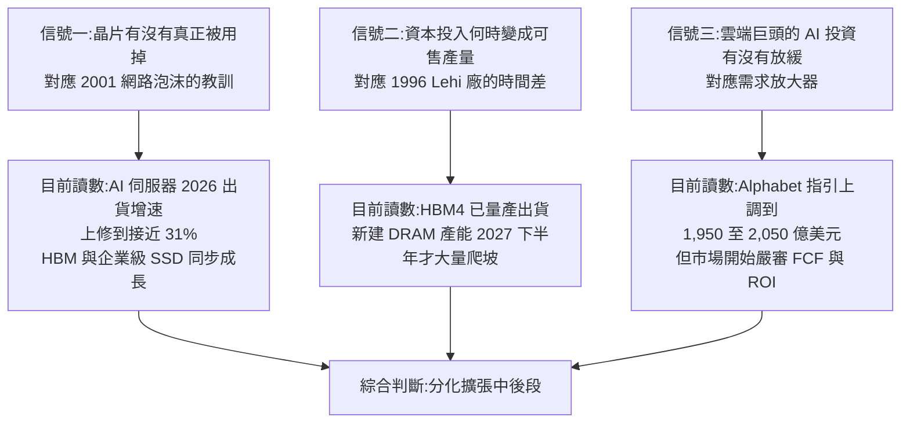
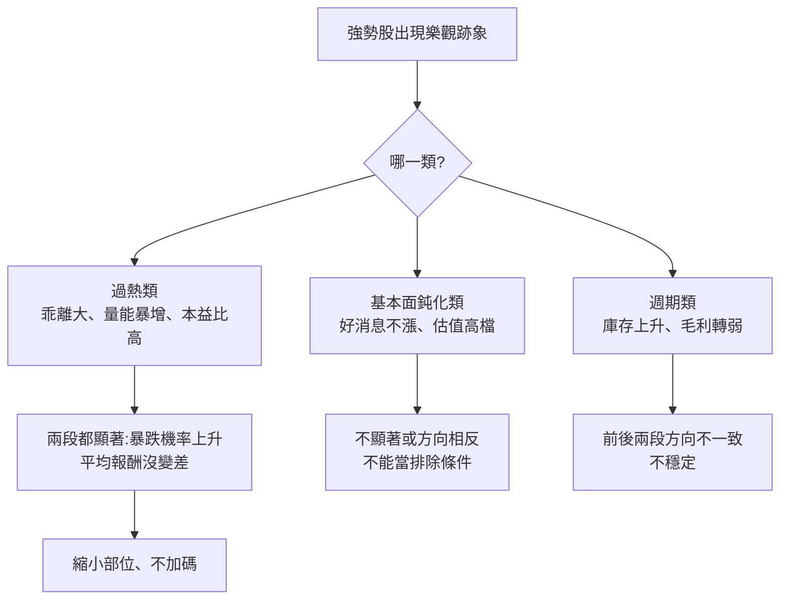

# 記憶體五十年週期覆盤:四次科技革命都沒消滅週期,AI 這輪該盯哪三個信號?

> ⚠️⚠️ **非投資建議。本文為知識整理,不構成任何買賣建議。文中所有數字請自行向官方來源查證。**
>
> 整理自 YouTube 頻道 **TradingKey 美股財經**(主持人 Yuki)〈[記憶體五十年週期覆盤:什麼決定下一次股價轉折?美光如何在繁榮與崩盤之間反覆沉浮?](https://www.youtube.com/watch?v=qANyQLdYC9E)〉(2026-10-17,約 17 分鐘)。逐字稿取自該片官方繁中字幕。
>
> **立場揭露:** TradingKey 是券商資訊平台,說明欄推廣自家 App(App Store / Google Play 下載連結)。影片本身沒有推薦個股或喊單,本文只整理它講的歷史與判斷框架。
>
> **核實狀態:** 2026 年的數字(美光 FY26Q4、TrendForce、Alphabet 資本開支)已比對財報與研究機構公開資料。**抓到兩處要修正:** 美光 FY2023 的 18.31 億美元存貨減值其實是前三季累計,不是全年;Alphabet 資本開支指引字幕寫「2000 美元」,實際是 1,950–2,050 億美元。1980–2001 年的早期報價只有影片單一來源。詳見 §7。
>
> **姊妹篇:** [[memory-cycle-history-1995-2018-vs-ai]](美投君用 1995、2018 兩輪對照這一輪);本文的時間軸更長(1970–2026),而且最後給了一套**可以持續追蹤的三信號**。
>
> **§8 實證檢驗:** 使用者的另一個研究專案用台美股回測檢驗了 §6 案例四的「過度樂觀」徵兆。結果是**只有過熱類跡象穩定有效**,而且它的意思是「縮部位」不是「不買」。
>
> **整理日期:** 2026-10-17

---

## TL;DR

1. **記憶體是標準品。** 同規格的晶片在客戶眼中沒有差別,所以競爭只剩良率、供貨穩定度和單位成本。這是五十年來每一輪暴跌的根源。
2. **四次科技革命(PC、Windows、網際網路、智慧型手機)都真的改變了世界,但沒有一次消滅週期。** 繁榮過後,代表性產品價格每次都跌掉 6 到 9 成。
3. **五堂課,每一堂對應一種把短缺推向過剩的機制:**
   - **蓋廠時間差**(1996 美光 Lehi 廠停工)
   - **「使用量成長」不等於「採購成長」**(2001 網路泡沫)
   - **每一家各自降成本,加總起來就是全行業供給海嘯**(2008)
   - **寡頭化能讓巨頭熬過低谷,但改變不了週期**(2013–2019)
   - **客戶庫存會把訂單訊號放大好幾倍**(2020–2023)
4. **AI 這輪確實有三個新條件:** 需求結構改變、HBM 擠壓傳統 DRAM 產能、終端市場兩極分化。
5. **影片給的三個追蹤信號:**
   - 晶片有沒有真正被用掉
   - 新產能什麼時候變成可賣的產量(關鍵時點是 2027 下半年)
   - 雲端巨頭的資本開支增速有沒有放緩

   作者依目前讀數判斷,這輪處在**「分化擴張中後段」**。
6. **對投資人最重要的一句:** 價格上漲還在推高廠商利潤,但**股票的回報取決於這些成長已經被市場預期了多少**。上一輪美光股價比 DDR4 現貨價早了一年多見底。

---

## 1. 底層規則:記憶體是「標準品」

1970 年 Intel 推出全球第一款商用 DRAM 晶片 **1103**,把電腦記憶體從手工穿線的磁芯時代帶進工業化製造。從這時起,這個行業就確立了一條規則:

> **記憶體是標準品(commodity)。不同廠商生產的同規格產品,客戶幾乎分不出差別。**

所以技術優勢只有一種變現方式:更高的良率、更穩定的供貨、更低的單位成本。沒有品牌溢價,也沒有轉換成本可以保護利潤。

**第一次血洗(1984–1985):** 日本廠商憑精密製造迅速追上。影片說,設備廠商直接採購的 64K DRAM 價格,15 個月內從 **4.16 美元跌到 0.90 美元**,跌幅接近八成。Intel 在 1985 年退出 DRAM,轉向微處理器。

- 其他史料給的起訖價不同:有的說 18 個月內從 3.50 美元跌到 0.35 美元,但方向和量級一致。
- Intel 的告別信寫:「256K DRAM 現在售價不到 3 美元,我們在更高密度的產品上不太可能達到可接受的獲利水準。」退出時,DRAM 只占 Intel 營收不到 5%。

---

## 2. 五次週期,五種把短缺推向過剩的機制

### 2.1 1993–1998:擴產決定在高峰做出,檢驗在投產那天到來

- **1993–1995:** Windows 帶動 PC 普及,每台電腦需要的記憶體容量倍增。DRAM 售價穩定、美光成本持續下降,毛利率大幅改善。
- **1995 財年:** 美光在猶他州 **Lehi** 開工建新晶圓廠,同時把既有工廠全力轉換到 8 吋晶圓。
- **1996 財年:** 既有產線的升級太成功了。晶圓產出 +17%,記憶體 bit 總產量 **+95%**。但這些新供給進入市場時,短缺早已結束:
  - 9 個月內,4Mb DRAM 平均售價跌 **78%**
  - 全行業 16Mb 均價也跌約 **75%**
- **1996 年 8 月:** 美光已為 Lehi 砸下 **6.17 億美元**,工程無限期擱置,錢凍結在在建工程裡。

> **第一課:** 蓋一座廠要好幾年,市場變臉只要幾個月。**短缺時決定的擴產,要等到變成產量的那天才會接受市場檢驗。** 那時需求並沒有消失,電腦也還在普及,只是供給來得更多。

### 2.2 1999–2001:「大家在用網路」與「客戶要買新設備」是兩件事

- **2000 財年:** 電信業者與科技公司搶購伺服器。美光 bit 銷量 **+142%**,64Mb 均價微漲 4%。美光推進製程微縮,英飛凌 Dresden 廠加速導入 12 吋晶圓。
- **轉折:** 網路使用量確實還在成長,但前期集中蓋的機房留下大量效能餘量。業者只要提高既有設備利用率,就能接住新流量,於是放慢擴建。傳到最上游的記憶體廠,就成了**新增訂單斷崖式下滑**。
- **結果:**
  - 128Mb DRAM 報價 11 個月內從 **18 美元跌到 1.8 美元**,跌掉九成
  - 美光 2001 財年 bit 銷量還成長 50%,但每 bit 均價跌 **60%**

> **第二課:** 網路被用得更多,不代表客戶要照原來的速度買新設備。**看終端使用量是不夠的,要看採購量。**

### 2.3 2006–2012:每一家各自理性,加總起來是災難

- **泡沫破裂後:** 為了活下去,所有廠商都靠技術升級降成本:更大的 12 吋晶圓、更先進的微縮製程,讓每片晶圓切出更多晶片。對單一公司,單位成本下降了;**所有人都這麼做時,總供給被推到新高**。
- **2006:** 押寶 Windows Vista 會帶動 PC 記憶體升級潮,提前鎖產能擴產。實際採購遠低於預期,12 吋產線的新產出卻已經湧進市場。
- **2008 金融海嘯:** 終端採購凍結。
  - 美光 2008 財年 DRAM bit 產量 **+70%**、NAND **+350%**
  - DRAM 均價腰斬,NAND 每 bit 售價跌 **65%**
- **代價:**
  - 2009 年德國奇夢達(Qimonda)破產
  - 2012 年日本爾必達(Elpida)申請重整,後被美光收購
- **但廠房不會消失。** 美光接手爾必達廣島廠後,產線照常運轉,市場還是得消化這些產能吐出的每一顆晶片。

> **第三課:** 個體理性(降本)加總成集體非理性(供給過剩)。**破產淘汰的是公司,不是產能。**

### 2.4 2013–2019:只剩三巨頭,還是躲不過

DRAM 集中到 **三星、SK 海力士、美光**,市場開始幻想:「競爭者淘汰光了,是不是終於能穩定賺錢?」

2013–2019 年有兩輪強勁繁榮,但隨後代表性產品價格**都跌了六成以上**:

- **第一輪:** 由減產加需求復甦推動。三星約一年的製程調整完成、25 奈米良率趨穩,SK 海力士也提升新製程良率,合格晶片大量增加。PC 客戶要求降價,合約價轉弱。
- **第二輪:** 由智慧型手機單機容量提升加伺服器暴增推動。2018 年底,資料中心與手機客戶開始消化積壓庫存。三星當季營業利潤年減 29%,產出增速再次跑贏銷售 bit 成長,價格再度腰斬。

> **第四課:** 寡頭化確實改變了一件事:巨頭規模大、資金厚,不再動輒破產或賤賣資產,能靠減產、延後投資、忍受利潤縮水撐過低谷。**但它沒改變週期的核心動力:市場方向仍取決於客戶買多快、廠商產出增加多快。**

### 2.5 2020–2023:客戶庫存是放大器

影片把這段講得最清楚,也最適合直接套用:

> **客戶的採購量 = 當期實際消耗量 + 庫存變化量**

- **2020 補庫存:** 居家辦公、線上教學、雲端服務帶來真實需求,物流受阻與交期拉長又讓科技巨頭陷入斷貨恐慌,開始大量提前下單、建安全庫存。傳到上游的訂單被放大成空前繁榮。DDR4 8Gb 合約均價在 **2021 年 7 月衝到 4.10 美元**。
- **2021 年底轉向去庫存:** 終端需求放緩後,客戶改用倉庫存貨滿足生產,新增採購斷崖。DDR4 顆粒兩年陰跌到 **1.30 美元**,跌 **68%**。
- **減產救不了庫存:** 美光 2022 年 11 月宣布 DRAM 與 NAND 晶圓投入削減 20%。但流水線上的晶片還是要吐出來,成品庫存繼續累積。
- **財務代價:** 美光 2023 財年營收跌 **49.5%**(約 155 億美元),並認列大額存貨減值。影片說「單一財年 18.31 億美元」,但 18.31 億其實是前三季的累計數(見 §7)。

**最值得記住的一個時間差:**

| 事件 | 時間 |
|---|---|
| DDR4 8Gb 合約價高點(4.10 美元) | 2021-07 |
| 美光股價見頂 | 2021 年底到 2022 年 1 月初(約 98 美元) |
| 美光股價觸底 | 2022 年 9 月(年底又測一次,約 48 美元附近) |
| DDR4 價格止跌 | 2023 年深秋 |

股價比產品價格**早了一年多觸底**。等報價止跌、財報轉好才進場,早就錯過了。反過來看,**股價也會在報價仍然強勁時先見頂**。

> **第五課:** 客戶多買時,你感受到的是「幻覺般的強勁成長」。客戶轉頭消化庫存時,你得獨自承擔被放大好幾倍、漫長而痛苦的收縮。

---

## 3. AI 這輪(2023 下半年起):三個真正不同的新條件

作者承認這輪確實不一樣:

1. **需求結構改變:** AI 伺服器對 HBM 與高容量伺服器 DRAM 拉動極強,因為訓練與推論大模型需要更大容量、更高頻寬。
2. **製造資源被擠壓:** HBM 晶片面積大、工序複雜,還要先進堆疊與封裝。
   - TrendForce 估計,到 2026 年底 HBM 會吃掉三大廠約 **22%** 的 DRAM 晶圓投入,卻只貢獻約 **9%** 的 bit 供給。
   - 廠商為了高利潤 HBM,得抽走大量晶圓與工程資源,擠壓傳統 DRAM 產能,把全行業價格推到新高。
   - 美光 **FY26Q4**(截至 2026-09-03)的 DRAM、NAND 價格季增分別約 high-teens 與 30%,營收季增 **31%**(414.6 億美元增至 542.3 億美元)。
3. **終端市場極度分化:** AI 資料中心需求如日中天,但消費端 PC 與手機因為記憶體價格高、終端需求平淡,開始壓縮配置(少裝記憶體)。**全行業成長比以往任何時候都更依賴資料中心持續擴張。**

> 原理細節見 [[hbm-high-bandwidth-memory-principle]](HBM 為什麼吃晶圓)與 [[advanced-packaging-explained]](堆疊與封裝)。

---

## 4. 三個可驗證的追蹤信號

作者的方法論是:不憑空猜未來,而是把五十年的教訓轉成**三個可以持續觀察的信號**。每個信號都對應前面某一堂歷史課:

| 信號 | 要問的問題 | 目前讀數(2026-10) | 轉壞的樣子 |
|---|---|---|---|
| **一、使用** | 客戶買走的晶片有沒有真正被用掉,還是在囤貨? | TrendForce 2026-08 把 2026 年 AI 伺服器出貨增速從 28% 上修到近 31%,SK 海力士 HBM 與企業級 SSD 同步成長。作者據此判斷還有實體基礎建設撐著,不是純粹虛高備貨。 | 出貨成長但部署/上線跟不上;客戶庫存天數上升 |
| **二、產能** | 廠商的資本投入什麼時候真的變成可賣的產量? | 美光、SK 海力士已量產出貨 HBM4;新建 DRAM 產能有意義的爬坡集中在 **2027 下半年**。現在供給偏緊,但新產能進場的壓力已經在遠期看得到。 | 新廠提前投產、良率突破讓 bit 供給跳增 |
| **三、資本開支** | 雲端巨頭的新增 AI 投資有沒有放緩? | Alphabet 2026-07 把全年資本開支指引從 1,800–1,900 億上調到 1,950–2,050 億美元,Meta 也上調。但市場對自由現金流與 AI 投資報酬率的檢視越來越嚴。 | 資本開支**增速**連續放緩(不一定要絕對值下降) |

**作者結論:** 綜合三個信號,目前處在 **「分化擴張中後段」**:

- 價格上漲仍在推高廠商利潤
- 但股票的回報,取決於這些成長**已經被資本市場預期了多少**

---

## 5. 結語:歷史不會重複,但會押韻

PC、網路、智慧型手機、雲端都真的改變了世界,卻沒有一個應用讓記憶體週期消失。繁榮帶來的採購與投資,總會在**不同的時間點**轉化為使用量與產量;等兩者再次相遇,市場環境往往已經變了。

> **技術進步可以改寫晶片架構,改變不了商業運作最底層的規律:客戶調整採購的速度,永遠快於工廠調整產量的速度。**
>
> 今天要驗證的從來不是 AI 有沒有未來,而是**客戶購買的速度能否持續跟上廠商增加產量的速度**。

---

## 6. 應用案例

### 案例一:把三信號做成每季檢查表

假設你持有記憶體類股。每次財報季(美光約在 3、6、9、12 月底公布)與雲端巨頭財報後,填這張表:

| 檢查項 | 資料來源 | 本季 | 上季 | 方向 |
|---|---|---|---|---|
| AI 伺服器出貨預估 | TrendForce 季度更新 | 近 31% | 28% | ↑ |
| 美光庫存天數 | 美光 10-Q 存貨 ÷ 銷貨成本 × 天數 | (自填) | (自填) | |
| 新產能量產時程 | 三大廠法說會 | 2027H2 | 2027H2 | 持平 |
| 四大雲端資本開支**增速** | 各家財報指引 | (自填) | (自填) | |
| DRAM 合約價季增 | TrendForce / DRAMeXchange | (自填) | (自填) | |

**判讀原則:**
- 三項裡**有兩項轉向**,就該降低部位,不要等到價格反轉。
- 2021 年的經驗是,**價格還在漲的時候股價就先見頂了**。

### 案例二:分辨「使用量成長」與「採購量成長」

你看到一則新聞:「ChatGPT 每週活躍用戶又創新高,推論 token 量年增 5 倍。」

先別急著推論「記憶體需求還會暴增」,套用 2001 年的教訓問兩件事:

1. **既有設備還有多少餘量?** 雲端業者可以靠模型量化、批次推論、提高 GPU 利用率,用同樣的硬體服務更多 token。使用量成長 5 倍,不代表採購量也成長 5 倍。
2. **採購量裡有多少是庫存?** 用 `採購量 = 消耗量 + 庫存變化` 拆。如果客戶在缺貨恐慌下提前下單,今天的訂單裡就藏著明天的去庫存。

### 案例三:用庫存放大器估算訂單崖

某雲端客戶每季實際消耗 100 單位 DRAM:

- **恐慌期:** 決定把安全庫存從 1 季提高到 2 季,連續兩季每季多囤 50 單位,採購量 150。上游看到「需求 +50%」。
- **恐慌結束:** 決定回到 1 季安全庫存,用兩季把多囤的 100 單位消化掉,每季採購 100 − 50 = 50。
- **對上游來說:** 訂單從 150 掉到 50,**跌了三分之二**。而終端消耗量從頭到尾都是 100,完全沒變。

這就是 2021–2023 年 DDR4 跌掉 68% 的機制:**需求沒有消失,是庫存在倒流。**

### 案例四:強勢股的「過度樂觀」警訊

這輪美光股價與營收都創新高。直覺上,強勢記憶體股反轉前常出現以下徵兆:

- 營收與毛利仍在創紀錄,但股價對好財報的反應開始鈍化
- 市場敘事轉成「這次不一樣」「週期已死」
- 廠商宣布大幅擴產,或新產能時程提前
- 下游開始壓縮配置。這輪已經看到消費端 PC 與手機在減少記憶體裝機量。

作者「分化擴張中後段」的判斷,就是在提醒:基本面還好,但好消息很可能已經反映在股價裡了。

**但這些徵兆經回測檢驗,多數不能當成排除條件**(見 §8):

- 「好財報不漲」在台股反而偏正。
- 「這次不一樣」、擴產公告沒有資料可測。
- 真正穩定的只有**過熱類跡象**,例如股價高於 60 日線 30% 以上、量能暴增、本益比 40 倍以上。它們讓暴跌機率明顯上升,平均報酬卻沒有變差。

**實務做法:**
- 看到過熱類跡象就**縮小部位、不加碼**,不是不買。
- 高週期產業**別在回檔時低接**。

---

## 7. 數字核實總表

### 已核實

| 說法 | 核實結果 |
|---|---|
| 美光 FY26Q4 營收季增 31% | 414.6 億美元增至 542.3 億美元,季增 30.8% |
| FY26Q4 DRAM、NAND 價格季增近 20%、30% | 管理層描述為 DRAM 均價季增 high-teens、NAND 約 30% |
| TrendForce:2026 年 HBM 占三大廠晶圓投入約 22%、bit 供給約 9% | 二手報導與 technews.tw 一致(以年底產能計) |
| TrendForce 把 2026 年 AI 伺服器出貨增速上修到近 31% | 2026-08-03 由 28% 上修 |
| 美光 FY2023 營收跌 49.5% | 約 155 億美元,年減約 49% |
| 2022 年 11 月美光減產 20% | 正確 |
| Intel 1985 年退出 DRAM | 正確(告別信提到 256K 售價不到 3 美元) |
| 奇夢達 2009 年破產;爾必達 2012 年重整後被美光收購 | 正確 |

### 需修正

| 影片說法 | 修正 |
|---|---|
| 美光「單一財年」認列 18.31 億美元存貨減值 | 18.31 億是 **FY2023 前三季累計**(Q2 單季 14.3 億、Q3 4.01 億);全年數字請查 10-K 的 NRV write-down 表 |
| Alphabet 資本開支指引上調到「2000 美元上下」 | 字幕漏了單位:實為 **1,950–2,050 億美元**(2026-07-22 Q2 財報上調,原為 1,800–1,900 億) |
| 美光股價「2021 年底見頂」 | 大致正確;收盤高點落在 2022 年 1 月初,約 98 美元 |

### 未能獨立核實

只有影片單一來源,未找到原始資料:

- 64K DRAM 4.16 美元跌到 0.90 美元。其他史料給的起訖價不同,例如 3.50 美元跌到 0.35 美元。
- 美光 Lehi 廠累計投入 6.17 億美元。
- 1996 年 4Mb 跌 78%、16Mb 跌 75%。
- 2001 年 128Mb 18 美元跌到 1.8 美元。
- 2008 年美光 DRAM bit +70%、NAND +350%。
- 這些數字很可能出自美光當年的 10-K,但本文沒有逐份比對。

---

## 8. 實證檢驗:哪些「過度樂觀」跡象真的能預警?

> **出處與性質:** 本節是使用者的另一個研究專案 Money_in_My_Pocket(私有 repo,`docs/OVERHEAT.md` 與 `docs/CYCLE.md`,2026-10-17)以本文為起點做的回測。結果是**自家回測,未經同儕審查**,不代表未來。⚠️非投資建議。

### 8.1 方法

- **強勢股:** 流動性股票中,120 日報酬前 10%,而且收盤在 250 日高點 80% 以上。
- **樣本:** 台股 2015–2026、美股 2016–2026。
- **比法:** 同一天的強勢股裡,比「有某跡象」和「沒有」的兩組,看之後:
  - 120 日超額報酬差
  - 120 日內從當天收盤跌 30% 的機率差
- **有效門檻:** 以交易日為單位、Newey-West t。2021 前與 2022 後兩段都 |t| ≥ 2 才算有效。

**基準:** 強勢股本來就容易大跌。120 日內跌 30% 的機率:

| 樣本 | 2021 前 | 2022 後 |
|---|---|---|
| 台股強勢股 | 29% | 30% |
| 台股全市場 | 16% | 16% |
| 美股強勢股 | 21% | 22% |

### 8.2 個股層級結果

數字是「有跡象 − 沒有跡象」的差,格式為 2021 前 / 2022 後,單位是百分點。**粗體** 代表該段 |t| ≥ 2。

| 跡象 | 台股 120 日超額差 | 台股崩跌機率差 | 美股 120 日超額差 | 美股崩跌機率差 |
|---|---|---|---|---|
| 股價高於 60 日線 30% 以上 | +2.0 / −1.9 | **+9.7 / +9.4** | +0.8 / +0.7 | **+17.9 / +20.7** |
| 股價高於 60 日線 50% 以上 | +0.4 / −5.8 | **+15.2 / +13.3** | +4.8 / −2.5 | **+26.0 / +27.0** |
| 20 日均量達 250 日均量 3 倍以上 | +2.0 / −4.6 | **+4.3 / +6.9** | +16 / +4(樣本少) | +5.6 / +14.6 |
| 本益比 40 倍以上(台股) | +2.6 / −0.6 | **+6.0 / +5.6** | — | — |
| 好消息不漲 | **+8.9** / +3.6 | −3.3 / +1.3 | −2.9 / −2.5 | +2.8 / +2.2 |
| 估值在自己 5 年的前 20% | −1.1 / −1.5 | −1.5 / −0.4 | +2.6 / +0.1 | +2.9 / −0.7 |
| 價近高點、RSI 背離 | +0.5 / +2.6 | −1.9 / **−2.4** | −1.7 / −0.7 | **−4.0 / −6.1** |
| 毛利率比去年低、營收仍成長(美股) | — | — | −1.9 / **−6.2** | 0.0 / +2.4 |
| 庫存天數年增 15% 以上(美股) | — | — | **+7.2 / −8.9** | −0.5 / +7.7 |

### 8.3 對照本文的直覺

| 本文的直覺 | 回測結果 |
|---|---|
| 股價會在基本面仍好時先見頂 | ✅ **產業層級成立**:股價領先營收年增,記憶體約 1–4 個月、MLCC 4 個月、CPO 6 個月、矽晶圓 10 個月 |
| 好財報反應鈍化是警訊 | ❌ 台股 2021 前反而顯著偏正(+8.9 個百分點),美股偏負但不顯著 |
| 估值已反映太多 | ❌ 台股強勢股 86% 都在自己 5 年估值前 20%,分不出好壞 |
| 庫存天數上升是警訊(§2.5 庫存放大器) | ⚠️ 美股 2022 後顯著偏負、2021 前卻顯著偏正,方向不穩 |
| 過熱本身就是風險 | ✅ **最穩定的訊號**,但它放大的是波動,不是方向 |
| 「這次不一樣」敘事、擴產公告、雲端資本開支增速 | ❓ 沒有歷史資料,未測 |

**一個反直覺的結果:** 「價近高點但 RSI 背離」在兩個市場都讓暴跌機率**下降**,美股兩段都顯著。常見的「頂背離 = 要反轉」說法,在這組樣本裡不成立。

### 8.4 產業層級:高週期產業別低接

回測依營收年增波動、營收最大回落、過熱後崩跌率,把產業分成高、中、低週期。只用 2021 前資料打分數。

**台股高週期產業:** 貨櫃航運、MLCC、DRAM 與記憶體模組、CPO、砷化鎵、LED、塑化、鋼鐵、紡織聚酯。

**60 日超額報酬**(台股,2021 前 / 2022 後):

| 類別 | 追突破 | 回檔買 |
|---|---|---|
| 高週期 | **+3.4% / +2.1%** | +0.5% / +0.9%(不顯著) |
| 低週期 | **+1.6% / +3.2%** | +0.6% / **+2.2%** |

**題材過熱時追突破**(分組 120 日跑贏大盤 30% 以上):

| 類別 | 分組狀態 | 120 日內跌 30% 的機率 |
|---|---|---|
| 高週期 | 過熱 | 28% / 30% |
| 高週期 | 未過熱 | 13% / 14% |

這呼應本文 §1 的「標準品」規則:同規格、誰都能做的產業,跌下來時沒有護城河撐著,所以**低接沒有優勢,要做就等突破,而且過熱時部位放小**。

### 8.5 限制

- **還沒做逐案比對:** 美光 2018、2021 兩次見頂,以及台股記憶體高點。
- **台股資料:** 季財報只有 2024 起,沒有毛利率、庫存天數的歷史。
- **存活者偏誤:** 美股價格只用今天仍在交易的股票。
- **分群偏差:** 題材分組成員是用今天的分群結果套回過去。

---

## 來源

- YouTube:[記憶體五十年週期覆盤:什麼決定下一次股價轉折?美光如何在繁榮與崩盤之間反覆沉浮?](https://www.youtube.com/watch?v=qANyQLdYC9E)(TradingKey 美股財經,2026-10-17)——逐字稿取自官方繁中字幕
- [Micron Reports Record Fiscal Q4 Revenue Of $54.23 Billion(Pulse 2.0)](https://pulse2.com/micron-reports-record-fiscal-q4-revenue-of-54-23-billion-and-fy2026-revenue-of-133-19-billion/)
- [Micron FY26 Q4 DRAM / NAND pricing analysis(sec-api.io)](https://sec-api.io/insights/micron-technology-mu-financial-and-ratio-analysis-q4-fy2026-results-dram-and-nand-pricing-peer-comparison-and-scenarios-to-fy2029)
- [HBM market tracker 2026(Servnet)](https://www.servnetuk.com/research/hbm-market-tracker-2026)
- [TrendForce:AI reportedly to consume 20% of global DRAM wafer capacity in 2026](https://www.trendforce.com/news/2025/12/26/news-ai-reportedly-to-consume-20-of-global-dram-wafer-capacity-in-2026-hbm-gddr7-lead-demand/)
- [DRAMeXchange Weekly Research:AI server shipment forecast revision](https://dramexchange.com/WeeklyResearch/Post/2/12787.html)
- [AI infrastructure demand pushes Alphabet's 2026 capex guidance to US$205 billion(W.Media)](https://w.media/ai-infrastructure-demand-pushes-alphabets-2026-capex-guidance-to-us-205-billion/)
- [Micron Technology FY2023 Form 10-K(SEC)](https://www.sec.gov/Archives/edgar/data/723125/000072312523000054/mu-20230831.htm)
- [Micron stock has a long road ahead(Motley Fool,2023-06-30)](https://www.fool.com/investing/2023/06/30/micron-stock-has-a-long-road-ahead)
- [Intel and Memory: A History of Exits and a New Bid to Return(TrendForce,2026-08-21)](https://www.trendforce.com/news/2026/08/21/news-intel-and-memory-a-history-of-exits-and-a-new-bid-to-return/)
- [Dynamic random-access memory(Wikipedia)](https://en.wikipedia.org/wiki/Dynamic_random-access_memory)
- §8 回測:使用者的私有研究 repo Money_in_My_Pocket(GitHub `shooter2062424/MoneyDashboard`,未公開)`docs/OVERHEAT.md`、`docs/CYCLE.md`(2026-10-17,commit `965f4d8`)
