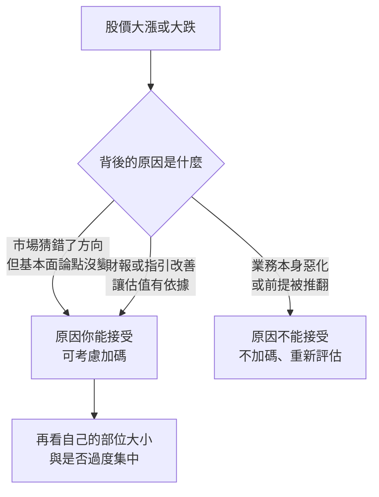

# 巴西大選「猜錯」引發的暴跌:Nu Holdings 為什麼被加碼,以及 SoFi 2026 Q3 財報

> 整理自 YouTube 頻道 **Nick 美股咖啡館**〈[笑死！這絕對是我見過最「瞎」的暴跌法：趁亂買入兩家公司！](https://www.youtube.com/watch?v=R1oLllxY7IQ)〉(2026-10-28,約 22 分鐘,官方繁中字幕)。
>
> ⚠️ **立場揭露**:
> - **作者持有並加碼了片中兩檔(NU、SoFi),有利益關係。** 他自述 10-26 在 NU 盤前約 11 美元加碼 100 股,SoFi 在財報前加碼,並說自己 SoFi 持有成本約 7 美元。
> - 片頭、片尾與說明欄推廣 **IB 盈透證券**推薦連結(每次點擊作者有回饋),本筆記不收錄推廣內容。
> - 作者自述**不是持牌分析師**,片尾聲明「這不是投資建議」。
>
> ⚠️ **非投資建議。** 本文整理影片論點並核對公開數據,不構成買賣建議,請不要因為作者買了什麼就照抄。
>
> ✅ 已核對:SoFi 2026 Q3 財報新聞稿(SEC 8-K)、Yahoo Finance 股價與指數收盤、巴西選前市場報導、Nubank 關於 Desenrola 的公告。官方字幕有多處把外文名稱聽錯,見第八節與待確認清單。

---

## 一句話總結

作者的核心觀點:**股價漲跌本身不是加碼的依據,「漲跌背後的原因」你能不能接受才是。** 他用一個「賭今天供應肋眼、結果上和牛就砸店」的笑話,比喻巴西大選:**市場原本押右派的 Bolsonaro 陣營會贏,結果左派 Lula 險勝,市場因為「猜錯了」而大跌**,但沒有證據顯示 Lula 任內對巴西經濟比較差。他因此在 Nu Holdings 暴跌時加碼,理由是 Lula 的債務重組政策**短期對最大的「窮人銀行」是利多**。另一檔 SoFi 財報大漲,他也小幅加碼,理由是財報給出了 2027 年指引、讓估值有依據。

---

## 一、事件與市場反應(✅ 已用市場數據核對)

選前的市場狀況(巴西媒體選前報導):第二輪投票在 **2026-10-25**,對手是 **Lula(PT)** 與 **Flávio Bolsonaro(PL)**;民調幾乎五五波(有的 Datafolha 各 50%、有的 Flávio 51% 對 49%),**市場資金偏向押 Flávio**,Ibovespa 在選前最後一個交易日還上漲。

⚠️ 影片和字幕多半只說「Bolsonaro」。依選前報導,實際候選人是 **Flávio Bolsonaro**(Jair Bolsonaro 之子)。

| 標的 | 10-23(選前最後一日)收盤 | 10-26 收盤 | 單日 |
|---|---:|---:|---:|
| **Ibovespa(巴西大盤)** | 205,083 | 176,608 | **−13.9%** |
| **NU(Nu Holdings)** | 15.16 美元 | 12.59 美元 | **−17.0%** |
| EWZ(巴西 ETF) | 42.59 | 34.15 | −19.8% |

- 影片說「巴西大盤跌十幾個百分點」✅ 成立(−13.9%)。
- 影片說 NU「盤前暴跌 25%」:收盤跌 17%,15.16 × 0.75 ≈ 11.4,與他說的盤前約 11 美元吻合;**盤前價本筆記沒有逐筆數據**。10-26 NU 成交量約 3.4 億股,是前幾日的 4 到 8 倍。
- 影片說「熔斷機制全部觸發」:本筆記**未核實**。
- 選舉結果本身(Lula 險勝):影片展示 BBC 標題「Lula wins fourth term in dramatic Brazil election comeback」。⚠️ 本筆記無法在搜尋中直接找到賽後報導,但上述大幅下跌與選前「市場押右派」的報導一致。

---

## 二、作者的論點:「沒有證據顯示 Lula 比 Bolsonaro 糟」

他先聲明:**沒有證據顯示左派比較好還是右派比較好**,原本市場猜右派會贏,結果猜錯。分幾點:

### 1. 利率高不是 Lula 造成的

- 作者:左派傾向干預、花錢救濟,市場擔心通膨更嚴重;但巴西利率本來就是全球最高之一,他給的長期圖表顯示過去幾十年常有類似水準。
- 核對:⚠️ 影片提到利率「13%」,**巴西央行 Selic 目前約 14.00%**(2026-08-05 從 14.25% 降息 25 個基點;次級來源,本筆記沒讀到央行公告)。方向(高利率、本來就高)成立,數字稍有出入。

### 2. 歷史表現:Lula 任內股市反而大漲

| 影片說法 | 核對 |
|---|---|
| Lula 第一任(2003–2010)巴西大盤漲約 500% | 方向與量級合理(Ibovespa 指數點數),但**本筆記沒逐年核對** |
| **2023–2026 年這三年大盤漲「六十幾個百分點」** | ✅ 以 2022 年底收盤 109,734 點算,到 10-23 的 205,083 是 +87%,到 **10-26 暴跌後的 176,608 就是 +61%**,與影片「六十幾個」一致,也就是影片是用暴跌後的位置算的 |

### 3. 公司業績也沒被 Lula 搞砸?

作者說 Lula 2023 年上任至今,巴西最大公司之一 Mercado Libre 業績漲 3 倍以上、Nu 的營收與淨利成長 4 倍並由虧轉盈。⚠️ **這一段的數字字幕嚴重錯亂**(「627 million」「2.4/2.5 billion」「297 million」等),**無法還原,列入待確認**。方向(Nu 這幾年營收與獲利大幅成長)合理,但具體倍數不可引用。

> ⚠️ 這個論證的邏輯限制(我的補充):**「Lula 上任後股市與公司業績都成長」不能證明政策好**,因為同期有全球利率週期、Nu 自己的客戶成長等混雜因素。作者的結論只用來反駁「Lula 一定比較差」,不能反過來證明他一定比較好,他自己也一直這樣說。

---

## 三、為什麼他認為 Nu 短期反而受益:債務重組政策

### 巴西的信用狀況(影片說法)

- Lula 上任前,信用違約人口比例 **39.2%**,現在 **58%**,「每兩個人就有一個沒準時還銀行錢」。⚠️ **本筆記沒找到對應數據,未核實**。
- 原因:①利率極高,借了不一定還得起;②制度上可以**「重新談判」**:銀行與政府有機制讓你不還錢後重新談新合約、少還一點(作者認為在台灣與美國難以想像)。

### 債務重組方案(⚠️ 字幕名稱錯亂,依內容推定為 Desenrola)

字幕把方案名稱聽成「底層 ROLLER」「DCR2.0」「鑲嵌 2.0」,**依內容與巴西公開資訊推定指的是 Desenrola(「Novo Desenrola Brasil」)**,**未經你確認,已列待確認清單**。

作者的描述:

| 階段 | 內容 |
|---|---|
| 2.0 | 鼓勵違約者找銀行重新談;銀行折扣可能很大(他說到 98% 折扣、幾乎不用還),**政府不出錢,但若重新借款後又不還,政府補助 Nu**;Nu 是最大參與者之一 |
| 3.0(上個月推出) | 預計約 300 億美元的債務合格,**政府直接出錢買斷這些壞帳** |

**作者的推論:** 欠 Nu 錢的人本來就沒打算還,現在有人接盤壞帳,對 Nu 絕對是好事;而且 Nu 是**巴西最大的「窮人銀行」**(不是最大的銀行),Lula 要照顧的客群自然是還不起錢的人,**Nu 是這些政策最大的受益者**。所以「短期對 Nu 絕對是利多」,長期(十年)他說不確定。

**核對與補充:**

- ✅ Nubank 官方公告:2026-05 確認參與「Novo Desenrola Brasil」;2026-06 公告提供**最高 90%** 的折扣與全數位流程;客戶結清後可能重新啟用信用卡,但須通過 Nubank 內部資格與新的信用評估。巴西媒體報導 Nubank 在 Novo Desenrola 的分期重新協商中居領先地位,針對較低收入的家庭。
- ⚠️ 作者說的「98% 折扣」「3.0 版、約 300 億美元、政府買斷」,本筆記**沒有找到對應來源**,未核實。
- ⭐ **作者沒討論的風險(我的補充):** ①政策變動:受益來自政府方案,延續性與規則不由公司決定;②**道德風險**:作者自己也說「鼓勵不還錢」,若處罰不夠,未來違約誘因上升,會傷害 Nu 的新貸款品質;③政府補助條件(例如重新借款後再違約由政府補助)的細節與期限不明;④本次暴跌也可能包含財政風險與匯率因素(EWZ −19.8% 反映整體巴西資產被賣),不只是 Nu 自己的基本面。

作者承認:**後續財報開出來怎麼樣,到時再談。**

---

## 四、SoFi 2026 Q3 財報:核對表

作者說 SoFi 財報當天(10-27)大漲十幾個百分點。✅ 10-26 收盤 14.46 → 10-27 收盤 **16.40(+13.4%)**,成交量約 1.6 億股,是前幾日的 4 倍。

| 項目 | 影片說法 | SEC 8-K 新聞稿 | 結果 |
|---|---|---|---|
| 調整後淨營收 | 成長 44%,優於預期 | **13.71 億美元,+44%** | ✅ |
| 新增會員 | 單季約 120 萬,破紀錄 | **單季新增 120 萬(紀錄)**,總計 **1,707 萬**,+35% | ✅ |
| Rule of 40 | 來到 79,「IPO 以來最好」 | **連續第 20 季達標,分數 79** | ✅ 79;⚠️「IPO 以來最好」新聞稿沒寫 |
| 2026 全年指引 | 營收成長從 30% 調升到 40% | **調整後淨營收約 50.4 億美元(約 +40%,調升)**、調整後 EBITDA 約 16.6 億(調升) | ✅ 方向;新聞稿摘要沒列「調升前的數字」 |
| 2026 EPS | 0.60 微升到 0.61 | 調整後 EPS 約 **0.61** | ⚠️ 數字吻合;但我取得的摘要寫「未變」,影片寫「微升」,**出入未解** |
| **2027 展望(首次給出)** | 營收 +27%、EPS 0.90 | **調整後淨營收約 64 億(+27%)、調整後 EBITDA 約 22.4 億(35%)、調整後 EPS 約 0.90** | ✅ |
| 放貸 | 表現非常好 | 總發放 **169 億美元(+71% YoY)**,個人貸款 126 億(+69%)、學貸 29 億(+96%)、房貸 14 億(+44%) | ✅ |
| 手續費(fee-based)占比 | 本季 **42%**,低於 2025 年 43%,比例沒再上升 | 手續費收入 5.706 億美元、占總營收 42% | ✅ 42%;⚠️ 前期 43% 新聞稿沒寫,**未核實**。作者的重點:SoFi 的目標是 2028 年過半營收來自手續費,但放貸太強使比例被拉回 |
| 淨沖銷率(收不回來的錢) | 從高點 3.8% 一路滑到 **2.26%** | **個人貸款年化沖銷率 2.26%,YoY 下降 34 個基點** | ✅ 2.26%;⚠️「3.8% 高點」未核實 |

### ⭐ 影片沒講清楚的一點:兩種沖銷率

新聞稿同時列出:

- **回報口徑 2.26%**(影片引用的)。
- **「全包」年化沖銷率約 3.4%**:排除晚期違約貸款出售、並含回收,**比上季改善 30 個基點**(推得上季約 3.7%)。

⇒ 兩個數字口徑不同,**說「收不回來的錢只有 2.26%」會偏樂觀**,比較時要看同口徑的趨勢(兩者都在改善)。

### 作者的觀察

1. **新舊貸款的還款表現**:兩條線比較「早期放出的貸款」與「近年放出的貸款」,新貸款還款比例更好,說明風控模型在進步,差距從上季 172 個基點擴大到 191 個基點,「連續九季」。⚠️ 字幕把比較基準年寫成「2027」(顯然聽錯,應為早期某年),**無法還原,列入待確認**。
2. **指引提高 + 首度給 2027**:作者說前幾季不敢調升指引,這次全面上調。⚠️ 他說明「不敢調升」原因的那句字幕不通順(「林總快要升級」),**無法還原,列入待確認**。
3. **作者看不順眼的一點**:手續費占比沒上升(上表);他拿 Palantir 早年被質疑「只吃政府單」、後來商業端起來類比,認為不會每季都往上,觀察幾季。

---

## 五、估值算術:2027 EPS 0.90 能給多少?

作者:給 30 倍本益比 ⇒ 0.9 × 30 = **27 美元**;就算是銀行只給 25 倍 ⇒ 22.5 美元,**都明顯高於現在的十幾美元**。所以他在財報前稍微加碼。

| 本益比假設 | 2027 調整後 EPS 0.90 | 對比 10-27 收盤 16.40 |
|---|---:|---:|
| 15 倍 | 13.5 美元 | −18% |
| **18.2 倍(目前隱含)** | **16.4 美元** | — |
| 20 倍 | 18.0 美元 | +10% |
| 25 倍 | 22.5 美元 | +37% |
| 30 倍 | 27.0 美元 | +65% |

⚠️ 重要限制:

- 這是**公司自己的調整後(非 GAAP)EPS 指引**,通常不含部分項目(例如股權激勵),且是**預測**。
- 作者的「30 倍」來自他對 SoFi 成長率(約 30%)的主觀判斷。他自己也說銀行不應該有 30 倍。
- 他提醒的邏輯(影片論點,我認為合理但不是保證):SoFi 過去給的指引常偏保守、實際常優於指引,所以 2027 年「+27%」可能最後更高。**這是對過去習性的推論,不是事實。**

---

## 六、核心觀點的整理:原因分類 > 價格方向

作者:「漲或跌不重要,重要的是這個原因。原因你可以接受的話,你才去加碼。」並以兩個相反方向的例子說明:**SoFi 股價漲了他加碼,NU 股價跌了他也加碼。**

⭐ 我的補充(這個框架的盲點):

1. **「原因我能接受」可能只是我願意接受**:要寫下加碼理由,並**寫下什麼情況會證明理由是錯的**。
2. **事件驅動的暴跌常伴隨基本面改變**:這次不只是「猜錯」,而是政策環境(債務重組、財政方向、匯率)真的改變;Nu 的受益是否持續,要看後續財報,作者也這樣說。
3. **集中度**:作者在兩個高波動標的上都加碼,自己持有成本很低(SoFi 約 7 美元)。**同樣動作對成本高或部位大的人風險完全不同。**

---

## 七、應用案例

### 案例 1:用「下跌原因分類表」決定要不要加碼

| 事件 | 原因分類 | 對你原本論點的影響 | 動作 |
|---|---|---|---|
| 大選結果與預期相反,股票暴跌 17% | 市場預期錯誤 + 政策環境改變 | 論點「窮人銀行 + 客戶成長」未被推翻,但**政策受益的持續性不確定** | 小量、分批,並設定下次財報檢查點 |
| 財報顯示新增貸款壞帳率上升,股票跌 15% | 業務惡化 | 論點「風控優於同業」被挑戰 | 不加碼,重新評估 |
| 財報強、指引上調,股票漲 13% | 基本面改善 | 論點被驗證,但價格已反映一部分 | 看估值敏感度,不要因為漲才追 |

### 案例 2:自己做一張 forward EPS 估值敏感度表

1. 找公司給的下一年度 EPS 指引(SoFi:2027 調整後約 0.90)。
2. 列出 15 / 20 / 25 / 30 倍本益比對應的價格(見第五節)。
3. 另外寫下**你認為指引偏高或偏低的機率**,例如:達標 50%、低於指引 30%、高於指引 20%。
4. 算期望價格,與目前價格比較,並**預先決定停損或重新評估的條件**。

### 案例 3:檢查「政策受益型」持股的三個問題

| 問題 | 為什麼重要 | 以 Nu 為例 |
|---|---|---|
| 受益來自**公司能力**還是**政府方案**? | 政府方案可以被調整、取消 | 債務重組:政府方案居多 |
| 方案有沒有**道德風險**,會不會傷害未來資產品質? | 「鼓勵不還錢」可能提高未來違約 | 作者自己也提出懲罰要「適時提高」 |
| 下跌是**公司特有**還是**整體國家風險**? | 後者要看匯率、財政與資金流向,不是靠公司財報能解決 | EWZ −19.8% 顯示整體巴西資產被賣 |

---

## 八、核實與補正

**✅ 已核實:**

- SoFi 2026 Q3:調整後淨營收 +44%、新增會員 120 萬(總 1,707 萬)、Rule of 40 為 79(連續第 20 季)、2026 全年指引(約 50.4 億美元,+40%)、2027 展望(64 億、+27%、EPS 約 0.90)、個人貸款沖銷率 2.26%、手續費占 42%。(SEC 8-K)
- 市場數據:Ibovespa −13.9%、NU −17.0%、EWZ −19.8%(10-26);SoFi +13.4%(10-27)。
- 選前背景:Lula 對 Flávio Bolsonaro、民調五五波、市場押右派。
- Nubank 參與 Novo Desenrola Brasil、折扣最高 90%。

**⚠️ 需補正:**

- 候選人是 **Flávio Bolsonaro**,不是 Jair Bolsonaro 本人。
- Selic 約 **14.00%**,不是 13%。
- 「2.26%」是回報口徑,**全包口徑約 3.4%**,兩者不可混用。
- 2023–2026 巴西大盤「+60 幾%」是以**暴跌後**的位置計算;暴跌前是 +87%。

**⚠️ 未能核實:**

- 選舉結果的賽後報導原文、熔斷觸發、NU 盤前 −25% 的盤前價。
- 信用違約人口 39.2% → 58%、98% 折扣、Desenrola「3.0」與約 300 億美元、政府買斷。
- Nu、Mercado Libre 的營收與淨利倍數(字幕錯亂)。
- Rule of 40「IPO 以來最好」、手續費占比上期 43%、淨沖銷率高點 3.8%、新舊貸款還款差距的基準年份。

**字幕還原**(官方繁中字幕多處聽錯,以下依上下文與公開資訊還原,**推定項已列入待確認**):「Luna / 魯拉」→ Lula;「博索拿」→ Bolsonaro(實為 Flávio Bolsonaro);「New Bay / 牛病 / new pink」→ Nu / Nubank;「底層 ROLLER / DCR2.0 / 鑲嵌 2.0」→ Desenrola(**推定**);「Renego寫」→ renegotiate;「摩卡多雷波 / Mcadle library」→ Mercado Libre;「forty zag / raw forty」→ Rule of 40;「net charge up」→ net charge-off;「Trepo b」與「林總快要升級」「臉總會生洗」:字幕不通順,**無法還原**,已列待確認清單,本筆記不採用任何推測。

---

## 相關筆記

- [[insider-buying-signal-five-companies]]:另一篇 Nick 頻道的選股文章。
- [[viking-holdings-river-cruise-moat]]:消費股研究中「新聞稿看不到的風險在法說會」。

---

## 來源

- YouTube:Nick 美股咖啡館〈笑死！這絕對是我見過最「瞎」的暴跌法：趁亂買入兩家公司！〉 https://www.youtube.com/watch?v=R1oLllxY7IQ (2026-10-28,官方繁中字幕;含 IB 盈透證券推廣連結;作者持有 NU、SoFi)
- SoFi Technologies,2026 Q3 財報新聞稿(SEC 8-K): https://www.sec.gov/Archives/edgar/data/0001818874/000181887426000065/a2026q3earningsrelease.htm
- Yahoo Finance 日線(SOFI、NU、^BVSP、EWZ): https://finance.yahoo.com/quote/NU/history
- Nubank,〈Nubank confirms participation in Novo Desenrola Brasil〉: https://international.nubank.com.br/company/nubank-confirms-participation-in-novo-desenrola-brasil/
- Rio Times,巴西選前報導與 Ibovespa 位置: https://www.riotimesonline.com/brazil-stocks-election-week-risk-2026/
- 巴西 Copom 降息至 14.00% 報導(未讀央行公告): https://www.mnimarkets.com/articles/mni-bcb-review-aug-2026-sep-live-data-dependence-continues-1786011233718
