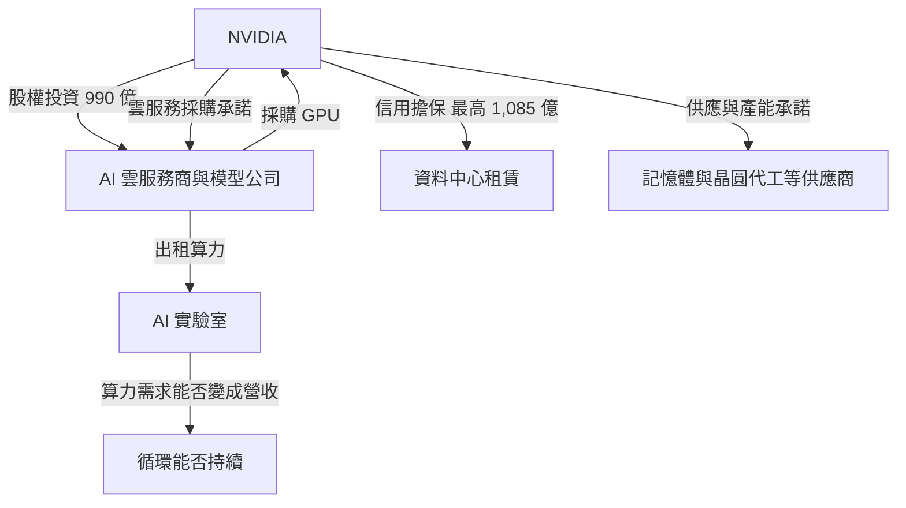

# 黃仁勳離任後的英偉達:5,305 億承諾與擔保怎麼拆,以及 11/17 第三季財報更新(Why QQ)

> ⚠️ 非投資建議。本篇整理 Why QQ 的產業分析並逐項對 NVIDIA 官方申報核實,不構成買賣建議,也不替任何人判斷這家公司值不值得持有。
> 來源:Why QQ〈黄仁勋突然离任,AI行业的「央行」要换人了?〉`xJ6mPg_hfaE`(2026-11-17 上傳,12:36)。該片有官方 zh-Hans 字幕,時間點均取自帶時間字幕。字幕中未見業配或自家產品推廣段。
> 🔗 同事件另兩篇:[[nvidia-without-jensen-huang-investment-view-meitoujun]](美投君,談個人減倉與「四個損失」)、[[jensen-huang-succession-and-vision]](黃仁勳自己談接班)。本篇的角度是**財務與生態結構**,且補上影片之後才公布的 **11/17 第三季財報**。

## 一、一句話結論

影片的主張:**真正要看的不是 CEO 換人,而是英偉達已經同時是投資者、供應商、雲服務採購方和資料中心信用擔保者**;新任領導者要證明的是「既能維持技術創新,也管得住越來越複雜的資本關係」。我核實後的補充:影片的數字大多吻合官方申報,且**影片發布隔天,11/17 財報就把承諾總額從 3,660 億推到 5,180 億**,這比任何推論都更直接。

## 二、影片內容(含時間)

| 時間 | 重點 |
|---|---|
| [0:00](https://www.youtube.com/watch?v=xJ6mPg_hfaE&t=0s) | 11/12 黃仁勳辭去總裁、CEO 與董事,即時生效;CFO Kress 暫代;董事會找正式繼任者;他 1993 年創立、掌舵 33 年 |
| [0:49](https://www.youtube.com/watch?v=xJ6mPg_hfaE&t=39s) | 背景:11/8 他向員工承認婚姻不忠並道歉;董事會同日啟動獨立調查,起因是媒體報導他可能受外國情報活動影響;董事會表示無理由認為國安或商業機密遭洩露 |
| [1:08](https://www.youtube.com/watch?v=xJ6mPg_hfaE&t=58s) | 11/10 獨立董事聘前聯邦檢察官 Joon H. Kim 與律所負責調查;影片特別區分「已公開承認的(不忠)」與「仍屬調查與報導的(情報活動)」 |
| [1:34](https://www.youtube.com/watch?v=xJ6mPg_hfaE&t=84s) | 黃仁勳同時承擔產品方向、技術戰略、客戶關係、資本配置與政府溝通;訪談自稱約 60 名直屬下屬,不靠一對一會議傳遞資訊 |
| [2:14](https://www.youtube.com/watch?v=xJ6mPg_hfaE&t=124s) | 三次戰略轉型:2006 CUDA、2012 AlexNet、2020 年前後 Mellanox 與整套資料中心系統 |
| [3:04](https://www.youtube.com/watch?v=xJ6mPg_hfaE&t=174s) | 護城河是 CUDA 二十年生態與遷移成本,不只是 GPU 性能 |
| [3:42](https://www.youtube.com/watch?v=xJ6mPg_hfaE&t=212s) | Vera Rubin NVL72:72 顆 Rubin GPU、36 顆 Vera CPU;客戶買的是供電、液冷、網路、軟體整套機架 |
| [4:22](https://www.youtube.com/watch?v=xJ6mPg_hfaE&t=252s) | 財務:FY26 全年營收 2,159 億(+65%);FY27 Q2 營收 962 億(+106%)、資料中心 890 億(+117%)、毛利率 75%;Q3 指引 1,080 億 ±2%、毛利率約 74% |
| [5:17](https://www.youtube.com/watch?v=xJ6mPg_hfaE&t=307s) | Kress 2013 年加入,此前在 Cisco、Microsoft、德州儀器,近 25 年財務經驗;短期穩定沒問題,正式 CEO 要判斷下一代架構 |
| [6:02](https://www.youtube.com/watch?v=xJ6mPg_hfaE&t=352s) | 股權投資 990 億、另有 250 億投資承諾、360 億 AI 雲服務協議;TechCrunch 問「Bank of Nvidia」會否繼續擴張 |
| [6:47](https://www.youtube.com/watch?v=xJ6mPg_hfaE&t=397s) | Hunterbrook 彙總 5,305 億:3,660 億未來承諾 + 560 億額外承諾 + 1,085 億擔保最高敞口;強調這是承諾與擔保,不是已花現金或到期債務 |
| [7:46](https://www.youtube.com/watch?v=xJ6mPg_hfaE&t=456s) | 簡化循環:投資雲服務商 → 它買 GPU → 實驗室租算力;CoreWeave 為例;好處是蓋得更快,代價是財務關係更緊 |
| [9:18](https://www.youtube.com/watch?v=xJ6mPg_hfaE&t=558s) | 風險:需求慢於預期時,被投公司估值、GPU 銷量、雲採購承諾、租賃擔保可能同時受壓;10-Q 自述客戶可能因缺資料中心、資金、技術採用慢而延後採購 |
| [10:08](https://www.youtube.com/watch?v=xJ6mPg_hfaE&t=598s) | 競爭:Google 第八代 TPU、Amazon Trainium3、Microsoft Maia 200、Meta MTIA 與 Broadcom;大客戶有更多選擇、議價力變強 |
| [10:51](https://www.youtube.com/watch?v=xJ6mPg_hfaE&t=641s) | 三種情境:平穩交接、經營穩定但戰略速度下降、AI 基建投資降溫;現實可能介於其間,證據不足以判斷 |
| [11:39](https://www.youtube.com/watch?v=xJ6mPg_hfaE&t=689s) | 下一個觀察點:11/17 第三季財報(營收、資料中心、毛利率、Rubin 出貨、新管理層對需求與投資承諾的表態) |

## 三、核實(對 NVIDIA 官方申報)

我讀的一手來源:SEC 上的 FY27 Q2 新聞稿與 CFO 評論(2026-08-26)、Q2 10-Q 全文(2026-08-26 申報)、FY27 Q3 新聞稿與 CFO 評論(2026-11-17)、2026-11-12 的 8-K。

### 3.1 已核實

| 影片說法 | 官方內容 |
|---|---|
| Q2 營收 962 億、+106%、資料中心 890 億、+117%、毛利率 75% | ✅ 新聞稿:$96.2 billion、+106%、資料中心 $89.0 billion +117%、GAAP 與非 GAAP 毛利率皆 75.0% |
| Q3 指引 1,080 億 ±2%、毛利率約 74% | ✅ 新聞稿:$108.0 billion ±2%、毛利率 74.0% ±50 bp;且「不假設任何中國資料中心運算營收」(影片未提這句) |
| 股權投資 990 億、投資承諾 250 億 | ✅ 10-Q:截至 2026-07-26 equity investments $99 billion、equity investment commitments $25 billion |
| 360 億 AI 雲服務協議 | ✅ 10-Q:cloud service agreements 承諾「totaled $36 billion」,通常六年期,**AI 雲方可單方面停止提供並改賣給第三方**,承諾隨第三方使用或自用 R&D 而遞減 |
| 3,660 億「未來承諾」拆成 2,790 億供應與產能、290 億雲服務、250 億股權、250 億未開始租賃、80 億資本支出 | ✅ CFO 評論的承諾表:279、29、25(租賃)、25(股權)、8,總計 366 |
| 1,085 億擔保最高敞口,其中 1,050 億為 SB Energy 替 OpenAI 資料中心的信用支持 | ✅ 10-Q:2026-08 簽署的擔保**上限合計 $105 billion**,對象為 OpenAI 關聯方在俄亥俄 PORTS 園區約 4.25 GW 的租賃;**各擔保於對應租約開始時生效、隨九期工程完成而增加,第一期預計在 FY2029**;另有其他 AI 雲夥伴租賃擔保,最大總敞口 $3.5 billion;105 + 3.5 = 108.5 吻合影片 |
| 5,305 億 = 3,660 + 560 + 1,085 | ✅ 算術吻合(366 + 56 + 108.5 = 530.5);**Hunterbrook 原報告我沒有讀到**,只驗證了它的各分項在官方申報中都找得到 |
| 供應承諾從 1,190 億漲到 2,790 億(與記憶體有關) | ✅ 10-Q 與 CFO 評論:$119 billion → $279 billion,主要是記憶體採購(這句出自我讀的 10-Q,影片本片沒提,但與既有筆記 [[nvda-fy27q2-guidance-and-circular-financing]] 一致) |
| 10-Q 自述客戶可能因缺資料中心、資金不足或採用較慢而延後採購新架構 | ✅ 10-Q 風險因素有這句,原文為 customers may postpone purchasing new architectures |
| 11/12 辭任、Kress 暫代 | ✅ 11/12 8-K(見 [[nvidia-without-jensen-huang-investment-view-meitoujun]] §三) |

### 3.2 需補充或有出入

| 項目 | 說明 |
|---|---|
| 「360 億雲服務」與「290 億雲服務」不是同一個數 | 10-Q 文字寫 $36 billion,CFO 承諾表列 $29 billion(7 月表)。我沒讀 Note 10 對兩者口徑的說明,影片把 360 億放在「額外承諾」、290 億放在「未來承諾」,兩個數同時被用,**差異來源未能確認**,引用時要標明取自哪份文件 |
| 「560 億額外承諾」 | 其中 360 億我在 10-Q 找得到;另 200 億「尚未開始的第三方資料中心租賃」我沒逐項找到出處,未能核實 |
| 擔保「最高敞口」不是預期損失 | 上限 1,050 億的擔保**要到租約開始才生效、首期 FY2029**,影片已提醒不是已花現金,這點與 10-Q 一致;但「最高敞口」是上限,不是機率加權的風險,不能當作潛在虧損 |

### 3.3 未能核實

- FY26 全年營收 2,159 億與 +65%:本輪沒讀 10-K,未查。
- 「GTC 2026 對 Blackwell 與 Rubin 到 2027 年累計收入可見度超過 1 萬億美元」:影片明說是公司給的需求展望,我沒有找到原始 GTC 材料,未能核實。
- Vera Rubin NVL72 的 72 顆 Rubin GPU 與 36 顆 Vera CPU:Q3 新聞稿只說 NVL72 已開始出貨,沒有拆這個配置,未能核實。
- Kress 的履歷(2013 年加入、Cisco/Microsoft/德儀、近 25 年):未查。
- 黃仁勳「約 60 名直屬下屬」:訪談原文未讀。
- Joon H. Kim 受聘與 11/8 道歉:我只看到多家媒體的搜尋摘要(受聘日 11/10、前代理 SDNY 檢察官、Wachtell 所代表),**沒有讀到 NVIDIA 官方聲明全文**,標「二手」。
- Google TPU 第八代、Trainium3、Maia 200、Meta 與 Broadcom 的 MTIA:屬公開產業資訊,本篇未逐項核對。

⚠️ 事件的情報與私人關係部分,仍是媒體引述與調查中的內容,本庫不作定論。

## 四、11/17 第三季財報:影片之後的新資料

影片結尾點名的觀察點已在 11/17 公布。以下全來自 SEC 的 8-K 新聞稿與 CFO 評論(**10-Q 尚未申報**,CFO 評論稱「coming weeks」)。

| 項目 | Q2(7/26 止) | Q3(10/25 止) |
|---|---|---|
| 營收 | $96.2B,+106% 年增 | **$115.8B**,+103% 年增、+20% 季增 |
| 資料中心 | $89.0B | **$107.6B**(+110% 年增);Hyperscale 60.1、AI Clouds / Industrial / Enterprise 47.5、Edge 8.2(總營收的組成) |
| GAAP 毛利率 | 75.0% | **74.8%**(非 GAAP 74.9%) |
| 下季指引 | Q3:$108.0B ±2%,毛利 74% | **Q4:$130.0B ±3%,毛利 71.0–72.0%**(Q4 多一週);仍不假設中國資料中心運算營收 |
| 暫代 CEO | — | 新聞稿由 **Colette Kress(interim CEO 兼 CFO)** 署名;稿內未提繼任者 |
| 買回 | 剩餘授權約 $99.0B | 9 月董事會增加 $1,500 億授權,Q3 回饋股東 $28.1B,剩餘約 $227.3B |

**承諾表(CFO 評論,2026-10-25 對比 2026-07-26,單位十億美元)**

| 項目 | 7/26 | 10/25 |
|---|---|---|
| 供應與產能 | 279 | **390**(主因多年期記憶體採購) |
| 雲服務協議 | 29 | 28 |
| 尚未開始的資料中心租賃 | 25 | **74** |
| 股權投資承諾 | 25 | 20 |
| 資本支出 | 8 | 6 |
| **合計** | **366** | **518** |

要點:
1. **Q3 營收比自家指引中值高約 7%、比上緣(約 110.2)高約 5%**(115.8 對 108.0 ±2%,我自己算的),且 Rubin 已開始出貨並稱「歷來最快的產品爬坡」。
2. **承諾總額 3 個月內增加約 1,520 億**,增幅幾乎全在「供應與產能」與「尚未開始的租賃」,不在股權投資;影片的情境二與三(戰略速度、基建降溫)都沒有在這份數字裡被證實。
3. **Q4 毛利率指引降到 71–72%**,比 Q3 的 74.8% 低約 3 個百分點,CFO 評論我只讀了指引段,沒有查到原因的解釋;不要當成確定的「記憶體成本」結論。
4. 這是財報,不是對 CEO 空缺的評論:**新聞稿看不出董事會的繼任進度**,三種情境仍然未分出勝負。

## 五、我的判讀(含限制)

- 影片的主軸「公司已經是多重角色」是對的,且有官方數字支持。但**它用 5,305 億這個合計數時,混了不同性質**:已簽約的供應採購(可取消或重新安排的比例不明)、單方可停的雲服務、條件觸發才生效的擔保,**加在一起不能直接當成「風險敞口」**。
- 三種情境是影片作者的框架,不是預測。11/17 的數字顯示短期需求端沒有鬆動,但這份財報也來自黃仁勳離任前已鎖定的訂單與產能(美投君影片的「短期不變」論點),**對「長期判斷力」那一半的檢驗要等下一任 CEO 出現後的決策**。
- 本篇和美投君那篇對同一事件下了不同結論(後者已減倉一半):兩人看的時間尺度不同,不是誰對誰錯。

## 六、應用案例

1. **把「合計承諾」拆開讀**:看到某公司「承諾與擔保 5,000 億」時,逐項問三件事:可不可以取消?什麼時候才生效?對方違約才觸發嗎?本篇 §3.1 的表就是示範。
2. **交叉驗證順序**:影片數字 → 新聞稿 → 10-Q 風險因素 → 後續財報。這次 11/17 的財報把影片引用的「未來承諾」3,660 億(承諾表口徑)更新成 5,180 億,說明單一時點的合計數會很快過時(5,305 億含擔保與額外承諾的新合計,官方未提供,我沒有自行重算)。
3. **關鍵人風險 vs 資產負債風險分開記帳**:CEO 離任是前者,承諾與擔保是後者;兩者可能互相放大,但分析時各自找證據,不要用一個推另一個。

## 相關筆記

- [[nvidia-without-jensen-huang-investment-view-meitoujun]] — 同事件:美投君的四個損失與 8-K 核實
- [[nvda-fy27q2-guidance-and-circular-financing]] — Q2 財報當時的循環融資與估值結構分析
- [[jensen-huang-succession-and-vision]] — 黃仁勳談接班:不做接班計畫,而是持續傳遞知識
- [[ai-industry-shift-c-to-b-compute-decides]] — 算力決定產業走向的框架
- [[nvidia-n1x-vs-x86]] — 英偉達產品線的另一個面向

## 來源

- Why QQ〈黄仁勋突然离任,AI行业的「央行」要换人了?〉`xJ6mPg_hfaE`:https://www.youtube.com/watch?v=xJ6mPg_hfaE (官方 zh-Hans 字幕)
- NVIDIA FY27 Q3 新聞稿(2026-11-17,8-K 附件):https://www.sec.gov/Archives/edgar/data/1045810/000104581026000088/q3fy27pr.htm
- NVIDIA FY27 Q3 CFO 評論:https://www.sec.gov/Archives/edgar/data/1045810/000104581026000088/q3fy27cfocommentary.htm
- NVIDIA FY27 Q2 新聞稿(2026-08-26):https://www.sec.gov/Archives/edgar/data/1045810/000104581026000073/q2fy27pr.htm
- NVIDIA FY27 Q2 CFO 評論:https://www.sec.gov/Archives/edgar/data/1045810/000104581026000073/q2fy27cfocommentary.htm
- NVIDIA FY27 Q2 10-Q(2026-08-26 申報):https://www.sec.gov/Archives/edgar/data/1045810/000104581026000075/0001045810-26-000075-index.htm
- NVIDIA 2026-11-12 CEO 交接 8-K:https://www.sec.gov/Archives/edgar/data/0001045810/000104581026000082/nvidiaannouncesceotransiti.htm
- Joon H. Kim 受聘(僅見搜尋摘要,未讀全文):https://thenextweb.com/news/nvidia-board-jensen-huang-inquiry-directors-succession
- Hunterbrook 彙總報告:未取得原文,僅有影片轉述
