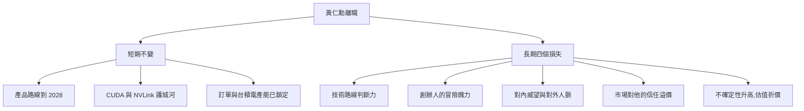

# 沒有黃仁勳的英偉達還能投資嗎?美投君的四個「不可估量的損失」與核實

> ⚠️ 非投資建議。本篇整理美投君的個人觀點並核實事件事實,作者自述已減持英偉達一半倉位,不代表任何人應該買賣。
> 來源:美投君〈没有黄仁勋的英伟达,还能投资吗?〉`wcx2A_31VcU`。該片**無字幕**,逐字稿由 faster-whisper large-v3-turbo 轉錄(694 段,非官方字幕,可能有聽寫誤差)。
> 🔔 **影片含業配與自家推廣**:[8:21 起](https://www.youtube.com/watch?v=wcx2A_31VcU&t=491s) 約一分鐘為富途牛牛(moomoo,影片中聽成「富途木木 / MUMU」)的產品與轉倉活動介紹,末段 [24:00 起](https://www.youtube.com/watch?v=wcx2A_31VcU&t=1430s) 推自家付費頻道「美投 Pro」。這兩段與投資分析無關,本篇略過。

## 一、一句話結論

美投君認為:**短期一兩年業績大概率不受影響(產品路線圖、護城河、訂單與產能已鎖定),但長期的「增量價值」受損**,因為黃仁勳留下的是技術路線判斷、創辦人的冒險魄力、人脈與市場信任這四樣職業經理人難以替代的東西。他自己因此把英偉達倉位砍了一半。

## 二、影片內容(含時間)

| 時間 | 重點 |
|---|---|
| [0:00](https://www.youtube.com/watch?v=wcx2A_31VcU&t=0s) | 作者休假兩週返回,不談離職的個人作風或政治陰謀,只談投資角度:沒有他還值得投資嗎、像沒有賈伯斯的蘋果一樣還會漲嗎、他會不會回來 |
| [1:35](https://www.youtube.com/watch?v=wcx2A_31VcU&t=95s) | 回顧 33 年:1995 年 NV1 失敗幾乎破產 → 黃仁勳主張放棄封閉架構、擁抱微軟標準,與共同創辦人普里姆(Priem)決裂 → 1997 年 Riva 128 救活公司 |
| [3:47](https://www.youtube.com/watch?v=wcx2A_31VcU&t=227s) | 管理風格:每天工作約 14 小時、公開檢討失敗,被員工視為「最愛罵人的 CEO」 |
| [5:02](https://www.youtube.com/watch?v=wcx2A_31VcU&t=292s) | 2000 年代 CPU 內建顯示核心威脅 GPU;2006 年推 CUDA,被華爾街與股東質疑十年;2012 年 AlexNet 後轉型 AI 公司 |
| [9:23](https://www.youtube.com/watch?v=wcx2A_31VcU&t=553s) | 對照賈伯斯 2011 年辭職後蘋果一年內漲 77%;拆成「沒問題的」與「會巨變的」 |
| [10:01](https://www.youtube.com/watch?v=wcx2A_31VcU&t=601s) | 沒問題的三件:產品路線到 2028 年、護城河(CUDA、NVLink)、上下游訂單與產能鎖定 |
| [10:43](https://www.youtube.com/watch?v=wcx2A_31VcU&t=643s) | 損失一:技術路線判斷(Vera Rubin 的液冷、機架設計 2024 年就已出現在路線圖,才有今天的產業鏈配合) |
| [12:30](https://www.youtube.com/watch?v=wcx2A_31VcU&t=750s) | 損失二:創辦人的冒險魄力;職業經理人(庫克、納德拉)是在行業成熟後接手「守天下」,AI 還在「打天下」;例:循環融資與 OpenAI 兜底 |
| [14:36](https://www.youtube.com/watch?v=wcx2A_31VcU&t=866s) | 損失三:關係網;對內威望(核心高管少有出走)、對外與供應商、客戶、政府的「握手交易」,引馬斯克的說法 |
| [16:38](https://www.youtube.com/watch?v=wcx2A_31VcU&t=998s) | 損失四:市場信任與估值;「中庸」與靈活應變,比喻「投資的是航行風浪中的巨輪,要的是船長」 |
| [20:25](https://www.youtube.com/watch?v=wcx2A_31VcU&t=1225s) | 結論:短期財報仍好看,長期增量價值受損;現在 12、13 倍本益比便宜,但這種便宜可能成常態;作者已砍一半倉位,可能繼續減 |
| [22:46](https://www.youtube.com/watch?v=wcx2A_31VcU&t=1366s) | 一線生機:大股東公開希望董事會請他回來,程序上可透過股東大會施壓;作者不把決策押在這個小機率事件 |
| [23:30](https://www.youtube.com/watch?v=wcx2A_31VcU&t=1410s) | 提到 AMD 可能受益,詳細邏輯在自家付費影片(略) |

## 三、事件事實核實

| 影片說法 | 結果 |
|---|---|
| 黃仁勳離職,帶領英偉達 33 年 | ✅ 2026-11-12 SEC 8-K:黃仁勳辭去總裁、CEO 與董事,**即時生效**;PBS:1993 年共同創辦、領導 33 年 |
| 臨時 CEO 是 CFO Kress(影片逐字稿聽成 Cress / Chris) | ✅ 8-K:Colette Kress 任臨時 CEO,在董事會選出永久 CEO 前同時續任 CFO;董事會同時任命前 Synopsys CEO Harvey C. Jones 為首任董事長 |
| 離職原因(影片刻意不談) | ✅ 8-K **未說明原因**。PBS 彙整媒體報導:涉及婚外情、與一名被美國情報部門懷疑為中國間諜的商人關係(中方否認,英偉達未證實)、另有與直屬高管的關係;11-08/09 英偉達稱正調查他是否為「外國情報行動目標」,他致信員工道歉 |
| 離職當天股價 | PBS:收盤跌逾 4%;另有報導該週累計跌約 13%、連續第六週下跌(二手)。影片未給確切數字 |
| 大股東公開希望董事會請他回來 | ❌ 未能核實:我搜尋沒有找到相關報導 |
| 馬斯克在 X 發文說很多交易只是和黃仁勳握手、合約後補 | ❌ 未能核實:搜尋沒有找到該貼文,不能當成已發生 |
| CFO Kress 強烈反對 2,500 億美元的 OpenAI 兜底方案、被黃仁勳壓下去 | ❌ 未能核實:找到的是 2026-07 媒體報導英偉達評估約 2,500 億美元的 OpenAI 資料中心融資擔保(WSJ 報導,雙方未證實),**沒有任何報導說 Kress 反對**;Kress 在財報電話會上只承認外界會稱之為循環融資 |
| 賈伯斯 2011 年辭職後蘋果一年內漲 77% | 未核實(量級合理,未查歷史股價) |
| 目前本益比約 12、13 倍 | 未核實(未查行情;請以最新報價為準) |
| NV1、Riva 128 的銷量、當年欠款與每天工作 14 小時等創業史 | 未核實:屬傳記式敘述,影片未註明出處,我未讀一手資料 |
| 黃仁勳 2006 年推 CUDA、2012 年 AlexNet、2024 年路線圖已有 Vera Rubin | 未逐項核實,為公開常識層級 |

⚠️ 事件細節以媒體與 8-K 為準;報導中的外遇與間諜指控屬媒體引述情報來源,英偉達與中方均未證實,本庫不作定論。

## 四、逐字稿校正(Whisper 常見誤聽)

| 逐字稿寫法 | 推定正確寫法 |
|---|---|
| 黄云勋、黄人勋、黄文勋 | 黃仁勳 |
| 美特军 | 美投君(自稱) |
| 普利姆 | Curtis Priem(NV1 核心設計者之一),屬推定 |
| Riva / REVA / Riva 128 | RIVA 128 |
| Kuda | CUDA |
| Chang GPT、Alex Knight | ChatGPT、AlexNet |
| 28 點的飛滿、Vero Rubin | 2028 年 Feynman、Vera Rubin(推定) |
| Cress、Chris | Colette Kress |
| 富途木木、MUMU | 富途牛牛 moomoo(業配段) |
| Metal Pro | 美投 Pro(自家推廣) |

「全夜冷、無線中版設計」「全 CPU 機架」等 Vera Rubin 規格段落聽寫不通順,我沒有用一手資料核對,筆記中只引用其論點「路線圖早已定案」,不引用規格細節。

## 五、我的判讀(含限制)

- 作者的論證邏輯一致:**短期看財報、長期看治理與判斷力**。但「增量價值受損」是推論,不是已觀察到的結果;影片也承認新 CEO「不一定什麼都做不成」。
- 他拿蘋果對照:賈伯斯 2011 年離開後蘋果仍大漲,與他自己的結論(離開讓風險升高)其實需要解釋差異,影片的解釋是「當時蘋果已是成熟產品線,AI 還在早期」。這是觀點,不是證據。
- 本益比 12–13 倍是否便宜取決於盈利預期;**英偉達 FY27 Q3 財報預定 2026-11-17**(多家報導),屆時管理層措辭是比影片推論更新的資料。
- 作者減倉是個人風險偏好,他自己說追求「長期安心賺錢」,不能套用到別人。

## 六、應用案例

1. **關鍵人風險檢查表**:持有任何由創辦人主導的公司時,列出「技術判斷、冒險決策、關係網、市場信任」四項,各自問「離開後有誰能替代、有沒有制度化」。
2. **短中長分層**:把「已鎖定的訂單與產能」(短期)和「路線判斷與人才留任」(長期)分開看,避免用單一估值倍數決定。
3. **事件驅動的驗證順序**:先看 8-K 與財報電話會,再看媒體引述,最後才看影片或社群的說法;本篇的核實表就是這個順序。

## 相關筆記

- [[jensen-huang-succession-and-vision]] — 黃仁勳接班與願景的先前整理
- [[nvda-fy27q2-guidance-and-circular-financing]] — 英偉達財測與循環融資,對照影片損失二
- [[nvidia-n1x-vs-x86]] — 英偉達產品線的另一個面向
- [[ai-proof-five-moat-stocks-nick]] — 護城河分析的類比框架
- [[meitoujun-why-blog-and-how-to-pick-finance-bloggers]] — 同作者,如何辨別財經博主(本片就含業配與自家推廣)

## 來源

- 美投君影片 `wcx2A_31VcU`:https://www.youtube.com/watch?v=wcx2A_31VcU (無字幕,faster-whisper large-v3-turbo 轉錄,非官方字幕)
- NVIDIA 8-K(2026-11-12 CEO 交接):https://www.sec.gov/Archives/edgar/data/0001045810/000104581026000082/nvidiaannouncesceotransiti.htm
- PBS NewsHour〈What we know after Jensen Huang's resignation as Nvidia's CEO〉:https://www.pbs.org/newshour/nation/what-we-know-after-jensen-huangs-resignation-as-nvidias-ceo
- CNBC 即時報導:https://www.cnbc.com/2026/11/12/nvidia-jensen-huang-ceo-live-updates.html (僅見搜尋摘要,未讀全文)
- Al Jazeera〈Why did Nvidia CEO Jensen Huang resign, and who is Colette Kress?〉:https://www.aljazeera.com/news/2026/11/12/why-did-nvidia-ceo-jensen-huang-resign-and-who-is-colette-kress (僅見搜尋摘要)
- OpenAI 兜底報導:https://axios.com/2026/07/27/nvidia-openai-financing-ai-jensen-huang-ssi (僅見搜尋摘要)
