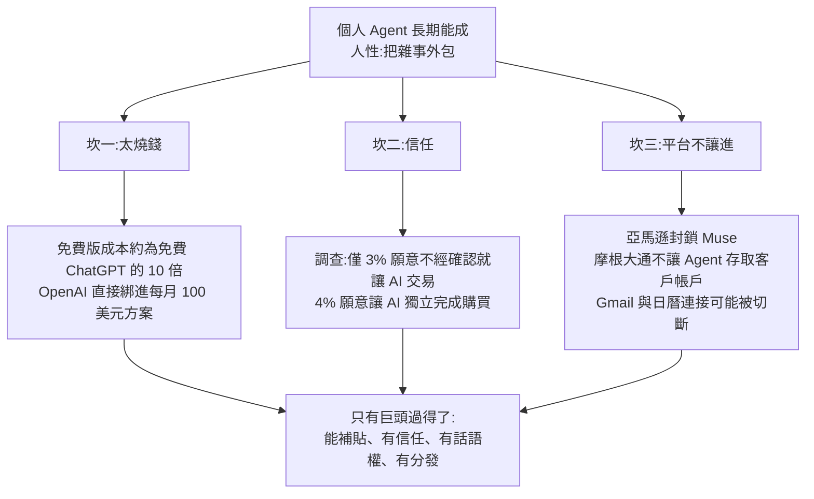

# 個人 Agent 大戰:Meta Muse 為何爆紅、三大困難,以及誰最可能贏

> 整理自 YouTube「美投讲美股(美投君)」〈个人Agent横空出世!新一轮军备竞赛即将展开!AI又要变天了?〉(2026-11-01 上傳,約 24 分鐘,影片 ID `U6DV0MzMBJs`)。
>
> **立場聲明:** 影片是 AI 配音(作者說回國探親,稿子在火車上改),結尾兩度導流到作者自家付費訂閱「美投 Pro」(谷歌最新財報分析在 Pro 內),**付費內容不在本篇範圍,也未轉述**。以下是影片公開部分的論點整理,加上我對數字與產品名稱的獨立核實。
>
> **⚠️ 非投資建議。** 影片裡的「誰會贏」是作者自己標明「很主觀」的預測,不是事實;本篇不構成買賣任何標的的建議。

---

## 一句話總結

作者的論點:**個人 Agent 長期一定做得成(人性好吃懶做),但過程有三道坎——太燒錢、需要信任、平台不一定讓你進;能過三道坎的基本只有巨頭,Meta 目前領先、谷歌可能後來居上;短期應用層沒什麼可期待,先受惠的是賣算力的基礎層。**

---

## 1. 什麼是個人 Agent?為什麼 ChatGPT 不夠

影片把 ChatGPT(尤其是免費版)當成個人助理時的三個痛點,對應 Muse 的設計:

| ChatGPT 的痛點 | Muse 的做法(依影片說法) |
|---|---|
| 只給答案、不執行,最後還是自己動手 | 每個用戶配一台**專屬雲端虛擬機**,裡面有瀏覽器,可開網頁、登入、填表、下單;App 關掉仍在後台 24 小時工作 |
| 卡在密碼與信用卡,用戶不敢交給聊天機器人 | 帳密單獨保管、連執行任務的 AI 自己都看不到;付款用一次性卡號 |
| 你不找它,它不會找你 | 主動看信箱與行事曆、主動提醒(例:Uber 免費會員到期前提醒取消) |

作者的歸納:ChatGPT 像大號搜尋、B 端 Agent(Codex、Claude Code)是工作工具,**個人 Agent 才像私人助理**;Muse 在「執行力」上不一定強過 Codex,但**把原本只能在工作電腦上跑的 Agent 搬進了每個人的手機**。

### 應用案例(影片舉例)

- 訂機票酒店、退訂不要的訂閱、換保險公司、比價:這些是現在 Muse 用戶實際在做的事,也是質疑者說的「一次性需求」。
- 作者自己的例子:Uber 試用一個月到期當天,Muse 主動提醒「記得取消」,是他以前不會想到要交辦的需求。

---

## 2. 市場有多大?(數字見核實段)

- 大摩(摩根士丹利)估算:未來能透過 Agent 數位化的消費支出約 **32 兆美元**,過半是電商與旅遊;就算 Agent 只抽 3%,也是接近 1 兆美元量級。
- 衝擊對象:OTA(訂房訂票平台)、數位廣告(用戶直接跟 Agent 說要買什麼,就不再看廣告)。
- 作者結論:C 端 Agent 的空間和 B 端大致相當。

---

## 3. 三道坎

1. **太燒錢:** 影片稱免費個人 Agent 的運行成本約是免費 ChatGPT 的 10 倍(任務消耗 token 遠高於問答,加上 24 小時在線的獨立虛擬機與安全機制)。引大摩估算:每位 Muse 用戶每月成本約 3 至 130 美元,額度全用滿約 128 美元/月。祖克柏在財報會上也承認成本是擴張的限制因素。
2. **信任:** 要辦事就得交出帳號與信用卡,多數人不放心。
3. **平台不讓進:** 亞馬遜對外說是安全考量,作者認為更怕的是廣告收入被繞過。長期平台大概率逐步放開,但過程有拉扯。

---

## 4. 誰能贏?作者的逐家評比

| 公司 | 作者看法 | 主要理由 |
|---|---|---|
| **Meta** | 目前領先、最快跑出來 | 廣告現金流 + 業界最多算力 + 願意重押的創辦人;30 多億用戶的分發;社交媒體長年「抓意圖」的經驗;C 端產品功力。**最大短板是信任** |
| **谷歌** | 最可能後來居上 | 最被信任保管密碼、廣告業務同樣燒得起、Gmail/地圖/YouTube/安卓的數據與分發。**風險:** 怕與搜尋廣告左右互搏(但作者認為正因為生死存亡反而最有緊迫感)、內部產品太多搶資源、決心待驗證 |
| **OpenAI / Anthropic** | 不看好 | 現金流相對弱、靠外部融資、收入主要來自 B 端,C 端變現尚早;B 端戰線已經夠燒。作者認為個人 Agent「模型不是關鍵」 |
| **蘋果** | 混合 | 握有 iPhone 入口、隱私口碑最佳、私人數據;但沒有自己的模型(目前用谷歌 Gemini)、軟體層慢一拍,作者推測可能淪為「收入口」角色 |
| **xAI(Grok)** | 位置尷尬 | 影片一句帶過 |

> 影片的信任度調查(Oppenheimer):誰來保管你的密碼——谷歌 30%、蘋果 23%、ChatGPT 16%、Meta 僅 8% 墊底。

---

## 5. 對投資的意涵(作者論點)

1. **應用層(上述幾家)短期沒什麼可期待:** 現在是燒錢階段、變現未開始,現金流難看,質疑不容易消散。
2. **真正的爆發訊號是「變現」:** 類比今年稍早 B 端 Agent 變現成功,才帶動 OpenAI、Anthropic 的估值上調。投行普遍預估個人 Agent 要到 **2027 年底**才開始變現;作者推算最快 2027 年中。
3. **2027 年是「軍備競賽年」:** Meta 已在融資,谷歌等會跟進。**最先受惠的是基礎層**(算力、半導體),因為不管誰贏都得先砸錢買算力——和過去兩年爭奪 B 端用戶時一樣。

關聯閱讀:[[ai-industry-shift-c-to-b-compute-decides]]、[[software-stocks-ai-token-cost-and-agent-infrastructure]]、[[cybersecurity-ai-agent-identity-platformization]](Agent 要拿帳密,身份安全是對應的需求)。

---

## 核實紀錄(2026-11-02 查證)

**已核實**
- Meta 個人 Agent 產品名 **Muse**,2026-09 上線並快速衝上下載榜;Sensor Tower 數據:約 22 天達 500 萬下載(The Next Web 對照 ChatGPT 56 天),約 40 天美國下載超過 1,000 萬。
- OpenAI 的個人 Agent 叫 **Dots**(Whisper 轉成「DOTS」),2026-09-29 DevDay 發表,綁在付費方案(Pro 起跳,每月 100 美元起;同時有 500 美元的新方案)——與影片「綁在每月 100 美元套餐、免費與 20 美元用戶用不了」一致。
- Anthropic 的產品叫 **Claude Duet**(Whisper 轉成「Cloud Duet」),約 10 月下旬曝光;有報導稱定價尚未公布,屬預覽性質。影片說「上週推出」大致吻合,細節以官方為準。
- 谷歌第三季財報(2026-10-28):雲端營收約 307 億美元、年增約 103%;單季資本支出約 514 億美元、自由現金流轉負。

**需修正**
- 影片說 Muse「36 天、美國 900 萬下載」。我查到的是「約 40 天、美國超過 1,000 萬」(另有「35 天、美加 1,000 萬」版本),**影片數字偏低或口徑不同**;「ChatGPT 當年用了 110 天」未查到對應來源。
- 影片說谷歌財報後股價「大跌 12%」。多家報導是盤後約 **8–10%**(依來源 8.25%、9.6%、10%),沒看到 12%。
- 影片說谷歌**搜尋業務「史無前例下跌」**。我查到的報導是搜尋營收約 634 億美元、**年增約 12%**,主要殺跌原因是獲利與現金流不及預期(EPS 約 2.12 美元低於預期、股權投資虧損、資本支出吃掉現金流)。**這點與影片相反,尚無法解釋差異(可能是細項、口徑,或影片付費內容另有所指),引用前請以谷歌官方財報為準。**

**未能核實**
- 大摩 32 兆美元、3% 抽成、每用戶每月 3–130 美元成本。
- 「免費個人 Agent 成本約為免費 ChatGPT 10 倍」。
- 「僅 3% 願意讓 AI 不經確認交易、4% 願意讓 AI 獨立購買」的美國調查。
- Oppenheimer 信任度 30/23/16/8。
- 「亞馬遜封鎖 Muse」「摩根大通不讓 Agent 存取」。
- Meta「30 多億 C 端用戶」為公司整體用戶規模,並非 Muse 用戶。

## 字幕還原(Whisper 推定,已通讀檢查)

| 字幕寫法 | 還原 | 備註 |
|---|---|---|
| 美育探路者、美國軍、美頭軍 | 美投君 / 美投 | 頻道名 |
| DOTS、Cloud Duet | Dots、Claude Duet | 見核實段 |
| 拆GPT、chat GPт | ChatGPT | |
| 大摩 | 摩根士丹利 | |
| Openheimer | Oppenheimer | 推定 |
| Groke | Grok(xAI) | 推定 |
| 粘出橫活的小龍蝦 | 疑為近期爆紅需自備電腦的開源 Agent(俗稱「小龍蝦」) | **推定,具體產品名未確認** |
| instinct | 某家做個人 Agent 的新創 | **推定,名稱未確認** |
| 一句「收入口廢」 | 「收入分成/流量入口」類角色之誤聽 | 推定 |

## 來源

- 美投讲美股(美投君):〈个人Agent横空出世!新一轮军备竞赛即将展开!AI又要变天了?〉 https://www.youtube.com/watch?v=U6DV0MzMBJs (該片無字幕,逐字稿以 CPU faster-whisper 轉錄,非官方字幕)
- Muse 下載數據:https://www.ithinkdiff.com/meta-muse-10-million-us-downloads-40-days/ ;https://thenextweb.com/news/meta-muse-3-million-weekly-users-information
- OpenAI Dots 發表:https://www.usecarly.com/blog/ai-news-2026-09-29-evening/ ;https://pricingsaas.com/companies/openai/diffs/2026D273
- Claude Duet:https://www.claudeainews.com/news/anthropic-claude-duet-ai-agent-launch
- 谷歌第三季財報與股價反應:https://www.xtb.com/en/market-analysis/alphabet-disappoints-wall-street-despite-record-results-shares-plunge-over-8-and-test-300 ;https://tech-insider.org/alphabet-q3-2026-earnings-miss-9-percent-negative-free-cash-flow-developers-2026/

⚠️ 非投資建議。本篇的產品與財報數字多來自二手媒體報導(部分為聚合站),重大決策前請回到 Meta、OpenAI、Anthropic、Alphabet 的官方發布與 SEC 文件核對。
