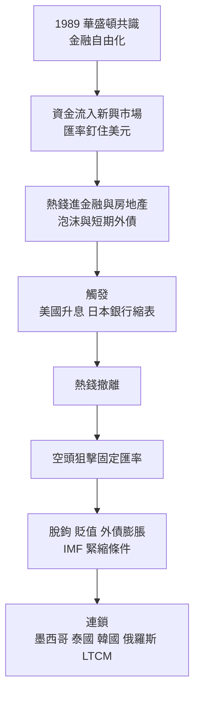

# 資本如何接連引爆多國金融危機:1994 墨西哥到 1998 俄羅斯,同一條「資金流入 → 熱錢撤離 → 空頭補刀」主線

> ⚠️ **非投資建議。** 本文是歷史與機制整理,不構成任何買賣建議。

**主題分類:** 投資 / 總體經濟與金融史
**來源:** YouTube 頻道 **小Lin说**〈资本是如何接连引爆多个国家的金融危机的?〉(2026-05-16,約 28.8 分)
**整理日期:** 2026-11-05

> **該片無官方字幕,逐字稿以 CPU 版 Whisper 轉錄,可能有同音字誤差。**
> ⚠️⚠️ **業配揭露:** 影片約 04:5x–06:40 插播 **Sally eSIM**(海外上網卡、折扣碼),**本文未納入**。
> ⭐ **讀法:** 本文把**歷史事實**(對照 Wikipedia 事件條目、HKMA 與媒體報導)與**講者個人觀點/詮釋**分開標示:📖 = 可核實史實;💬 = 講者觀點;⚠️ = 數字與講法需修正。

---

## TL;DR

1. 📖 1994 年底到 1998 年,墨西哥、泰國、印尼、馬來西亞、韓國、俄羅斯、巴西等接連出事。💬 講者認為它們有**統一脈絡**:華盛頓共識式的金融自由化 → 熱錢大量湧入、推高金融與房地產泡沫 → 外部條件變化(美國升息、日本銀行縮表)使熱錢撤離 → 空頭對固定匯率補刀 → 本幣崩、外債膨脹、信貸危機。
2. 💬 講者強調**資本不是單一主體**:墨西哥的是美國養老金與共同基金,亞洲的是日本銀行與套利交易,俄羅斯的是歐美投行,**真正出手狙擊的是少數激進對沖基金**;各路資金利益還互相衝突。
3. 💬 講者的結論:**金融越自由,越需要完善的監管;各國之後都收緊監管並大幅增加外匯存底**。⚠️ 但片中多個數字有誤差(見核實表),尤其是「墨西哥三天暴跌 40%」「泰國利率 1.5%(實為 1,500%)」「俄羅斯 GKO 8 月 150%」。

## 1. 墨西哥 1994:第一集「開胃菜」

**講者敘事:** 華盛頓共識(1989)主張貨幣、貿易、資本流動、產業全面自由化;墨西哥開放資本管制並把披索釘住美元,華爾街可在美國以約 3% 融資、投到墨西哥拿約 5% 且「無匯率風險」,1992–94 年每年約 300 億美元流入;1994 年美國升息,墨西哥為留住資金改發**美元計價短期債**並開出更高利率(約 10%),1994 年發行超過 300 億美元短債;**12 月外匯存底耗盡、披索脫鉤**;IMF 帶頭提供約 **500 億美元**救助,美國共同基金與養老金得以全身而退。💬 講者據此提出 **IMF 的道德風險**:救援讓資本覺得「新興市場高收益且低風險」,為後續危機埋下伏筆。

**核實:**
- ✅ **救助規模約 500 億美元**:1995 年 1 月方案,美國 200 億、IMF 178 億、BIS 100 億,其餘為拉美與加拿大小額出資(Wikipedia〈Mexican peso crisis〉)。
- ✅ 短期債即 **Tesobonos**:披索計價但保證以美元支付。
- ✅ 美國共同基金投入墨西哥資產超過 **450 億美元**,投資人曾面臨 80–100 億美元損失風險。
- ⚠️ **「披索三天內暴跌超過 40%」不精確:** 1994-12-20 先貶約 13%–15%,12-22 放任浮動後再跌約 15%;之後**累計約貶一半**(約 3.4 → 7.2 披索/美元),1995 年通膨 52%。
- 📌 墨西哥當時是**爬行區間匯率**而非嚴格釘住,講者「直接釘住美元」是簡化。

## 2. 泰國與東南亞 1996–97:日本資金、熱錢、與兩種「撤」

**講者敘事:**
- 資金來源:美國升息、歐洲利率高;**日本利率低、日圓 1995 年升到歷史高位(約 1 美元對不到 80 日圓)**,日本銀行在國內以不到 2% 成本融資、投東南亞賺 5–6% 以上。1996 年日本銀行資金占**泰國債務 54%、印尼 39%、馬來西亞 36%、韓國 25%**。
- 💬 **熱錢的兩個問題:** 短視(流向最快賺錢的金融與房地產,造成實體沒發展卻吹起泡沫),以及來得快跑得更快。
- 日本泡沫後銀行壞帳累積到約 **2,300 億美元**,政府頒布資本要求,多數銀行不達標,只能緊急縮減海外貸款 → 泰國金融與地產公司現金流被抽乾,泰股半年跌 40%。
- **索羅斯的手法(💬 講者詮釋):** 找快撐不住的國家,先買賣權、做空期貨布局,再大舉做空外匯,引發跟風;偏愛**固定匯率**標的(崩盤前一天看起來風平浪靜,政府硬撐耗外匯;攻擊失敗匯率不變,匯率端不虧,成功則暴跌)。1992 年做空英鎊(黑色星期三)約賺 18 億美元。講者也指出老虎基金當時體量比索羅斯大得多,只是索羅斯更會宣傳。
- **1997 泰國:** 泰國央行不到 400 億美元外匯存底,超過 270 億押在遠期市場護盤,又花 80 億救金融公司;**1997 年 5 月高盛報告預測泰銖面臨重大貶值壓力**成為進攻號角;隔夜拆借利率被拉到極端以提高放空成本;**6 月索羅斯約 10 億、老虎基金約 30 億美元**投入;最大金融公司 **Finance One** 因無力償還約 20 億債務破產;**7 月 2 日**泰國放棄釘住美元,泰銖數日內重貶 50% 以上。
- 擴散:**7/11 菲律賓披索、7/14 馬來西亞令吉、8/14 印尼盾**脫鉤(講者給貶幅 40%/46%/80%);馬來西亞總理**馬哈迪**公開怒罵索羅斯。

**核實:**
- ✅ 1997-07-02 泰國放棄釘住美元,原釘 25:1(Wikipedia〈1997 Asian financial crisis〉)。
- ✅ 1997-06 至 1998-07 貶幅:泰銖 **40.2%**、印尼盾 **83.2%**、菲披索 **37.4%**、馬幣 **49.1%**、韓元 **34.1%**——講者的 40/46/80 約略同量級,但**不是同一期間口徑**,不宜當精確數字。
- ✅ 馬哈迪指控索羅斯等交易者搞垮馬來西亞經濟屬實;📌 索羅斯自述是在貶值過程中**反向買進**令吉。
- ✅ 泰國 IMF 方案超過 170 億美元(1997-08-11 宣布)。
- ✅ **泰國隔夜拆借利率 = 1,500%**(使用者 2026-11-07 聽原片確認;字幕「1.5%」是轉錄誤差,片中接著說「放空兩週虧一半」與此量級吻合)。
- ❓ 日本銀行占各國債務比率、泰國 270 億遠期、80 億救援、索羅斯 10 億/老虎 30 億、高盛 5 月報告:**本次未能獨立核實**,視為講者轉述。
- 💬 「是索羅斯的陰謀嗎?」講者立場是**不是單一陰謀、各國本身也有脆弱處**(新加坡、台灣、香港受攻擊後很快恢復)——合理的詮釋,但非定論。

## 3. 香港:三次進攻與 1998 年的入市

**講者敘事:** 1997 年 8 月第一波試探(港股跌約 10%);**10 月第二波**,金管局把隔夜拆借利率推高到約 300%,港幣守住但 10 月港股跌 40%;空頭發現規律「炒港幣 → 利率升 → 股市跌」,於是**同時埋伏股市與期指空單,雙邊獲利**;**1998 年 8 月**第三波,金管局與財政司決定**直接入市買港股**;最高峰 **8/28 單日成交 790 億港元(平日約 20 倍)**,兩週動用超過 **1,000 億港元**,穩住後港股 2000 年創高(超過 17,000 點)。

**核實:**
- ✅ **入市期間 8/14–8/28**,總投入 **HK$118 billion(約 150 億美元,約占外匯基金 18%)**,買入恒指 33 隻成分股;**8/28 單日 HK$79 billion**。HKMA 2000 年自述「已回收 725 億,手上仍有約 1,750 億市值」,即後來帳面獲利。講者「超過 1,000 億」「單日 790 億」與史實一致。
- ✅ 1997-10-23 HKMA 把隔夜利率從 8% 推到 23%,一度達 **280%**(講者 300% 為約數);恒指 10/20–10/23 跌 **23%**。
- ⚠️ **講者說金管局外匯儲備「600 多億美元」疑偏低:** 媒體(CGTN)引述香港外匯儲備約 **960 億美元**,但 1997 年當時確切數字**未核到**,請勿引用 600 億。

## 4. 韓國 1997:財閥高槓桿被拔掉插頭

**講者敘事:** 10 月 17 日新台幣一度大貶;**10 月 22 日韓國起亞汽車因現金流危機被現代汽車以股權置換方式救下**,外資逃離;💬 韓國 GDP 比泰、馬、印尼加起來還大,空頭本沒預期韓國會倒,「自己腿先軟」暴露**財閥借貸過激進、槓桿過高**;11 月 17 日政府放棄抵抗,韓元連續暴跌,美股也一度跌 10%;**12 月 4 日 IMF 提供 570 億美元**,對東南亞各國合計救助約 1,180 億美元。

**核實:** ✅ 韓國 IMF 方案約 **570–584 億美元**(Wikipedia 彙整為 58.4B)。⚠️ 講者「總計 1,180 億」可能含世銀、亞銀與雙邊承諾,不同來源口徑從 1,100 億到更高不等,宜視為「約 1,100 億美元量級」。❓ 美股「一度跌 10%」未核實。

## 5. 俄羅斯 1998:不是美元債,是盧布 GKO

**講者敘事:** 俄羅斯 1992 年採休克療法、擁抱資本市場;亞洲危機使熱錢外逃;**政府大量發行盧布計價的短期國債 GKO**,被海外投資人拋售,又遇油價暴跌,央行不斷拉高利率;**1998 年 8 月 GKO 殖利率升到 150%**,光利息支出就超過全國稅收;世銀與 IMF 貸款部分「莫名消失」;**8 月 17 日**宣布盧布貶值、國債重組、90 天暫停償付,GKO 跌到面值 10–15%;連鎖:美國對沖基金 **LTCM** 爆雷(聯準會出面協調),巴西跟著崩,油價跌到每桶不到 10 美元;俄羅斯一年內換六任總理(講者說法,查證約三任)。

**核實:**
- ✅ **8/17 貶值並對內債違約、外債暫停償付**;盧布 8/17–8/25 由 6.43 貶到 7.86,**9/21 約 21 盧布/美元**(不到一個月失去約三分之二價值)。
- ⚠️ **GKO 150% 是 6 月:** 1998 年 6 月基里延科把 GKO 利率拉到 **150%**,講者說「8 月」不精確。
- ✅ **IMF/世銀約 226 億美元方案(1998-07-13 核准)**,其中約 **50 億美元**事後發現下落不明,與講者「消失」一致(歸因「腐敗」屬講者詮釋)。
- ✅ 1998 年 6 月月度利息支付比月度稅收高 40%,方向與講者「利息超過稅收」一致,但口徑是單月。
- ✅ 央行約 **270 億美元**外匯存底在 1997-10 至 1998-08-17 間被耗用。
- 「一年六任總理」:使用者 2026-11-07 聽原片確認講者確實說六任;屬講者說法,查證 1998 年內約三任(Chernomyrdin → Kiriyenko → Primakov)。
- LTCM 1998 年因俄羅斯違約爆雷、Fed 召集銀行團救援,為廣泛歷史共識,本次非逐項查證。

## 6. 後果與講者結論

- 💬 **共同機制:** 一進(熱錢湧入)、一飄(泡沫)、一撤(熱錢撤離),加上空頭趁火打劫,本國陷入信貸與現金流危機。
- **貶值的連鎖傷害:** 外債以本幣計價翻倍膨脹;進口品變貴造成輸入型通膨;IMF 救助附帶**嚴苛的緊縮與改革條件**,多年後受助國反而最反感 IMF。講者稱泰國超過 200 萬人失業、印尼之後十年累計超過 2,000 萬人失業(⚠️ 口徑未核實),泰、韓、印尼政府因危機倒台。
- 💬 **對「資本是壞人嗎」的回答:** 資本是高度抽象概念,每個個體追求自身利益最大化;市場競爭使其高效,但**沒有健全制度的過度自由會引發嚴重後果**——「越自由的市場越需要完善、嚴格的監管」。各國之後收緊金融監管、大幅提高外匯存底;「華盛頓共識」自此少有人提。

## 應用案例

- **判斷新興市場脆弱度(自我檢查清單):** ① 匯率是否釘住或準釘住?② 外債中**短期、外幣計價**的比例?③ 外匯存底是否被遠期合約或救助耗掉(看**淨**存底,不是帳面)?④ 資金流入是否集中在房地產與銀行信貸?⑤ 資金來源國(如當年的日本)自己有沒有縮表壓力?——1997 年的泰國這五項全中。
- **解讀新聞:** 看到某國政府「把隔夜利率拉到極高」守匯率,對照香港 1997-10(280%)與泰國:這是**用國內經濟與股市換匯率穩定**的短線手段,代價是股市與實體,常見後續是股市重挫。
- **個人配置的教訓:** 別用「近期高報酬」推論「低風險」——IMF 救援製造的道德風險讓資金誤以為新興市場高報酬無風險;追逐單一國家或題材的高息時,要問「有沒有人兜底、能兜多久」。
- **對照本庫相關主題:** 日圓套利與日本政策轉向的現代版見 [[yen-40-year-low-takaichi-trade-and-us-japan-intervention]];1994 年升息週期對債股的影響見 [[us-bond-stock-divergence-valuation-vs-earnings-1994]];戰爭與經濟代價見 [[russia-ukraine-war-economy-who-pays]]。

## 核實總表

| 說法 | 結果 |
|---|---|
| 墨西哥救助約 500 億美元;Tesobonos;共同基金 450 億曝險 | ✅ |
| 披索「三天暴跌 40%」 | ⚠️ 約 13–15% 後放浮動再跌約 15%,累計約半 |
| 泰國 1997-07-02 放棄釘住、原釘 25:1 | ✅ |
| 馬哈迪罵索羅斯 | ✅(索羅斯自述反向買令吉) |
| 泰國隔夜利率「1.5%」 | ✅ 1,500%(使用者 2026-11-07 聽原片確認) |
| 日本銀行占 54/39/36/25% | ❓ 未核實 |
| 港府入市 8/14–8/28、HK$118bn、單日 HK$79bn | ✅ HKMA 與媒體報導 |
| 1997-10 港拆息約 300% | ≈ ✅(峰值約 280%) |
| 港府外匯儲備「600 多億美元」 | ⚠️ 疑偏低(媒體稱約 960 億) |
| 韓國 IMF 570 億 | ✅ 約 570–584 億 |
| GKO 150% | ⚠️ 6 月而非 8 月 |
| 俄羅斯 8/17 違約與貶值、IMF 約 226 億方案、約 50 億不見 | ✅ |
| 「一年六任總理」 | 講者說法(使用者確認講者確實說六任),查證約三任 |
| 各國失業人數 | ❓ 未核實 |

## 來源

- YouTube:[资本是如何接连引爆多个国家的金融危机的?](https://www.youtube.com/watch?v=7qWH7e_AEDs)(小Lin说,2026-05-16;**無官方字幕,逐字稿以 CPU 版 Whisper 轉錄,可能有同音字誤差**;含 Sally eSIM 業配,未納入)
- [Wikipedia — Mexican peso crisis](https://en.wikipedia.org/wiki/Mexican_peso_crisis)
- [Wikipedia — 1997 Asian financial crisis](https://en.wikipedia.org/wiki/1997_Asian_financial_crisis)
- [Wikipedia — 1998 Russian financial crisis](https://en.wikipedia.org/wiki/1998_Russian_financial_crisis)
- 香港 1998 入市:[HKMA — The wicked month of August](https://www.hkma.gov.hk/eng/news-and-media/insight/2000/08/20000803)、[CGTN — How Hong Kong survived the 1998 financial crisis](https://news.cgtn.com/news/2019-08-14/How-Hong-Kong-survived-the-1998-financial-crisis-J9lwvZrsNq/index.html)、[SCMP — Exchange fund: how US$574 billion war chest defeated Soros](https://www.scmp.com/business/article/3182687/exchange-fund-how-us574-billion-war-chest-defeated-soros-defended-hong)

**Whisper 還原對照:** 彼索/比索 → 披索;泰珠/泰租 → 泰銖;墨溪哥/墨希哥 → 墨西哥;熱前/熱淺/烟钱 → 熱錢;老罗 → 老虎基金創辦人 Julian Robertson(推定);GTO → GKO;「油價不到十億美元一桶」→ 不到 10 美元一桶。
