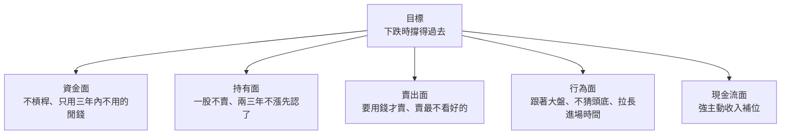

# 長期投資的六條反人性心法:一股不賣、賣最差的、用停損的錢出國玩(Moboo)

> 整理自作者 **Moboo** 的社群貼文〈#長期投資的方法〉(使用者貼文收錄於 2026-11-21;原文網址未提供,文末署名 #Moboo,內容提到其 Podcast 與「高薪賽道」主題)。
>
> ⚠️ **非投資建議。** 這是個人十多年心得,作者自己寫明「僅供參考」。本文整理論點並標出前提與反例,不構成買賣建議。
>
> ⚠️ **利益與背景揭露:**
> - 作者自述持有 **130 多萬美元的 AAPL**,並說近兩天資產回檔一百多萬美元;全篇心態建立在這個「防禦型大持股」上,前提與一般人不同。
> - 作者經營 Podcast 與課程性質的「高薪賽道」內容,第六點「主動收入」與自身商業模式有關,需知有利益關係。
> - 本文只有貼文本身,**沒有數據與一手來源**;下方「延伸與查證」我沒有讀到原始論文,全標「未能核實」。

## 一、一句話

**長期投資的唯一秘訣是下跌時撐得住**,所以重點不在選股技巧,而在資金結構(不借錢、用閒錢、有主動收入墊底)與決策規則(賣最差的、不擇時)。

## 二、六條心法(整理原文)

1. **「一股不賣奇蹟自來」**:每檔股票都做好持有兩到三年的準備。三年內會被迫賣出,代表那筆錢不是閒錢,「沒這個膽量持的股票,一天也不要擁有」。關掉 App 不是意志力,是資金風險控管的結果:不用看,才等得到資金回來。
2. **兩三年沒漲的時間成本先想好**:不要因為「一直沒漲」賣掉而錯過起漲點。用新資金去買新股票,而不是一直換股。
3. **要用錢就賣表現最差的**:不看已實現虧損或未實現獲利,看整體資產;問自己「未來最不看好哪一檔」就賣它,避免價位定錨與沉沒成本。
4. **永遠拿停損的錢出國玩**:花錢一律賣虧損股,不是賺了很高興賣掉來花。作者稱兩個好處:①大股災時不會因套牢不敢花錢,變成「精神上的窮人」;②手上永遠是當下較強的股票。並認為「先賣 50% 落袋為安」對長期投資人是踩剎車。
5. **大船理論**:你在市場這艘大船上,跟著水位起伏,最差有人墊底;自己下海游泳,沉得比別人快。跌幅若比別人大就容易重傷,所以不槓桿或只用很小比例,不做出比市場激烈的反應(例如搶先賣股)。先逃過下跌多半有運氣成分,成功叫「逃過下跌」,失敗就是追高殺低;應拉長進場時間、不猜頭底、平滑成本。
6. **強大的主動收入**:有工作能力的人應最大化主動收入的穩定性,沒錢時能從別處賺回來。很多強調被動收入的人,本業其實是開課、收會員這類主動收入。長期投資成功的重要支柱是提高主動收入。

## 三、延伸與查證

> 以下是我的對照,**沒有讀一手論文或資料**,僅憑既有知識,一律標「未能核實」。

| 論點 | 對照 | 狀態 |
|---|---|---|
| 第 3、4 點「賣輸家、留贏家」 | 行為金融的**處置效應**(Shefrin & Statman 1985;Odean 1998)指出散戶傾向賣贏家、抱輸家,作者做法是反過來;與之相符的方向是「別被成本價綁住」 | 未能核實(未讀原文) |
| 第 4 點:賣輸家的稅務面 | 在有資本利得稅的地區,賣虧損可抵稅(tax-loss harvesting),對作者有利;但**台灣個人海外股票的稅制與美國不同**,不可直接套用 | 未能核實,需依自身稅籍確認 |
| 第 4 點:「手上永遠是較強的股票」 | 賣最差的等於汰弱留強,近似動能(momentum)策略;但「跌最多的」不等於「基本面最差的」,可能賣在均值回歸前 | 推論,非事實 |
| 第 5 點:不擇時、平滑成本 | 與本庫《持續買進》主張相同,見[[just-keep-buying-nick-maggiulli]] | 方向一致 |
| 第 1 點:三年內可能被迫賣出就別持有 | 對應「資金期限要配合持有期限」;與 AAPL 這類大型防禦股的波動結構有關 | 常識性原則 |

### 我看到的盲點

1. **倖存者偏誤與前提**:作者的心態來自 130 萬美元 AAPL 加十年以上經驗;對單一個股重倉的人,「撐過去」不保證漲回來(個股可長期不回)。
2. **「三年不漲也撐」對個股風險不等價於對大盤**:大船理論的前提是你持有的就是市場;若持單一股票,等於游泳而非坐船,這與作者第 5 點自己的警告矛盾,除非他把 AAPL 當市場代理。
3. **賣最不看好的**需要可靠的看空判斷,否則容易變成追高殺低的反向版本。
4. **花虧損的錢**是心理帳戶技巧,對總報酬沒有魔法;好處在行為(不被套牢綁架消費),稅務效果因地而異。

## 四、應用案例

**案例一:資金期限檢查表**
買進前寫下「這筆錢三年內會不會用到」。若會,改放定存或短債;若不會,才進股票。這是第 1 點的落地版。

**案例二:要用錢時的賣出順序**
需要 30 萬出國或換車時,列出持股,逐檔回答「未來一年最不看好哪一檔」,賣那檔,不看成本價。事後記錄這個判斷是否準,三到五次後就知道自己的看空能力。

**案例三:用新資金而不是換股**
每月薪水固定買指數基金或既有核心持股;看到沒漲的個股誘惑時,把「換股」改成「新錢買新標的」,避免頻繁換倉。

**案例四:主動收入優先**
股災時先確認「六個月生活費加主要現金流」是否穩;若主要收入不穩,先把部位降到不會睡不著的水準,再談長期。

## 五、相關筆記

- [[just-keep-buying-nick-maggiulli]] — 把買進變成不靠意志力的自動規則
- [[retail-investor-losing-system-not-luck]] — 散戶輸在系統而非運氣
- [[when-to-add-reason-not-percent-fico-nick]] — 加碼看理由不看跌幅
- [[thinkers-get-rich-jonathan-clements]] — 長期理財的行為面
- [[trading-math-expectancy-variance-risk]] — 擇時勝率與期望值數學

## 六、來源

- Moboo〈#長期投資的方法〉社群貼文(使用者提供的貼文全文,於 2026-11-21 貼入對話收錄;原文網址未提供,無法附連結)。
- 處置效應參考(僅憑既有知識列出,未讀原文):Shefrin & Statman (1985) "The Disposition to Sell Winners Too Early and Ride Losers Too Long";Odean (1998) "Are Investors Reluctant to Realize Their Losses?"
