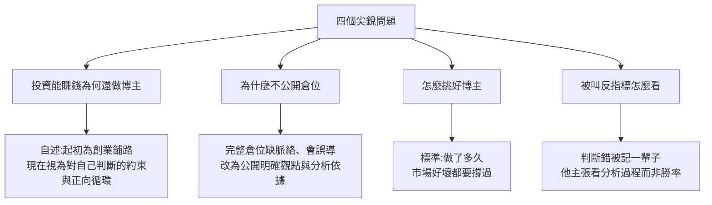

# 投資能賺錢還做博主?美投君談財經博主的行業內幕,以及怎麼篩選好博主

**主題分類:** 投資 / 策略 — 資訊來源與財經博主的判讀
**來源:** YouTube〈投资能赚钱,还做什么博主?业内人告诉你,如何筛选好博主!〉(美投君 / 美投讲美股,2026-11-08,18 分 54 秒;[影片連結](https://www.youtube.com/watch?v=6LiHFqguqcQ))
**逐字稿:** 該片無字幕,**逐字稿以 faster-whisper `large-v3-turbo` 轉錄,非官方字幕**;可疑處見 §7。
**整理日期:** 2026-11-09

> ⚠️ **非投資建議。** 本篇整理的是「怎麼看待財經博主」的論述,不涉及任何個股或操作建議。
> ⚠️ **立場揭露:** 這是**博主講博主**,講者與其團隊的商業模式就是付費訂閱。說明欄第一行即「美投 Pro」新用戶 7 天免費試用連結(`utm_campaign` 帶追蹤參數),並列出 Pro 股票、Pro 市場、Pro 交易等付費服務。**影片內容本身沒有推銷,但它是在為講者自己(及同行)的行業辯護**,閱讀時要把「自我辯護」與「可用的判斷標準」分開。
> ⚠️ 影片中所有講者個人資料(從業年數、粉絲數、持倉槓桿、完播率、團隊成員經歷、推薦績效)都是**自述,未能獨立查證**。

---

## 1. 一句話

講者的立場:**好的投資內容本來就不適合算法時代的自媒體**,所以博主不得不包一層「糖衣」(標題黨、開頭製造懸念);因此觀眾要靠辨別力,他給的第一個篩選標準是**看博主做了多久**。同時解釋為什麼他**不公開完整倉位**,以及怎麼看待被叫「反指標」。

## 2. 影片重點與時間點

| 時間 | 內容 |
|---|---|
| 1:06([連結](https://www.youtube.com/watch?v=6LiHFqguqcQ&t=56s)) | 問題一:投資真能賺錢,還做什麼博主?講者自述在美股堅持十多年,投資表現「很不錯」,財富自由談不上。 |
| 2:04([連結](https://www.youtube.com/watch?v=6LiHFqguqcQ&t=114s)) | 自述一開始做頻道是為了替**自己的創業項目**鋪路,項目後來失敗(「不止黃了一次」);做博主「不是為了賺錢」。 |
| 3:46([連結](https://www.youtube.com/watch?v=6LiHFqguqcQ&t=216s)) | 美股投資不是零和博弈:「我買英偉達賺錢,也不耽誤你買英偉達賺錢」,類比廚師、歌手。 |
| 4:44([連結](https://www.youtube.com/watch?v=6LiHFqguqcQ&t=274s)) | 做頻道給他上了一道「鎖」:研究不透不敢放出來;自述分析師 Lead 否掉他想做的「AI 長期投資方向直播」,理由是太主觀、沒研究透。 |
| 5:19([連結](https://www.youtube.com/watch?v=6LiHFqguqcQ&t=309s)) | 引用 Taleb《Skin in the Game》:要有好判斷,必須為判斷承擔風險;他把「公開發表被幾十萬人審視」視為 skin in the game 的一種機制。 |
| 7:17([連結](https://www.youtube.com/watch?v=6LiHFqguqcQ&t=427s)) | 第一個「秘密」:好的投資內容不適合做自媒體;投資反人性,吸引人的往往不是好內容(「三隻明天翻倍、勝率 90%、每週穩賺 3000」),沒有這樣的策略。 |
| 8:49([連結](https://www.youtube.com/watch?v=6LiHFqguqcQ&t=519s)) | 類比健身:「每天五分鐘一個月瘦三十斤」的內容吸引人但不靠譜。 |
| 9:24([連結](https://www.youtube.com/watch?v=6LiHFqguqcQ&t=554s)) | 想繼續做好內容就得「搞點不要臉的事」:標題黨、開頭故弄玄虛,裡面再「推邏輯、擺數據、辯證思考、給明確觀點」;自稱同行心照不宣,但「也有整個都給你提供糖衣的」,需要觀眾自己辨別。 |
| 10:47([連結](https://www.youtube.com/watch?v=6LiHFqguqcQ&t=637s)) | 為什麼不公開倉位:持倉常年 1.5–2 倍槓桿,靠倉位管理與期權風控;觀眾不一定有同樣風控能力,抄了會虧;用華法林(最早是老鼠藥)類比「同一片藥對不同人是救命藥或毒藥」。 |
| 12:12([連結](https://www.youtube.com/watch?v=6LiHFqguqcQ&t=722s)) | 他無法公開每筆交易的全部 context、投資瞬息萬變、無法保證觀眾看到未來所有變化,所以不公開;但**公開明確觀點**(看好/不看好),即使被說是反指標。 |
| 13:47([連結](https://www.youtube.com/watch?v=6LiHFqguqcQ&t=817s)) | 第三個秘密:怎麼挑財經博主——**看他做了多久**。理由:短期吸睛的操作不可持續、崩得也慘;這行受市場影響大,好年景捧你、差年景挨罵;能撐下來的多少守住了長期價值。 |
| 14:52([連結](https://www.youtube.com/watch?v=6LiHFqguqcQ&t=882s)) | 觀察:做得越久的博主爭議越大,時間短的反而好評如潮。 |
| 15:08([連結](https://www.youtube.com/watch?v=6LiHFqguqcQ&t=898s)) | 問題四:被說是「反指」怎麼看。他說賺了是自己厲害、虧了是博主的問題;給明確觀點更容易落人口實;錯一次可被記一輩子,對的不會有人提(舉年初看空白銀為例)。 |
| 15:55([連結](https://www.youtube.com/watch?v=6LiHFqguqcQ&t=948s)) | 承認判斷有錯,但主張「看分析依據而非判斷對錯」;自稱美投 Pro 追蹤推薦股票表現跑贏標普 500 不少(公開頻道只挑了一部分、高風險股未放)。 |
| 17:22([連結](https://www.youtube.com/watch?v=6LiHFqguqcQ&t=1032s)) | 勝率不重要:長期真正賺錢的就四五隻股票,核心是對少數股票持續跟蹤、多次判斷、累積認知。 |
| 18:26([連結](https://www.youtube.com/watch?v=6LiHFqguqcQ&t=1096s)) | 為什麼做這期:講者這幾週在國內探親,提前準備「沒有時效性」的內容。 |

## 3. 可核實的外部事實

| 影片說法 | 查證 | 狀態 |
|---|---|---|
| 華法林(warfarin)最早是老鼠藥 | 威斯康辛大學 Karl Paul Link 實驗室研發,以 WARF(威斯康辛校友研究基金會)命名;**1948 年先以殺鼠劑上市,1954 年核准人用**(商品名 Coumadin);「救命藥」的轉折有不同年代敘述(1951 前後)。見 [WARF](https://warf.org/announcement/of-rats-and-men-warfarin-becomes-world-famous-by-1955)、[Science History Institute](https://www.sciencehistory.org/stories/magazine/a-study-in-scarlet/) | ✅ 已核實(搜尋結果摘要,未讀全文) |
| Taleb 的《Skin in the Game》,影片稱「非對稱風險」 | 英文版 2018 年出版,副標 *Hidden Asymmetries in Daily Life*;**繁體中文版書名為《不對稱陷阱》**(誠品書目),「非對稱風險」是簡體中文版譯名的說法,台灣書店搜尋不到 | ✅ 已核實(補正書名,見 [誠品](https://www.eslite.com/product/1002149592644865)) |
| Taleb 曾是華爾街交易員 | 公認事實,本篇未另查來源 | ⚠️ 未另查 |
| 「經濟學家不承擔判斷風險所以做不好投資、動不動喊崩盤」 | 這是 Taleb 論點的**講者轉述與推論**,不是可驗證的統計 | ❓ 觀點,未能核實 |

## 4. 無法核實的自述(請當作「講者說」)

- 做財經博主第七年、兩個頻道接近百萬關注、**完播率長年 50% 以上**。
- 持倉常年 **1.5–2 倍槓桿**,且「持倉波動率比大部分沒槓桿的人低」(沒有數據;這個說法與槓桿本身的風險是不同命題)。
- 團隊成員背景(前 50 億規模公募基金經理、前投行保薦代表)。
- 「年初說白銀長不下去、結果銀價崩了」(影片沒給日期,我沒有查價格,**未能核實**)。
- 「Pro 推薦股票每頭追蹤收益、跑贏標普 500」:只有講者自述,**非公開、非第三方審計**;影片也承認公開頻道只挑部分。

## 5. 批判性閱讀(形式分析)

1. **自我辯護的結構。** 四個問題都是對講者不利或尖銳的指控,回答幾乎都把「缺乏證據」轉成「你要理解我的處境」。這是常見的公關寫法,不代表答案錯,但**說服力來自說明風險與處境,而不是舉出可被驗證的證據**。
2. **「看他做多久」是倖存者偏誤的標準。** 能做久的博主未必判斷準,也可能只是商業模式(訂閱、流量)撐得久。講者自己也說「做得越久爭議越大」,表示這個標準**不能單獨使用**。
3. **不公開倉位的理由有道理但無法被驗證。** 「抄我會被誤導」是真實風險;但同時也讓外界**無法查證他的績效與利益衝突**(是否持有他正在推薦的標的)。折衷是「公開觀點與依據」,然而觀點是否事後被驗證,需要外部紀錄。
4. **與引用的 Taleb 論點有張力。** 講者把「公開被審視」當作 skin in the game,但 Taleb 論點的核心是**自己承擔後果的曝險**;不公開持倉就難以讓外人確認「他是否用真錢賭同一方向」。這是我的分析,不是影片的說法。
5. **「勝率不重要」是正確的一半。** 長期賺錢靠少數大贏家(右尾)是有道理的,但**不能拿來取代「推薦清單的整體績效要攤開」**;講者同時又用「跑贏標普 500」自證,兩者對勝率的態度並不一致。
6. **標題黨被當成必要之惡。** 他說這是為了讓好內容有機會被看見,**觀眾也應該據此提高警覺**:同一套手法在不誠實的博主身上會被用在整個內容。
7. **商業利益。** 結尾提醒「偶爾講這種內容過把癮就得了」,以及說明欄的 Pro 導流,都說明這集也在維繫與觀眾的信任(行銷價值)。

## 6. 應用案例:自己怎麼篩選財經博主(整理自影片 + 我的補充)

**情境:** 你想追蹤一位財經博主,又怕被帶著衝動交易。

| 檢查項 | 做法 | 來源 |
|---|---|---|
| 做多久 | 往回翻他在**上一個空頭/大回檔**時說了什麼、有沒有消失或改口 | 影片標準 + 我的補充 |
| 觀點是否明確 | 把他的看多/看空記在表格(日期、標的、價格、理由),半年後回看 | 影片「給明確觀點」+ 我的補充 |
| 依據是否可查 | 數字、財報、論文是否附來源,你能不能自己重算 | 影片「分析依據攤開」 |
| 是否揭露利益 | 業配、聯盟連結、自家付費產品、是否持有所推標的 | 我的補充(本片說明欄即有自家付費產品) |
| 績效是否第三方可驗證 | 「跑贏大盤」是否有公開、可審計的紀錄 | 我的補充 |
| 別照抄倉位 | 槓桿、期權、停損都要依自己的風險承受力 | 影片(華法林比喻) |

**用法:** 把這張表當作「看完每支影片後花 2 分鐘打勾」的清單;連續幾次缺項,就降低它在你決策中的權重。

## 7. 逐字稿校正(Whisper 常見誤聽)

| Whisper 寫法 | 推定正確 | 依據 |
|---|---|---|
| 繁指、繁殖(15:08–15:26) | **反指**(「反指標」) | 上下文「你推薦的賺錢是我厲害、虧了是你的問題」,後面接「高盛被稱為反指」;**推定** |
| 美头、每头(說「美頭 pro」) | **美投**(美投 Pro) | 說明欄 |
| 保健代表人(Jason 的前職) | **保薦代表人**(sponsor representative) | **推定** |
| 美股博博尔街专利(0:00) | 聽不清,**不採用** | — |
| 华法林(11:54) | 華法林(warfarin) | 與藥名核對 |

## 來源

- [影片:投资能赚钱,还做什么博主?(美投君)](https://www.youtube.com/watch?v=6LiHFqguqcQ)(說明欄含美投 Pro 試用連結)
- [WARF:Of Rats and Men — Warfarin becomes world famous by 1955](https://warf.org/announcement/of-rats-and-men-warfarin-becomes-world-famous-by-1955)
- [Science History Institute:A Study in Scarlet(warfarin 歷史)](https://www.sciencehistory.org/stories/magazine/a-study-in-scarlet/)
- [誠品線上:Skin in the Game 繁體中文版《不對稱陷阱》](https://www.eslite.com/product/1002149592644865)
- 逐字稿:faster-whisper `large-v3-turbo` int8,非官方字幕
