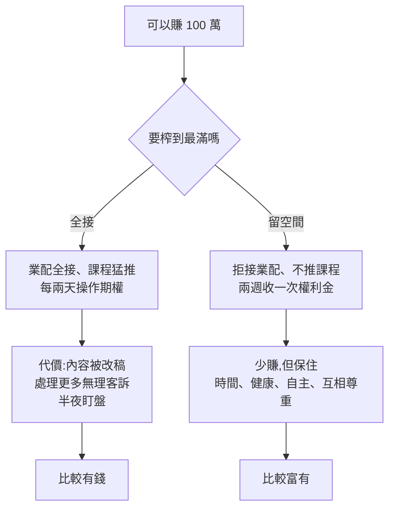

# 為什麼「賺好賺滿」反而會害了你:社會資產與「不最大化」的選擇

> 整理自 YouTube 頻道 **Nick 美股咖啡館**〈[為什麼想著把錢「賺好賺滿」反而100%會害了你?](https://www.youtube.com/watch?v=tEjPWVEuu_8)〉(2026-10-13,約 14.5 分鐘,官方 zh-TW 字幕)。
>
> ⚠️ **非投資建議。** 本集是理財觀與人生觀的雜談,不是個股分析。
>
> ⚠️ **立場揭露**:
> - 說明欄附 **IB 盈透證券推薦連結**。作者在片中明說「點選一下,IB 會把我的便當加一隻雞腿」,也就是點擊後作者會拿到回饋。
> - 作者另外販售 Excel 估值模型與 nickvischool 課程。
> - 作者自稱目前「幾乎不接業配」,本集沒有業配。片中提到的最大持股 AMD 屬作者持有,有利益關係。

---

## 一句話總結

> ⭐⭐ **目標不是變得「最有錢」,而是變得「最富有」。** 收入和投資報酬都不必榨到最滿。留一點空間給時間、健康、關係和自尊,這些「社會資產」長期比多賺那 20% 更值錢。

---

## 一、資產不只是錢:金融資產 vs 社會資產

| 類型 | 內容 | 作者的觀察 |
|---|---|---|
| 金融資產 financial asset | 現金、股票、債券,可以變現的東西 | 一般人把「資產」直接等同於錢 |
| 社會資產 social asset | 影響過的人、建立的信任、關係、社群(community) | 越有錢的人反而越重視這一類 |

- 作者用自己的例子:在墨爾本辦粉絲小聚,請大家喝咖啡、吃飯。淨值變少了,但「I feel richer」。
- 他也拆字玩笑:asset 如果「只看頭不看尾」,也就是只看錢的數字、不看為它犧牲了什麼(時間、身心健康),就只剩 ass,沒用的東西。作者自己承認這是「瞎掰」,但用來提醒「要看錢的來源與代價」。

### 拿公司類比:AMD 的無形資產遠大於現金(本文已用 SEC XBRL 核實)

作者說 AMD 現金約 50 億美元,但商譽、商標等無形資產約 400 億,是現金的 8 倍以上。查 AMD 10-Q(2026-06-27):

| 項目 | 金額 | 核實 |
|---|---|---|
| 現金與約當現金 | $5.09B | ✅ 與「約 5B」相符 |
| 商譽 Goodwill | $25.47B | |
| 其他無形資產淨額 | $15.63B | |
| 商譽 + 無形資產 | **$41.10B** | ✅ 與「約 40B、8 倍」相符(8.1 倍) |

> ⚠️ 補正:
> - **只算現金不公平**:AMD 另有短期投資 $8.03B,現金加短期投資約 $13.1B,倍數會降到約 3 倍。
> - **商譽不等於品牌魅力**:AMD 的商譽主要來自併購會計(2022 年併購 Xilinx 等),是「收購價高於可辨認淨資產的差額」,不等於品牌口碑。這個類比可以用來說明「看不見的價值」,但數字不能直接解讀成「品牌值 400 億」。

---

## 二、作者的實例:主動「把錢留在桌上」

1. **業配**:剛開頻道時,作者因眼疾手術休養兩年,覺得落後同學,「每支影片都是業配、價格 OK 就全接」。後來發現業配要寫稿、給廠商校稿、改語氣,甚至改整部內容。現在「價格兩倍三倍、十倍都不接」。
2. **課程**:課程是不錯的額外收入,但他已經很久沒主動推廣。原因是曾在週六晚上收到學員來信,對方沒注意到「半年沒登入就先砍帳號」的公告,卻要他「快處理」。作者的邏輯是:**賣 10 倍的課,就要處理 10 倍的這種事**。他也說 99.9% 的學員都很好。
3. **選擇權**:他提倡兩週收一次權利金,而不是做兩天到期的期權。後者賺更多,但要天天盯單;人在澳洲時,美股開盤已經過了半夜 12 點半。

> 作者的核心句:**「最賺錢、績效最高的投資策略,絕對不是最好的投資策略。」** 最好的策略是不讓操作頻率吞掉你的生活。

- 作者也引用粉絲推薦的書《Company of One》(一人公司,Paul Jarvis 著):公司可以選擇「不成長」,不必盲目擴張營收。作者把它延伸到個人收入。
  - 書名、作者與核心論點屬公開資訊。✅ 書的核心論點與作者轉述一致;作者把它延伸到個人的部分,是他的詮釋。

---

## 三、這個觀念放進投資框架

- **策略的「可持續性」本身就是報酬的一部分**:一個要你天天半夜盯盤的策略,就算期望值較高,也容易因疲勞、出錯或放棄而崩掉。能長期執行的次佳策略,常常勝過三個月就放棄的最佳策略。這跟 [[just-keep-buying-nick-maggiulli]] 談的「能堅持的計畫才是好計畫」一致。
- **時間是不可再生的資產**:為了最後 20% 的收益付出的時間與健康成本,通常不成比例。[[thinkers-get-rich-jonathan-clements]] 也提到,財富的目的是買到自由與時間。
- **期權頻率的取捨**:短天期權利金的 theta 衰減快、看起來賺得多,但交易次數多,管理成本、滑價與失誤機率也上升。頻率要配合自己的時區和生活節奏。

---

## 四、應用案例

### 案例 1:接案者的「收入天花板」設計

自由接案者一個月最多可接 10 案,但第 9、10 案都要犧牲週末。改成設上限 8 案,把接案標準寫清楚:不接要求大改、溝通成本高的客戶。收入少 20%,但留下穩定的休息與客戶品質。這跟作者拒接業配是同一個邏輯。

### 案例 2:賣權策略選兩週到期而非兩天到期

在台灣上班、晚上要睡覺的投資人做 Sell Put。兩天到期的週期權利金年化看起來較高,但每晚美股開盤都要盯單。改成約兩週到期、只在固定時間(例如週末)檢查與調整,報酬略低,但不影響睡眠,犯錯的機率也低。照作者的定義,這才是「最好的策略」。

### 案例 3:把「社會資產」寫進年度財務檢視

年度檢視時,除了淨值變化,另外列一欄「社會資產」:這一年幫助了誰、建立了哪些可以互相請教的關係、健康指標如何。如果淨值增加 15%,但體檢紅字變多、跟家人相處時間減半,就把下一年的收入目標調低一點,換回時間。

### 案例 4:看財報時分清「無形資產」的性質

學作者用 AMD 舉例時,要記得拆開看:商譽多半是併購溢價,可能因被併購業務表現不佳而減損;其他無形資產則會逐年攤提。比較公司「看不見的價值」時,商譽占總資產比例過高反而要留意減損風險,不能直接當作品牌力。

---

## 五、批判與補充

- **倖存者視角**:作者已經有穩定的頻道收入與持股,才有本錢「把錢留在桌上」。剛起步、背負房貸或負債的人,「賺好賺滿」有時是必要的階段,作者自己也經歷過這個階段。
- **推薦連結的張力**:作者說不接業配,所以請觀眾點 IB 推薦連結。這本身也是一種收益來源,讀者應知悉。
- 本集沒有引用學術研究,主要是作者的個人經驗與觀點。

---

## 來源

- Nick 美股咖啡館〈為什麼想著把錢「賺好賺滿」反而100%會害了你?〉:https://www.youtube.com/watch?v=tEjPWVEuu_8(官方 zh-TW 字幕)
- AMD 10-Q XBRL(CIK 0000002488,2026-06-27 資產負債表,查詢日 2026-10-19):https://data.sec.gov/api/xbrl/companyfacts/CIK0000002488.json
- Paul Jarvis,《Company of One: Why Staying Small Is the Next Big Thing for Business》(2019):https://pjrvs.com/company/
- 揭露:說明欄 IB 盈透證券推薦連結(點擊作者得回饋)、Excel 估值模型 / nickvischool 為作者自家產品,本文不收錄
