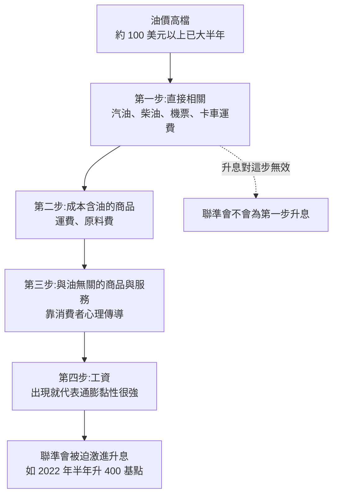
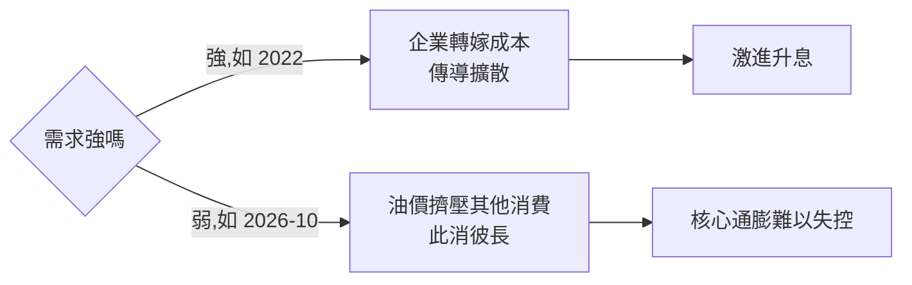

# 高油價會不會讓通膨失控?油價傳導四步檢查法(2026-10 美股大跌)

> 整理自 YouTube 頻道 **美投讲美股(美投君)**〈[通胀失控,加息飙升,AI融资泡沫…危机集体爆发!美股扛不住了?](https://www.youtube.com/watch?v=xu8g7ZhavUc)〉(2026-10-18,約 24 分鐘)。
>
> ⚠️ **非投資建議。** 本文整理的是**判斷通膨會不會擴散的分析框架**,以及美投君的個人觀點。
>
> ⚠️ **業配與自我推廣揭露**:片頭約 1:25–3:03、片尾都在推廣頻道自家的付費產品「美投選股訓練營」(US$19.99,限 288 名,結營時「拿走三支最看好標的」),說明欄另有「美投 Pro」訂閱導購連結。本文不收錄這些內容。
>
> ⚠️ 該片無字幕,逐字稿以 CPU 版 Whisper(faster-whisper small)轉錄取得,非官方字幕,可能有少量聽寫誤差。片中主要的官方數字,本文已對照 BLS API 核實(見第二節)。

---

## 一句話總結

> ⭐⭐⭐ **市場怕的不是通膨本身,而是聯準會因通膨被迫激進升息。** 要判斷會不會走到那一步,就看**油價有沒有從「直接相關產業」往外傳導**到商品、服務,最後到工資。2026 年 9 月的數據顯示,傳導**只停在第一步**(能源、運輸、交通)。所以美投君判斷:通膨仍可控,聯準會大概只會做 2–3 次溫和的預防性升息,因通膨恐慌造成的下跌**反而是機會**。

---

## 一、背景:2026-10 第二週的「壞消息三連」

- 週三 CPI 超預期,週四 PPI 再超預期,週五油價漲到約 **US$110**(比戰爭期間還高)。
- 美股一週跌約 4.5%。對利率最敏感的 CoreWeave 重挫;半導體 ETF **SMH 連跌 9 個交易日**(片中稱是 20 年來最差);小型股進入回檔區。
- 市場同時冒出幾個「鬼故事」:聯準會大幅升息、AI 融資鏈斷裂、美國衰退。

---

## 二、數據回顧(BLS 官方數字已核實)

| 指標(2026 年 9 月) | 片中說法 | BLS API 核實(NSA) |
|---|---|---|
| 整體 CPI 年增 | 3.7%(上月 3.4%) | **3.74%**(8 月 3.40%)✓ |
| 核心 CPI 年增 / 月增 | 2.6% / 0.3% | 年增 **2.56%** ✓;月增 NSA 0.37%(片中應為季調值) |
| PPI final demand 年增 / 月增 | 6.3% / 1.3%(預期 5.5% / 0.6%) | 年增 **6.34%** ✓;月增 NSA 1.11%(片中應為季調值) |
| 非農新增就業 | 約 2.9 萬 | **+2.9 萬** ✓ |
| 失業率 | 4.2% | **4.2%** ✓ |

片中其他細項(未逐項核實):
- 能源一個月漲 5.2%,約占整體 CPI 漲幅 6 成。汽油年增 34.2%。
- 核心商品月增 0.25%,是 2025 年 1 月以來最高。核心服務月增 0.37%,約占核心漲幅 8 成。
- 核心 PPI 月增 0.7%、年增 5%。

---

## 三、核心框架:油價傳導四步



**關鍵觀念**:聯準會升息**不是要壓已經漲上去的價格**(油價直接帶動的那部分,升息也壓不下來),而是要**壓那些還沒來得及漲的價格**,也就是阻止傳導往下走。

### 用 9 月數據逐步檢查

| 步驟 | 看什麼數據 | 9 月結果 | 判定 |
|---|---|---|---|
| 一 | CPI 交通服務、PPI 貿易運輸倉儲 | 汽車與卡車租賃 +5.4%、機票 +1.2%;PPI 能源月增 10.8% | ✅ **已傳導** |
| 二 | 核心商品 | 只有玩具 +4.2%(關稅)與二手車 +0.7% 在漲,兩者都跟油價關係不大;PPI 核心商品只 +0.3% | ❌ 未明顯傳導 |
| 三 | 與油無關的服務 | 核心服務八大類只有交通服務抬頭。房租(OER,業主等價租金)貢獻核心漲幅近一半,但集中在**中西部單月 +0.68%**,其他地區仍在下降,比較像統計波動 | ❌ 未傳導 |
| 四 | 亞特蘭大聯準會工資成長追蹤 | 仍在下滑,來到 2021 年以來最低 | ❌ 未傳導 |

- 旁證:片中引用高盛模型,目前核心通膨高出 2% 目標的部分,**約 90% 來自關稅與伊朗戰爭的能源衝擊**。

---

## 四、油價維持高檔會怎樣:供給面 + 需求面

不去預測戰爭,改問:「**如果油價一直不降,會怎樣?**」

### 供給面:不是 1970 年代

- 1970 年代的美國是純石油進口國,也沒有戰略石油儲備。現在原油基本自給,戰略儲備也更靈活。
- 每創造 1 美元 GDP 消耗的能源,1970 年代約是現在的 **3 倍多**。
- 汽油占居民消費的比重,從 1980 年代約 6% 降到現在約 2%。

### 需求面:不是 2022 年

傳導的前提是**需求夠強**,企業才轉嫁得了成本。2022 年有疫後大放水,人們手上有錢,企業漲價很容易。現在的情況:

| 需求指標 | 片中數字 | 解讀 |
|---|---|---|
| 非農就業 | 9 月 +2.9 萬;高盛研究指出低於 6 萬代表經濟在放緩,5 月以來一直如此 | 偏弱 |
| 沃爾瑪美國同店銷售 | 8 月財報 +2.6%(去年同期 4.6%);來客沒少,客單價下降 | 消費者變謹慎 |
| 失業率 / 銀行財報 | 4.2%;消費者財務仍健康 | 不溫不火 |
| 9 月零售銷售 | 整體月增 0.8%(預期 0.3%),但**控制組只有 +0.1%**(預期 0.3%) | 油價**擠壓**其他消費,屬於此消彼長,企業難以漲價 |



### 基期效應

到明年 2–3 月,油價的比較基期會變成約 100 美元,油價年增率會自動回落,甚至轉成通縮因子。聯準會看的是**漲幅**,不是**價格水準**。所以美投君判斷,面對注定會回落的通膨,聯準會只會做 **2–3 次溫和預防性升息**,而且市場已大致 price in。

---

## 五、AI 融資鏈的「鬼故事」

- 大型科技公司槓桿很低、投資報酬率很高,本身沒有融資風險;就算利率翻倍,也有動力繼續借錢投 AI。
- **CoreWeave 確實是風險**:槓桿約 7–8 倍,商業模式就是在 AI 基建早期用高槓桿搶紅利,升息對它衝擊大。但它在 AI 算力中只占約 3–5%,四大雲端廠的 CDS 價格幾乎沒受它的違約風險影響,所以「它倒了會拖垮整條鏈」是誇大。
- 尾部風險鏈:**通膨失控 → 激進升息 → 估值壓縮 → 衝擊 AI 融資鏈**。美投君認為發生機率不高。
- 另外提醒:**期中選舉前**市場歷來較脆弱,短期波動會變大。

---

## 六、什麼情況會讓這個判斷出錯(可證偽條件)

| 情境 | 能預測嗎 | 監控方式 |
|---|---|---|
| ① 油價失控上漲到 US$150 以上 | 不能(取決於戰局) | 油價本身 |
| ② 經濟比預期強:升息 3–4 次後需求仍旺,企業照樣漲價 | **可以持續追蹤** | 每週與每月的經濟數據:控制組零售、工資、核心商品與服務 |

> 方法論的重點:**把無法預測的變數(戰爭)和可追蹤的變數(需求、傳導)分開**,只對後者設監控與調整規則。

---

## 七、應用案例

### 案例 1:每月 CPI / PPI 公布日的「傳導檢查表」

數據出來後,不要只看整體數字超不超預期,照順序逐步打勾:

```text
[一] 交通服務 / PPI 運輸倉儲  → 漲?(預期會漲,升息無效)
[二] 核心商品(剔除關稅品項)→ 漲?
[三] 核心服務(剔除交通;OER 拆區域看是否單區跳動)→ 漲?
[四] 亞特蘭大聯準會工資成長追蹤 → 抬頭?
需求確認:零售銷售「控制組」vs 整體
```
只有第一步打勾的話,判斷為「恐慌大於實質」。第二、第三步開始打勾,就把升息預期上調;第四步也打勾,就是 2022 年的劇本。

### 案例 2:把框架寫成可回測的規則

用 BLS API(`CUUR0000SA0L1E` 核心 CPI、`WPUFD4` PPI final demand)加上 FRED 的工資與零售控制組序列,定義「傳導分數」0–4。回測:分數 ≤1 時,因 CPI 超預期造成的 SPX / SMH 週跌幅,之後 1 / 3 個月的報酬分布,是否優於分數 ≥3 時。這可以驗證美投君「因通膨恐慌造成的下跌是機會」這句話,在歷史上是否成立。

### 案例 3:個股壓力分層

同一個升息情境,對不同公司的衝擊不同:高槓桿的 AI 基建(CoreWeave,約 7–8 倍)最敏感,低槓桿、高 ROIC 的大型科技最不敏感。可以搭配 [[memory-50-year-cycle-three-signals]] 的過熱訊號一起用:過熱又高槓桿的,倉位縮最多。

### 案例 4:區分「數字恐慌」和「實質威脅」

OER 中西部單月 +0.68%、其他地區下降,這種**單一區域跳動**要先當統計雜訊處理,等下個月確認再說。這跟 [[us-bond-stock-divergence-valuation-vs-earnings-1994]] 說的一樣:先拆清楚恐慌的來源,再決定要不要應對。

---

## 八、批判與補充

- **觀點偏多**:這是美投君的判斷。「下跌是機會」成立的前提,是第六節兩個條件都不發生。
- 片中季調月增率(核心 CPI 0.3%、PPI 1.3%)和 BLS 未季調數字不同屬正常;年增數字已核實一致。
- 高盛 90% 模型、沃爾瑪同店、CoreWeave 槓桿與算力占比、CDS 圖,本文**未逐項查證**。
- 「美國很難重演 1970 年代」的論述,只適用於美國的能源結構;對能源進口國(如台灣、日本)的通膨傳導不能直接套用。

---

## 來源

- 美投讲美股〈通胀失控,加息飙升,AI融资泡沫…危机集体爆发!美股扛不住了?〉:https://www.youtube.com/watch?v=xu8g7ZhavUc(該片無字幕,逐字稿以 CPU 版 Whisper 轉錄取得,非官方字幕)
- BLS Public Data API(CPI-U `CUUR0000SA0`、核心 `CUUR0000SA0L1E`、PPI `WPUFD4`、非農 `CES0000000001`、失業率 `LNS14000000`,查詢日 2026-10-18):https://api.bls.gov/publicAPI/v2/timeseries/data/
- Atlanta Fed Wage Growth Tracker:https://www.atlantafed.org/chcs/wage-growth-tracker
- 揭露:片頭與片尾的「美投選股訓練營」、說明欄的「美投 Pro」為頻道自家付費產品推廣,本文不收錄
