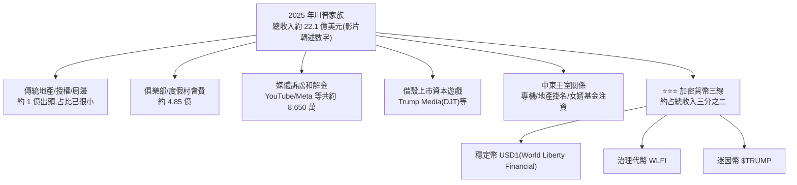

# 川普第二任期的賺錢秘笈:從地產 IP 到加密貨幣

> ⚠️ **非投資建議**。整理自 小Lin说〈[特朗普收入曝光,一年狂揽$22亿,竟然是靠…](https://www.youtube.com/watch?v=fKoWrF49Qo8)〉。
> ⚠️ **該片無官方字幕(YouTube 限流抓不到),逐字稿以 CPU 版 Whisper 轉錄取得,可能有同音字誤差**(例如把「川普」轉成「特朱普/特朔普/贺朗普」等,本文已統一還原為「川普」)。
> 本片未發現業配/聯盟連結片段,無須揭露。

---

## 一、背景:兩個版本的「川普經商哲學」

**版本 1.0(1980s–2016,第一任總統前):** 核心資產是曼哈頓/芝加哥/加州等地產與高端俱樂部,
悟出「**我最值錢的資產不是樓,是我的名字**」——把 Trump 這個 IP 授權出租,同款酒店掛上 Trump 招牌可貴 30%。

**第一任總統期間(2017–2021)反而是商業谷底:** 核心客群集中在民主黨票倉城市,
川普當總統後反被自己的政治流量反噬,部分業主甚至投票要拆招牌;2021 年國會山事件後更被多個社交平台封號、
銀行斷貸、背上兩筆官司(E. Jean Carroll 性騷擾案約賠 8,800 萬美元;紐約州虛報資產詐貸案一審判賠約 4.54 億美元)。

**版本 2.0(第二任總統,2025 起):** 在商業谷底被「逼出」一套全新打法——**不再守著傳統地產,轉向把總統身份本身變現**。

---

## 二、2025 年收入結構(以影片轉述的美國政府道德法申報報告為主要依據)

### 2.1 俱樂部與度假村(約 4.85 億美元)

海湖莊園(Mar-a-Lago)等會員制俱樂部的會費,**第一任之前約 10 萬美元,第二任已漲到約 100 萬美元**——
影片的解釋是「當總統後,俱樂部等於多了一個能直接接觸總統本人的機會」,會費因此暴漲。

### 2.2 媒體訴訟和解金

川普在第一任後被多個社交平台封號,第二任上台後對這些平台提告,多數選擇和解(影片數字):
**YouTube 賠 2,200 萬美元、Meta 賠 2,450 萬美元**,加上 CBS、ABC、X 等,**合計約 8,650 萬美元**;
紐約時報、BBC、華爾街日報等訴訟仍在進行中。

> ✅ 這一項已核實方向正確(見第四節),具體金額與公開報導有小幅差異但量級一致。

### 2.3 借殼上市:Trump Media & Technology Group(股票代號 DJT)

2024 年 3 月透過借殼上市,股價上市初期一度把市值衝到約 90 億美元。
影片指出:**公司號稱橫跨社交、流媒體、金融、AI 搜尋,但 2026 年第一季營收僅約 87 萬美元**;
同期卻虧損約 4 億美元——原因是公司拿募資買進近 1 萬枚比特幣、均價約 11 萬美元,買在高點後遇到比特幣大跌。
川普兩名兒子後續又如法炮製了新的借殼上市公司(New America),2025 年 8–12 月操作,影片估計整個家族因此增加的財富「最保守約 12 億美元」。

### 2.4 中東關係

2025 年卡達贈送一架價值約 4 億美元的波音 747 專機(名義上贈與美國政府,實際將轉入川普基金會);
2024 年起川普集團與中東國家簽下一系列掛名開發項目(卡達高球度假村約 55 億美元、沙烏地多座 Trump Tower、
杜拜新塔等),總盤子影片估算約一兩百億美元,**川普團隊不出資,只收掛名費與管理費**。
同時,沙烏地主權基金向川普女婿庫許納(Jared Kushner)的私募基金投資約 20 億美元,
卡達、阿布達比隨後跟進約 15 億美元。

### 2.5 ⭐⭐⭐ 加密貨幣(影片估算占 2025 年總收入三分之二)

| 項目 | 內容(影片轉述數字) |
|---|---|
| **穩定幣 USD1**(World Liberty Financial 發行) | 2025 年收入約 1.97 億美元;阿聯MGX 基金曾注入約 20 億美元規模的資金 |
| **治理代幣 WLFI** | 川普家族抽成賣幣收入的 75%,2025 年這塊收入約 5.9 億美元 |
| **迷因幣 $TRUMP** | 2025 年 1 月 17 日(就職前三天)發行,上線當天衝到約 75 美元,之後已重挫逾 90%;影片稱這是 2025 年單項最大收入來源,約 6.35 億美元 |

> ⭐⭐⭐ **三線加密貨幣合計影片估算約 14 億美元** —— 約是俱樂部與度假村全部收入的三倍,且是即時現金收入,不是帳面浮盈。

---

## 三、關鍵問題:這合法嗎?為什麼沒人管?

影片的論點:**美國利益衝突迴避相關法律(《美國法典》第 18 篇第 208 條)明文排除總統與副總統**——
國會議員、聯邦法官受此法律約束,但總統不受。穩定幣法案裡的「禁止高官持有穩定幣」條款,
適用範圍同樣排除總統和副總統。制度設計的邏輯不是靠事前禁止,而是靠**強制資訊揭露**——
源自 1978 年水門事件後訂立的《政府道德法》(高官須每年申報資產、負債與每筆收入來源),
以及 2012 年補充的「45 天內申報股債交易」規定。影片引用美國大法官 Brandeis 的名言:
**「陽光是最好的消毒劑」**,制度假設透明本身會促成自我約束,但影片的觀察是:
**「川普的『陽光』好像變成了他最好的保護色」**——公開了、喊出來了,反而沒什麼後果。

> 📌 **這一段是影片作者本人的觀點/評論,不是查核過的法律結論,讀者應自行對照原始法條與後續司法動態判斷。**

---

## 四、核實狀態

### ✅ 已核實(對照獨立媒體報導)

| 影片說法 | 核實結果 |
|---|---|
| **YouTube 就 2021 年帳號停權案與川普和解,賠款約 2,200 萬美元(流向川普白宮宴會廳建設基金)** | **屬實**(2025-09-29 多家媒體報導 Alphabet/YouTube 以 2,450 萬美元總額和解,其中 2,200 萬給川普本人、250 萬給其他共同原告) |
| **Meta 就類似帳號停權案與川普和解,賠款約 2,450 萬美元(流向川普總統圖書館基金)** | **方向屬實**,金額與公開報導(約 2,500 萬美元,其中 2,200 萬指定給圖書館基金)量級一致 |
| **World Liberty Financial 發行穩定幣 USD1、阿聯 MGX 基金有大額資金往來、WLFI 代幣抽成 75% 歸川普家族** | **方向屬實**(MGX 以 USD1 完成對 Binance 20 億美元投資一事經多家媒體報導;WLFI 代幣銷售川普家族抽成 75% 亦有報導佐證) |
| **$TRUMP 迷因幣於 2025 年 1 月就職前發行,上線初期暴漲後大幅回落** | **方向屬實**,屬公開可查的加密貨幣市場事件 |

### ⚠️ 未能獨立查證(以影片轉述 900 多頁政府道德法申報報告與第三方估算為主,本文未逐項核對原始申報文件)

- **2025 年家族總收入 22.1 億美元、凱淨財富從 23 億漲到 65 億美元(近三倍)的精確數字** —— ⚠️ **屬影片對官方申報表與第三方報導的綜合估算,本文未直接開啟該申報文件核對。**
- **俱樂部/度假村收入細項(海湖莊園 7,750 萬、高球度假村 1.21 億,合計 4.85 億)** —— **未逐項核對。**
- **媒體訴訟和解金總額「約 8,650 萬美元」的加總明細(CBS、ABC 各自金額)** —— **未逐項核對,量級與已核實的 YouTube/Meta 部分一致。**
- **紐約州虛報資產案在上訴法院被推翻、不用賠償的具體時間與金額** —— **未查得對應判決書或獨立報導確認**;使用者 2026-11-07 聽原片確認講者確實這麼說(上訴被推翻、財富 23→65 億),屬講者原話,事實查證未完成,講者說法,未查證。
- **Trump Media(DJT)2026 年第一季營收 87 萬美元、虧損 4 億美元、買入近 1 萬枚比特幣均價約 11 萬美元** —— **未查得對應財報確認,以影片轉述看待。**
- **$TRUMP 幣最大買家為孫宇晨(Justin Sun)、具體認購金額** —— 字幕「剩億美元」= 「上億美元」(使用者 2026-11-07 聽原片確認):孫宇晨總計購買 TRUMP 相關幣約「上億美元」(金額量級,非精確值)。
- **穩定幣 USD1、WLFI 代幣各自 2025 年收入「1.97 億」「5.9 億」、迷因幣 $TRUMP「6.35 億」的精確拆分金額** —— **未逐項核對,屬影片對官方申報與第三方估算的綜合數字。**
- **卡達贈送 4 億美元波音 747、中東開發項目「總盤子約一兩百億美元」、庫許納基金獲中東主權基金注資 20 億＋15 億美元** —— **方向與公開報導的中東-川普商業往來大致吻合,但精確金額未逐項核對。**

---

## 五、應用案例

1. **讀公開人物財富報導時的查核習慣**:美國總統/副總統的年度財產申報(OGE 表格)是公開文件,
   任何人都能下載核對——本篇示範的做法是「先看影片的數字框架,再去找官方申報文件或多家獨立媒體交叉驗證」,
   而不是把二手轉述當一手事實。
2. **理解「加密貨幣監管盲區」的實務案例**:迷因幣(如 $TRUMP)目前不被視為證券,SEC、CFTC 都難以管轄,
   發行方常用「免責聲明」(不構成投資機會,純屬支持的表達)規避詐欺指控——
   這是觀察任何迷因幣項目時都該先檢查的揭露條款位置。

---

## 來源

- YouTube:[特朗普收入曝光,一年狂揽$22亿,竟然是靠… — 小Lin说](https://www.youtube.com/watch?v=fKoWrF49Qo8)
  - ⚠️ **該片無官方字幕,YouTube 限流抓不到,逐字稿以 CPU 版 Whisper 轉錄取得,可能有同音字誤差(人名/地名/數字皆已盡力核對,仍有部分片段標記為「推定」或「未能查證」,見第四節)。**
- [YouTube to pay $22 million in settlement with Trump — The Jakarta Post / 多家媒體 2025-09-30 聯合報導](https://www.thejakartapost.com/world/2025/09/30/youtube-to-pay-22-million-in-settlement-with-trump)
- [Alphabet will pay $22 million to settle President Trump's YouTube lawsuit — Engadget](https://www.engadget.com/big-tech/alphabet-will-pay-22-million-to-settle-president-trumps-youtube-lawsuit-234611643.html)
- [World Liberty Financial's stablecoin will be used to close MGX's $2B Binance investment — CoinDesk](https://hotfix.coindesk.com/business/2025/05/01/world-liberty-s-stablecoin-will-be-used-to-close-mgx-s-usd2b-binance-investment-eric-trump)
- [World Liberty Financial — Wikipedia](https://en.wikipedia.org/wiki/World_Liberty_Financial)
