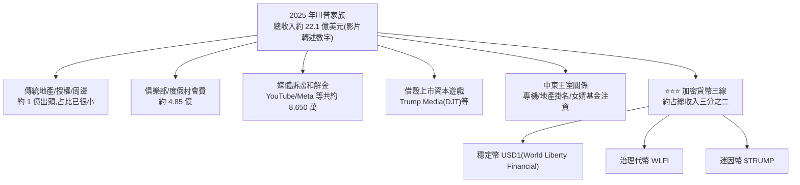

# 川普第二任期的賺錢秘笈:從地產 IP 到加密貨幣

> ⚠️ **非投資建議**。整理自 小Lin说〈[特朗普收入曝光,一年狂揽$22亿,竟然是靠…](https://www.youtube.com/watch?v=fKoWrF49Qo8)〉。
> ⚠️ **該片無官方字幕(YouTube 限流抓不到),逐字稿以 CPU 版 Whisper 轉錄取得,可能有同音字誤差**(例如把「川普」轉成「特朱普/特朔普/贺朗普」等,本文已統一還原為「川普」)。
> 本片未發現業配/聯盟連結片段,無須揭露。

---

## 一、背景:兩個版本的「川普經商哲學」

**版本 1.0(1980s–2016,第一任總統前):** 核心資產是曼哈頓/芝加哥/加州等地產與高端俱樂部,
悟出「**我最值錢的資產不是樓,是我的名字**」——把 Trump 這個 IP 授權出租,同款酒店掛上 Trump 招牌可貴 30%。

**第一任總統期間(2017–2021)反而是商業谷底:** 核心客群集中在民主黨票倉城市,
川普當總統後反被自己的政治流量反噬,部分業主甚至投票要拆招牌;2021 年國會山事件後更被多個社交平台封號、
銀行斷貸、背上兩筆官司(E. Jean Carroll 性騷擾案約賠 8,800 萬美元;紐約州虛報資產詐貸案一審判賠約 4.54 億美元)。

**版本 2.0(第二任總統,2025 起):** 在商業谷底被「逼出」一套全新打法——**不再守著傳統地產,轉向把總統身份本身變現**。

---

## 二、2025 年收入結構(以影片轉述的美國政府道德法申報報告為主要依據)

> ⚠️ **總收入 22.1 億美元:未能核實。** 畫面 [5:24](https://www.youtube.com/watch?v=fKoWrF49Qo8&t=314s) 只見字幕「2025年特朗普总收入」,未出現數字;搜尋未找到對應總數。另一來源(NBC 報導)列出的是 2025 年加密相關收入約 14 億美元,與影片「14 億」一致(見 §四)。下方圖中的各項金額一律以影片為準,未逐項核實。

### 2.1 俱樂部與度假村(約 4.85 億美元)

海湖莊園(Mar-a-Lago)等會員制俱樂部的會費,**第一任之前約 10 萬美元,第二任已漲到約 100 萬美元**——
影片的解釋是「當總統後,俱樂部等於多了一個能直接接觸總統本人的機會」,會費因此暴漲。

### 2.2 媒體訴訟和解金

川普在第一任後被多個社交平台封號,第二任上台後對這些平台提告,多數選擇和解(影片數字):
**YouTube 賠 2,200 萬美元、Meta 賠 2,450 萬美元**,加上 CBS、ABC、X 等,**合計約 8,650 萬美元**;
紐約時報、BBC、華爾街日報等訴訟仍在進行中。

> ✅ **已核實(畫面 + 申報列項 + NBC 報導)**:畫面 [7:14](https://www.youtube.com/watch?v=fKoWrF49Qo8&t=424s) 的圖表顯示 X 800 萬、ABC 1600 萬、CBS 1600 萬、Meta 2400 萬(畫面取整)、YouTube 2200 萬,加總 8650 萬;申報表列項可見 Meta「$24,500,000」、YouTube「$22,000,000」(Settlement 欄)。NBC 報導和解收入約 8,000 萬美元以上,並稱款項付給 Donald J. Trump Presidential Library Foundation。
> 🔧 **需修正**:原稿寫 YouTube 款項「流向白宮宴會廳建設基金」,NBC 報導的收款方是 Presidential Library Foundation;「宴會廳」的說法未能核實,已改為待確認(見 §四)。

### 2.3 借殼上市:Trump Media & Technology Group(股票代號 DJT)

2024 年 3 月透過借殼上市,股價上市初期一度把市值衝到約 90 億美元。
影片指出:**公司號稱橫跨社交、流媒體、金融、AI 搜尋,但 2026 年第一季營收僅約 87 萬美元**;
同期卻虧損約 4 億美元——原因是公司拿募資買進近 1 萬枚比特幣、均價約 11 萬美元,買在高點後遇到比特幣大跌。
川普兩名兒子後續又如法炮製了新的借殼上市公司(New America),2025 年 8–12 月操作,影片估計整個家族因此增加的財富「最保守約 12 億美元」。

### 2.4 中東關係

2025 年卡達贈送一架價值約 4 億美元的波音 747 專機(名義上贈與美國政府,實際將轉入川普基金會);
2024 年起川普集團與中東國家簽下一系列掛名開發項目(卡達高球度假村約 55 億美元、沙烏地多座 Trump Tower、
杜拜新塔等),總盤子影片估算約一兩百億美元,**川普團隊不出資,只收掛名費與管理費**。
同時,沙烏地主權基金向川普女婿庫許納(Jared Kushner)的私募基金投資約 20 億美元,
卡達、阿布達比隨後跟進約 15 億美元。

### 2.5 ⭐⭐⭐ 加密貨幣(影片估算占 2025 年總收入三分之二)

| 項目 | 內容(影片轉述數字) |
|---|---|
| **穩定幣 USD1**(World Liberty Financial 發行) | 2025 年收入約 1.97 億美元;阿聯MGX 基金曾注入約 20 億美元規模的資金。⚠️ **未能核實**:NBC 報導未列穩定幣收入;另一搜尋摘要的 1.97 億美元是「出售 Hashnote 股權」,數字相同,推定影片可能混淆,待查 |
| **治理代幣 WLFI** | 川普家族抽成賣幣收入的 75%,2025 年這塊收入約 5.9 億美元。⚠️ **來源分歧**:一搜尋摘要列 WLF 相關收入約 5.88 億美元(數字接近);NBC 分列為 token 銷售 >2.36 億、WLF 股權出售 >6,500 萬、WLF 相關錢包 >2.9 億,與「75% 抽成」的敘述對不上,未能核實 |
| **迷因幣 $TRUMP** | 2025 年 1 月 17 日(就職前三天)發行,上線當天衝到約 75 美元,之後已重挫逾 90%;影片稱這是 2025 年單項最大收入來源,約 6.35 億美元。✅ NBC 報導:迷因幣授權收入 >6.35 億美元(授權方 Celebration Coins);Herald/Reuters 報 6.36 億。發行日與價格波動**未另行核實** |

> ⭐⭐⭐ **三線加密貨幣合計影片估算約 14 億美元** —— 約是俱樂部與度假村全部收入的三倍,且是即時現金收入,不是帳面浮盈。

---

## 三、關鍵問題:這合法嗎?為什麼沒人管?

影片的論點:**美國利益衝突迴避相關法律(《美國法典》第 18 篇第 208 條)明文排除總統與副總統**——
國會議員、聯邦法官受此法律約束,但總統不受。穩定幣法案裡的「禁止高官持有穩定幣」條款,
適用範圍同樣排除總統和副總統。制度設計的邏輯不是靠事前禁止,而是靠**強制資訊揭露**——
源自 1978 年水門事件後訂立的《政府道德法》(高官須每年申報資產、負債與每筆收入來源),
以及 2012 年補充的「45 天內申報股債交易」規定。影片引用美國大法官 Brandeis 的名言:
**「陽光是最好的消毒劑」**,制度假設透明本身會促成自我約束,但影片的觀察是:
**「川普的『陽光』好像變成了他最好的保護色」**——公開了、喊出來了,反而沒什麼後果。

> 📌 **這一段是影片作者本人的觀點/評論,不是查核過的法律結論,讀者應自行對照原始法條與後續司法動態判斷。**
>
> ✅ **法條方向已核實**:美國政府倫理辦公室(OGE)1983 年的 advisory 頁面稱,總統與副總統「not legally subject to」18 U.S.C. §§ 202–209(含 §208 利益衝突條文)。來源:[OGE: President and Vice President not Subject to 18 U.S.C. §§ 202-209](https://oge.gov/web/oge.nsf/Resources/83x16:+President+and+Vice+President+not+Subject+to+18+U.S.C.+§§+202-209)。影片畫面 [17:36](https://www.youtube.com/watch?v=fKoWrF49Qo8&t=1046s) 出現的是 §208 條文原文(「Acts affecting a personal financial interest」)。
>
> ⚠️ **未能核實**:影片說穩定幣法「禁止高官持有穩定幣」條款同樣排除總統與副總統——本次未查到法案條文,此點待查。1978 年《政府道德法》與 2012 年「45 天內申報股債交易」的敘述未另行核實。
>
> 🖼️ 畫面 [20:04](https://www.youtube.com/watch?v=fKoWrF49Qo8&t=1194s) 確認為 Brandeis 肖像與字幕;「陽光是最好的消毒劑」的原出處未另行核實。

---

## 四、核實狀態

### ✅ 已核實(對照獨立媒體報導)

| 影片說法 | 核實結果 |
|---|---|
| **YouTube 就 2021 年帳號停權案與川普和解,賠款約 2,200 萬美元(流向川普白宮宴會廳建設基金)** | **金額屬實,收款用途需修正**:2025-09-29 多家媒體報導 Alphabet/YouTube 以 2,450 萬美元總額和解,其中 2,200 萬給川普本人、250 萬給其他共同原告;申報表列項 YouTube「$22,000,000」。NBC 報導款項付給 Presidential Library Foundation,「白宮宴會廳」說法**未能核實**,已改為待確認 |
| **Meta 就類似帳號停權案與川普和解,賠款約 2,450 萬美元(流向川普總統圖書館基金)** | **方向屬實**,金額與公開報導(約 2,500 萬美元,其中 2,200 萬指定給圖書館基金)量級一致 |
| **World Liberty Financial 發行穩定幣 USD1、阿聯 MGX 基金有大額資金往來、WLFI 代幣抽成 75% 歸川普家族** | **方向屬實**(MGX 以 USD1 完成對 Binance 20 億美元投資一事經多家媒體報導;WLFI 代幣銷售川普家族抽成 75% 亦有報導佐證) |
| **$TRUMP 迷因幣於 2025 年 1 月就職前發行,上線初期暴漲後大幅回落** | **方向屬實**,屬公開可查的加密貨幣市場事件 |

### ⚠️ 未能獨立查證(以影片轉述 900 多頁政府道德法申報報告與第三方估算為主,本文未逐項核對原始申報文件)

- **2025 年家族總收入 22.1 億美元、凱淨財富從 23 億漲到 65 億美元(近三倍)的精確數字** —— ⚠️ **未能核實。** 搜尋未找到 22.1 億的對應總數;NBC 報導(見 §延伸閱讀)強調申報表中許多金額是區間,無法精確算出總收入。影片開場的「23 億→65 億」為講者敘述,未核對財富數字來源。
- **俱樂部/度假村收入細項(海湖莊園 7,750 萬、高球度假村 1.21 億,合計 4.85 億)** —— **未逐項核對。**
- **媒體訴訟和解金總額「約 8,650 萬美元」的加總明細(CBS、ABC 各自金額)** —— ✅ **已於 §2.2 以畫面圖表核實**(ABC、CBS 各 1600 萬;X 800 萬)。
- **紐約州虛報資產案在上訴法院被推翻** —— ⚠️ **部分核實,需修正**:2025-08-21 紐約州上訴法院(Appellate Division, First Department)推翻約 4.646 億美元的 disgorgement 罰款(認定為違憲的過度罰金),但**維持詐欺責任認定與營業限制**;檢方表示將上訴至 Court of Appeals。影片說「不用賠」只對了罰款部分。來源(多家媒體摘要):[Courthouse News](https://www.courthousenews.com/new-york-appeals-court-tosses-trumps-500-million-civil-fraud-penalty/)、[InvestmentNews](https://investmentnews.com/regulation-and-legislation/ny-appeals-court-tosses-500m-civil-fraud-penalty-against-trump-upholds-injunctive-relief/261809)、[WHRO](https://www.whro.org/2025-08-21/an-appeals-court-throws-out-a-massive-civil-fraud-penalty-against-president-trump)。各媒體金額不一(4.54/4.64/5.00/5.27 億),原因是計算口徑不同(含利息與否)。
- **Trump Media(DJT)2026 年第一季營收 87 萬美元、虧損 4 億美元、買入近 1 萬枚比特幣均價約 11 萬美元** —— ✅ **營收與虧損已核實(搜尋摘要,未開 10-Q 原文)**:Q1 2026 營收約 87.1 萬美元($871,000),淨虧損 $405.9M,主因為數位資產減記;持有 9,542 BTC。來源:[KuCoin 快訊](https://www.kucoin.com/news/flash/trump-media-q1-net-loss-widens-to-406m-amid-bitcoin-and-cro-losses)、[Pulse](https://www.pulse.bot/finance/news/trump-media-parent-of-truth-social-reports-q1-sales-of-871000-and-4059-million-net-loss-f81cbc9c-f927-4560-9e81-48b9a9c7e526/)。**「買入均價約 11 萬美元」未能核實**。
- **$TRUMP 幣最大買家為孫宇晨(Justin Sun)、具體認購金額** —— 字幕「剩億美元」= 「上億美元」(使用者 2026-11-07 聽原片確認):孫宇晨總計購買 TRUMP 相關幣約「上億美元」(金額量級,非精確值)。
- **穩定幣 USD1、WLFI 代幣各自 2025 年收入「1.97 億」「5.9 億」、迷因幣 $TRUMP「6.35 億」的精確拆分金額** —— $TRUMP「6.35 億」✅ 已由 NBC 報導印證(見 §二表格);USD1「1.97 億」與 WLFI「5.9 億」來源數字對不上,**未能核實**(詳見 §二表格註記)。
- **卡達贈送 4 億美元波音 747、中東開發項目「總盤子約一兩百億美元」、庫許納基金獲中東主權基金注資 20 億＋15 億美元** —— **方向與公開報導的中東-川普商業往來大致吻合,但精確金額未逐項核對。**

---

## 五、應用案例

1. **讀公開人物財富報導時的查核習慣**:美國總統/副總統的年度財產申報(OGE 表格)是公開文件,
   任何人都能下載核對——本篇示範的做法是「先看影片的數字框架,再去找官方申報文件或多家獨立媒體交叉驗證」,
   而不是把二手轉述當一手事實。
2. **理解「加密貨幣監管盲區」的實務案例**:迷因幣(如 $TRUMP)目前不被視為證券,SEC、CFTC 都難以管轄,
   發行方常用「免責聲明」(不構成投資機會,純屬支持的表達)規避詐欺指控——
   這是觀察任何迷因幣項目時都該先檢查的揭露條款位置。

---

## 延伸閱讀與深度補充(2026-11-07 核實增補)

1. **申報表與「區間」問題(已讀 NBC 報導原文)**:[NBC New York 報導](https://www.nbcnewyork.com/news/national-international/trump-financial-disclosure-lists-crypto-earnings-meme-coins)指出,2025 年度申報是提交給 OGE 的財務申報表,共 927 頁,報導日期 2026 年 6 月 30 日。加密相關收入約 14 億美元:$TRUMP 迷因幣授權 >6.35 億、其他代幣銷售 >2.36 億、WLF 股權出售 >6,500 萬、WLF 相關錢包 >2.9 億(歸為收入)。和解收入約 8,000 萬美元。**報導也明確指出,許多金額以區間呈現,無法精確算出總收入。** 影片說這些是「十足的現金收入」,但「錢包歸類為收入」的項目並非確定現金,這點影片沒有交代。
   - 深度差異:「授權費」「代幣銷售抽成」「錢包持有」性質不同,影片合併成一個數字與酒店收入比較,比較基礎並不一致。
   - 另一搜尋摘要稱 2024 年度申報總收入逾 6 億美元(未開原文)。影片的 2025 年數字需與年度分開看,避免混用。
2. **法律條文(OGE 頁面已讀;CRS 僅見摘要)**:[OGE 1983 年 advisory 頁面](https://oge.gov/web/oge.nsf/Resources/83x16:+President+and+Vice+President+not+Subject+to+18+U.S.C.+§§+202-209)只記錄單一結論(總統與副總統「not legally subject to」§§202–209),**未附理由與政策條件**,PDF 全文未開啟。搜尋摘要另指 1989 年修法明確排除、1974 年有司法部代理部長認為對總統適用 §208 有合憲疑慮,而**合憲性從未經法院裁判**([CRS Legal Sidebar LSB10250](https://sgp.fas.org/crs/misc/LSB10250.pdf),僅見搜尋摘要)。
   - 深度差異:影片把「不受約束」直接解讀為制度漏洞;但 OGE 的結論是對既有法條的解釋,並非政策許可,法律上仍有爭議。
3. **DJT 虧損結構(搜尋摘要)**:Q1 2026 淨虧損中,比特幣未實現損失約 2.44 億美元,另有股權投資減記約 1.082 億美元;持有 9,542 BTC,其中約 4,260 BTC 作為可轉債抵押。營運現金流為正(約 1,790 萬美元,靠賣出 BTC 的 put 選擇權)。影片「虧 4 億是因為比特幣大跌」方向大致正確,但**還包括股權投資減記**。來源:[KuCoin 快訊](https://www.kucoin.com/news/flash/trump-media-q1-net-loss-widens-to-406m-amid-bitcoin-and-cro-losses)、[Pulse](https://www.pulse.bot/finance/news/trump-media-parent-of-truth-social-reports-q1-sales-of-871000-and-4059-million-net-loss-f81cbc9c-f927-4560-9e81-48b9a9c7e526/)。
4. **紐約州案:影片的重大簡化**:上訴法院推翻的是罰款,**責任認定與營業限制維持**,檢方並將上訴(見 §四)。影片說「判罰過重,特朗普你不用賠了」只對了一半。

## 來源

- YouTube:[特朗普收入曝光,一年狂揽$22亿,竟然是靠… — 小Lin说](https://www.youtube.com/watch?v=fKoWrF49Qo8)
  - ⚠️ **該片無官方字幕,YouTube 限流抓不到,逐字稿以 CPU 版 Whisper 轉錄取得,可能有同音字誤差(人名/地名/數字皆已盡力核對,仍有部分片段標記為「推定」或「未能查證」,見第四節)。**
- [YouTube to pay $22 million in settlement with Trump — The Jakarta Post / 多家媒體 2025-09-30 聯合報導](https://www.thejakartapost.com/world/2025/09/30/youtube-to-pay-22-million-in-settlement-with-trump)
- [Alphabet will pay $22 million to settle President Trump's YouTube lawsuit — Engadget](https://www.engadget.com/big-tech/alphabet-will-pay-22-million-to-settle-president-trumps-youtube-lawsuit-234611643.html)
- [World Liberty Financial's stablecoin will be used to close MGX's $2B Binance investment — CoinDesk](https://hotfix.coindesk.com/business/2025/05/01/world-liberty-s-stablecoin-will-be-used-to-close-mgx-s-usd2b-binance-investment-eric-trump)
- [World Liberty Financial — Wikipedia](https://en.wikipedia.org/wiki/World_Liberty_Financial)
- [NBC New York:Trump financial disclosure lists crypto earnings, meme coins(2026-07-01)](https://www.nbcnewyork.com/news/national-international/trump-financial-disclosure-lists-crypto-earnings-meme-coins)
- [OGE:President and Vice President not Subject to 18 U.S.C. §§ 202-209(1983)](https://oge.gov/web/oge.nsf/Resources/83x16:+President+and+Vice+President+not+Subject+to+18+U.S.C.+§§+202-209)
- [CRS Legal Sidebar LSB10250:Executive Branch Ethics and Financial Conflicts of Interest](https://sgp.fas.org/crs/misc/LSB10250.pdf)(僅見搜尋摘要)
- [KuCoin 快訊:Trump Media Q1 Net Loss Widens to $406M](https://www.kucoin.com/news/flash/trump-media-q1-net-loss-widens-to-406m-amid-bitcoin-and-cro-losses)
- [Pulse:Trump Media Q1 Sales $871,000 and $405.9 Million Net Loss](https://www.pulse.bot/finance/news/trump-media-parent-of-truth-social-reports-q1-sales-of-871000-and-4059-million-net-loss-f81cbc9c-f927-4560-9e81-48b9a9c7e526/)
- [Courthouse News:NY appeals court tosses Trump's $500M civil fraud penalty](https://www.courthousenews.com/new-york-appeals-court-tosses-trumps-500-million-civil-fraud-penalty/)
- [InvestmentNews:NY Appeals court tosses $500M civil fraud penalty; upholds injunctive relief](https://investmentnews.com/regulation-and-legislation/ny-appeals-court-tosses-500m-civil-fraud-penalty-against-trump-upholds-injunctive-relief/261809)
- [WHRO:An appeals court throws out a massive civil fraud penalty against President Trump](https://www.whro.org/2025-08-21/an-appeals-court-throws-out-a-massive-civil-fraud-penalty-against-president-trump)
