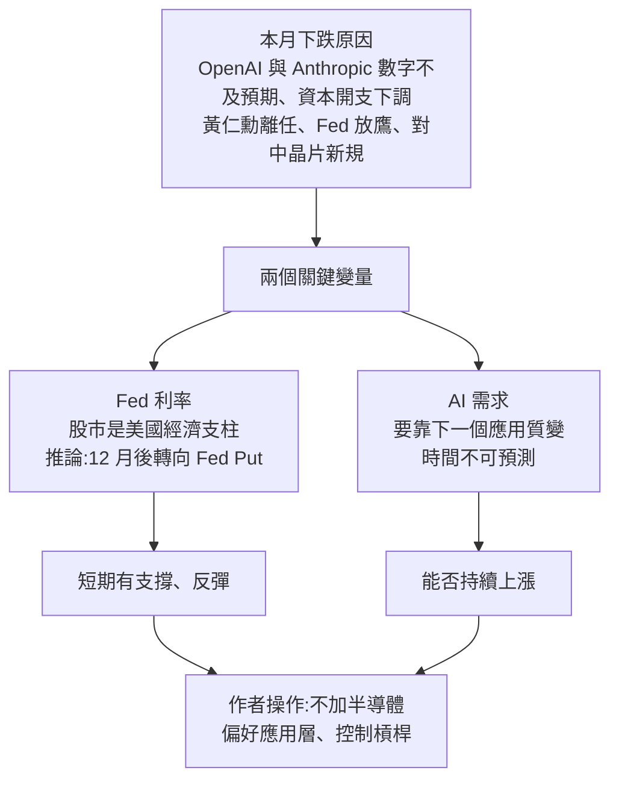

# 美股自由落體:Fed Put 會先到,AI 需求才決定能不能續漲(美投君 11/22)

> 整理自 YouTube 頻道 **美投君 / 美投讲美股**〈[最担心的来了!AI泡沫破裂?美股还有救吗?](https://www.youtube.com/watch?v=v_2Q_rdJPf0)〉(2026-11-22,24 分 36 秒)。
> 該片無字幕,逐字稿以 CPU 版 faster-whisper `large-v3-turbo` 轉錄取得,非官方字幕;時間點取自帶時間逐字稿。
>
> ⚠️ **非投資建議。** 本文整理作者論點並標出查證結果與盲點,不構成買賣建議。
> ⚠️ **利益與業配揭露:**
> - 片中 [1:17–2:39](https://www.youtube.com/watch?v=v_2Q_rdJPf0&t=67s) 為**美投期權課黑五折扣業配**(自家課程,附贈 90 天 ProPlus),片尾 [23:57](https://www.youtube.com/watch?v=v_2Q_rdJPf0&t=1427s) 起再推**美投 Pro** 與期權課;說明欄為美投 Pro 付費服務與 Discord。
> - 作者自述([21:52](https://www.youtube.com/watch?v=v_2Q_rdJPf0&t=1302s))前陣子賣掉很多英偉達,目前倉位不重,**「個人願意在此刻加仓」**,並說已在美投 Pro 分享打算加倉的股票:有利益關係與推廣動機。
> **核實方式:** Anthropic 數字對照我下載的 SEC 424B4 原文;Fed、OpenAI、商務部規則、BofA 調查用搜尋結果交叉,**多為二手報導**,未讀到一手公告。

## 一、一句話

作者認為這輪下跌是「Fed 轉向會先來、AI 應用端質變要等」:**美聯儲(Fed)為了保護被股市撐著的美國經濟,大概率在 12 月再放鷹一次後轉向(Fed Put),美股短期有支撐;但要持續上漲,還得等下一個 AI 應用落地。** 他不加碼半導體(資本開支擔憂會繼續發酵),較看好應用層。

## 二、影片重點與查證

| 時間 | 影片說法 | 查證 |
|---|---|---|
| [0:07](https://www.youtube.com/watch?v=v_2Q_rdJPf0&t=0s) 起 | 標普跌 11.6%、納指近 20%;英偉達單週 −23%,創 2008 年以來最差單週 | 指數與個股跌幅**未能核實**(我沒查到對應行情);片中 [21:25](https://www.youtube.com/watch?v=v_2Q_rdJPf0&t=1275s) 又說納指自高點回撤 18%,前後口徑略不同 |
| [0:52](https://www.youtube.com/watch?v=v_2Q_rdJPf0&t=42s) | Anthropic 上市第二天差點跌破發行價 | 發行價 $83.00 ✅(424B4 私募價同 IPO 價);「差點跌破」未能核實 |
| [3:06](https://www.youtube.com/watch?v=v_2Q_rdJPf0&t=176s) | 10/8 報導 OpenAI 年化收入約 500 億,比流傳的 700 億少 200 億 | ✅ 二手交叉:FT 10/8 報導 run rate 近 $50B;Axios 9/29 曾報近 $70B。⚠️ **影片沒提差距主因是會計口徑**(雲端夥伴銷售算法不同,700 億是拉齊 Anthropic 口徑的調整值),不等於銷售變弱 |
| [3:26](https://www.youtube.com/watch?v=v_2Q_rdJPf0&t=196s) | 10/14 Anthropic 外洩 Q3 收入 168 億美元,環比增速 147% → 45% | 與 424B4 定案數字**接近但不同**:Q3 營收 $16,956M,Q2 $11,555M、Q1 $4,731M,環比 +144.2%、+46.7%(147%、45% 為外洩版本,以 424B4 為準)。見 [[anthropic-ipo-compute-bill-vs-growth-424b4-agent-alchemist]] |
| [3:58](https://www.youtube.com/watch?v=v_2Q_rdJPf0&t=228s) | 美銀 11/12 調查:52% 基金經理預期未來 6 個月至少一家大雲廠削減資本開支 | ✅ 二手交叉:BofA 調查期間 11/6–11/12,52% 預期有超大型雲端公司宣布削減;另有科技淨加碼從 37% 降到 12%(2006 年 6 月以來最大月降幅)。**彭博「資本開支增速 26 年 100%、27 年不到 60%、28 年無一超過 20%」未能核實** |
| [4:28](https://www.youtube.com/watch?v=v_2Q_rdJPf0&t=268s) | 黃仁勳離開英偉達,「AI 央行」信用擔保人退出 | 事件有報導(離任與事件經過見 [[nvidia-without-jensen-huang-investment-view-meitoujun]]);「AI 央行」「信用擔保人退出」是**作者詮釋** |
| [5:03](https://www.youtube.com/watch?v=v_2Q_rdJPf0&t=293s) | 「10 月 18 日」公布 10 月會議紀要:幾乎所有人認為加息合適;同日沃勒呼籲 12 月加 50 基點 | ⚠️ **日期需修正為 11 月 18 日**(二手:investingLive 11/18「Waller/Fed minutes 把更大幅度 12 月加息帶進討論」);「幾乎所有與會者」「沃勒要 shock 市場」二手一致;紀要為 10 月會議(10–2 維持不變),也有「一些人對 25 基點以上開放」的說法 |
| [5:29](https://www.youtube.com/watch?v=v_2Q_rdJPf0&t=319s) | 8 月底 Jackson Hole、9/16 加息 25 基點,三年來首次 | ✅ 二手交叉:9/16 升息 25 基點至 3.75–4%,是 2023 年 7 月以來首次、Warsh 任內第一次;之後到 10 月標普與納指反而漲約 5% **未能核實** |
| [6:14](https://www.youtube.com/watch?v=v_2Q_rdJPf0&t=374s) | 「本周五」商務部新規堵死中國企業遠端使用美國先進晶片 | 規則**有**:BIS 臨時最終規則,**報導日期為 11/16**(含對印尼、馬來西亞、新加坡、泰國、巴西加晶片許可);影片說「本周五」與報導日期不符,可能是指同一規則的後續動作,**未能確定** |
| [6:30](https://www.youtube.com/watch?v=v_2Q_rdJPf0&t=380s) | 華盛頓翻舊帳,調查英偉達與 AMD 文件與財務 | **未能核實** |
| [9:00](https://www.youtube.com/watch?v=v_2Q_rdJPf0&t=530s) | 穆迪:收入前 10% 家庭貢獻全美逾半消費;後 80% 消費年增 4.5% vs 通脹 3.9% | **未能核實** |
| [12:06](https://www.youtube.com/watch?v=v_2Q_rdJPf0&t=716s) | 提出 Fed Put:股市是經濟支柱,Fed 會轉向 | **作者推論**。依據之一:10/16 Warsh 在舊金山聯儲說明內部三種情境,只有「AI 不及預期、股市跌致失業上升」是壞情境(**我沒查到這場談話,未能核實**) |
| [12:49](https://www.youtube.com/watch?v=v_2Q_rdJPf0&t=759s) | 布蘭特原油從 10 月底約 117 美元跌到約 90,降低加息迫切性 | **未能核實** |
| [13:21](https://www.youtube.com/watch?v=v_2Q_rdJPf0&t=791s) | 2018 年類比:鮑威爾上任第一年加息 4 次,9 月到 12 月標普與納指急跌逾 20%,12 月零售 −1.9%,轉向後 2019 全年標普 +28.9%、納指 +35.2% | 加息 4 次、2019 年標普約 +29%、納指約 +35% 與我所知相符,**但我沒回頭查資料,視為常識性、未逐項核實**;12 月零售 −1.9% 初值與修正值不同,未能核實 |
| [14:18](https://www.youtube.com/watch?v=v_2Q_rdJPf0&t=848s) | 摩根大通研究院:前 10% 高收入者從投資帳戶淨提款比例 2015 年 6.6% → 2026 年 20.3%;每月超 10% 消費來自提款(2015 年不到 4%) | **未能核實** |
| [16:21](https://www.youtube.com/watch?v=v_2Q_rdJPf0&t=971s) | 費半今年二季度單季 +87.8%,1994 年以來最大單季漲幅 | **未能核實** |
| [17:30](https://www.youtube.com/watch?v=v_2Q_rdJPf0&t=1040s) | 五大廠近四季合計自由現金流 327 億(一年前 2,011 億,−84%);資本開支占經營現金流 95.5%;前十個月發債 1,820 億,近去年兩倍 | 327 vs 2,011 的 −84% 算術無誤(−83.7%);各數字**未能核實** |
| [20:05](https://www.youtube.com/watch?v=v_2Q_rdJPf0&t=1195s) | 結論:下跌大概率短期、幅度可控,會隨 Fed 轉向反轉;持續上漲需 AI 需求重新加速;最可能犯的錯是 Fed 誤判,12/8–12/9 FOMC 為第一個驗證點 | 作者預測;12/8–9 FOMC 日期我沒另查 |

### 2.1 Whisper 逐字稿校正(推定)

| 轉錄寫法 | 推定 | 依據 |
|---|---|---|
| 美头军 | 美投君 | 頻道名 |
| 黄荫逊、黄人勋 | 黃仁勳 | 上下文(英偉達創辦人) |
| 沃石、卧实、卧时 | 沃什(Warsh) | 新任 Fed 主席,二手報導 |
| Fat Put | Fed Put | 概念名,影片前後語意 |
| 放映 | 放鷹 | 與「鷹派」上下文 |
| 烧克 | shock(休克療法) | 沃勒原話「shock 一下市場」 |
| 贾西 | 加息 | 語意 |
| 乌漏偏峰连夜雨 | 屋漏偏逢連夜雨 | 成語 |
| 载而衰、载而截 | 再而衰、三而竭 | 成語 |
| OA 两家 | OpenAI 與 Anthropic | 上下文 |
| AR 年化收入 | ARR(年化經常性收入) | 語意 |
| 美股波浩二阶专利 | 開頭亂碼,推定為標題語「美股暴跌…」之類,無實義 | 語意不通 |

## 三、我的判讀

1. **「Fed Put」是作者推論,不是已發生的事**:片中自己也承認可能錯在對 Fed 的誤判。沃勒、紀要與 9/16 升息有二手報導支撐,但 Fed 主席的反應函數只能猜。
2. **「股市是經濟支柱」的論點有道理但證據多未核實**:穆迪、摩根大通的統計數字我都沒查到一手,別直接引用。
3. **類比 2018 年可用但要小心**:2018 年轉向後 V 型反轉;但現在通膨仍在(升息是因為通膨黏著),與當年環境不同,影片也只用「油價已下跌」作理由,而該數字未核實。
4. **半導體 vs 應用層**:作者推論的邏輯是資本開支放緩對應用層(大雲廠自己是最大投入者)反而是好事。這是單一觀點,且與他「個人願意加倉」的利益立場相連。
5. **Anthropic 數字影片用外洩版**:定案 424B4 為 +144%、+47%,本庫另有筆記逐項核實帳單。

## 四、應用案例

**案例一:分開「Fed 驅動」與「AI 驅動」兩個變量**
作者把當前風險壓縮成兩個:利率政策與 AI 需求。自己整理時可建一張兩欄表,每條新聞標它屬於哪個變量,避免被「鬼故事」帶著走。

**案例二:用相同口徑比較收入數字**
看到「OpenAI 500 億 vs 700 億」這類差距,先查是否為同一口徑(例如雲夥伴銷售按總額還是淨額),再決定是不是需求問題。

**案例三:作者個人倉位 ≠ 你的倉位**
作者說願意加倉的前提是「自己倉位不重、不暴露過多槓桿」。你要用的是同一個檢查:先確認就算再腰斬一半也不會承受不可控虧損,再談要不要加碼。

**案例四:檢查日期與數字**
本片有「10 月 18 日紀要」與報導 11 月 18 日不符之類小錯誤;引用前把日期與數字回到原報導核對。

## 五、相關筆記

- [[nvidia-without-jensen-huang-investment-view-meitoujun]] — 同作者上一支:沒有黃仁勳的英偉達
- [[us-stocks-five-risks-2026q4-hike-treasury-midterm]] — 2026 Q4 美股五大風險
- [[us-stocks-rate-hike-risk-2026]] — 同作者:美股升息風險研判
- [[us-treasury-selloff-warsh-communication-shift]] — Warsh 溝通方式與美債拋售
- [[anthropic-ipo-compute-bill-vs-growth-424b4-agent-alchemist]] — Anthropic 424B4 帳單 vs 成長

## 六、來源

- 美投君〈最担心的来了!AI泡沫破裂?美股还有救吗?〉:https://www.youtube.com/watch?v=v_2Q_rdJPf0 (無字幕,逐字稿以 faster-whisper large-v3-turbo 轉錄,非官方字幕)
- Anthropic, PBC 424B4(季度營收與發行價):https://www.sec.gov/Archives/edgar/data/2130357/000162828026074944/anthropicpbc-424b4.htm
- investingLive,11/18 Waller 與 Fed 紀要:https://investinglive.com/news/investinglive-americas-fx-news-wrap-18-nov-waller-fed-minutes-put-a-bigger-december-hike-in-play/
- Axios,Fed 9/16 升息(Warsh 任內首次):https://www.axios.com/2026/09/16/fed-rates-warsh-trump
- The Next Web,美國限制中國經由海外資料中心遠端使用 AI 晶片:https://thenextweb.com/news/us-remote-access-ai-chips-rule-china-singapore-malaysia
- Axios,OpenAI ARR 近 700 億(9/29):https://axios.com/2026/09/29/scoop-openais-annual-recurring-revenue-nears-70b
- Bloomberg 轉載,OpenAI 年化收入近 500 億(10/8 起):https://news.bgov.com/artificial-intelligence/openais-annualized-revenue-nears-50-billion-ft-says
- Newsquawk / Edge Malaysia 對 BofA 11 月基金經理調查的摘要(二手):https://theedgemalaysia.com/node/826236
