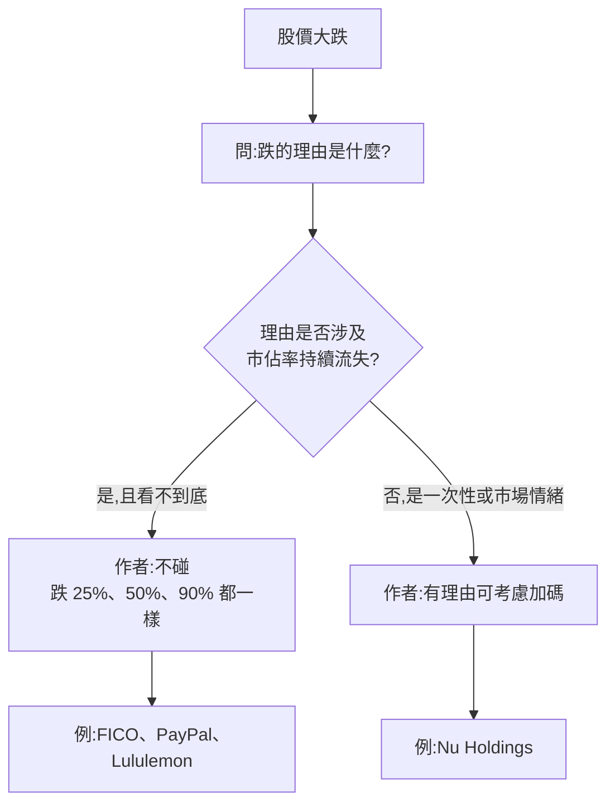

# 跌多少才能加碼?Nick 的答案:看「理由」不看「幾趴」(FICO 對比 Nu Holdings)

> 整理自 YouTube 頻道 **Nick 美股咖啡館**〈公開2026最強投資策略:股票到底跌幾%才能加碼?〉(2026-10-03,約 11 分鐘,影片 ID `7aWsuekAoqY`,官方 zh-TW 字幕)。
>
> ⚠️ **非投資建議。** 本文整理影片論點並核對公開資訊,不構成買賣建議,請勿因作者買或不買什麼就照做。
>
> ⚠️ **利益揭露**:
> - 作者**自述持有 Nu Holdings(NU)**,並說高機率會加碼;曾持有 PayPal(均價約 60 美元,在 CEO Alex 離任那季賣出)。有利益關係。
> - 片尾推廣 **IB 盈透證券**連結(每次點擊作者有回饋),屬業配/聯盟連結,**本筆記不轉述推廣內容**。
> - 片頭長達數分鐘為相親笑話與澳洲旅居雜談,略過。

---

## 一句話總結

**「股價跌 X% 所以加碼」沒有意義;跌的「理由」你能不能接受,才是加碼與否的依據。** 作者用兩個對照說明:FICO 跌 25% 他仍不買(因為市佔率只可能下降、看不到底),Nu Holdings 跌 8% 他高機率加碼(因為沒有失去市佔率的問題)。

---

## 一、事件:FICO 為何暴跌(✅ 已用新聞核實)

作者前一支影片的結論是「不買 FICO」,理由是它從 0 個競爭對手變成 1 個(VantageScore),市佔率「只可能往下」。影片當天(他剛抵達澳洲)FICO 又大跌,他歸納兩個壓力:

| 影片說法 | 核實結果 |
|---|---|
| 股價單日跌約 25% | ✅ 報導為盤中約 25%、收盤約 26.78%(約 615.71 美元) |
| 過去一年已跌約 60% | ✅ 報導年初至今約 −60%(離歷史高點約 −65%) |
| VantageScore 宣布維持 0.99 美元/份到 2028 年 | ✅ 實為 **TransUnion 將 VantageScore 4.0 的 0.99 美元定價延長到 2028-12** |
| FICO 約 10 美元,高出約 10 倍 | ✅ FICO 表示對 tri-merge 經銷商的房貸分數價格維持 10 美元(Preferred Program 成員) |
| Rocket 改以 VantageScore 為優先模型 | ✅ Rocket Mortgage 成為首家以 VantageScore 為偏好評分模型的貸款機構 |
| (影片未提)觸發點之一 | FHFA 局長 Pulte 宣布 Fannie / Freddie 改採單一定價表,讓 VantageScore 與 FICO Classic 並列 |

⚠️ 分析師看法不一:有報導指出「FICO 究竟會失去多少市佔率、或被迫降價多少仍很不明確」(RBC 維持 Outperform,但提醒「分數比價(score shopping)」風險)。作者的立場是「不知道底在哪」,不是「一定歸零」。

## 二、方法論:四個判斷步驟

1. **不設「跌幾趴就加碼」的固定數字**:跌 25%、50%、75% 後面都要有理由,否則只是追價。
2. **市佔率是核心檢查項**:作者原則是「不投資高機率持續流失市佔率的公司」。
3. **便宜 ≠ 該買**:FICO 的估值相較歷史確實很便宜,但「不知道市佔率會掉到哪」讓估值無法錨定。
4. **別以為「已經 price in」**:FICO 在政府宣布採用 VantageScore 時跌一段、生效當天又跌 20 多個百分點,說明消息「宣布」與「生效」可以各反映一次;作者坦言這類情緒分析不是他的重點。

## 三、案例對照

| 公司 | 作者判斷 | 他給的理由 |
|---|---|---|
| FICO | 不買,跌多少都不買 | 首次出現競爭者(價格約差 10 倍)、Rocket 開第一槍,下一家貸款機構是誰不知道 |
| Nu Holdings | 昨天跌 8%,高機率加碼 | 他認為沒有失去市佔率的可能;影片稱收購一家英國金融科技約 130 億美元「看起來偏高」但不影響此判斷(⚠️ **此收購案影片數字與對象本筆記未核實**) |
| PayPal | 已賣出,整體投資失敗 | 持續失去市佔率,仍抱著不放;賣出時約 40–50 美元、均價約 60 美元(⚠️ 作者自述,未逐筆核對) |
| Lululemon | 沒買 | 作者說同店銷售(comparable store sales)持續下滑 = 失去市佔率(⚠️ 未核實) |

## 四、「YT 標題投資法」的提醒

作者的笑點:有人看到影片標題出現某公司就衝進去買,股價跌了又怪他,但他影片裡明明說「不買」。提醒是:**看內容,不要只看標題或封面**;也不要因為他買了某檔就跟著買,投資 thesis 要自己成立。

## 應用案例

- **情境:你持有的股票一天跌 20%。** 先寫下一句「跌的原因」。若是「財報指引下修但商業模式未變」,可以繼續評估;若是「出現能長期搶走客戶的對手」,就像 FICO 的情況,先確認自己能不能量化市佔率的下限,量化不了就不加碼。
- **情境:朋友問「跌了 30% 要不要抄底?」** 用本文第二節的流程反問:跌的理由是什麼?這個理由會持續嗎?
- **情境:檢視自己的持股清單。** 每檔問「過去四季同店銷售/客戶數/市佔率是否持續下降?」若是,先降低疑慮再談估值。

---

## 字幕還原

字幕整體清楚。「Vantage score」= VantageScore;「Rocket Mortgage / Rocket Companies」= Rocket Companies(房貸公司);「盈透證券」= Interactive Brokers(推廣連結,未納入)。「NU」指 Nu Holdings(Nubank 母公司),字幕寫法正確。無股票需送台股查表(皆為美股)。

## 來源

- Nick 美股咖啡館〈公開2026最強投資策略:股票到底跌幾%才能加碼?〉(2026-10-03)https://www.youtube.com/watch?v=7aWsuekAoqY (官方 zh-TW 字幕)
- FICO 暴跌與 VantageScore / Rocket / TransUnion 報導:https://www.fool.com/investing/2026/09/29/why-fair-isaac-corporation-plunged-today/ ;https://tradersunion.com/news/stocks/show/3571475-fico-slides-26-78percent-today-on/ ;https://parameter.io/fair-isaac-fico-stock-plunges-after-bofa-cuts-rating-on-regulatory-headwinds/ ;https://www.nationalmortgagenews.com/news/fico-seeks-to-fend-off-vantagescore-with-10-bundle
- 同作者相關筆記:[[nubank-brazil-election-selloff-and-sofi-q3-2026-nick]]

> 以上數字來自二手媒體整理,**未直接讀 FICO / TransUnion 公司公告**;下單前請對照一手來源。⚠️ 非投資建議。
