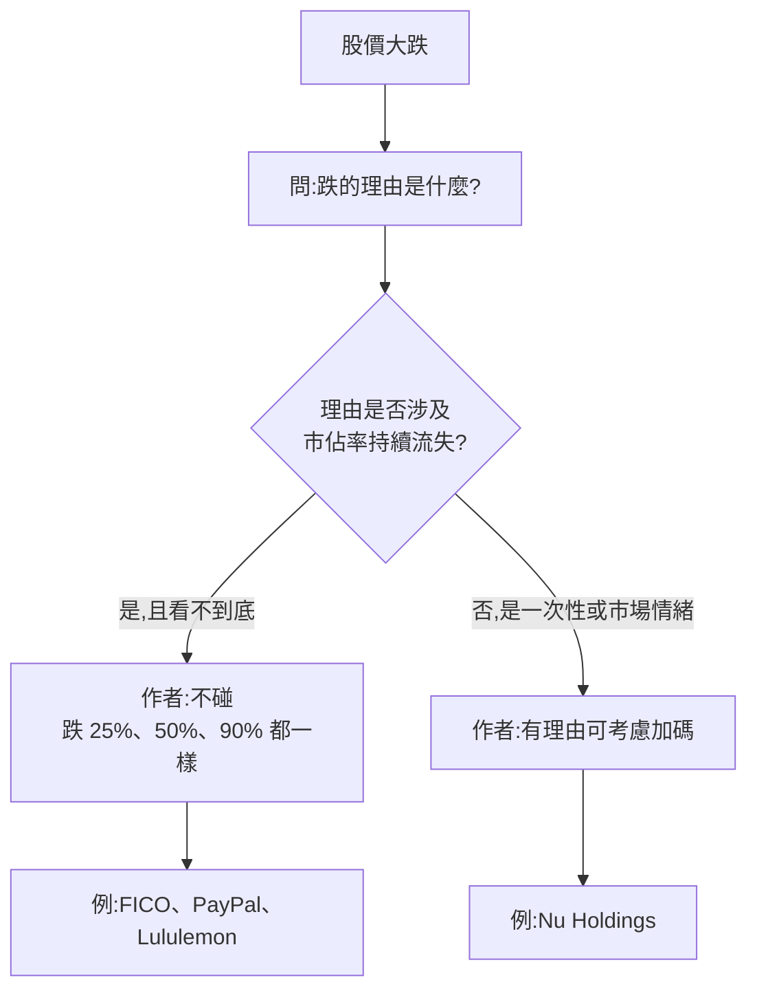

# 跌多少才能加碼?Nick 的答案:看「理由」不看「幾趴」(FICO 對比 Nu Holdings)

> 整理自 YouTube 頻道 **Nick 美股咖啡館**〈公開2026最強投資策略:股票到底跌幾%才能加碼?〉(2026-10-03,約 11 分鐘,影片 ID `7aWsuekAoqY`,官方 zh-TW 字幕)。
>
> ⚠️ **非投資建議。** 本文整理影片論點並核對公開資訊,不構成買賣建議,請勿因作者買或不買什麼就照做。
>
> ⚠️ **利益揭露**:
> - 作者**自述持有 Nu Holdings(NU)**,並說高機率會加碼;曾持有 PayPal(均價約 60 美元,在 CEO Alex 離任那季賣出)。有利益關係。(2026-11-07 核實增補:影片 [8:33] 附近畫面為券商帳戶紀錄,顯示 2026-09-30 買進 NU 20 股、成交價 12.17 美元,可佐證其持有陳述。)
> - 片尾推廣 **IB 盈透證券**連結(每次點擊作者有回饋),屬業配/聯盟連結,**本筆記不轉述推廣內容**。
> - 片頭長達數分鐘為相親笑話與澳洲旅居雜談,略過。

---

## 一句話總結

**「股價跌 X% 所以加碼」沒有意義;跌的「理由」你能不能接受,才是加碼與否的依據。** 作者用兩個對照說明:FICO 跌 25% 他仍不買(因為市佔率只可能下降、看不到底),Nu Holdings 跌 8% 他高機率加碼(因為沒有失去市佔率的問題)。

---

## 一、事件:FICO 為何暴跌(✅ 已用新聞核實)

作者前一支影片的結論是「不買 FICO」,理由是它從 0 個競爭對手變成 1 個(VantageScore),市佔率「只可能往下」。影片當天(他剛抵達澳洲)FICO 又大跌,他歸納兩個壓力:

| 影片說法 | 核實結果 |
|---|---|
| 股價單日跌約 25% | ✅ 已核實:Motley Fool 報導 2026-09-29 盤中跌 25.4%(https://www.fool.com/investing/2026/09/29/why-fair-isaac-corporation-plunged-today/);另一報導收盤跌約 26.78%、約 615.71 美元(https://tradersunion.com/news/stocks/show/3571475-fico-slides-26-78percent-today-on/),各家時點不同 |
| 過去一年已跌約 60% | ⚠️ 需修正/未能核實:搜尋所見報導的數字是「**年初至今**約 −60%」(離歷史高點約 −65%),與影片「過去一年」期間不同,未能核實「過去一年」的數字 |
| VantageScore 宣布維持 0.99 美元/份到 2028 年 | ✅ 大致核實(細節未能一手確認):實為 **TransUnion** 將 VantageScore 4.0 的 0.99 美元定價延長到 2028-12,Motley Fool 列為下跌原因之一。TransUnion 原始公告未能取得(新聞網站回 403);搜尋摘要另稱 Experian 亦同價 0.99、Equifax 為 1 美元(未直接讀取全文) |
| FICO 約 10 美元,高出約 10 倍 | ✅ 搜尋摘要所見:FICO 對房貸分數定價 10 美元(National Mortgage News 報導 https://www.nationalmortgagenews.com/news/fico-seeks-to-fend-off-vantagescore-with-10-bundle ,未直接讀全文)。0.99 對 10 美元約 10 倍,計算成立 |
| Rocket 改以 VantageScore 為優先模型 | ✅ 已核實:影片 [5:44] 畫面截取 Rocket Mortgage 2026-09-28 新聞稿,標題為 "Becomes First Home Lender to Use VantageScore as its Preferred Scoring Model on All Eligible Loans";新聞稿稱 2026 Q4 起,交付 Fannie Mae、Freddie Mac、VA 貸款預設使用 VantageScore 4.0 |
| (影片未提)觸發點之一 | ✅ 已核實:Motley Fool 報導指 Fannie / Freddie 改採同一價格表,讓 FICO 與 VantageScore 並列,移除 FICO 的定價優勢(FHFA 局長 Pulte 為主導者,由搜尋摘要所見) |

⚠️ 分析師看法不一:有報導指出「FICO 究竟會失去多少市佔率、或被迫降價多少仍很不明確」(RBC 維持 Outperform,但提醒「分數比價(score shopping)」風險;此句 2026-11-07 未能覆核)。另搜尋摘要顯示 Wells Fargo 曾降評等,同樣未直接讀原文。作者的立場是「不知道底在哪」,不是「一定歸零」。

## 二、方法論:四個判斷步驟

1. **不設「跌幾趴就加碼」的固定數字**:跌 25%、50%、75% 後面都要有理由,否則只是追價。
2. **市佔率是核心檢查項**:作者原則是「不投資高機率持續流失市佔率的公司」。
3. **便宜 ≠ 該買**:FICO 的估值相較歷史確實很便宜,但「不知道市佔率會掉到哪」讓估值無法錨定。
4. **別以為「已經 price in」**:FICO 在政府宣布採用 VantageScore 時跌一段、生效當天又跌 20 多個百分點,說明消息「宣布」與「生效」可以各反映一次;作者坦言這類情緒分析不是他的重點。

## 三、案例對照

| 公司 | 作者判斷 | 他給的理由 |
|---|---|---|
| FICO | 不買,跌多少都不買 | 首次出現競爭者(價格約差 10 倍)、Rocket 開第一槍,下一家貸款機構是誰不知道 |
| Nu Holdings | 昨天跌 8%,高機率加碼 | 他認為沒有失去市佔率的可能。影片 [8:33] 提到「13 billion」收購英國 Fin-tech,字幕已由使用者 2026-11-07 確認正確。⚠️ **需修正**:這筆並非已成交的收購。媒體(首報約 2026-09-26)報導 Nu 洽談收購英國 Monzo,估值上限約 £10 億(約 130 億美元量級,各家換算不一);**Nu 於 2026-10-01 公告「not pursuing a transaction with Monzo」**(https://ffnews.com/news/nu-holdings-ltd-statement-regarding-media-reports-ea6b0c0e)。「昨天跌 8%」未能精確核對(搜尋摘要稱傳聞當日約跌 8–10%,數字不一) |
| PayPal | 已賣出,整體投資失敗 | 持續失去市佔率,仍抱著不放;賣出時約 40–50 美元、均價約 60 美元(⚠️ 作者自述,**未能核實**)。「CEO Alex 離任那季」已核實:搜尋摘要所見 8-K 顯示 Alex Chriss 於 2026-02-02 離任,Enrique Lores 自 2026-03-01 接任(https://www.boardroomalpha.com/sec/pypl-8-k-2026-02-03-0001193125-26-035860 ,未直接讀全文) |
| Lululemon | 沒買 | 作者說同店銷售(comparable store sales)持續下滑 = 失去市佔率。✅ 已核實同店銷售數字:2026 會計年度第二季(截至 2026-08-02)全球同店銷售 −9%(固定匯率 −10%),Americas −12%、International −3%(https://corporate.lululemon.com/newsroom/press-releases/2026/09-03-2026-210528733)。⚠️ 「等於失去市佔率」是作者推論,公司歸因為產品上市不如預期與負面輿論(見延伸閱讀) |

## 四、「YT 標題投資法」的提醒

作者的笑點:有人看到影片標題出現某公司就衝進去買,股價跌了又怪他,但他影片裡明明說「不買」。提醒是:**看內容,不要只看標題或封面**;也不要因為他買了某檔就跟著買,投資 thesis 要自己成立。

## 應用案例

- **情境:你持有的股票一天跌 20%。** 先寫下一句「跌的原因」。若是「財報指引下修但商業模式未變」,可以繼續評估;若是「出現能長期搶走客戶的對手」,就像 FICO 的情況,先確認自己能不能量化市佔率的下限,量化不了就不加碼。
- **情境:朋友問「跌了 30% 要不要抄底?」** 用本文第二節的流程反問:跌的理由是什麼?這個理由會持續嗎?
- **情境:檢視自己的持股清單。** 每檔問「過去四季同店銷售/客戶數/市佔率是否持續下降?」若是,先降低疑慮再談估值。

---

## 延伸閱讀與深度補充(2026-11-07 核實增補)

以下為本次實際讀到內容的一手或近一手來源,重點是「影片沒講的機制」與「影片說法比一手資料強的地方」。

1. **Nu 的 Monzo 傳聞與否認(一手公告)**:Nu 於 2026-10-01 發布聲明,表示「雖然我們非常尊重 Monzo,本公司並未進行與 Monzo 的交易」;(搜尋摘要另稱公司表示策略重心仍在巴西、墨西哥、哥倫比亞與美國,資本配置框架不變,未直接讀到該段原文。)(https://ffnews.com/news/nu-holdings-ltd-statement-regarding-media-reports-ea6b0c0e)
   - **與影片差異**:影片把 Nu 描述成「收購英國 Fin-tech」,實際是媒體傳聞、公司否認。作者「Nu 沒有失去市佔率所以可加碼」的論點,不依賴這筆併購成立;但若當作「Nu 已花大錢擴張」來看就會失真。
2. **FICO 下跌的三個原因(Motley Fool,2026-09-29)**:Fannie / Freddie 改採同一價格表;TransUnion 將 VantageScore 4.0 的 0.99 美元維持到 2028 年 12 月;Rocket 優先採用 VantageScore。(https://www.fool.com/investing/2026/09/29/why-fair-isaac-corporation-plunged-today/)
   - **與影片差異**:影片把重點放在「競爭者出現、市佔率只會下降」。一手報導顯示是**定價結構改變**(政府採購規則 + 價格戰 + 大型貸款商採用),影響的是 FICO 的定價權與收入,不必然等於市佔率已下降。市佔率下降的幅度仍不明確,這正是作者「看不到底」的核心,影片的立場在此是合理的推論,但不是已確定的事實。
   - 同一頁面報價框顯示 2026-11-06 約 681.32 美元(非事件當日價格,僅供參考,未納入上方計算)。
3. **Rocket Mortgage 的決定(新聞稿,2026-09-28)**:公司稱測試後,使用 VantageScore 讓更多客戶通過審核、同時降低信用評分成本;2026 Q4 起對 Fannie / Freddie / VA 貸款預設採 VantageScore 4.0。(新聞稿原始 URL 未能取得,依影片畫面所見標題與內文摘要。)
   - **機制重點**:這是「貸款機構的內部決策」,不是單純的市場競爭。影片說「Rocket 開了第一槍」描述正確,但下一家是誰需要看各家貸款商的成本與核准率測試結果,不是只看一家公司。
4. **Lululemon 第二季財報(2026-09-03)**:同店銷售 −9%;淨營收 24 億美元、年減 4%;2026 全年淨營收指引 103.5–105.0 億美元(年減 5%–7%)。(https://corporate.lululemon.com/newsroom/press-releases/2026/09-03-2026-210528733)
   - **與影片差異**:影片把同店銷售下滑直接等同「失去市佔率」。公司在相關報導中的解釋包括產品上市不如預期、負面輿論影響(由搜尋摘要所見,未逐篇讀原文)。同店銷售下滑可能來自**需求、產品或品牌問題**,不一定等於市佔率被特定對手搶走,作者的推論需要另外證明。
5. **PayPal 管理層更替(8-K 摘要,2026-02)**:Chriss 於 2026-02-02 離任,董事長 Enrique Lores 接任 CEO(2026-03-01 生效),董事會理由為績效未達預期、品牌電商商家支付表現不佳。(https://www.boardroomalpha.com/sec/pypl-8-k-2026-02-03-0001193125-26-035860 ,搜尋摘要,未直接讀全文)
   - 這支持影片「CEO 離任那季賣出」的時間點描述。

**仍未能核實的項目**:TransUnion 原始公告(0.99 至 2028 年的確切條款);Nu 收購估值的美元換算(£10 億約 130 億美元,為各家換算,非一手);Monzo 本身的回應;Axios 原文(新聞網站回 403);PayPal 賣出價格(40–50 美元)與均價 60 美元;影片「NU 昨天跌 8%」的精確數字;Experian / Equifax 定價細節(僅見搜尋摘要)。

**影片畫面核對**:已截取 5 個畫面(影片 [5:17]、[5:36]、[5:44]、[8:33]、[10:08] 附近)。畫面與字幕相符的部分:「FICO 有史以來第一個競爭對手出現了」、「價格少它十倍」、Rocket 新聞稿、券商 NU 買進紀錄、Lululemon 同店銷售 −9% 的投影片。

## 字幕還原

字幕整體清楚。「Vantage score」= VantageScore;「Rocket Mortgage / Rocket Companies」= Rocket Companies(房貸公司);「盈透證券」= Interactive Brokers(推廣連結,未納入)。「NU」指 Nu Holdings(Nubank 母公司),字幕寫法正確。無股票需送台股查表(皆為美股)。

## 來源

- Nick 美股咖啡館〈公開2026最強投資策略:股票到底跌幾%才能加碼?〉(2026-10-03)https://www.youtube.com/watch?v=7aWsuekAoqY (官方 zh-TW 字幕)
- FICO 暴跌與 VantageScore / Rocket / TransUnion 報導:https://www.fool.com/investing/2026/09/29/why-fair-isaac-corporation-plunged-today/ ;https://tradersunion.com/news/stocks/show/3571475-fico-slides-26-78percent-today-on/ ;https://parameter.io/fair-isaac-fico-stock-plunges-after-bofa-cuts-rating-on-regulatory-headwinds/ ;https://www.nationalmortgagenews.com/news/fico-seeks-to-fend-off-vantagescore-with-10-bundle
- 同作者相關筆記:[[nubank-brazil-election-selloff-and-sofi-q3-2026-nick]]
- (2026-11-07 增補)Nu Holdings 否認 Monzo 交易聲明(2026-10-01):https://ffnews.com/news/nu-holdings-ltd-statement-regarding-media-reports-ea6b0c0e
- (2026-11-07 增補)Motley Fool FICO 下跌報導(2026-09-29):https://www.fool.com/investing/2026/09/29/why-fair-isaac-corporation-plunged-today/
- (2026-11-07 增補)Lululemon 2026 Q2 財報新聞稿(2026-09-03):https://corporate.lululemon.com/newsroom/press-releases/2026/09-03-2026-210528733
- (2026-11-07 增補,搜尋摘要)PayPal 8-K 管理層更替:https://www.boardroomalpha.com/sec/pypl-8-k-2026-02-03-0001193125-26-035860
- (2026-11-07 增補,搜尋摘要)Nu / Monzo 媒體報導:https://www.axios.com/2026/09/28/nu-monzo-acquisition-talks (403,未能直接讀取)
- (2026-11-07 增補,搜尋摘要)TransUnion 0.99 定價:https://nationalmortgageprofessional.com/news/transunion-locks-99-cent-vantagescore-pricing-through-2028 (403,未能直接讀取)

> 以上數字來自二手媒體整理,**未直接讀 FICO / TransUnion 公司公告**;下單前請對照一手來源。⚠️ 非投資建議。
