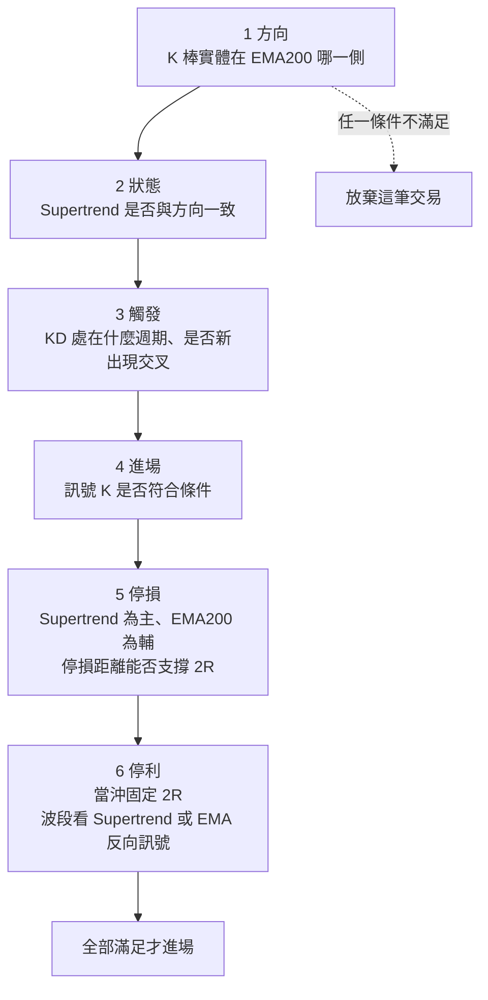
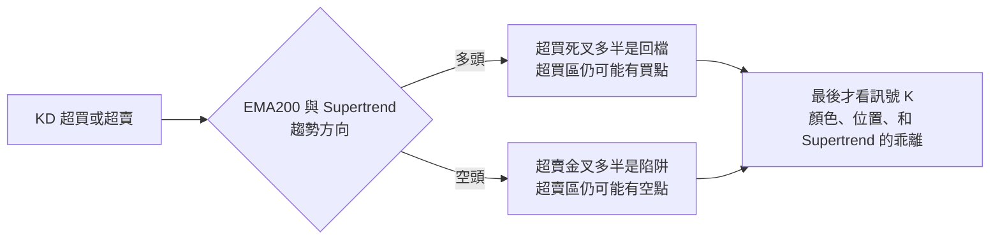

# 超級趨勢過濾策略:Supertrend + KD + EMA200 的六步驟 SOP

> 整理自 YouTube 頻道 **交易聰明錢**〈[最準確買賣訊號？Supertrend＋KD--超級趨勢過濾策略｜當沖、波段完整交易系統](https://www.youtube.com/watch?v=2DfBuY1kaAw)〉(2026-10-24,約 17 分鐘)。
>
> ⚠️ **立場揭露**:作者在 09:00 與說明欄推廣自家 **LINE 社群**;說明欄附 TradingView 連結。影片的「實盤 A / B」**沒有標示商品、日期,也沒有回測統計**,只是挑選出來的示範案例,不能當成勝率證明。
>
> ⚠️ **非投資建議。** 本文僅整理影片中的交易方法,不構成任何買賣建議;任何策略上線前都應自行回測與小額驗證。

---

## 一句話總結

單用 Supertrend 會「翻多才追、翻空才走」並在盤整被來回停損;單用 KD 會遇到「金叉後還跌、超買後還漲」。作者把三個指標分工:**EMA200 定方向、Supertrend 確認趨勢狀態並當停損、KD 交叉找進場時機**,再用「訊號 K」做最後過濾,形成六步驟 SOP。**條件只要有一個不滿足,就放棄這筆交易。**

---

## 一、三個指標各自的問題與分工

| 指標 | 單獨使用的問題 | 在本策略裡的角色 |
|---|---|---|
| **Supertrend** | 翻多時已漲一段、翻空時利潤已回吐;盤整時來回被停損 | 確認趨勢**狀態**(多 / 空 / 走平),並作為**固定停損參考** |
| **KD** | 金叉後價格繼續跌、死叉後繼續漲;超買不敢追卻一路飆、超賣抄底又繼續跌 | 尋找**進場時機**(金叉 / 死叉與所處週期) |
| **EMA200** | — | 界定**多空方向**;與 Supertrend 靠近時當輔助停損 |

> **Supertrend 是什麼**:以 ATR(平均真實波幅)為基礎的趨勢指標。中點 (高+低)/2 加減「倍數 × ATR」形成上下軌,上升趨勢顯示下軌、下降趨勢顯示上軌;收盤穿越線就判定趨勢翻轉。線只會朝趨勢方向收緊,所以常被拿來當移動停損。(TradingView 說明頁)

---

## 二、六步驟 SOP



### 做多與做空條件

| | 做多 | 做空 |
|---|---|---|
| 方向 | K 棒實體在 **EMA200 上方** | K 棒實體在 **EMA200 下方** |
| 狀態 | Supertrend **多頭** | Supertrend **空頭** |
| 觸發 | KD 進入**金叉週期**並發出金叉 | KD 進入**死叉週期**並發出死叉 |
| 訊號 K | 必須是**紅 K**(陽線) | 必須是**綠 K**(陰線) |
| 停損 | Supertrend 下方;EMA200 靠近時一併參考 | Supertrend 上方;EMA200 靠近時一併參考 |
| 停利 | 當沖固定 2R;波段抱到 Supertrend 或 EMA 反向 | 同左 |

> ⚠️ 影片的「紅 K = 上漲、綠 K = 下跌」是台灣慣例(與歐美相反)。

### 單週期還是雙週期

- **當沖**持倉短,看單一週期即可。
- **波段**持倉長且不固定,可配合雙週期。
- 影片示範都用 **15 分鐘圖、單週期**。

---

## 三、什麼時候完全不看 KD:盤整

當 **EMA200 完全走平、幾乎是一條直線**,價格在 EMA200 附近來回穿越,**Supertrend 也走平** ⇒ 行情處於橫盤,**KD 發出的任何訊號都當成錯誤訊號,不理它**。

要等到 K 棒實體站穩 EMA200、Supertrend 轉多頭,才算進入多頭週期,KD 的訊號才開始有參考價值。

---

## 四、怎麼挑「訊號 K」

同樣是金叉,對應的訊號 K 好壞差很多。作者從示範案例歸納的判準:

| 加分 | 扣分 |
|---|---|
| 紅 K 光頭光腳(無上下影線),動能強 | 訊號 K 顏色不符(做多卻是綠 K) |
| 剛好在**回檔末端**,被 Supertrend「接住」 | 十字線,方向不明 |
| 和 Supertrend 的**乖離很小**(停損距離短) | 和 Supertrend **乖離過大** ⇒ 後續大概率回檔,也很難達到 2R |
| KD 處在週期底部、剛結束死叉週期後的金叉 | 無法判斷 KD 處在金叉還是死叉週期 |
| 雙頂第二個頂部的死叉(做空) | Supertrend 走平、K 棒進入橫盤 |

**原則:確定趨勢方向之後,不一定要出手。** 訊號 K 的狀態和位置不合適,就等價格走出合適的訊號 K,而不是 KD 一交叉就立刻進場。

### 示範結果(作者自述)

| 案例 | 進場 | 當沖(2R) | 波段 |
|---|---|---|---|
| 實盤 A(15 分鐘,做多) | 金叉 3 對應的光頭光腳紅 K,停損放 Supertrend 下 | 一根大紅 K 很快達到 2R | 抱到截圖當下約 **6R** |
| 實盤 B(15 分鐘,做空) | 死叉 4 對應的光頭光腳綠 K,停損放 Supertrend 與 EMA200 上 | 一根大綠 K 達到 2R | 等 Supertrend 反向訊號出場,約 **6.8R** |

⚠️ 兩個案例都是作者挑選的成功示範,沒有提供失敗案例、樣本數或勝率。

---

## 五、最容易犯錯的兩種情境

### 情境一:多頭行情,KD 持續超買

| 常見錯誤認知 | 作者的看法 |
|---|---|
| ❌ 持續超買一定反轉暴跌 | 不一定。EMA200 和 Supertrend 都在多頭時,**超買區的死叉幾乎都只是回檔**。示範中最後一次超買死叉出現深度回檔,是因為 **Supertrend 同時發出反向訊號**;但 EMA200 趨勢沒變,仍只算深度回檔 |
| ❌ 持續超買一定不能買 | 強勢上漲時 KD 會一直超買,**超買區的金叉並非都不能買**。示範中 5 個金叉只有 1 個符合條件:其他不是綠 K,就是和 Supertrend 乖離過大、很難到 2R |

### 情境二:空頭行情,KD 持續超賣

| 常見錯誤認知 | 作者的看法 |
|---|---|
| ❌ 持續超賣一定能抄底 | 下跌趨勢裡,**超賣區的金叉等於死亡訊號**,每次抄底都迎來更深的暴跌。想在超賣區買進有一個**硬性前提:價格走勢處在多頭週期**(剛啟動多頭或多頭中的回檔都可以) |
| ❌ 持續超賣一定不能做空 | 整段都在下跌趨勢時,超賣區的死叉往往代表更強的下跌動能。示範中 5 次死叉有 2 次可做空;第 5 次雖然是強勁綠 K,但**和 Supertrend 乖離過大、Supertrend 與 EMA200 的距離也越拉越大** ⇒ 有反彈風險、停損距離撐不起 2R ⇒ **滿足方向條件也不該做** |



**共同結論:先確定價格走勢、EMA200 與 Supertrend 的狀態,最後才考慮 KD,再用訊號 K 決定要不要出手。** KD 的超買超賣本身不是方向訊號。

---

## 六、補充與限制(影片沒講)

- **參數沒給**:影片沒說 Supertrend 的 ATR 週期與倍數、KD 的參數。TradingView 內建 Supertrend 常見設定為 ATR 10、倍數 3;KD 在 TradingView 是「Stochastic」,台灣看盤軟體常用 (9,3,3),TradingView 預設是 (14,1,3)。**不同參數訊號會差很多,回測時要固定一組。**
- **「金叉週期 / 死叉週期」沒有明確定義**:影片用來描述 KD 大致處在上升段或下降段,但何時算「進入」沒有量化規則,這部分偏主觀判斷。
- **「乖離過大」也沒有量化門檻**:實務上可改用「停損距離是否 ≤ 預期目標的一半」(也就是能否撐起 2R)來客觀化。
- **2R 的意思**:獲利目標 = 2 倍停損距離。例如進場 100、停損 98(風險 2),2R 目標就是 104。
- **示範案例無法驗證**:沒有商品名稱與時間,本筆記無法核對走勢;也沒有手續費、滑價、勝率與最大回撤。

---

## 七、應用案例

### 案例 1:套用六步驟檢查一筆做多

情境:某股 15 分鐘圖,收盤 52.0。

| 步驟 | 檢查 | 結果 |
|---|---|---|
| 1 方向 | K 棒實體在 EMA200(50.8)上方 | ✅ |
| 2 狀態 | Supertrend 為多頭,目前在 51.3 | ✅ |
| 3 觸發 | KD 從 25 附近金叉,前一段是完整的死叉週期 | ✅ |
| 4 進場 | 訊號 K 是收在高點附近的紅 K,剛從回檔被 Supertrend 接住 | ✅ |
| 5 停損 | 放 Supertrend 下方 51.2,風險 0.8;EMA200 離太遠不參考 | ✅ |
| 6 停利 | 當沖 2R = 52.0 + 1.6 = **53.6**;波段改抱到 Supertrend 翻空 | ✅ |

六步全過才下單。若第 4 步訊號 K 是綠 K,或第 5 步 Supertrend 在 49.5(風險 2.5、2R 要到 57.0,不切實際),就放棄。

### 案例 2:把 SOP 寫成 TradingView 腳本先回測

下面是依影片規則改寫的 **Pine Script v5 草稿**(⚠️ 未經驗證、參數為假設值,只供回測研究):

```pinescript
//@version=5
strategy("Supertrend + KD + EMA200 filter (draft)", overlay=true)

atrLen  = input.int(10,  "Supertrend ATR")
factor  = input.float(3.0, "Supertrend factor")
kLen    = input.int(9,   "KD length")
rr      = input.float(2.0, "Take profit (R)")

ema200 = ta.ema(close, 200)
[st, dir] = ta.supertrend(factor, atrLen)        // dir < 0 = 多頭
k = ta.sma(ta.stoch(close, high, low, kLen), 3)
d = ta.sma(k, 3)

// 1 方向 + 2 狀態
bull = math.min(open, close) > ema200 and dir < 0
bear = math.max(open, close) < ema200 and dir > 0
// 3 觸發
goldCross = ta.crossover(k, d)
deathCross = ta.crossunder(k, d)
// 4 訊號 K 顏色
longSig  = bull and goldCross and close > open
shortSig = bear and deathCross and close < open

// 5 停損 = Supertrend;6 當沖停利 = 2R
if longSig and strategy.position_size == 0
    risk = close - st
    strategy.entry("L", strategy.long)
    strategy.exit("L-x", "L", stop=st, limit=close + rr * risk)

if shortSig and strategy.position_size == 0
    risk = st - close
    strategy.entry("S", strategy.short)
    strategy.exit("S-x", "S", stop=st, limit=close - rr * risk)
```

這版**沒有**處理影片中偏主觀的部分(盤整判斷、KD 週期、乖離過大、光頭光腳)。回測時可以逐一加上濾網(例如 EMA200 斜率門檻、停損距離 ÷ ATR 上限),看每加一條對勝率和期望值的影響,而不是一次全加。

### 案例 3:用影片的觀念檢查自己的停損紀錄

情境:翻出過去 20 筆 KD 交易,其中 12 筆停損。

- 有幾筆是在 **EMA200 走平、價格來回穿越**時進場? ⇒ 影片說這時 KD 訊號都當錯誤訊號。
- 有幾筆是**下跌趨勢中超賣區金叉抄底**? ⇒ 影片說這是最常見的「死亡訊號」。
- 有幾筆進場時**離 Supertrend 很遠**? ⇒ 停損距離大、2R 不切實際。

把停損單按這三類分組,通常就能看出自己最該先改掉的是哪一個習慣。

---

## 相關筆記

- [[breakout-four-layers-of-evidence]]:突破要看四層證據,和本策略「多條件過濾」是同一種思路。
- [[short-term-trading-7-rules]]:短線交易的七條紀律。
- [[double-top-bottom-momentum]]:影片做空案例提到的「雙頂第二個頂部」。

---

## 來源

- YouTube:交易聰明錢〈最準確買賣訊號？Supertrend＋KD--超級趨勢過濾策略｜當沖、波段完整交易系統〉 https://www.youtube.com/watch?v=2DfBuY1kaAw (2026-10-24;含 LINE 社群推廣)
  - 該片無字幕,逐字稿以 CPU faster-whisper 轉錄、非官方字幕。
  - 已還原的誤轉:「Supertron / SuperTran / Supertune / SuperChain」→ Supertrend、「EMAI 200」→ EMA200、「金X / 精差 / 金沙」→ 金叉、「死X / 時差 / 史插」→ 死叉、「K-bump / KBUN」→ K 棒、「當充」→ 當沖、「撥斷」→ 波段、「停歷 / 停力 / 挺立」→ 停利、「停搎 / 停搟」→ 停損、「乖理率 / 怪力」→ 乖離率、「石盤 / 10 盤」→ 實盤。
- TradingView,Supertrend 說明: https://www.tradingview.com/support/solutions/43000634738-supertrend/

> ⚠️ **再次提醒:非投資建議。** 示範案例為作者挑選,未附回測數據;請自行回測與控管風險。
