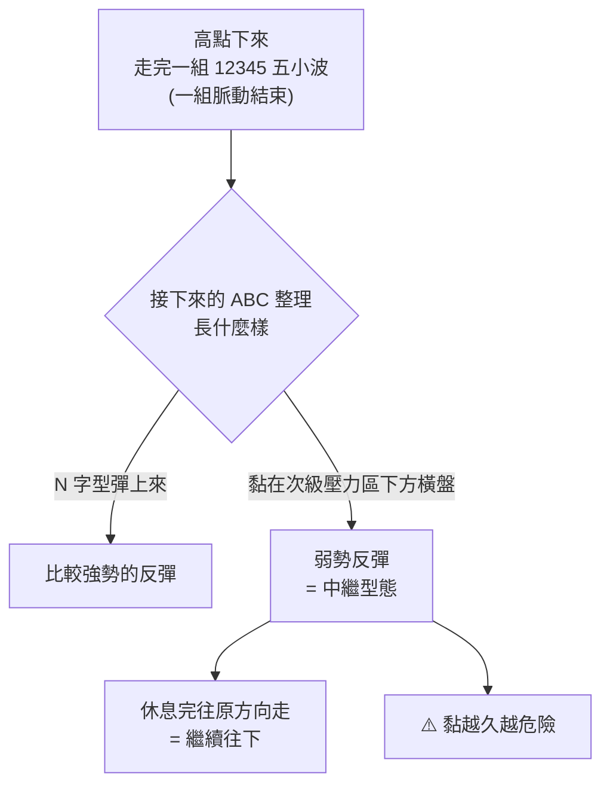

# 颱風假躲過重挫,接下來補跌還是主跌?黃培碩用波浪結構看大盤、台積電與個股(2026-10-27)

> 整理自 YouTube **黃培碩分析師-運達證券投顧**〈[颱風假避開重挫！仍然補跌？主跌？20261027 黃培碩 分析師 運達證券投顧](https://www.youtube.com/watch?v=huzZi422Ni0)〉(2026-10-27,約 44 分鐘,官方繁中字幕)。
>
> ⚠️ **立場揭露**:這是投顧分析師的盤後節目,片中多次招攬加入 LINE 官方帳號與付費會員,並提到「上週四已帶會員放空個股」「蓋牌股不回答」。**分析師與其會員可能持有片中討論標的的部位(包括空單),有利益關係。** 節目結尾的法定聲明:「本公司與所推薦分析之個股無不當利益關係,以往績效不保證未來獲利,投資人應獨立判斷、審慎評估並自負投資風險。」
>
> ⚠️ **非投資建議。** 本文只整理分析師的觀點與技術分析邏輯,不構成任何買賣建議。片中的點位、波浪劃分都是分析師個人判讀,沒有附回測或勝率。

---

## 一句話總結

分析師**整體偏空**:大盤與台積電從高點下來的第一段跌勢已走完一組「五小波」,接著在次級壓力區下方**黏住橫盤**,沒有出現強勢的 N 字反彈。他把這種低檔橫盤判讀為**「中繼型態」**(走到一半休息,休息完往原方向、也就是往下走),**橫得越久越危險**。所以他已全面出清多單、上週四開始放空正在走 **C 波**下跌的弱勢股;建議觀眾**利用整理期間積極調節持股**,不要放空強勢股,做多「寧缺勿爛」。

---

## 一、今天大盤發生什麼事

| 項目 | 分析師說法 |
|---|---|
| 今日 K 棒 | 一根小黑 K,**上下影線很長**;最高漲 544 點、最低跌 364 點,**高低震幅剛好 900 點**,收在平盤附近 |
| 颱風假 | 上週五(10-23)颱風假休市。前一晚(美股週四)**費半跌了約 7%**,他估計若照常開盤,台股**至少跌 2,000 點左右**(約 5%),「天公有保庇」 |
| 連假後 | 美股反彈,台股今天沒有明顯補跌,但盤中開高走低 |
| 低點 | 大盤原本低點約 46,170,今天略破;台積電原本低點約 2,390,今天最低 2,380,只破一點點 |

⇒ 他的判斷:**結構「還沒有」明顯拉開往下的主跌段,但風險還在**,要持續觀察。

---

## 二、他怎麼用波浪結構看大盤與台積電

### 核心邏輯:五小波 → 該整理 → 看整理的「樣子」判強弱

**中繼型態 vs 反轉型態**(他的比喻):

- **反轉型態**:到了目的地,折返回來,方向改變。
- **中繼型態**:走到一半休息,休息完**繼續往原來方向走**。

從高檔打下來後在低檔橫盤震盪,一般比較屬於中繼型態 ⇒ 原方向是往下 ⇒ 要小心。

### 大盤

- **10-19 那段下來的五波有效**,低點(約 46,170)暫時支撐,他當時就說會「橫盤整理幾天、高點不容易過」,結果確實整理了幾天;10-20 破一點點底又彈回。
- 這次**沒有像以前一樣跌下來就 N 字型彈上來**,而是「黏住」。
- 他標的波浪:第一波(初跌段,內含 12345 小波)→ 橫盤震盪(弱勢反彈、中繼型態)→ 若往下就是**第三波(主跌段)**。
- 目前只剩兩種結構:
  1. 直接往下走第三波。
  2. 再多「混」一段時間(類似假跌破後繼續橫盤),整理完再往下。

### 台積電

- 從約 **2,590 / 2,580** 開始一段明顯的下跌脈動,12345 波到 **2,390**,之後橫盤整理。
- 小時線上反彈也出現類似五小波,接著破底;但「幅度還不夠」,不像另一組推動已經開始。
- 兩種結構:第一大波下跌 → 第二大波橫盤 → 現在往下是**第三大波**;或是假跌破後繼續橫盤一段時間。
- ⭐ **大盤要主跌,台積電一定缺席不了。** 台積電今天「還好、結構還 OK」,所以大盤還沒正式往下。

---

## 三、他的操作立場

| 項目 | 內容 |
|---|---|
| 多單 | **一張都沒有**。最後一檔多單上品(4770)在 10-21(週三)第五波一出去就逢高出清,隔天就重挫 |
| 空單 | 10-22(週四)起**帶會員放空個股**;他說這幾年只放空過兩段,這是很重大的決策 |
| 為什麼平常不做空 | 做多最簡單;做空要考慮停資券、強迫回補、股東會與除權息、借不到券等一堆問題,**非逼不得已不做空** |
| 為什麼這次做空 | 嗅到系統性風險,「覆巢之下無安卵」;也不能讓會員資金一直閒置 |
| 多空並存 | 偶爾仍會挑零星有把握的多單,好處是**避開系統性風險**(全部跌停也有空單對沖),盤整時多空個股各賺各的 |

### 他的核心觀點:風險不在大盤指數,而在個股

- 很多漲了很久的個股已經**「封頂」**(出現歷史高點,那個價位可能永遠解不了套)。
- 就算之後費半、大盤、台積電再推升,**那些個股也未必回得來**。
- 這一波拉回是「**財富重新分配**」的關鍵轉折:先避開,下一波才是贏家;被套住的人到最低點也不敢買,好的買點出來時「沒有你的份」。
- 「日落西山你不退,東山再起的盤勢來,你是誰啊。」

---

## 四、放空的基本原則

| ✅ 該空的 | ❌ 絕對不要空的 |
|---|---|
| 正在走 **C 波**往下的弱勢股(艾略特波浪理論 ABC 修正裡的 C 波):大盤怎麼漲它都不動、只會慢慢滑落,「一跌難漲」 | 正在推升中的**強勢股**,即使漲很高、看不順眼、本益比很高 |
| 找**反彈點**去空 | 「漲那麼高給它放空」⇒ 會被軋死 |

> 「形勢比人強,那種你沒買就算了,絕對不能去放空它。」

做空要有耐心:空單不像多單會連續漲停,通常是慢慢滑落(除非系統性風險一次全部跌停)。

**做多**:目前「**寧缺勿爛**」,只做零星點火、把握度高的;還要考慮量能,有些量真的太小。

---

## 五、觀眾提問的個股看法

⚠️ 以下全是分析師的盤中口頭判讀;股票名稱由字幕與代號還原,可能有誤。

| 代號 / 個股 | 他怎麼看 | 結論 |
|---|---|---|
| 4542(科嶠) | 類似 1234567 一組,結構接近完整 | 這裡別再追高,**站在賣方** |
| 6456(GIS-KY 業成) | 悶了好幾年,近期逆勢上漲、量能出來;先前一段小初升段他們也有做;推完五段休息後又往上 | 照理還要再一個 ABC 整理,**拉回再考慮** |
| 2409(友達) | 值得追蹤,有沒有機會再過高;第三波拉回第四波,低點不能和第一波重疊太遠 | 碰到軌道線附近可嘗試**以小博大**;**防守:上升軌道線、第一波高點不能破** |
| 3481(群創) | 和友達同類 | 要追蹤不如追友達 |
| **2468 華經**(資訊服務) | 很久沒動、從低檔翻上來;今天也有開高走低的味道,但盤中又拉上來,沒有 6148 那麼明顯。長線看是從最低檔反彈,約 25–30 元彈到約 57 元。**兩種結構**:①只是低檔反彈震盪,三段式的話**這裡就差不多了**、相對已高;②若要繼續做,一定要押它走**五段式推升**,而且目前一組小脈動已結束,**要先等拉回**再找防守點 | 他**沒興趣、不追蹤**:雖然位置相對低,但以營運動能看要推升有難度;想做的人自己先設好防守點,「三段式就沒搞頭了」 |
| **6148**(字幕作「華晶」,代號推定為驊宏資,未確認) | 和華經同類、同樣從低檔翻上來,目前也是三段;**今天開高震盪走低比華經更明顯** | 同上:要做只能押五段式,先等拉回、自設防守點 |
| 2408 南亞科 / 2344 華邦電 | 記憶體曾是會員持股「重中之重」,在約 500 元臨界處全部出清,之後跌了 100 多元;今天低檔像要表態 | **把握度不高,再觀察**,兩檔會同步 |
| 6213(聯茂) | 7 月底以來 PCB 族群最強、持續創高;但營運沒有特別強(他引第二季 EPS 約 3.5 元、第三季營收約 150 億),目前看來只有三段 | **需要時間整理**,假突破就是第五段也要小心 |
| 6274 台燿 / 2383 台光電 | 高點那邊一直混,台燿今天還打到跌停 | 比聯茂弱 |
| 1709(和益) | 「形勢比人強」的投機股,認為有特定人士照顧,停損(拉回)很長 | 拉回照理不是完成結構 |
| 3583(辛耘) | 從 1,010 跌到快腰斬;前段是完整五波;他估一季 EPS 約 5 元、一年約 20 元,股價 580 多元 ⇒ 本益比近 30 倍,**比台積電、NVIDIA 都高** | 就算反彈頂多區間震盪,**站在賣方** |
| 秦城(?) | 只是破底,「翻到漲停才叫破底翻」 | 底很深,**先別殺低**,再看一下 |
| 4770(上品) | 五小波,第五波一出去就逢高出清 | 已出場 |

---

## 六、他的技術分析方法整理

1. **先數波**:找一組 12345 小波(一組脈動)。五波走完,正常要做 ABC 整理。
2. **看整理的樣子判強弱**:N 字型彈上來 = 強;黏在次級壓力區下方橫盤 = 弱、偏中繼型態。
3. **橫得越久越危險**:中繼型態休息完往原方向走。
4. **三段式 vs 五段式**:低檔反彈若只是三段式,到了就差不多;想繼續做,一定是押它走五段式推升。
5. **防守點位**:
   - 第四波低點不能和第一波高點重疊(「一四不重疊」)。
   - 畫上升軌道線,軌道線不能破。
6. **本益比當輔助**:拿台積電、NVIDIA 的本益比當基準,比它們高很多的個股不算便宜。
7. **大盤與權值股連動**:大盤要主跌,台積電一定要跟著修。

---

## 七、應用案例

### 案例 1:用「整理的樣子」判斷反彈強弱

情境:某股從 100 跌到 80,數得出一組五小波。

| 接下來的走勢 | 他的判讀 | 動作 |
|---|---|---|
| 三天內彈回 90 以上,呈 N 字 | 強勢反彈 | 可以觀察有沒有新的推升 |
| 在 80–84 黏了兩週,84 剛好是前一段的次級壓力區 | 弱勢、中繼型態 | 利用整理期間減碼,不要攤平 |
| 黏完跌破 80 | 原方向往下,可能是第三波 | 已持有的要處理;不要以為「跌深了」去接 |

### 案例 2:手上有一檔被套的股票,先自問三個問題

1. 它是不是已經「**封頂**」(歷史高點在上方很遠、漲了一大段)? ⇒ 大盤回來它也未必回得來。
2. 它現在是不是在走 **C 波**(ABC 修正的最後一段,大盤漲它不漲、只會慢慢滑),還是只是跟著大盤震盪? ⇒ 前者最該先處理。
3. 它的本益比和台積電比起來如何? ⇒ 遠高於台積電又在走弱的,反彈時「站在賣方」。

### 案例 3:想放空時的檢查表

| 問題 | 答案是「是」才考慮空 |
|---|---|
| 它正在往下走,大盤漲它也不漲? | ✅ |
| 我是在反彈時進場,不是追殺低點? | ✅ |
| 我確認過能借券、近期沒有股東會停券或除權息? | ✅ |
| 它是不是正在創高的強勢股? | ❌ 是的話絕對不空 |

---

## 八、核實與補充

**⚠️ 搜尋結果無法對齊日期:** 搜尋到中央社有一篇「費城半導體指數重挫 7.87%、台積電 ADR 跌逾 6%」的報導(原因是韓國記憶體業者大跌),但本筆記無法確認該報導是否就是 10-22(美股週四)這一天,所以「費半前一晚跌約 7%」暫列未核實。

**⚠️ 未能核實:**

- 10-23(週五)颱風假台股休市、費半前一晚跌約 7%:本筆記沒有找到證交所公告,也無法確認費半大跌的確切日期。
- 「若開盤至少跌 2,000 點」是分析師的估計。
- 大盤與台積電的具體點位(46,170、2,380 / 2,390 / 2,580)、今日震幅 900 點。
- 個股 EPS 與營收(聯茂第二季 EPS 約 3.5 元、第三季營收約 150 億;辛耘一季 EPS 約 4.8–5 元)為分析師口述,未對照公開資訊觀測站。
- 「這幾年只放空過兩段」「每檔空單都賺錢」為分析師自述的會員績效,無法查證。
- 波浪劃分(哪裡是 12345、哪裡是中繼)屬主觀判讀,不同分析師可能數出不同結構。

**字幕還原:** 「黃培說」→ 黃培碩、「序尾波 / 細微波」→ 細微波(小級數波浪)、「恆台 / 橫台」→ 橫盤、「西坡 / 稀坡 / 稀薄」→ **C 波**(艾略特波浪理論 ABC 修正中的 C 波;感謝使用者指正,初版誤譯為「西坡/下坡」)、「新雲」→ 辛耘、「合意」→ 和益、「聯帽」→ 聯茂、「台耀」→ 台燿、「上平」→ 上品、「華邦店 / 華邦天」→ 華邦電、「廢半」→ 費半、「嘎」→ 軋(軋空)、「站在賣房」→ 站在賣方。

---

## 相關筆記

- [[evolved-elliott-wave-analysis-method]]:波浪理論的數浪方法,本篇分析師的「五小波、一四不重疊」就是這套規則。
- [[breakout-four-layers-of-evidence]]:判斷突破或假突破要看的證據。
- [[supertrend-kd-ema200-filter-strategy]]:另一種「先定方向、再找訊號」的交易系統。

---

## 來源

- YouTube:黃培碩分析師-運達證券投顧〈颱風假避開重挫！仍然補跌？主跌？20261027 黃培碩 分析師 運達證券投顧〉 https://www.youtube.com/watch?v=huzZi422Ni0 (2026-10-27,官方繁中字幕;含 LINE 會員招攬)
- 經濟日報,〈費半重挫逾4% 法人:台股短線仍處修正整理〉: https://money.udn.com/money/story/5607/9651554

> ⚠️ **再次提醒:非投資建議。** 本文整理的是一位投顧分析師的個人觀點與技術判讀,請獨立判斷並自負風險。
