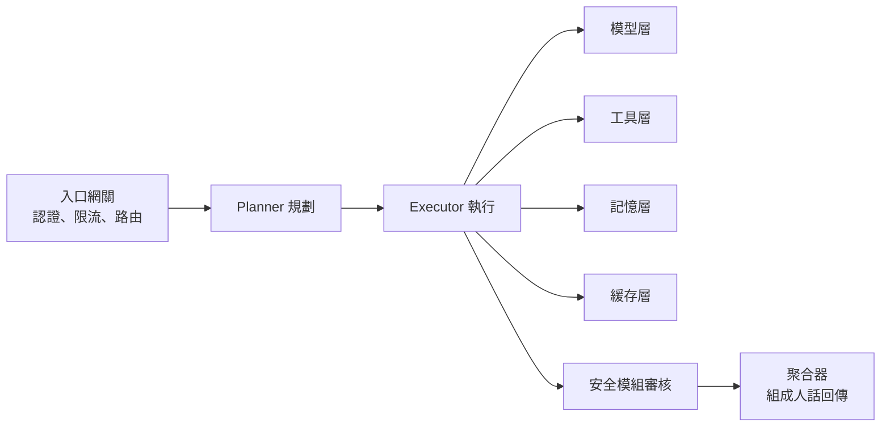

# Agent / RAG 生產級面試題庫:字節 8 題 + 落地十連問 + 履歷五大雷區

> 整理自 YouTube 頻道 **白白说大模型** 三支面試導向影片,合併成一篇(都是「把 Demo 升級成生產系統」的題庫與話術):
> ① 〈月薪从25K冲到45K:字节Agent & RAG架构通关密码〉(2026-09-01,約 16.1 分鐘)
> ② 〈Agent系统架构与工程落地十连问快问快答〉(2026-08-27,約 13 分鐘)
> ③ 〈简历上Agent项目必须避开的 5 个坑:从存储选型、代码能力到业务落地的实战排雷手册〉(2026-10-22,約 13.8 分鐘)
>
> ⚠️ 三片均無官方字幕,逐字稿以 CPU 版 Whisper 轉錄,可能有同音字誤差(見文末還原表)。
> ⚠️ 薪資數字(25K / 45K、年薪 60 萬)與「字節 / 淘寶」場景是**包裝性說法,無公開來源**;技術內容為通用工程實務。片中無課程或付費社群推銷。
> 📎 與本庫 [[agent-project-resume-enterprise-grade]](同頻道另一支履歷影片)互補;記憶 / 圖譜深入見 [[agent-long-term-memory-layered-design-baibai]]、[[is-graphrag-needed-rag-variants-comparison]]、[[multi-agent-data-consistency-reliability]]。

---

## 一句話總結

> **玩具 Demo 與生產系統的差別不在 prompt,而在:高並發低延遲、容錯降級、安全隔離、分層記憶、可量化評測。** 面試官會從「儲存選型」一眼推算你真實跑過的資料量與並發。

---

## 第一部分:25K → 45K 的能力階梯與字節 8 題(影片①)

| 層級 | 要求 |
|---|---|
| 25K(基礎) | 跑通 Function Calling;懂 RAG 標準三步;懂單 Agent 記憶機制與基礎 prompt 工程;能獨立完成可用的小專案 |
| 45K+(架構) | 設計多 Agent 分布式架構、保證分布式狀態強一致;用 MCP 協定整合工具;懂端到端強化學習微調與消融實驗設計 |

影片的說法:兩層「差的不是經驗年限,而是對系統全局的把控能力」。

### Q1:Agent 怎麼調工具?——四步生命週期 + 五道關卡

**四步**:① 把工具寫成「說明書」(函式名、描述、參數型別,用 JSON Schema);② 模型把自然語言翻成**結構化呼叫請求**(不直接執行);③ 後端執行器呼叫目標函式,**做好超時控制與錯誤捕獲**;④ 結果塞回上下文讓模型接著推理。

**生產環境卡死五道安全關卡**:① 精準過濾該用哪個工具、避免誤觸發(用戶隨口說「跑」不能誤調跑步路線規劃);② 參數提取防錯(要整數傳成字串);③ 資料格式強校驗、防惡意注入;④ **在沙箱裡執行**,不能直接訪問系統檔案或網路;⑤ 把結果無縫揉進上下文並確保乾淨可用。
初學者的雷:用字串匹配判斷意圖、為圖省事丟 Python `eval` 動態執行——一上線就有**權限注入與資料破壞**風險。

### Q2:還有哪些工具調用姿勢?
ReAct(邊想邊做,先查天氣再規劃路線)、LangChain / LangGraph 式執行器把多工具串成 DAG（影片 [5:39]–[5:44] 的說法；**需修正**：LangGraph 的設計重點是有狀態圖與循環（agent 迴圈），並非只限 DAG，見延伸閱讀），**輕量小模型當裁判**動態選最優路徑(高並發低延遲場景省掉大模型反覆推理)、事件總線做非同步分發、本地插件做**熱載入**、多 Agent 間發訊息委託形成去中心化協作網。

### Q3:模型怎麼判斷要不要調工具?MCP 解決什麼?
三種成熟做法(可組合,無絕對優劣):① 在提示詞定規矩,模型自己判斷並吐出特定標記;② 專門訓練一個**輕量分類小模型**當開關(極低延遲,適合高並發入口);③ ReAct 式推理規劃。
MCP:解決「**適配地獄**」——以前每個模型 × 每個工具都要硬編碼適配;MCP 統一用標準化格式描述工具、請求回應、錯誤碼與非同步回調,「像插 USB」。(轉錄為「全用接生C碼說話」,使用者 2026-11-07 確認講者說的是 JSON Schema;另註:MCP 傳輸協定本身是 JSON-RPC 2.0,工具參數以 JSON Schema 描述,兩者不同層(已核實:[MCP 工具規範 2025-06-18](https://modelcontextprotocol.io/specification/2025-06-18/server/tools) 的 `tools/list`、`tools/call` 範例為 JSON-RPC 2.0,工具的 `inputSchema` 為 JSON Schema)。見 [[function-calling-mcp-a2a]]。)

### Q4:上下文爆表(token 超限)怎麼辦?
三優先級:**① 保證當前任務完成(不可妥協)→ ② 盡量保留近期對話相關性 → ③ 最後才顧語句流暢**。拒絕按長度硬截斷。四種策略:滑動視窗(適合短時任務)、舊對話高倍率壓縮成摘要 + 關鍵實體(有損但保關鍵)、**RAG 化歷史**(歷史向量化存庫,依當前語意召回最相關片段)、**讓大模型給每段歷史打重要性分**只留高分(像清理手機相簿)。

### Q5:生產 RAG 鏈路怎麼跑?
開卷考試三步:問題 → embedding 轉向量 → 向量庫做近似最近鄰(ANN)搜尋 → 片段 + 原問題拼給大模型生成。進階:檢索器與生成器可獨立優化,甚至用強化學習做端到端微調,讓檢索器學會「為生成器找對資料」(前沿研究方向)。

### Q6:Embedding 與向量庫底層怎麼檢索?
文件按固定或動態視窗切塊(例:512 token 一塊)→ 模型轉定長稠密向量 → 查詢也轉向量 → 算餘弦相似度或內積找最近座標。資料量大時暴力算距離跑不動,線上要用 **FAISS / HNSW** 這類 ANN 索引。(轉錄「5C / H&SW」=FAISS / HNSW,**已核實**:影片 [12:20] 同段投影片標示 FAISS、HNSW 字樣;HNSW 原論文見延伸閱讀。)
例:搜「蘋果手機續航」而文件寫「iPhone 電池耐用」——字面幾乎無重疊,關鍵字搜不到,向量空間裡兩概念靠得很近能召回。

### Q7:Agent 記憶怎麼管、存在哪?
邏輯三級:**短期記憶**(進行中的對話上下文)、**工作記憶**(當前任務執行中的變數與暫存)、**長期記憶**(歷史偏好、重大決策、外掛知識庫)。物理存放:短期 / 工作 → 記憶體或 **Redis**(讀寫頻繁,隨任務生命週期走);長期 → 向量庫或關聯式 DB。管理:**LRU 淘汰**或依重要性打分刪除;分布式場景還要多副本強一致同步,否則「用戶換台機器就突然失憶」。(更完整設計見 [[agent-long-term-memory-layered-design-baibai]]。)

### Q8:多 Agent 協作怎麼傳上下文與任務狀態?
不走中央集權,走**去中心化通訊協定**:可用**合同網協議(Contract Net)**或拍賣機制自動協商分工;共享記憶庫或訊息中帶**上下文 ID + 版本號**(像快遞單號)做全鏈路追蹤;任務狀態必須可序列化且不可隨意篡改——把任務當**有限狀態機**或用 **Actor 模型**(每個任務一個小實體,狀態變化以**事件溯源日誌**記錄);金融等要命場景再上**分布式共識演算法**保證狀態日誌強一致。

### Q9(字節壓軸):多 Agent 系統上線後怎麼評估?消融實驗怎麼設計?
- **系統級 / 鏈路級指標**:多 Agent 協作成功率、通訊時延、任務完成率。
- **生成品質指標**:幻覺率、上下文忠實度、答案相關性。
- **消融實驗**(控制變量):剝離或替換 **Memory 模組**看長期任務成功率變化;剝離**路由小模型**對比直連大模型的時延與準確率;改變通訊協定與協作拓撲,評估系統吞吐極限。

---

## 第二部分:落地十連問(影片②)

1. **生產級 Agent 架構**:拆 6 層——入口層、調度層(Planner / Executor)、模型層、工具層、記憶層、緩存層。入口像機場安檢:確認身份、限流、路由;結果還要過**安全模組**審核,最後由聚合器回傳。
2. **規劃-執行-反思迴圈**:本質是**狀態機控制**。Planner 產生步驟並**為每步定驗收標準**;Executor 調度工具 / 模型;Reflector 校驗結果,錯了帶具體報錯原因回去讓 Planner 重新規劃。**必加三道保險**:最大重試輪次、單次執行超時、最終人工兜底——否則模型死咬錯誤工具陷入「我覺得我還能再搶救一下」的死循環,打爆 token。
3. **多輪記憶分級與緩存**:記憶不是越長越好,是越有條理越好(整理衣櫃):短期上下文(Redis 熱資料)→ 會話摘要(動態壓縮,保主線)→ 用戶長期畫像(向量庫,語意召回)→ **業務知識庫**(扣款記錄、訂單狀態這類強一致資料,**必須進業務 DB,絕不能丟**)。緩存 key 要綁**用戶 ID + 會話 ID + 工具 ID + 結果**,且每個 key **強制帶 TTL、版本號、失效策略**。黃金定律:**緩存亂了比沒有緩存更可怕**,寧可不加也不讓不一致資料污染上下文。
4. **向量庫選型**(比喻):Chroma 像電動車,輕量適合本地原型,但影片稱「不支持分布式、資料量大查詢變慢」(投影片畫面,[4:30]),**需修正**:Chroma 官方架構頁已列 Distributed 模式(多服務 + 物件儲存,託管版為 Chroma Cloud),單機模式官方描述適用約 1,000 萬筆以下;「不支持分布式」已過時,「百萬級就吃力」未能核實;Pinecone 像租專車,全託管 SaaS 免運維,團隊小求快首選,但資料不在自己手裡、規模大成本高;Milvus 像自己改裝的重卡,雲原生、存算分離、億級向量毫秒檢索、私有化部署且成本可控。（存算分離與無狀態 worker 已核實，見 [Milvus 架構頁](https://milvus.io/docs/architecture_overview.md)；該頁未載「億級」與「毫秒」數字，未能核實。）影片以「淘寶導購 / 客服」為例:資料量龐大、要和即時交易鏈路打通 → 選 Milvus 或自研;且**純向量相似度不夠**,要把品類、價格、品牌等**業務元數據**混進去。(轉錄「Furamo / Honkkon」=Chroma(投影片與講者 [4:30] 對應,已核實);「Panco」=Pinecone;「Meaverse / Mews / Mewis」=Milvus。)
5. **Function Calling 可靠性**:五層「防彈衣」——Schema 校驗、參數補全(缺省值自動填)、**權限校驗**(不越權調改 API)、**冪等控制**(防重複下單 / 重複扣款)、結果校驗(回傳資料是否合邏輯)。模型反覆調錯同一工具的**四步熔斷**:① 記錄失敗軌跡,連續兩次出錯則把該工具拉入黑名單、暫時從上下文剔除;② 強制切斷當前執行,把具體錯誤堆疊交給 Planner 換思路;③ 重新規劃仍不行就走**規則化兜底**,輸出預設的抱歉話術;④ 涉及核心交易鏈路則立即**轉人工**,不讓模型死磕。
6. **工具 description 怎麼寫**:它是給大模型看的使用說明書。公式:**用途 + 邊界 + 輸入約束 + 禁忌場景**。淘寶查庫存例:用途「用戶詢問特定商品在特定地區是否有貨時呼叫」;約束「必須提供數字型 ItemID 與國標省市區代碼 RegionID」;禁忌「**絕對不要用於**查價格、優惠券、個性化推薦或店鋪搜尋;問價格請呼叫 query_price」。「它能幹什麼、絕對不能幹什麼都講清楚,呼叫準確率會有質的飛躍。」
7. **RAG 切塊大小**:沒有銀彈,取決於語意完整性與召回精度。**FAQ / 客服**:300–500 字(一問一答,越細越準;勿把多個 QA 對跨在同一塊);**基礎文件**:800–1200 字,按 Markdown 標題或**程式碼塊邊界**切,**不要從中間硬切長程式碼**;**商品詳情**:別當普通文字切,存成**結構化 JSON**,價格 / 材質 / 評價作為 metadata 精準提取。
8. **檢索相關性不高怎麼優化**:先像警察斷案排查三要素(切分不合理?向量模型失效?排序不靠譜?),再用四招:① **混合檢索**:BM25 做關鍵字精準硬匹配(防專有名詞查不到)+ 向量檢索做語意泛化;② **查詢改寫**:口語先用小模型預處理成標準關鍵詞(「蘋果手機」→「iPhone」);③ **重排**:粗排多抓(例 Top-50),再用專門的重排模型(轉錄「BG1 Rerankers」=BGE Reranker,[9:57] 講者念出,同段投影片標示 BGE-Reranker,已核實;模型見延伸閱讀)精排;④ **業務特徵強過濾**:電商把品類、品牌、價格區間、庫存當**硬性過濾條件**。
9. **串行工具導致高延遲**:優化看 **P95 / P99** 而非平均。原則:「用戶要的是快看見,不是算完」。① 並行與緩存:無依賴工具並行發起(如 `Promise.all`),高頻資料直接 Redis 不走大模型,複雜聚合由定時任務離線預計算;② **大小模型路由**:簡單意圖識別交小模型秒回,複雜推理決策才上大模型;③ **流式輸出**,先回可降級的骨架資料,長任務轉後台非同步;④ 外部介面必加超時熔斷,不讓一個慢速第三方 API 拖垮整個 Agent。
10. **高並發彈性伸縮**:核心是**無狀態編排與有狀態儲存徹底拆開**。入口網關(像遊樂園閘機)承擔限流排隊熔斷;**無狀態執行層**只負責邏輯編排,可看佇列長度與 P95 延遲用 **K8s HPA** 秒級橫向擴縮;最難的是**有狀態資源層**(大模型 API 並發配額、資料庫連線池、第三方介面),難以瞬間擴容,要做隔離與容量保護——**長任務與短任務分開、設不同優先級佇列**(別讓只買一瓶水的人堵住整個結帳台)。

總結(影片原意):從狀態機的迴圈控制、記憶的分層管理,到高並發下的資源隔離與熔斷——**工程細節才是普通候選人與高級架構師的分水嶺**。

---

## 第三部分:簡歷五大雷區(影片③)

面試官的篩選漏斗:最上層看到明顯培訓班同質化專案(**2–3 秒就歸檔**);稍好的、寫了點呼叫介面邏輯的留在中間層及格線;最底層才是展示出**生產環境思維**的人。判斷「玩具」看三件事:**完全脫離真實業務上下文**(像塑膠小廚房開不了火)、**看不到程式碼深度**(接口一接、沒有任何架構設計)、**零容錯**(網路卡頓或模型回傳格式多一個空格就崩)。

| # | 雷區 | 問題 | 怎麼改 |
|---|---|---|---|
| 1 | 儲存選型偽裝 | 寫「百萬級非結構化資料、高並發企業知識庫」,技術棧卻是**單機本地輕量向量庫**——像五星酒樓後廚只有一台迷你電飯煲。面試官從引擎即可推算你真實資料量與並發 | 單機輕量庫誠實標示為**原型驗證 / 幾十萬以內內部工具**;資料破百萬到千萬、要求高可用才用**分布式向量集群(Milvus / Qdrant 之類,轉錄「q轉的」=推定 Qdrant)**;簡歷交代**資料規模、並發要求、選型原因、實測吞吐** |
| 2 | 混淆崗位職責 | 寫「親手部署開源大模型、全棧大模型部署專家」→ 被追問顯存動態分配、批處理調度、多卡張量並行通訊延遲就啞口。個人輕量環境跑模型在面試官眼裡只是玩具 | 底層算力優化是 **AI 系統工程師**(vLLM、TGI、TensorRT-LLM)的領域。應用開發者的主戰場是**模型之上的系統設計**:長對話上下文怎麼管不超長、二十多個外部介面怎麼保證調度準確率、介面掛了或幻覺時系統魯棒性 |
| 3 | 過度依賴低代碼拖拉拽平台 | 面試官看不出你的物件導向能力與架構水準;拉三天就能做出大差不差的流程,毫無技術門檻 | 轉向**程式碼級編排框架**或用原生 Python 自寫狀態機;展示**高並發非同步控制、狀態機管理複雜分支、長上下文留存與動態路由**,面試官看到的是類別封裝、執行緒池、狀態圖與異常捕獲 |
| 4 | 把寫 prompt 和呼叫 API 當核心亮點 | 單輪提示詞與基礎介面對接只是**冰山浮在水面的一角**,是行業通用基本功 | 提煉水面之下的系統級能力:**複雜長文本的上下文工程**;**外部介面超時、模型輸出格式漂移時的容錯機制**。範例鏈路:請求先走**上下文緩存**(降重複提問延遲與 token)→ 依意圖做**動態資訊壓縮與精準檢索** → 結果過**結構化輸出校驗** → 介面掛了 / 格式報錯時觸發**自我修復重試與降級恢復**,不讓程式白屏報錯 |
| 5 | 業務場景同質化 | 十份簡歷七八份是單文檔 PDF 問答助手,其餘是通用知識庫客服或每日日程天氣提醒。「沒有真實業務邏輯耦合的 Agent,本質是披著 Agent 外衣的模型前端殼子」 | 選**業務深水區**:金融風控(解析版式複雜的非結構化財報表格 + 規則引擎交叉比對資金流 + 異常自動標記追因)、供應鏈(庫存預警 + 企業內部 ERP 協同調撥 + 外部介面失敗時的**事務狀態回滾**)、運維(海量雜亂報錯日誌的自動鏈路追蹤與故障復現推演)。技術架構隨之豐滿:資料清洗流水線、任務拆解 + ReAct + 反思、**嚴格權限鑑權**、重試與兜底容錯 |

### 簡歷改寫對照
- 儲存:「本地輕量向量庫」→「**分布式向量引擎 + 混合檢索**」
- 開發:「拖拉拽工作流平台」→「**程式碼級編排與狀態圖設計**」
- 架構:「簡單知識檢索單鏈」→「**多工具動態呼叫、多步推理與異常自癒系統**」

### STAR 在 Agent 語境
- **S(背景)**:先拋真實業務痛點(跨系統效率低、資料格式極度混亂)。
- **T(任務)**:界定系統邊界,寫出當時的吞吐量壓力與準確率要求。
- **A(行動)**:重點寫你在程式碼裡怎麼做**狀態機流轉**、怎麼處理**複雜工具鑑權**、怎麼做**系統級異常處理**。
- **R(結果)**:**量化數字收尾**——平均處理耗時降低 X%、錯誤率壓到 Y% 以下、減少多少人工干預時間;不要「效果顯著」。

結語:市面不缺只會調介面、拼提示詞的「拼裝工」;企業搶的是能跳進髒亂差真實業務、用扎實程式碼與健壯架構解決複雜問題的系統工程師。(同主題更完整的指標體系見 [[agent-project-resume-enterprise-grade]] §八–九。)

---

## 應用案例

**案例 1:電商客服 Agent 面試的完整回答骨架(串十連問)**
「我把系統拆 6 層。入口網關認證限流;Planner 把『我的訂單沒到』拆成『查訂單 → 查物流 → 判斷是否賠付』並為每步設驗收標準;Executor 調工具,工具 description 按『用途+邊界+約束+禁忌』寫、五層防彈衣校驗;記憶四層分流,訂單 / 扣款走業務 DB、不進向量庫;RAG 對 FAQ 切 300–500 字,檢索用 BM25 + 向量混合、重排、再加品類 metadata 硬過濾;狀態機有重試上限 2 次、超時、人工兜底;工具連續失敗兩次熔斷並降級轉人工;用 P95 看延遲、K8s HPA 擴執行層、長短任務分佇列。」

**案例 2:你的簡歷專案只有「PDF 問答」,怎麼救?**
不要重寫一個更炫的,而是補工程深度:加上資料規模與實測吞吐(雷區 1)、容錯與結構化輸出校驗(雷區 4)、選一個垂直場景(如財報表格交叉核驗,雷區 5),並用 STAR 量化。

**案例 3:對工具調用做 code review 的檢查表**
是否有:沙箱執行(而非 eval)、Schema 校驗、冪等 key、超時與重試上限、黑名單熔斷、權限校驗、結果合理性檢查。缺一項就是面試官追問的突破口。

---

## 核實與評語

- **業界通用,可信**:FAISS / HNSW 為標準 ANN 索引;BM25 + 向量的混合檢索、查詢改寫、reranker 為常見組合;Chroma / Pinecone / Milvus / Qdrant 為真實向量庫;vLLM / TGI / TensorRT-LLM 為真實推論引擎;合同網協議(Contract Net)為分散式 AI 經典協調機制;事件溯源、Actor 模型、冪等、K8s HPA 皆標準工程概念(除 HNSW 論文、MCP 工具規範、Milvus 與 Chroma 架構頁、BGE Reranker 模型頁已讀外,其餘未逐項查官方文件)。
- **作者主張 / 經驗值**:切塊大小(300–500 / 800–1200)、「連續兩次出錯拉黑名單」「重試上限」「FAQ 越細越準」皆屬經驗法則,**未提供實驗依據**,請依自己語料實測;Top-50 粗排也是示意值。
- **有爭議處**:影片③雷區 2 說「個人跑模型沒價值」略絕對——對應用工程師來說,**了解推論引擎的取捨有助於成本與延遲估算**,但不該在簡歷把自己包裝成部署專家(這一點判斷是合理的)。
- **高度雷同**:影片③與 [[agent-project-resume-enterprise-grade]] 同主題(同作者),本篇只補不同之處;三道題的重疊度高,請勿重複背誦。

### 轉錄還原表(推定)
「相量 / 項量 / 像量」=向量、「RG / RIG / IG」=RAG、「A准 / A織 / 一整」=Agent、「Furamo / Honkkon」=Chroma、「Panco」=Pinecone、「Meaverse / Mews / Mewis」=Milvus(此三項 2026-11-07 以影片畫面截圖確認:投影片 Q4 向量資料庫選型寫 Chroma / Pinecone / Milvus)、「5C」=FAISS、「H&SW」=HNSW、「BG1 Rerankers」=BGE Reranker、「Lunchian / Long Graph」=LangChain / LangGraph、「VLL / TGI / Tensor TLL」=vLLM / TGI / TensorRT-LLM、「q轉的」=Qdrant、「Promise.org」=Promise.all、「Extrude / xcute」=Executor、「Planet / Pnano」=Planner、「斯大法則」=STAR 法則、「吊包程序員」=調包(調 API)工程師、「消融 / 骁容 / 銷融」=消融實驗。

---

## 延伸閱讀與深度補充(2026-11-07 核實增補)

> 以下每點都是實際讀過的一手來源(論文摘要、官方規範/架構頁、模型頁);影片比來源多出的部分才標為「補充」。

1. **HNSW 原論文**(Malkov & Yashunin,arXiv 2016,v4 2018)：[https://arxiv.org/abs/1603.09320](https://arxiv.org/abs/1603.09320)
   - 機制：建立多層鄰近圖（hierarchical NSW）；每個元素的最高層隨機抽取、機率呈指數衰減；搜尋從最稀疏的上層開始逐層下探，複雜度隨資料量呈對數成長。
   - 與影片的差異：影片 [12:20] 只說「線上要用 FAISS / HNSW 這類 ANN 加速」，沒講到建索引成本、記憶體佔用與 recall 之間的取捨。面試若被追問，可從「分層 + 由上而下搜尋」切入。

2. **MCP 工具規範（2025-06-18）**：[https://modelcontextprotocol.io/specification/2025-06-18/server/tools](https://modelcontextprotocol.io/specification/2025-06-18/server/tools)
   - 工具欄位：`name`、`description`、`inputSchema`（JSON Schema）、可選 `outputSchema`；呼叫為 `tools/call`。
   - **錯誤分兩類**：① 協定錯誤（JSON-RPC `error`，如 `Unknown tool`、參數無效）；② 工具執行錯誤（回傳 `isError: true`，如 API 限流）。這正好對應 Q1 的「錯誤捕獲」，影片沒講這個區分。
   - 規範的安全要求：Server **MUST** 驗證所有輸入、限流、清理輸出；Client **SHOULD** 對敏感操作要求使用者確認、在呼叫前顯示輸入、驗證結果後才餵給 LLM、設 timeout、記錄審計日誌。比影片的「五道關卡」多出 **人工確認與審計**。

3. **Milvus 架構頁**：[https://milvus.io/docs/architecture_overview.md](https://milvus.io/docs/architecture_overview.md)
   - 官方用語為 "fully disaggregated storage and compute layers"；worker 因存算分離而**無狀態**；持久化資料與索引存在物件儲存（MinIO / AWS S3 / Azure Blob），QueryNode 快取查詢所需的資料與索引。
   - 快取被逐出時資料不會消失，但未命中會增加 I/O 與查詢延遲（Tiered Storage 說明）。
   - **未能核實**：影片與投影片的「億級向量、毫秒檢索」數字，官方架構頁未載。

4. **Chroma 架構頁**：[https://docs.trychroma.com/docs/overview/architecture](https://docs.trychroma.com/docs/overview/architecture)
   - 三種部署：Local（嵌入式，原型用）、Single-Node（官方描述約 1,000 萬筆以下、少量 collection）、**Distributed**（多服務部署，物件儲存 + SSD 快取 + 共享系統資料庫；託管版為 Chroma Cloud）。
   - 與影片差異：投影片「不支持分布式」已過時；影片「百萬級就吃力」屬作者經驗，未能以官方數字完全對應。
   - 實務含義：選型時不要只看「本地 vs 雲」，而要看**規模超過單機門檻後是否要換 Distributed 或託管版**。

5. **BGE Reranker v2-m3 模型頁**：[https://huggingface.co/BAAI/bge-reranker-v2-m3](https://huggingface.co/BAAI/bge-reranker-v2-m3)
   - 北京智源（BAAI）出品，約 0.6B 參數，以 bge-m3 初始化；**cross-encoder** 架構：query 與 passage 一起輸入、輸出相關性分數（非獨立向量）。
   - 定位：對第一階段檢索的候選做**重排**，不用於全庫搜尋；官方評測是對其他檢索器的 top-100 結果重排。
   - 與影片對照：影片說「粗排取 50 條、再用 BGE Reranker 精排」，方向一致；「50 條」為示意值，官方評測用 top-100。

6. **LangGraph 的循環設計（未能一手核實全文）**：影片 [5:39] 把 LangGraph 與 LangChain 歸為 DAG 工作流。搜尋摘要引用舊版 LangGraph.js 文件，稱 LangGraph 主要為**加入循環**而設計、不只是 DAG（[https://js.langchain.com/docs/langgraph](https://js.langchain.com/docs/langgraph)，該網址已重導向）；我抓取的新版 LangChain overview 頁只描述 LangGraph 為「low-level orchestration framework, for advanced needs combining deterministic and agentic workflows」（[https://docs.langchain.com/oss/javascript/langchain/overview](https://docs.langchain.com/oss/javascript/langchain/overview)），未提循環。**結論：影片「串成 DAG」的說法不準確，但循環的具體文字依據尚待一手全文確認（未能核實全文）。**

---

## 來源

- 〈月薪从25K冲到45K:字节Agent & RAG架构通关密码〉— 白白说大模型,2026-09-01:<https://www.youtube.com/watch?v=Pio4SrsPHCY>
- 〈Agent系统架构与工程落地十连问快问快答〉— 白白说大模型,2026-08-27:<https://www.youtube.com/watch?v=x-s1Dbp4BE4>
- 〈简历上Agent项目必须避开的 5 个坑:从存储选型、代码能力到业务落地的实战排雷手册〉— 白白说大模型,2026-10-22:<https://www.youtube.com/watch?v=W-gdYr3Vj8s>

> 三片均無官方字幕,逐字稿以 CPU 版 Whisper 轉錄,可能有同音字誤差。
