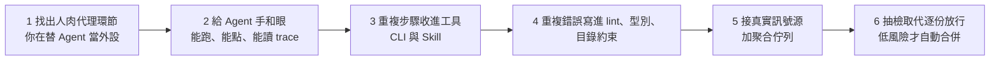

# 先給 Agent 驗證,再談規模:Lauren Tan 訪談的「人肉代理」、抽檢與自動合併

> 整理自 YouTube 頻道 **Why QQ**〈[一个月2500个PR,她怎么评审](https://www.youtube.com/watch?v=M6sOWI1QLEc)〉(2026-10-29,約 9 分鐘,官方 zh-Hans 字幕)。這是一支 **Reaction**:作者看完 Matt Pocock 與 Lauren Tan 的訪談後,挑出可落地的部分。
>
> 立場:說明欄與片中沒有業配或聯盟連結;說明欄自述「PR 數量為 Lauren 自述」。**原訪談我沒找到可讀的全文或逐字稿,第二手的訪談內容(2,500 個 PR、16:14 verification 段落、Dune 框架等)無法獨立核實**,以下以「影片轉述」標示。
>
> 相關:同一位 Lauren Tan(poteto)的開源技能庫見 [[pstack-poteto-mode-cursor-plugin]](那篇讀過原始碼);Matt Pocock 的技能見 [[matt-pocock-skills-teardown]]。本篇不重複 pstack 的劇本與原則,聚焦「驗證、約束、抽檢、風險分級」。

---

## 一句話總結

> **先減少單個 Agent 需要人工代勞的環節(讓它自己跑、自己看結果),再把重複出現的錯誤寫進 lint 與型別,最後才擴大並行與自動合併。** 順序顛倒的話,十個 Agent 只會給你十份待檢查的作業。

2,500 個 PR 本身不是重點:Lauren 自己也說其中包含大量「程式碼園藝」,不能換算成 2,500 個新功能(影片轉述)。

---

## 一、人物背景(影片介紹,部分已核對)

| 人物 | 影片說法 | 核對 |
|---|---|---|
| Matt Pocock | Total TypeScript 與 AI Hero 作者,曾在 Vercel 做開發者倡導,參與過 XState | 與本庫 [[matt-pocock-skills-teardown]] 的背景一致,細節未再逐項查 |
| Lauren Tan(poteto) | 待過 Meta React 團隊、Netflix、Cursor;React Compiler 核心成員;SpaceXAI 的 Grok Bot 與 Cursor 相關工作 | pstack 原始碼筆記已核對 Meta / Netflix / Cursor / React Compiler;SpaceXAI 與 Grok Bot 僅影片轉述 |
| pstack | 她開源的 Agent 工程技能庫 | ✅ 見 [[pstack-poteto-mode-cursor-plugin]] |

---

## 二、核心觀點

### 1. 人肉代理(meat proxy)

Lauren 早期優化 Cursor Agents 視窗效能時,Agent 改完程式碼,她自己開 Chrome DevTools 看火焰圖與堆快照,再把結果餵回去。很多人今天仍這樣:AI 說修好了你啟動專案、頁面報錯你複製終端、接口失敗你截圖再問一次——**看起來在指揮 AI,實際在給 AI 當外設**。Agent 看不到真實產物,只能根據你的轉述繼續猜,每次猜測都吃掉你的注意力。

### 2. 驗證是 Agent 的手和眼

影片說 16 分 14 秒附近講 verification:讓 Agent 執行程式、像使用者一樣點頁面、讀 trace 與快照,再根據結果修改。修前端 bug 可給一條固定命令:啟動應用 → 開路由 → 執行重現步驟 → 存下 console 錯誤與截圖;修效能再補一份可比較的紀錄。目標:**Agent 宣告完成前必須拿出執行證據**。

兩類驗收要分開:

| 問題 | 誰來驗 |
|---|---|
| 行為是否符合預期 | 腳本、測試、瀏覽器 |
| 結構是否方便下次修改(程式碼放對位置?臨時方案有沒有擴散?) | 型別設計、模組邊界、人的判斷 |

PR 能跑只代表過了行為門檻。(本庫 [[agent-skill-three-layer-run-do-verify]] 把「跑—做—驗」寫成技能三層,可對照。)

### 3. 把確定性的步驟收進工具

Agent 每次驗證都臨時寫腳本、用完就丟、下一個再重寫,既慢又難比較。Lauren 把重複步驟收進 CLI 與 Skill(Playwright、Chrome DevTools Protocol、截圖與 trace 由同一套工具處理)。**需要判斷的留給 Agent,機械步驟交給程式。**

### 4. 約束寫進程式碼庫,不是提示詞

影片轉述:Lauren 團隊有內部框架 Dune(功能有固定目錄、lint 規則很嚴,多數改動只剩一種常見寫法)。早期 Grok Bot 桌面端曾有八個上萬行的超大檔案,Agent 很容易順著壞模式繼續加,她會拆結構,再把重複錯誤轉成 lint、型別或目錄約束。作者的評論:這比一直追加 `AGENTS.md` 有效——提示詞要求 Agent 記住一百條規矩,程式碼庫可以直接讓部分錯誤過不了檢查。一般專案也做得到:禁止跨層 import、限制舊 API、給危險狀態加型別區分、把 review 裡重複出現的評論交給工具。

### 5. 內外循環與聚合佇列

- **內循環**:改程式、驗證、交付。
- **外循環**:從 Slack、Linear、使用者回饋帶入新資訊。過去她看到 bug 再手動貼給 Agent,自己成了搬運工;現在 Grok Bot 訂閱外部訊號,Cursor Projects 的協調 Agent 拆任務、管子 Agent。
- ✅ **已核實**:Cursor 官方 changelog 說明 Projects 的協調 Agent 自己不寫程式,負責規劃與委派,再把完成的工作交回給你審查(Projects 於 2026-09-10 以 beta 推出)。**這解釋了高 PR 數量的來源是「真實工作觸發 + 共用上下文」,不是人手動開幾千次聊天。**
- 一個容易略過的細節(影片轉述):Lauren 讓 Agent 持續掃描 React 裡的危險寫法,結果先追加到文件、不立即逐個修,隔幾天再讀,常發現許多紀錄指向同一個根因。作者的建議:**自動修復前加聚合步驟**——收集、去重、按模組與症狀分組,再決定是否開工;否則把每個訊號當獨立工單,會重複修同一個問題、錯過更高層的模式。

### 6. 抽檢取代逐份放行,以及自動合併的門檻

- Lauren 對「2,500 個 PR 怎麼評審」的回答是 **sampling(抽檢)**:抽查已合入的程式碼,發現多個 Agent 重複走捷徑,就回頭改 Skill、lint、型別、目錄結構。從逐份放行,轉為檢查系統能否持續產出合格結果。
- 作者的判斷:事後看 main 算不算評審,取決於改動風險與回滾成本——低風險、可回滾、驗證充分的工作,抽檢能減少阻塞;**高風險仍需前置審查**;抽檢也不能只看 diff 漂不漂亮,要結合線上錯誤、回滾紀錄、使用者回饋,否則只是把問題推遲到更貴的地方。
- 「睡覺時 Agent 自動合併」的前提(影片轉述):專案有驗證 Skill、程式碼庫持續清理、常見錯誤被約束、PR 經過多個 Verifier、Agent 反覆執行與模糊測試、pstack 文件要求重新檢查變動後的補丁並結合 CI 狀態;Lauren 也直說這套流程**很耗 token**。
- Matt 追問醫療、金融等高風險場景時,用**單向門 / 雙向門**比喻:能低成本 revert 的改動,事後抽檢較容易被接受;會造成資料遺失、資金變化、合規影響的改動,自動合併需要另一套證據與審批。Lauren 承認難以程式化驗證的領域「還沒有現成答案」。

---

## 三、應用案例

### 案例 1:找出你的「人肉代理」

1. 導出最近 20 次真實開發對話。
2. 逐次標記人工接管:補背景?糾正目錄?要求重跑?推翻設計?
3. **同一種干預出現三次以上 = 改造候選。**
4. 挑一個每週重複五次的驗收環節,讓 Agent 自己完成並留下證據(一條重現命令、一組瀏覽器步驟、或一份效能基線)。

### 案例 2:修前端 bug 的固定驗證命令

寫成 `repro.sh`(或專案 Skill):啟動應用 → 打開指定路由 → 執行重現步驟 → 存 console 錯誤與截圖到固定資料夾。規則寫明:**Agent 宣告修好前,附上這次執行的輸出;沒有就不算完成。**

### 案例 3:把 review 評論變成 lint 規則

某條評論一個月出現 4 次(例如「不要從 UI 層直接 import 資料層」)→ 改成 ESLint / 依賴邊界規則。之後 Agent 與人類都過不了 CI,不用再靠 `AGENTS.md` 提醒。

### 案例 4:自動合併的漸進放權

| 階段 | 做法 |
|---|---|
| 1 | Agent 只準備可審查的 PR |
| 2 | 開放固定類型的低風險改動(文件、格式、可回滾的小重構)自動合併 |
| 3 | 觀察回滾率與漏檢,再慢慢擴大 |
| 全程 | PR 標註**爆炸半徑與回滾路徑**,把權限綁風險:Agent 多做可逆的事,人留意不可逆的決策 |

---

## 四、核實與保留

**✅ 已核實:** Cursor Projects 的協調 Agent 只規劃與委派、不寫程式(Cursor 官方 changelog,2026-09 beta);pstack 與 Lauren Tan 的公開背景(見 [[pstack-poteto-mode-cursor-plugin]] 的原始碼核對)。

**⚠️ 需保留:**

- 「一個月 2,500 個 PR」是 Lauren 自述,且含大量程式碼園藝;外部報導也指出 Cursor 的合併率說法缺樣本數與基準。
- 訪談內的細節(16:14 的 verification、Dune 框架、八個上萬行檔案、Agent 掃描 React 危險寫法)我**未能取得原訪談核對**。
- 「睡覺時自動合併」若單獨剪出來容易變成全自動編程神話;放回整場訪談門檻很高,且耗 token(Cursor 文件也指並行子 Agent 的 token 成本明顯更高)。

**⭐ 影片沒強調、值得補的:** 抽檢要定義「抽多少、看什麼、發現問題後的回修動作」;否則只是延後審查。建議指標:回滾率、線上錯誤與 PR 的對應、同類錯誤重複次數。

---

## 相關筆記

- [[pstack-poteto-mode-cursor-plugin]]:Lauren Tan 的技能庫原始碼拆解。
- [[matt-pocock-skills-teardown]]:Matt Pocock 的技能。
- [[agent-skill-three-layer-run-do-verify]]:技能的跑、做、驗三層。
- [[cross-model-review-claude-codex-harness]]:用不同模型互審,降低球員兼裁判。
- [[loop-engineering-when-and-how-gary-chen]]:驗收目標與 hard stop 的設計。

---

## 來源

- YouTube:Why QQ〈一个月2500个PR,她怎么评审〉 https://www.youtube.com/watch?v=M6sOWI1QLEc (2026-10-29;官方 zh-Hans 字幕)
- Cursor changelog:Projects(協調 Agent 規劃與委派、不寫程式) https://cursor.com/changelog/projects
- 第二手報導(協調 Agent 與成本說明): https://www.eesel.ai/blog/cursor-projects 、 https://runtimewire.com/article/cursor-projects-persistent-coordinator-coding-agents
- Cursor plugins(pstack): https://github.com/cursor/plugins
