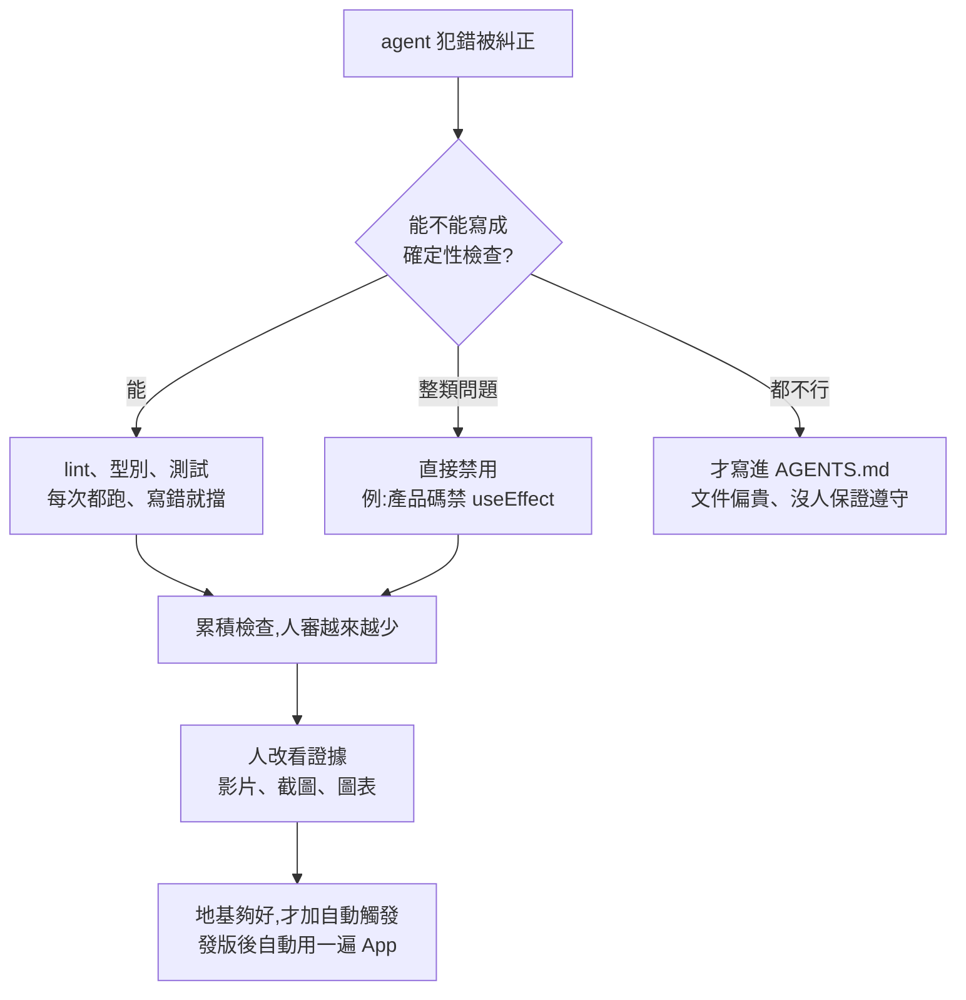

# 所有程式碼都是垃圾,除了我的:Lauren Tan 把每次糾正變成確定性檢查(Agent 煉金術士)

> 整理自 YouTube 頻道 **Agent 煉金術士**〈[SpaceX 主任工程師教你:讓 AI 少寫垃圾](https://www.youtube.com/watch?v=OPAdcgNb4ts)〉(2026-11-18,9 分 33 秒)。影片是對 Lauren Tan(poteto)在 AI Engineer Code Summit 2026 演講〈All Code Is Slop (Except Mine)〉的中文整理。
> 字幕:官方 zh-Hans/zh-Hant 字幕(抓取時遇 429,最後成功取得帶時間檔);時間點取自帶時間逐字稿。
> 立場:說明欄無業配或聯盟連結;片尾 [9:15](https://www.youtube.com/watch?v=OPAdcgNb4ts&t=545s) 是頻道自我介紹與訂閱呼籲,屬自家宣傳。
> ⚠️ **核實範圍:原演講錄影([YouTube 直播回放](https://www.youtube.com/watch?v=ZZ19zhYnDKY&t=3600s))與她在 X 的貼文我都沒能讀到**;下表的「二手交叉」指我讀到的三份第三方整理文章數字一致,不是一手。

## 一、一句話

寫垃圾的不只 AI,AI 會**照抄程式碼庫現有的寫法並放大**。Lauren 的做法:**每次糾正 agent,不要再往 AGENTS.md 加一行,而是變成 lint、型別、測試這類確定性檢查,或乾脆把錯的選項禁掉**;人不再逐行審,改看 agent 交回的驗證證據;環境整理好之後才談「軟體工廠」(自動觸發、無人值守)。

## 二、影片重點與查證

| 時間 | 影片說法 | 查證 |
|---|---|---|
| [0:36](https://www.youtube.com/watch?v=OPAdcgNb4ts&t=26s) | 寫垃圾不只 AI,AI 放大身邊環境;「垃圾」多半指「不是我寫的」 | 二手交叉一致:演講主旨是「關注程式碼周圍的環境」 |
| [1:21](https://www.youtube.com/watch?v=OPAdcgNb4ts&t=71s) | agent 照現有程式碼寫法抄 | 二手交叉:「你的程式碼庫是 agent 最大的輸入」 |
| [1:35](https://www.youtube.com/watch?v=OPAdcgNb4ts&t=85s) | 她三月 68 個 PR,十月 3,127 個,約一天一百個;每天收約三百個同事 PR(2024 年約三個) | 十月約 3,000 個與每天約 300 個**二手交叉一致**;三月 68 個**未能核實** |
| [2:37](https://www.youtube.com/watch?v=OPAdcgNb4ts&t=147s) | Cursor 的例子:agent 愛用計時器遮閃爍,9/9 出現第一個、10/3 被抄進共用模組、10/17 已有 183 個計時器 | 183 個與 9/9、10/17 日期**二手交叉**(Webreactiva);種類為 setTimeout、requestAnimationFrame、requestIdleCallback |
| [3:05](https://www.youtube.com/watch?v=OPAdcgNb4ts&t=175s) | 倒金字塔:程式碼與 API 最便宜,往下依序是確定性檢查、驗證、文字(AGENTS.md 等)、人審最貴 | 二手交叉:五層為 codebase、static analysis、verification、prose、human review |
| [4:11](https://www.youtube.com/watch?v=OPAdcgNb4ts&t=241s) | 註解從六萬五千多個砍到一千兩百多個 | **二手交叉**:7/31 為 65,824,演講當天 1,227;「禁 99% 註解」也有 |
| [4:17](https://www.youtube.com/watch?v=OPAdcgNb4ts&t=247s) | 難用的東西整類禁掉,例:產品碼禁 `useEffect`,只留自家框架 Dune 內部用 | **二手交叉**;Dune 規則細節未公開,文章只給示意範例 |
| [4:46](https://www.youtube.com/watch?v=OPAdcgNb4ts&t=276s) | 確定性檢查七月 7 條、十一月累積 167 條 | **二手交叉**(七月 7、八月 38、九月初 90、十一月 167) |
| [5:32](https://www.youtube.com/watch?v=OPAdcgNb4ts&t=322s) | TLA+ 驗證跨裝置通知;Lean 證明自家清單元件捲動不閃、不抖 | **二手交叉**(Lean 證的是自製虛擬化清單函式庫);抓到的 bug 數文章都沒給 |
| [5:55](https://www.youtube.com/watch?v=OPAdcgNb4ts&t=345s) | Bombadil 函式庫自動亂點介面找違規,抓到幾個 UI bug | ✅ 一手:[antithesishq/bombadil](https://github.com/antithesishq/bombadil) 為 MIT,自述「web 與終端 UI 的 property-based testing,自主探索並驗證正確性屬性」,可跑在本機、CI、Antithesis;頁面約 3.0k stars(搜尋摘要曾顯示 1.5k,時間不同) |
| [6:15](https://www.youtube.com/watch?v=OPAdcgNb4ts&t=365s) | Cindy Sridharan 每天 70% token 花在驗證 | **二手交叉**;ai-heartland 註明這是另一位工程師的數字,不是 Lauren 的 |
| [6:42](https://www.youtube.com/watch?v=OPAdcgNb4ts&t=392s) | 十月 10,926 個 PR(六月八百多個)、227 人送 PR | 227 人與約一萬一千**二手交叉**;六月八百多個**未能核實** |
| [7:13](https://www.youtube.com/watch?v=OPAdcgNb4ts&t=423s) | 撤回率六月 0.98%、十月 0.47% | 「穩定約 0.5%」**二手交叉**;**0.98% 與 0.47% 精確值未能核實**;ai-heartland 註明只計「被撤回」,不含後續 PR 修掉的 bug |
| [7:24](https://www.youtube.com/watch?v=OPAdcgNb4ts&t=434s) | 冷啟動 2.3 秒→1.4 秒;記憶體更高、調整視窗變慢 | **二手交叉**:冷啟動 2,304→1,395 ms(−39%)、閒置記憶體 +12%、視窗縮放 3→6.9 ms |
| [8:23](https://www.youtube.com/watch?v=OPAdcgNb4ts&t=493s) | 每次發版自動派 agent 把整個 App 用一遍,找到 bug 自己開 PR 並自動合併 | **二手交叉**(Webreactiva 舉 Linux 模糊測試一次去重後 56 個 bug) |
| [0:27](https://www.youtube.com/watch?v=OPAdcgNb4ts&t=17s) | Lauren 是 SpaceXSI 主任工程師,負責 Grok Bot | **身份說法不一致**:搜尋結果有稱 SpaceXSI、SpaceX、xAI Grok Bot 團隊;本庫舊筆記 [[pstack-poteto-mode-cursor-plugin]] 寫 Cursor。**未能核實,不寫死單一頭銜** |

### 2.1 影片沒講、二手文章有的反面數字

- 啟動時載入的 JS+CSS 從 2 MB 增至 7.7 MB(約四倍);閒置 CPU 從 0.40% 增至 0.80%;冷開長對話 +8%(Webreactiva 整理自投影片)。影片只提「記憶體更多、調整視窗更慢」,**沒提體積與 CPU 也變差**。
- 撤回率 ≈ 0.5% 只代表「被整個撤回」的 PR;小 bug 以後續 PR 修掉的不在內。

## 三、延伸:為什麼「變成程式碼」比「寫進文件」可靠

- **文件靠自覺,檢查靠機制**:影片用鹽匙比喻([4:00](https://www.youtube.com/watch?v=OPAdcgNb4ts&t=230s)),AGENTS.md 是牆上紙條,lint 規則是固定份量的鹽匙,而且「寫錯就擋下來,還告訴它怎麼修」。實務上 lint 的錯誤訊息本身就是對 agent 最即時的提示。
- **成本層級**:同一條糾正,放在越上層(改 API 讓錯誤寫不出來)成本越低、可重現性越高;放最下層(人審)最貴。這與本庫 [[claude-code-team-code-review-seven-layers]] 把審查分成多層、讓機器先擋大部分問題的想法一致。
- **「禁用」的邏輯**:`useEffect` 這類需要分寸才用得好的 API,對 agent 的錯誤率高;整類禁掉比逐條 review 便宜(二手文章也提到 `electron-main` 與 `electron-renderer` 目錄禁止互相 import)。
- **驗證越來越便宜**:TLA+(模型檢查)、Lean(定理證明)、property-based testing 都不是新東西,以前貴,現在 agent 讓「測到以前不划算的程度」變可行([6:23](https://www.youtube.com/watch?v=OPAdcgNb4ts&t=373s))。
- **不要先蓋軟體工廠**:生產線十個壞一個,速度調快十倍就壞十倍([7:47](https://www.youtube.com/watch?v=OPAdcgNb4ts&t=457s))。先讓 agent 寫得好又自檢,最後才加自動觸發。

## 四、我的判讀

1. **方向可信、數字別當基準**:主旨與多份二手整理一致;但精確的撤回率、六月與三月數字我讀不到一手,不要拿去當自己團隊的目標。
2. **0.5% 撤回率不是品質全貌**:它只計整個被撤回的 PR;而且同一張成績單上體積、CPU、記憶體都變差,代表這套做法是「用部分指標換品質與速度」,不是全面變好。
3. **前提是投資很多**:167 條檢查、形式化驗證、自建框架 Dune、六個月整理環境;小團隊可從「一條 lint + 一個禁用規則」開始,不必照搬。
4. 與本庫 [[agent-verification-before-scale-lauren-tan-reaction]](同一位 Lauren 的訪談 Reaction)互補:那篇講人肉代理與抽檢,這篇講確定性檢查與禁用。

## 五、應用案例

**案例一:把糾正變成 lint 規則**
agent 又在 React 元件裡亂用 `useEffect`?不要在 AGENTS.md 寫「請少用 useEffect」,改在 ESLint 加 `no-restricted-syntax` 規則並在錯誤訊息寫「改用 X」。下次 agent 寫錯,CI 直接擋下並告訴它怎麼改。

**案例二:追蹤「糾正 → 檢查」的累積數**
開一個表,每次 code review 提出的重複意見都記一列,下一輪把能機械化的轉成規則。像影片那張圖,看規則數隨時間上升、review 意見隨之下降。

**案例三:先量再放行**
要讓 agent 自動合併前,先用兩週統計「被撤回或回滾比例」與「後續修補 PR 數」,兩者都穩了才開自動合併,再加發版後自動全流程巡一遍。

**案例四:UI 先用屬性式測試**
前端專案用 [Bombadil](https://github.com/antithesishq/bombadil) 寫幾條「頁面永遠不應出現 X」的屬性,讓它在 CI 自動亂點,抓 agent 改完後的 UI 回歸。

## 六、相關筆記

- [[agent-verification-before-scale-lauren-tan-reaction]] — Lauren Tan 訪談:人肉代理、抽檢與自動合併
- [[pstack-poteto-mode-cursor-plugin]] — poteto 的 agent 工作流技能庫(讀過原始碼)
- [[claude-code-team-code-review-seven-layers]] — 多層審查,讓機器先擋
- [[ci-cd-for-ai-coding-gary]] — 用 CI/CD 約束 AI 寫程式
- [[always-on-agent-grok-bot-lee-robinson]] — Grok Bot 的產品側
- [[ai-coding-fragile-codebase-merz-needle-in-repo-dora-why-qq]] — AI 寫程式與脆弱程式碼庫

## 七、來源

- Agent 煉金術士〈SpaceX 主任工程師教你:讓 AI 少寫垃圾〉:https://www.youtube.com/watch?v=OPAdcgNb4ts (官方 zh 字幕)
- 影片說明欄所列原演講回放(未讀到全文):https://www.youtube.com/watch?v=ZZ19zhYnDKY&t=3600s
- Lauren Tan 的 X 貼文(說明欄所列,未能讀取):https://x.com/poteto/status/2109110547824378140
- AI Engineer Guide 摘要(僅主旨、AGENTS.md 與禁用規則、目錄分離):https://aiengineerguide.com/til/all-code-is-slop-except-mine-by-lauren-tan/
- Webreactiva(數字最完整的二手整理):https://www.webreactiva.com/blog/all-code-is-slop-poteto
- ai-heartland(撤回率口徑與 70% token 出處提醒):https://ai-heartland.com/agent/code-is-slop/
- Bombadil 專案(MIT):https://github.com/antithesishq/bombadil
- INSIDE 報導(HTTP 403,未能讀取):https://www.inside.com.tw/article/42920-lauren-tan-spacexsi-trust-pyramid-ai-engineer-code-2026
