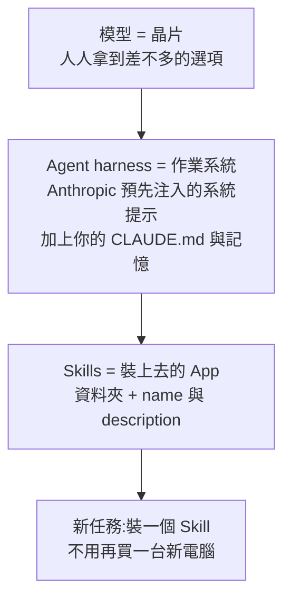

# 別再為每個任務做新 Agent:模型是晶片、Agent 是作業系統、Skill 是 App,以及 Skills 的六個層級(Andy Lin 林玉堂整理 RoboNuggets)

**主題分類:** 科技 / AI Agent — Skills 設計與維護
**來源:** YouTube 頻道 **Andy Lin 林玉堂**〈Anthropic 工程師:別再做 AI Agent 了!改用 Skills 的 6 個層級|Jay E〉(2026-11-24,8 分 42 秒)https://youtu.be/C9XzsJF-FNY
**影片性質:** **二次整理**。說明欄載明原素材為 Jay E | RoboNuggets〈Anthropic's Engineers Stopped Building AI Agents (Here's What They Build Instead)〉https://www.youtube.com/watch?v=IMSYKloMFrE(原片約 16 分鐘)。本篇只看了這支 8 分鐘摘要,**沒看原片**,所以「Level 1、4、5」影片幾乎沒講,不補寫。說明欄結尾推廣作者的免費學習網站(10xboost),非付費業配。
**無官方字幕**:逐字稿以 CPU **faster-whisper large-v3-turbo(int8,不帶詞表)** 轉錄、非官方字幕。中英旁白交疊,VAD 切掉約 3:00–3:15 等片段,下文凡逐字稿聽錯的人名都已對照一手來源改正(見〈字幕還原〉)。
**整理日期:** 2026-11-26

> ⚠️ **先講結論的限度:** 影片標題「Anthropic 工程師說別再做 Agent」是**二手濃縮 + 標題黨**。一手來源是 Anthropic 的 Barry Zhang 與 Mahesh Murag 在 AI Engineer 的演講〈Don't Build Agents, Build Skills Instead〉(2025-11),主張是「**不要為每個領域各做一個 Agent,做一個通用 Agent + 一批 Skills**」,不是「Agent 不重要」。

---

## TL;DR

| 重點 | 一句話 | 核實 |
|---|---|---|
| 三層比喻 | 模型 = 晶片、Agent(harness)= 作業系統、Skill = 裝在上面的 App | ✅ 與 Barry Zhang 演講比喻一致(見[[building-claude-skills]]) |
| 少即是多 | 一個調教好的通用 Agent 勝過 100 個缺領域知識的分身 | ⚠️ 屬作者與講者觀點,非量測結果 |
| Skill 本質 | 一個資料夾 + `name`/`description` 標籤;模型靠標籤決定要不要打開 | ✅ agentskills.io 規格 |
| 開放標準 | 影片稱「超過 70 個平台」採用 | ⚠️ 開放標準屬實;**「70」與「ChatGPT」未能核實** |
| Level 2 Skillify | 先親手做一次,再叫 Claude 把過程打包成 Skill | 影片自述,未查官方功能名 |
| Level 3 螢幕錄製 | 錄畫面 + 口述,讓 Claude 學會沒有 API / MCP 的後台操作 | 影片自述,**官方文件未查到**,標未能核實 |
| Level 6 偶爾不用 Skill | 每半年刪掉 CLAUDE.md、Skills、hooks,看新模型自己能做到什麼 | ❌ **未能核實**(見〈延伸查證〉) |
| 殘害效應(hobbling) | 模型已會做的事,你寫的規則反而擋路;Claude Code 砍了 80% 系統提示 | ❌ **未能核實** |

## 一、影片脈絡(附時間)

| 時間 | 內容 | 連結 |
|---|---|---|
| 0:25 | 「Anthropic 工程師早就停止為每個任務做新 Agent」 | [前往](https://youtu.be/C9XzsJF-FNY?t=15) |
| 0:38 | 晶片 / 作業系統 / App 的比喻 | [前往](https://youtu.be/C9XzsJF-FNY?t=28) |
| 1:15 | 通用 Agent 底層比想像更通用;缺的是你的專業 | [前往](https://youtu.be/C9XzsJF-FNY?t=65) |
| 2:56 | Skill = 資料夾 + 名稱描述標籤 | [前往](https://youtu.be/C9XzsJF-FNY?t=166) |
| 3:05 | harness 三層架構圖(模型、系統提示、Skills 資料夾) | [前往](https://youtu.be/C9XzsJF-FNY?t=175) |
| 3:50 | 開放標準、「70 個平台」 | [前往](https://youtu.be/C9XzsJF-FNY?t=220) |
| 4:30 | Level 2:Skillify 工作流 | [前往](https://youtu.be/C9XzsJF-FNY?t=260) |
| 5:29 | Level 3:螢幕錄製 | [前往](https://youtu.be/C9XzsJF-FNY?t=319) |
| 6:25 | Level 6:偶爾完全不用 Skill(Boris Cherny) | [前往](https://youtu.be/C9XzsJF-FNY?t=375) |
| 7:22 | 「殘害效應」與砍 80% 系統提示 | [前往](https://youtu.be/C9XzsJF-FNY?t=432) |

## 二、六個層級的實際內容

影片只明講 Level 2、3、4、6(Level 1 僅在說明欄提到「官方產生器」,Level 5 全片未提)。

| 層級 | 影片說法 | 怎麼用 |
|---|---|---|
| Level 1 | 官方產生器(僅說明欄) | 影片未展開 |
| Level 2 | **Skillify**:先自己跟著做一次,把過程像帶實習生一樣交給 Claude,最後叫它打包成 Skill | 適合文字型、可重複的流程 |
| Level 3 | **螢幕錄製**:邊操作邊口述每個按鈕為何點,Claude 看錄影後提出 Skill | 適合沒有 MCP / API 的舊後台 |
| Level 4 | Skill 可擴成含客戶資料庫、品牌規範、詞庫的資源包 | 對應 Skill 資料夾內的 `references/`、`assets/` |
| Level 5 | 影片未提 | — |
| Level 6 | 偶爾**完全不用** Skill,測試新模型的原生能力 | 見下 |

## 三、應用案例

- **每週登入供應商後台下載報表**(影片舉的例子):該網站沒有 MCP、沒有 API。錄一次螢幕並口述「點這顆是為了選上週區間」,讓 Claude 產生 Skill。⚠️ 實務風險:後台改版按鈕位置就失效;含帳密的畫面不要錄進去,錄影可能被送往模型。
- **一人公司 / 小企業**:不開十個「行銷 Agent、客服 Agent」,留一個 Claude Code,裝「品牌語氣」「報價單格式」「客訴回覆流程」三個 Skill,換模型時 Skill 還能帶走。
- **每季體檢**:把現有 Skills 與 CLAUDE.md 備份(例如 git 分支)後暫時停用,用同一批任務比較有無 Skill 的結果,只留真的提升表現的。這是 Level 6 想法的**安全版**,不必真的刪光。

## 四、延伸查證

| 影片說法 | 結果 | 依據 |
|---|---|---|
| Skill 是資料夾,必備 `SKILL.md`,含 `name`、`description` | **已核實** | [agentskills.io 概覽](https://agentskills.io):skill 為含 `SKILL.md` 的資料夾,metadata 至少 `name`、`description`,可附 `scripts/`、`references/`、`assets/` |
| 模型靠描述決定要不要打開 | **已核實** | 同頁「漸進式披露」三階段:啟動時只載入名稱與描述 → 任務吻合才讀完整指令 → 執行時按需載入檔案 |
| 已成為開放標準 | **已核實** | 同頁:格式由 Anthropic 發起、釋出為開放標準,已被多個產品採用 |
| 超過 70 個平台,含 ChatGPT、Cursor、GitHub Copilot | **未能核實** | 客戶展示頁(`agentskills.io/clients`)是動態清單,抓不到名單與數量;ChatGPT 是否原生支援沒查到一手說法。勿當確定事實 |
| 「Barry Jung」「Dari Zhang」兩位工程師 | **需修正** | 逐字稿聽錯。AI Engineer 演講講者是 **Barry Zhang 與 Mahesh Murag**(Anthropic)。晶片/OS/App 比喻出自此演講脈絡,與 [[building-claude-skills]] 已整理的一致 |
| Boris Cherny 建議每 6 個月刪掉 CLAUDE.md、Skills、hooks | **未能核實** | 我搜尋到的只有二手文章(Substack、LinkedIn)轉述,**沒有 Cherny 或 Anthropic 的原話或原始訪談連結**。相近、有紀錄的是他的「為六個月後的模型而建」想法與 CLAUDE.md 要隨錯誤更新 |
| 「hobbling / 殘害效應」是 Boris 創的詞 | **未能核實** | 搜尋沒有任何來源使用該詞。影片中文「殘害效應」是翻譯,英文原詞 hobbling 只見於影片 |
| Claude Code 把系統提示砍掉 80% | **未能核實** | 只有一則 LinkedIn 轉述,沒有 Anthropic 發行說明或文件佐證 |
| 5 分半內說的「Fable 和 Opus 5.5 更聰明」 | **逐字稿不通順** | 該段 Whisper 中文大量亂碼(約 6:49–7:16),語意不確定,不採用 |

### 判讀

1. **「少 Agent」與「不要多代理」不是同一件事。** 演講原意是:領域知識不要綁死在某個 Agent,放進可攜的 Skill。需要平行處理、隔離上下文時,多代理仍有用。
2. **Level 6 的核心合理、細節存疑。** 「新模型出來後重新檢視舊規則」符合常識(規則可能過時),但「每半年全刪」與「砍 80%」缺原始出處,只能當待驗證說法。可與 [[skill-doctor-self-improving-agent-loop]] 的評測式維護對照:用實測決定留不留,而非憑感覺刪。
3. **螢幕錄製學 Skill 沒找到官方文件**,實作前請先在自己版本的 Claude 確認是否真有此功能,別照影片假設。

## 五、字幕還原(Whisper 聽錯處)

| 逐字稿 | 推定 | 依據 |
|---|---|---|
| 安Tropic、Enthroid、Entropic | Anthropic | 英文原聲 |
| 溪谷 | 矽谷 | 語意 |
| Barry Jung / Dari Zhang | Barry Zhang(一人) | AI Engineer 講者名 |
| Cloud Code、Cloud | Claude Code、Claude | 同音 |
| Scale(「Level 4 Scale」) | Skill | 語意,「Level 6 Scale」同 |
| 共識四 | 可能為「重點四」類結語,未核實 | 語意不明 |

## 相關筆記

- [[building-claude-skills]] — Barry Zhang 演講與 Skills 規格的完整整理
- [[agent-skill-three-layer-run-do-verify]] — Skill 三層分工的另一種切法
- [[skill-doctor-self-improving-agent-loop]] — 用評測決定 Skill 是否保留
- [[matt-pocock-skills-teardown]] — 實際 Skills 拆解案例
- [[claude-app-redesign-nested-sessions-projects-side-chat]] — 同作者的另一篇二次整理(RoboNuggets 素材)

## 來源

- [YouTube:Anthropic 工程師:別再做 AI Agent 了!改用 Skills 的 6 個層級|Jay E(Andy Lin 林玉堂,2026-11-24)](https://youtu.be/C9XzsJF-FNY)(無字幕,逐字稿以 CPU faster-whisper large-v3-turbo 轉錄,非官方字幕)
- [YouTube:Anthropic's Engineers Stopped Building AI Agents(Jay E | RoboNuggets,原素材,未觀看)](https://www.youtube.com/watch?v=IMSYKloMFrE)
- [Agent Skills 概覽 — agentskills.io](https://agentskills.io)
- [Agent Skills 客戶展示頁(動態清單,未能取得名單)](https://agentskills.io/clients.md)
- [AI Engineer:Don't Build Agents, Build Skills Instead – Barry Zhang & Mahesh Murag, Anthropic(2025-11)](https://www.ai.engineer/talks/CEvIs9y1uog-agent-skills)
- 搜尋所見二手轉述(非一手):[Delete your CLAUDE.md(Substack)](https://charliehills.substack.com/p/delete-your-claudemd)
