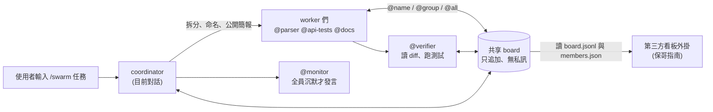

# Google Antigravity `/swarm`:共享看板、coordinator 與 verifier,以及 SDK 原始碼裡看得到的底層

> 2026-11-24 整理。起點是 Will 保哥的非官方指南〈Antigravity Swarm 指南〉,再對照 **Google 官方 `/swarm` 文件**、**官方 Python SDK 原始碼(google-antigravity/antigravity-sdk-python,已 clone 讀完)**、官方 sidecar 文件與多篇報導。
> ⚠️ 先講結論:**`/swarm` 本體(Antigravity App / CLI 內的編排器)沒有公開原始碼**;能讀到的是 SDK 的 subagent / workflow 原語,以及「第三方 Swarm 看板外掛」的做法。下文每一項都標來源與核實狀態。

---

## 一、先分清楚三樣東西

| 東西 | 是什麼 | 有原始碼嗎 |
|---|---|---|
| **官方 `/swarm`** | Antigravity App 與 CLI 內建指令(預覽版),目前對話變 coordinator,帶一群 worker 與 verifier 在共享 board 上協作 | ❌ 未公開(CLI 據報導為 Go 寫的閉源,見下) |
| **官方 Antigravity SDK(Python)** | 建 agent 的 SDK,含 subagent、workflow、hook、policy、trigger | ✅ Apache-2.0,但**套件內含編譯好的 runtime 二進位**,只 clone 跑不起來 |
| **保哥指南描述的看板外掛** | 以 sidecar 形式跑的 Node 程式,讀 Swarm 寫下的 `board.jsonl` / `members.json`,在瀏覽器畫 Board / Members / Overview / 圖 | ⚠️ 指南列了檔名與行號,**但沒給 repo 網址;我搜不到** |



---

## 二、官方 `/swarm` 文件的運作機制(已核實,讀自 antigravity.google/docs/swarm)

### 1. 流程
1. 輸入 `/swarm <task>`:**目前對話變成 coordinator**,替 swarm 命名,把工作切成互不衝突的片段(每檔或每套件一個 worker),命名如 `@parser`、`@api-tests`、`@docs`;同質工作用編號群組 `@fix-1`…`@fix-4`。
2. 每個 worker 以**乾淨上下文**在自己的對話啟動,簡報(brief)含:負責範圍、禁碰範圍、「完成」的定義,並公布到 board。
3. **通常每 2–4 個 worker 配一個 `@verifier`**:讀 diff、跑測試、把問題退回給寫程式的 worker。
4. 所有指派、提問、diff 摘要、測試結果都以 `@name` / `@group` / `@all` 貼在**共享 board**。**worker 之間不私下通訊**,整段團隊對話依序保存在同一處。
5. 沒事做的 worker、等回報的 coordinator **在 board 上休眠、不耗 token**,被 @ 到才喚醒。
6. coordinator 會加 `@monitor`:**只有工作未完成且全員沒動靜時才發言**,點名能推進的人。
7. **coordinator 不做技術工作**,只派工、評估、向你回報,所以 worker 在跑時你還能跟它講話。

### 2. 成員狀態與配額
| 狀態 | 意義 |
|---|---|
| Active | 思考、跑工具或等模型 |
| Waiting | 在 board 休眠、不耗 token,直到被提及 |
| Killed | 不可復原,只能新增 worker 取代 |

- **配額耗盡時成員暫停、不重試**;要等新貼文、換模型或你直接發訊息才會動,**配額恢復不會自動重啟**。
- 官方文件**沒公布**具體配額數字與 worker 數量上限。

### 3. 模型與工作區
- worker 預設用你對話的同一個模型;可在 prompt 指定單一或全部 worker 的模型,也可請 coordinator 把等待中的 worker 換模型(保留對話內容)。
- 工作區預設**共用**;多個 worker 同時編輯或建置時,coordinator 可給每個 worker **專屬工作副本**。**移除 worker 會刪掉它的工作副本**,所以 coordinator 會先要求它把變更合併(land)。
- 官方文件**沒寫「git worktree」這個詞**。但 SDK 原始碼的 workflow 原語寫明 `workspace="branch"` 是「fork 隔離的 VCS 工作區(例如 git worktree)」(見第四節)——可推定 swarm 的專屬副本是同類機制,**這是推定、非官方明說**。

### 4. 操作
| 面 | 怎麼用 |
|---|---|
| App | 輸入 `/swarm`、Tab、描述任務;coordinator 回覆末尾有 **Open the Swarm UI**。面板有 Board、Members(Active / Standing by / Retired)、Graph(@ 提及的有向圖,箭頭粗細依貼文數,可回放)。Overview > Plugins > Swarm 可重開 |
| CLI | `/swarm` 啟動後用 `/swarm board` 或 **Alt+S** 開全螢幕 board;提示框下有狀態列(標題、最新貼文、貼文數),**Alt+X** 關閉 |
| 直接對 worker 說話 | App:從 Members 或 Overview 的 Subagents 開對話;CLI:提示以 `@verifier also run the integration tests` 開頭,**只發給該 worker、不上 board** |
| 其他 CLI | `/agents` 列 worker;**Alt+J** 跳到下一個等工具核准的 worker;**Ctrl+K** 不離開主對話核准請求 |

Board 三窗格(Roster / Posts / Message)快捷鍵:`j/k` 移動、`g/G` 首尾、`Enter` 顯示隱藏、`Space` 展開貼文、`[` `]` 上下則、`f` follow、`p` 篩選作者、`Tab` 換窗格、`z` 放大、`o` 開對話、`q` 離開。⚠️ macOS 的 Alt+S 要終端機把 Option 當 Meta,否則用 `/swarm board`。

### 5. 與其他指令的分工(官方比較表)
| | Subagents | `/boost` | **`/swarm`** | `/teamwork` |
|---|---|---|---|---|
| 適合 | 單一側邊任務 | 難 bug、競態、演算法 | **可乾淨拆分的廣泛任務** | 多里程碑專案、大遷移、深度研究 |
| 驗證 | 父 agent 看回覆 | worker 試著打破先前結果 | **專屬 verifier 審 diff 跑測試** | Critic / Challenger / Auditor 關卡 |
| 時程 | 秒~分 | 秒~小時 | 分~小時 | 小時~天 |
| 方案 | 全部 | 付費 | 全部(商業/企業需 admin 允許) | 付費 |

官方四個範例:①三個 API handler 各加輸入驗證,一人一檔、一個 verifier 跑 `npm test`;②為 `pkg/httpclient` 與 `pkg/webhooks` 加指數退避,**verifier 用不同模型**查競態並跑 `go test -race ./...`;③CLI 啟動要 4 秒,三個**唯讀** worker 分查 import / 設定載入 / 外掛探索再交叉比對;④pytest 依套件分組修,**不得刪 assertion**,最後 verifier 重跑整套。

---

## 三、保哥指南補了什麼(第三方,非官方)

指南的賣點是把 Swarm 的紀錄**讀懂**。它描述的資料流:原生 Swarm 寫 `board.jsonl`(貼文)與 `members.json`(名冊)→ Node sidecar 找到該對話所屬 swarm、加上成員狀態 → 瀏覽器輪詢 `GET /api/swarm`。

| 指南內容 | 我的核對 |
|---|---|
| 角色 coordinator / worker | ✅ 與官方一致 |
| 角色 **monitor** | ✅ 官方有 `@monitor` |
| 角色 **narrator**(整理進度供 Overview) | ⚠️ 官方 swarm 文件**沒提**,可能是該外掛或較新版內部角色,未能核實 |
| 預設頻道:coordinator / narrator / monitor 看全部頻道,worker 只看主頻道;訂閱前的貼文不補顯示 | ⚠️ 官方 swarm 文件**沒有「頻道」概念**,未能核實(可能是更新版或外掛視角) |
| 「等待」只表示本回合停了,不代表在等什麼;應回看板讀最後一則貼文 | ✅ 與官方 Waiting = 休眠相符,實用建議 |
| 提及關係圖、蜂巢圖、GIF 匯出 | 提及圖官方有(Graph);**蜂巢圖與 GIF 匯出官方文件沒提**,未能核實 |
| 原始碼地圖 `main.mjs:220–289` 等行號 | ❌ **無 repo 網址,無法對行**,未能核實 |
| 看板外掛以 sidecar 跑 | ✅ 機制是真的,見下 |

### Sidecar 機制(已核實,讀自 antigravity.google/docs/sidecars)
- 發現路徑:全域 `~/.gemini/config/sidecars/<id>/sidecar.json`;外掛 `~/.gemini/config/plugins/<plugin>/sidecars/<name>/sidecar.json`(id 為 `<plugin>/<name>`)。
- 欄位:`command` 與 `builtin`(目前只有 `schedule`)**擇一**,另有 `args`、`restart_policy`(`always` 預設 / `on-failure` / `never`)、`description`、`env`、`display_name`。
- **預設停用**,要在 `~/.gemini/config/config.json` 的 `sidecars.<id>.enabled` 開啟。
- 資料目錄 `~/.gemini/antigravity/sidecar_data/<id>/`:`data/`(環境變數 `ANTIGRAVITY_EXECUTABLE_DATA_DIR`)、`logs/`、`events/`。
- sidecar 用 `agentapi new-conversation <prompt>` / `agentapi send-message <id> <prompt>` 跟 Antigravity 互動。
- 官方 sidecar 頁**沒有**「宿主旗標」「Node 入口」的說明——指南 `sidecar.json` 註冊 Node 入口與宿主旗標一項,只能算它那個外掛的用法。

---

## 四、原始碼:SDK 裡真正讀得到的(已讀,repo 最新 commit `97c5c53`,2026-11-18;SDK 0.1.24)

> `grep -ri swarm` 整個 SDK repo **零命中**(只有 interactive 範例碰巧出現 board 字樣)。所以**沒有 swarm 實作**,但有它會用到的積木。

### 1. 三層架構
- Layer 1 `Agent`:async context manager,管生命週期、工具、hook、權限預設。
- Layer 2 `Conversation` / `Step` / `ToolCall` / `HookRunner` / `ToolRunner` / `TriggerRunner`。
- Layer 3 `Connection` / `ConnectionStrategy` / `LocalConnection`(以本機 runtime 二進位通訊,protobuf 定義在 `proto/`)。

### 2. Subagent 協定(`proto/agent_tools.proto`、`localharness.proto`)
```proto
message InvokeSubagentCall { string type_name = 1; string role = 2; repeated Content prompt = 3; }
message SendMessageCall    { string recipient = 1; repeated Content message = 2; }
message ManageSubagentsCall {
  enum Action { ACTION_LIST = 1; ACTION_KILL = 2; ACTION_KILL_ALL = 3; }
  Action action = 1; repeated string interaction_ids = 2;
}
message ManagedSubagent {
  enum Status { STATUS_IN_PROGRESS = 1; STATUS_IDLE = 2; STATUS_REQUIRES_ACTION = 3;
                STATUS_FAILED = 4; STATUS_CANCELLED = 5; }
}
message DefineSubagentCall { string name = 1; string description = 2; string system_prompt = 3; }
message SubagentsConfig {
  bool enabled = 1;
  int32 max_nesting_depth = 2 [default = 1];
  repeated string allowed_subagents = 3;
  bool disable_define_subagent_tool = 4;
  bool disable_manage_subagents_tool = 5;
}
```
- 對照官方 swarm 的概念:**`invoke_subagent` ≈ 新增 worker、`manage_subagents` 的 KILL ≈ 移除 worker(Killed 不可復原)、`send_message` ≈ 貼 @ 訊息**。這是**對應關係的推論**,swarm 本體是否直接用這些工具,原始碼讀不到。
- 軌跡狀態有 `STATE_WAITING_FOR_SUBAGENTS`;停止原因含 `STOP_REASON_QUOTA_EXHAUSTED`——與官方「配額耗盡成員暫停」一致。
- `max_nesting_depth` 預設 **1**(不允許孫代理);要多層得顯式調高。

### 3. 靜態與動態 subagent(`examples/getting_started/subagents.py`)
```python
reviewer = types.SubagentConfig(
    name="code_reviewer",
    description="Audits source code files and reports missing docstrings.",
    system_instructions="You are a code reviewer. ...",
    tools=[get_reviewer_badge],            # 只給白名單工具
)
config = LocalAgentConfig(
    subagents=[reviewer],
    tools=[get_reviewer_badge, get_root_admin_secret],  # root 的機密工具 subagent 拿不到
    hooks=[log_pre_tool, log_post_tool],
)
async with Agent(config) as agent:
    resp = await agent.chat("Ask the 'code_reviewer' subagent to review mcp_server.py ...")
```
- **動態自我複製**:預設 `LocalAgentConfig` 就開啟 subagent,主 agent 可 clone 自己(`type_name="self"`)把重活丟出去,保持自己上下文乾淨——與 swarm「coordinator 不做技術活」同一思路。
- **多層巢狀**:`CapabilitiesConfig(max_subagent_depth=3, allowed_subagents=["lead_researcher"])`,中層 `SubagentCapabilities(enabled_tools=[...INVOKE_SUBAGENT], allowed_subagents=["fact_checker"])`;範例以 root → lead_researcher → fact_checker 三層驗證白名單與深度限制。
- 驗證邏輯:`allowed_subagents` 若含未註冊名稱,`_validate_allowed_subagents` 直接丟錯;停用 `INVOKE_SUBAGENT` 又指定 `allowed_subagents` 也會丟錯。

### 4. Workflow 原語(`google/antigravity/workflows.py`,501 行)——最接近「swarm 積木」的部分
```python
WorkspaceMode = Literal["inherit", "branch", "share"]
# inherit: 用父 agent 的工作區
# branch : fork 隔離的 VCS 工作區副本(例如 git worktree),workflow 結束時清掉
# share  : 與父共用底層 repo 儲存(例如 git worktree / hg share),另開工作樹,結束時清掉

def agent(prompt=None, schema=None, role=None, type_name="self", workspace="inherit") -> WorkflowAgent
def parallel(items, fn)   # 同時對每個 item 跑 fn
def pipeline(items, fn)   # 逐一跑
def call_tool(name, **tool_args)
def phase(name); def log(*values)
```
- 這些函式在宿主 Python 直接呼叫會丟 `RuntimeError`(只是**編譯期 stub**),要放進 `@workflows.define` 函式,由 runtime 解析執行(`validate_workflow_source` 用 `ast` 檢查:禁止頂層 return / yield 等)。
- `agent(..., schema={...})` 能約束結構化輸出;多輪用 `reviewer = workflows.agent("standing instructions", role="Reviewer")` 再 `await reviewer("turn", schema=...)`。
- **`workspace="branch"` 與官方 swarm「worker 專屬工作副本」高度同型**,是目前最接近公開證據的實作線索。

### 5. 其他有用的 SDK 面向
- 預設模型 0.1.24 起改為 `gemini-4-hydrogen`,`ThinkingLevel.EXTRA_HIGH` 對應 `"xhigh"`。
- 預設**拒絕 `run_command`**,要用 policies(allow / deny / ask_user)放行;`CapabilitiesConfig` 只控制模型看得到哪些工具、**不等於權限**。
- Triggers 可做背景排程(例如每 60 秒);另有 MCP、LiteRT 本機模型(Gemma 4,建議 ≥24GB VRAM)。

---

## 五、發布脈絡與費用(報導,非一手)

| 項目 | 內容 | 狀態 |
|---|---|---|
| 首度曝光 | TestingCatalog 2026-11-10:Google 在測 Swarm,三個 agent 協作,UI 有共享 board / agents / graph 三視圖;角色提到 Greeter 與 Verifier | 報導,據「Raider」爆料 |
| 官方文件 | 預覽版、App 與 CLI 皆可、全方案可用(商業/企業需 admin) | ✅ 一手 |
| 方案說法衝突 | 有報導稱限 Pro / Ultra 或 Ultra;**官方文件寫「所有方案」** | 以官方為準 |
| 模型 | 報導稱 lead 為 `gemini-4-carbon`(2026-11-10 GA),workers 用較輕量模型 | 報導,官方 swarm 頁只說 worker 預設同你的模型 |
| 價格 | 報導:Carbon 至 2026-11-30 前 $2 / $10 每百萬 token,之後 $4 / $20 | 未能核實,用前查官方價目 |
| 官方 demo | Mountain View 校園 3D 遊戲(三個 sub-agent 並行:Blender 資產、Three.js 前端、Web Audio 音效) | 報導轉述 Google 展示 |

安全面:多 agent 加瀏覽器整合擴大 prompt injection 與資料外洩面(Simon Willison 2025-11-25 已談過 Antigravity 外洩風險)。啟用 swarm 前先決定每個 worker 的權限邊界、唯讀 worker 就別給寫入。

---

## 六、判讀

1. **Swarm 的真正設計是「共享 board 取代隱藏編排」**:別的 multi-agent 多半把協調藏在 coordinator 內部,這裡所有指派與交接都落在可搜尋、可回放、可插話的 board 上。代價是 token 與配額消耗快。
2. **verifier 是關鍵**,不是裝飾:官方範例明講 verifier 可用**不同模型**審 worker,對應 [[cross-model-review-claude-codex-harness]] 的跨模型互審。
3. **休眠不耗 token**是控成本的核心:等待中的 worker 不跑,所以 worker 多不等於線性燒錢,真正貴的是「同時 Active」的數量。
4. 想**自己做**:SDK 的 `invoke_subagent` + `allowed_subagents` + `workflows.agent(workspace="branch")` + `parallel` 就是積木;board 要自己用檔案(JSONL 只追加)加 `@` 解析實作——這正是保哥指南那個外掛讀的資料形態。

## 七、應用案例

- **多檔平行改**:把 20 個 handler 補輸入驗證——每檔一個 worker,`@verifier` 跑測試;沒有重疊檔案才不需要專屬副本。
- **大型重構避免互踩**:多個 worker 都要改同一套件的相鄰檔案時,請 coordinator 開專屬工作副本,完成後要求 worker 先 land 再移除。
- **只讀調查**:查「CLI 為何啟動 4 秒」,三個唯讀 worker 分查後在 board 交叉比對,產出排序修復清單,零寫入風險。
- **自建最小版**(SDK):用 `SubagentConfig(name="verifier", tools=[...])` 加 `allowed_subagents=["verifier"]`,主 agent 派工後只允許叫得到 verifier,並用 `parallel()` 並行跑多個 `workflows.agent(..., workspace="branch")`。
- **盯進度**:CLI 用 Alt+S / `/swarm board`,看 Roster 的 working / waiting / killed 與最後貼文時間;卡住的 worker 直接 `@worker名 ...` 插話。

## 八、還沒解決的問題

- `/swarm` 本體原始碼未公開;**CLI 為 Go 閉源**一說只見於 apiyi 一篇二手報導,我沒能在官方頁面核實。
- 保哥指南看板外掛的 repo 網址(找不到),其中 narrator、頻道、蜂巢圖、GIF 匯出無官方佐證。
- worker 數量上限、配額換算方式官方未公布。

## 相關筆記

- [[codex-multi-agent-v2-graph-engineering]] — OpenAI 側的主 agent 調度加動態 subagent,可與 swarm 對照
- [[hermes-main-agent-orchestration]] — 主 agent 中樞式編排
- [[cross-model-review-claude-codex-harness]] — verifier 用不同模型審的同一思路
- [[herdr-terminal-runtime-agent-to-agent]] — agent 之間的終端 runtime 溝通
- [[gemini-4-argon-release-benchmarks-pricing]] — swarm 背後的 Gemini 4 系列模型與定價脈絡

## 來源

- 使用者提供:[Antigravity Swarm 指南(Will 保哥,非官方,MIT)](https://antigravity-swarm-guide.gh.miniasp.com/)
- 官方:[Swarm (/swarm) 文件](https://antigravity.google/docs/swarm.md)、[Sidecars 文件](https://www.antigravity.google/docs/sidecars)、[Antigravity Overview](https://antigravity.google/docs/overview)
- 原始碼:[google-antigravity/antigravity-sdk-python](https://github.com/google-antigravity/antigravity-sdk-python)(Apache-2.0;本次 clone 讀 `workflows.py`、`proto/agent_tools.proto`、`proto/localharness.proto`、`types.py`、`examples/getting_started/subagents.py`、`CHANGELOG.md`,commit `97c5c53`,讀完已刪除暫存)
- 報導:[TestingCatalog:Google testing agent swarm mode for Antigravity(2026-11-10)](https://www.testingcatalog.com/google-testing-agent-swarm-mode-for-antigravity/)、[Apidog:Antigravity /swarm 與 Gemini 4 Carbon](https://apidog.com/blog/google-antigravity-swarm/)、[Apiyi:Antigravity Orchestrator 深度解析](https://help.apiyi.com/en/google-antigravity-orchestrator-deep-dive-en.html)
- 說明:以上報導為二手來源,價格、模型分工、方案限制請以官方頁面為準。
