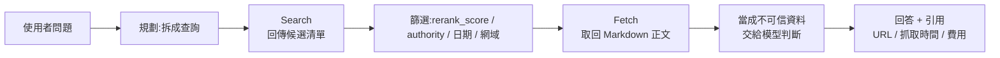
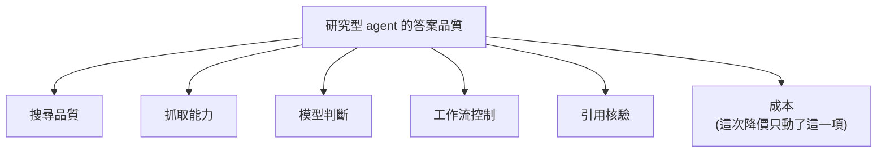

# DeepSeek 開賣搜尋:Search / Fetch API 每千次 0.75 美元,便宜的搜尋能不能變成可靠的證據

> 整理自 YouTube 頻道 **Why QQ**〈[DeepSeek卖搜索0.75刀1000次](https://www.youtube.com/watch?v=Gg2eGkhspFo)〉(2026-10-20,約 7.6 分鐘)。
>
> ⭐ 本片**沒有字幕**(Why QQ 少見),逐字稿以 CPU faster-whisper 轉錄。片中規格、價格、限流、基準數字已**逐項比對 DeepSeek 官方文件**([Search 指南](https://api-docs.deepseek.com/guides/search)、[10-17 更新公告](https://api-docs.deepseek.com/news/news261017)、[Hugging Face 模型卡](https://huggingface.co/deepseek-ai/DeepSeek-V4.1-Flash-1017)),見第七節。**⚠️ 限流數字影片與官方文件不符。**
>
> 立場:影片與說明欄沒有業配。基準分數是 DeepSeek **自報**、在指定 harness 下跑出來的。

---

## 一句話總結

2026-10-17 DeepSeek 把自建搜尋引擎拆成兩支獨立 HTTP 接口賣:**Search 找線索、Fetch 拿原文**,各 0.75 美元/千次成功請求。價格低是真的,但它只動了「研究型 agent 品質」六個變數裡的一個;真正拉開差距的是搜尋品質、抓取能力、模型判斷、工作流控制與引用核驗。

---

## 一、為什麼模型需要搜尋

語言模型訓練完,參數裡的知識就固定了;今天發布的內容,模型靠自己不會知道。Agent 要在真實世界做事,得有人替它**檢索、打開網頁、把內容帶回來**。

DeepSeek 這次開放的兩支接口**不聊天、也不產研究報告**:

| 接口 | 端點 | 職責 |
|---|---|---|
| **Search** | `POST https://api.deepseek.com/v1/tools/search` | 發現候選來源 |
| **Fetch** | `POST https://api.deepseek.com/v1/tools/fetch` | 取回單一網頁正文(Markdown) |

判斷與推理仍交給你選的模型與工作流。影片的觀察:**「一家模型公司開始賣資訊入口了」**。



---

## 二、Search:給 agent 的結構化搜尋

一般人看 10 條藍色連結自己挑;agent 要的是**能直接進上下文、能參與排序與過濾的結構化資料**。

**參數(官方文件):**

| 參數 | 說明 |
|---|---|
| `query` | 1–128 字元 |
| `count` | 1–50,預設 10 |
| `ori_question` | 選填,原始問題(1–128 字元) |
| `need_content` | 預設 `false`;為 `true` 時回傳 `content` 全文 |

**查詢運算子:** `site:` / `-site:`、`-詞` / `-"片語"`、`"精確片語"`、`lang:`、`after:` / `before:`。做技術情報可以先 `site:github.com` 加官方文件網域限定——**搜尋從介面動作變成可編排的程式碼**。

**每筆結果欄位:**

- `title`、`url`。
- `snippet`:約 100–200 字,給 UI 看。
- `summary`:約 600–800 字,**專門給模型讀**。
- `site_name`、`date`(可能為 `null`)。
- `rerank_score`:0–3,**1.5 以上算高品質**。
- `authority`:0–4,`-1` 表示未知,**3 以上算高權威**。

---

## 三、Fetch:不是萬能瀏覽器

給一個 URL,回傳 `title` 與 Markdown `content`。模型不需要導覽列、廣告位和 UI 裝飾,要的是有標題、有段落、適合引用的乾淨文字。

把 Search 和 Fetch 拆開的好處:**agent 自己決定哪些連結值得讀**,每一步花多少錢也記得清楚。

⚠️ 限制:登入牆、反爬機制、複雜前端渲染都可能讓它失敗(官方錯誤碼 `403` = 被安全策略拒絕、`404` = 沒有可用頁面內容)。**抓得到內容 ≠ 內容可信。**

---

## 四、算錢:便宜的是「取資訊」這個動作

- Search、Fetch **各 0.75 美元 / 1,000 次成功請求**。
- **只有 HTTP 200 且有結果才收費**;失敗、空結果、逾時不收。
- **`count` 不影響價格**:要 1 條和要 50 條都算一次。

**影片的試算:** 研究 agent 搜 1 次 + 讀 3 頁 = 4 次成功請求 = **0.003 美元**;同流程跑 1,000 次 = **3 美元**。

⚠️ 但這筆帳**不含模型 token、伺服器、重試與快取**。整套研究系統的成本是另一筆帳。

⭐ **別急著把 `count` 拉滿**:候選越多,上下文越長、去重成本越高,錯誤來源與提示注入的風險也跟著漲。工程上要優化的目標很樸素——**用盡可能少的調用,拿到足以回答問題的可靠證據**。

---

## 五、「DeepSeek 免費聯網」其實混了三件事

| 層次 | 誰控制檢索 | 計費 |
|---|---|---|
| ① 獨立 Search / Fetch API | 你自己管檢索、抓取、篩選、調模型 | 0.75 美元/千次 |
| ② 模型接口內建 `web_search` | 模型生成中自己觸發 | 影片稱目前**只給 V4 Pro**,Flash 會忽略(⚠️ 本筆記未能在官方文件找到這句,見第七節) |
| ③ Harness / Claude Code / Codex 透過工具層呼叫 | 客戶端 | **目前免費,北京時間 2026-11-01 00:00(= 10-31 16:00 UTC)開始計費**(✅ 官方) |

三者的呼叫方式、可控程度與計費邊界完全不同。

---

## 六、同日更新:V4.1 Flash 1017

搜尋開放當天,V4.1 Flash 也更新到 1017 版(後續升級,不是首發)。官方模型卡數字:

| 基準 | 1017 | 前一版 Flash | harness |
|---|---|---|---|
| Terminal-Bench 4.0 | **42.3** | 31.2 | Claude Code |
| DeepSWE v1.1 | **77.0** | 74.2 | Mini-SWE-V2 |
| HLE(不用工具) | 42.6 | 36.8 | 未標 |
| ProgramBench | 29.1 | 20.3 | 未標 |

- 官方另稱任務耗時與輸出長度都縮短,並針對 DeepSeek Harness、騰訊 CodeBuddy、WorkBuddy 優化。
- ⭐ **這些是官方在指定 harness 下自報的分數**;Terminal-Bench 甚至是用 Claude Code 的框架跑的。換成你手上的專案,表現未必一樣。
- 權重開放在 Hugging Face 與 ModelScope,**MIT 授權**(✅ 模型卡)。
- ⚠️ **開放的是權重;搜尋索引與抓取基礎設施沒有開源。**

影片的判讀:**模型、搜尋工具、執行環境同一天更新,方向很清楚——agent 的效果越來越取決於整條工作流。** 相關背景見 [[agent-runtime-deepseek-harness-cordis]]。

---

## 七、核實結果

**✅ 已核實(與官方一致):**

- 2026-10-17 同時發布 Search / Fetch 與 V4.1 Flash 1017。
- 0.75 美元/千次成功請求;失敗、空結果、逾時不收;`count` 範圍 1–50 且不影響價格。
- 支援 `site:`、`lang:`、時間範圍等運算子。
- 回傳欄位含 title / url / snippet / summary / 日期 / 排名分數 / 來源 / 權威度。
- Fetch 回傳 Markdown 正文。
- 超限回 `429`;逾時與 5xx 可退避重試,其他 4xx 不改請求就別重試。
- Claude Code / Codex / Harness 目前免費,北京時間 11-01 開始計費。
- Terminal-Bench 4.0 31.2 → 42.3、DeepSWE v1.1 74.2 → 77.0;Terminal-Bench 用 Claude Code harness。
- 權重在 Hugging Face / ModelScope,MIT 授權。
- 官方公告稱自建引擎「每天服務數億次請求」。

**⚠️ 需修正:**

- **限流:** 影片說「Search 和 Fetch 每個帳號各自每秒 5 次」。官方 Search 指南(2026-10-21 查閱)寫的是 **Search 100 QPS、Fetch 25 QPS**(各自獨立),Fetch 另有**單一網域** QPS 上限。部分第三方文章也寫 5 QPS,可能是早期數字或文件後來調整;**以官方文件當下版本為準**。

**❓ 未能核實:**

- 「索引數千億網頁」:官方公告只寫每天數億次請求,**沒有給索引規模**。
- 內建 `web_search` 只給 V4 Pro、Flash 會忽略:影片稱出自官方 Responses 文件,本筆記查閱時該頁未見此說明。

---

## 八、上線前的工程門檻

影片列出最小版本離「能用」還差的幾道:

1. **限流**:Search / Fetch 各自有 QPS 上限,Fetch 對同一網站另有頻率限制,超了回 `429`。
2. **重試**:逾時與 5xx 退避重試;**鑑權失敗與參數錯誤重放多少次都沒用**。
3. **快取與去重**:同一個 URL 不必每個問題都重抓。
4. **安全邊界**:網頁正文可能藏著「忽略之前指令」這類注入。**檢索回來的資料一律當不可信資料,絕不能升級成系統指令。** 詳見 [[prompt-injection-5-techniques-defenses]]。
5. **可觀測性**:記錄搜尋結果、費用、耗時與引用,出錯才查得回去。

---

## 九、作者的判斷:搜尋供應商要做成可替換元件

**好處:** 模型廠商有了自己的搜尋能力,檢索、總結、工具調用可以在同一個 API 生態裡閉環——整合路徑變短,成本結構也好優化。

**硬幣另一面:**

- 搜尋和模型來自同一家,資訊完不完整你很難獨立判斷。
- 想換來源時,遷移成本不低。
- 結果品質波動時,很難分辨問題在搜尋還是在模型。

作者傾向:**把搜尋供應商做成可替換的元件**,每條證據保留原始 URL、抓取時間,並獨立評估。

### 研究型 agent 的六個變數



任何一個變數掉鏈子,最終答案都會出問題。這也解釋了**單純降價掀不起大浪**:價格只是六個變數之一。

---

## 十、應用案例

### 案例 1:技術情報 agent 的最小呼叫鏈

情境:每天追某個開源專案有沒有新版、有沒有安全公告。

```js
// Node.js 示意(依官方 Search 指南的端點與欄位)
const headers = {
  "Authorization": `Bearer ${process.env.DEEPSEEK_API_KEY}`,
  "Content-Type": "application/json",
};

const s = await fetch("https://api.deepseek.com/v1/tools/search", {
  method: "POST", headers,
  body: JSON.stringify({
    query: 'site:github.com "deepseek-harness" release after:2026-10-01',
    count: 10,
  }),
}).then(r => r.json());

// 先用分數篩,再決定要不要花 Fetch
const picks = s.results.filter(x => x.rerank_score >= 1.5 && x.authority >= 3).slice(0, 3);

for (const p of picks) {
  const f = await fetch("https://api.deepseek.com/v1/tools/fetch", {
    method: "POST", headers, body: JSON.stringify({ url: p.url }),
  }).then(r => r.json());
  // f.content 是不可信資料:放進 user 區塊並標明來源,不要拼進 system prompt
  log({ url: p.url, fetchedAt: new Date().toISOString(), chars: f.content.length });
}
```

成本:1 次 Search + 3 次 Fetch = 0.003 美元;每天跑一次,一年約 1.1 美元(不含模型 token)。

### 案例 2:評估搜尋供應商,不要只比標價

用同一組題目,讓 DeepSeek Search 和你現在用的方案各跑一輪,逐項打分:

| 題目類型 | 要看什麼 |
|---|---|
| 中文查詢 | 覆蓋率、有沒有被內容農場灌滿 |
| 過去 24 小時的新聞 | 時效性(`date` 欄位是否可靠) |
| 找論文原文 | 能不能避開二手轉載,直接到 arXiv / 官方頁 |
| Fetch GitHub README | 能不能拿到乾淨 Markdown |
| Fetch 動態渲染頁面 | 失敗率 |

### 案例 3:把證據鏈寫進答案

成熟的 agent 不只給答案,還交代**證據從哪來、什麼時候抓的、花了多少錢**。輸出格式可以固定成:

```text
結論:……
證據:
  [1] https://… (抓取 2026-10-21T08:30Z, rerank 2.1, authority 3)
  [2] https://… (抓取 2026-10-21T08:30Z, rerank 1.8, authority 4)
成本:Search ×1 + Fetch ×2 = $0.00225
```

---

## 來源

- YouTube:Why QQ〈DeepSeek卖搜索0.75刀1000次〉 https://www.youtube.com/watch?v=Gg2eGkhspFo (2026-10-20)
  - 該片無字幕,逐字稿以 CPU faster-whisper 轉錄、非官方字幕。已還原的專名:「DeepSync / DeepSeak / Deepseq」→ DeepSeek、「Fatch / Fitch」→ Fetch、「Surch / 搜所」→ Search / 搜尋、「Azint」→ Agent、「Modoscope」→ ModelScope、「Redmay」→ README、「Cloud Code」→ Claude Code。
- DeepSeek 官方 Search / Fetch 指南(2026-10-21 查閱): https://api-docs.deepseek.com/guides/search
- DeepSeek 2026-10-17 更新公告: https://api-docs.deepseek.com/news/news261017
- Hugging Face 模型卡 DeepSeek-V4.1-Flash-1017: https://huggingface.co/deepseek-ai/DeepSeek-V4.1-Flash-1017
- DeepSeek Responses API 文件(查閱時未見內建 `web_search` 支援模型說明): https://api-docs.deepseek.com/guides/responses
