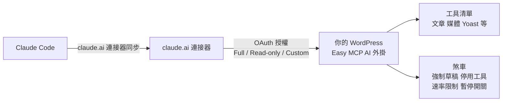

# 用 Easy MCP AI 讓 Claude Code 管 WordPress:一句話批次補 SEO,與「強制草稿 / 停用工具 / 一鍵暫停」三道煞車

**主題分類:** 科技 / AI Agent 應用 — MCP 實戰、網站維運自動化
**來源:** YouTube 頻道 **YAHA学堂**〈MCP让Claude Code直接管你的Wordpress网站|Easy MCP AI实测教程〉(2026-10-02,約 8 分,YouTube 自動字幕)
**整理日期:** 2026-11-05

> 影片未見業配;結尾有 YouTube「Hype」互動呼籲(略)。**核實:** 對照 [WordPress.org 外掛頁](https://wordpress.org/plugins/easy-mcp-ai/)(作者 Themeisle)與外掛官網介紹。**影片拍攝時工具數為 117;外掛頁現為 280+、版本 2.4.0(2026-11-07 核實時;前次整理寫 2.3.2),功能已擴充**,下文凡有出入處標明。

---

## TL;DR

- **Easy MCP AI** 是免費 WordPress 外掛,把你的站變成 **MCP server**:Claude / ChatGPT / Cursor 等 MCP 客戶端授權後,可讀寫文章、媒體、SEO 欄位。外掛頁稱 **30,000+ 啟用**,**不呼叫 OpenAI / Anthropic / Google 的模型**,內容只在 AI 客戶端與你的站之間流動。
- 最有價值的示範:**6 篇已發布文章的 SEO 標題與 meta 描述,一句話批次補完**(手動每篇約 3 分鐘,30 篇 1.5 小時),且**寫入前每篇的標題/描述都會攤在批准提示給你看**。
- 風險在**權限等同你的帳號**(你是管理員它就是管理員),所以影片後半專講煞車。

## 1. 三步設定(影片流程)

1. **安裝並啟用**外掛(官方市場直接搜;普通虛擬主機可用。前次整理曾寫「正式站 OAuth 須 HTTPS、Cloudflare Flexible SSL 下會拒發 token」,本次核實的外掛頁未見此句,**標未能核實**)→ 自動進入設定精靈,共三步:連上 AI、確認連通、試提示詞。
2. **連 AI:** 選 Claude Code 會開啟 claude.ai 連接器頁,網址已預填成你站的 MCP URL → 外掛偵測到兩種登入方式(顯示 Detected)→ Connect 跳到**你站的授權頁**。這是 **OAuth**:WordPress 密碼不交給 Claude。授權三檔:**Full access / Read-only / Custom**(依分類勾選)。
3. **Claude Code 端不用再裝東西**:連接器自動同步,進去選「查看工具」可看到每個工具標註 read-only / destructive 等權限(影片當時 117 個)。
4. **確認連通**:請它列最近 5 篇文章(呼叫 `List Posts`,Claude Code 會先問你允許);能列出,且草稿狀態也正確,就代表通了。

- 🔎 **外掛頁補充:** 認證為 OAuth 2.1 + PKCE(含動態客戶端註冊、refresh token 輪替、可撤銷);也有 API token 給設定檔式客戶端。

## 2. 實戰一:批次補 SEO(Yoast)

- 預設 Yoast 整合未開:到外掛的 **Tools(下方英文那個)→ Plugins**,勾 **Yoast SEO**(五個工具全開;Rank Math、SEOPress 同一處)。授權若是 Full access,新整合自動涵蓋、不用重授權——但 **Claude Code 手上是舊工具清單,退出再進來**才會更新。
- 提示:「幫我把 6 篇已發布文章加上 SEO 標題和 meta 描述,描述一兩句話講清重點」。它先逐篇讀文,再用 Yoast 的 `Update Post SEO` 逐篇寫入;**每次批准提示都顯示將寫入的標題與描述**,寫完還用 `Get Post SEO` 抽查。寫進的是 **Yoast 自己的欄位**,不滿意仍可在後台手改。
- 🔎 外掛頁:SEO 整合支援 Yoast 與 Rank Math(標題、描述、canonical、robots、Open Graph、焦點關鍵字、schema),SEOPress 亦列為支援;**每個整合都要對應外掛已啟用**。

## 3. 實戰二:媒體庫與精選圖片

一句「把這張圖片匯入媒體庫、改替代文字、設為某文章的精選圖片」,它自己串成:找文章 → 匯入圖片 → 拿到媒體 ID → 把 ID 填入精選圖片。示範時用站內既有圖片網址,媒體庫出現同名檔(自動改名 `pic-1`),所以**重複匯入會產生兩份相同檔**——要注意。

## 4. ⭐ 第五段:三道煞車(影片重點)

| 煞車 | 效果 | 外掛頁核實 |
|---|---|---|
| **Force Draft(強制草稿)** | AI 新增的文章/頁面不論要求什麼狀態一律存草稿。影片實測:批准提示裡傳的是 `publish`,回來是 `draft`,AI 自己發現 | ✅ 有此功能,**預設關閉**;⚠️ 官方註明只涵蓋 Easy MCP **自己的建立工具**,**其他外掛的 abilities 與後續編輯不受限**。影片 [5:41](https://www.youtube.com/watch?v=OCE-qMzzb_U&t=331s) 起示範,截圖 5:43(t=343s)的設定頁顯示此開關為開啟 |
| **停用工具** | 勾選的工具無論從哪個連線來都呼叫不到;被停用者**連工具清單都看不到**,AI 不知道有此功能。影片稱「改使用者、改站設定、啟用外掛、換主題」出廠已關,**刪文章/頁面/媒體預設沒關,要自己勾** | ✅ **站台層級停用清單存在**:官方安全頁寫可在 *Easy MCP AI → Settings → Advanced → Disabled tools* 對所有 client 一次停用,列出 **39 個高風險工具**(刪除類、使用者與站台設定變更、外掛與主題安裝等),並稱「多數新安裝預設關閉」(未列出哪些)。影片截圖 6:10(t=370s)可見勾選清單與 `Whitelist tools` 欄(畫面文字「All 122 tools are available」)。刪除文章工具:影片 [6:42] 起實測,截圖 6:42 附近 Claude Code 回覆「已开放的工具里没有 wp_delete_post」(畫面原文為簡體),需自行開放 |
| **一鍵暫停(總開關)** | 所有 AI 呼叫全拒絕,連唯讀查詢也不行 | ✅ 官方安全頁稱 **Pause All AI Access**:「One switch on the dashboard refuses every tool call and empties the tool list.」;同頁「Tool calls are logged, including refused ones」(被拒呼叫仍入稽核紀錄)。「client 保持登入」一句未在頁面見到,**未核實**。影片 [6:57](https://www.youtube.com/watch?v=OCE-qMzzb_U&t=407s) 介紹 |
| **Rate limit** | 影片:預設每 token 每分鐘 60 次,不用動 | ✅ 影片截圖 5:43(t=343s)設定頁顯示 **60**;⚠️ 外掛頁 2.4.0 寫預設 **120 次/分鐘/token**,搜尋摘要多處寫 60,屬版本差異,以安裝版設定頁為準 |
| **IP whitelist** | 影片建議**先別開**:走 claude.ai 連接器時請求從 **Anthropic 伺服器**發出,不是你家 IP,開了會把自己擋在外面 | ✅ 設定頁文字(截圖 6:10 可見):「Cloud clients such as claude.ai and ChatGPT connect from the vendor's servers, not from the user's machine」,並建議列入廠商 IP 範圍或留空;Anthropic 官方支援頁證實 connector 連線來自其雲端。⚠️ 外掛頁用詞是「IP allowlist for API tokens」,設定頁則寫適用於 MCP endpoint 的每個請求,兩者略有出入(詳見下節) |

- 其他外掛頁揭露:**Audit Log**(工具呼叫紀錄,預設 30 天)與 **Change History**(修改前後快照,新安裝預設開);**每天一次**從 `skills.easymcpai.com` 下載簽章的 skill 指示(只帶外掛版本,可用 `wp-config.php` 常數 `EASY_MCP_AI_SKILLS_SYNC` 關閉);接 GA4 / Search Console / Semrush / Ahrefs 等分析來源時,憑證與查詢參數會送往該供應商,費用由供應商收。

## 5. 底層怎麼跑

影片比喻:**MCP 是給 AI 用的 USB 接頭**。Claude Code 透過 claude.ai 連接器連你的站;**外掛跑在你自己的 WordPress 內,不經第三方中轉**(與外掛頁「不呼叫 AI 模型」相符);每次呼叫都以你批准的那個帳號身分執行。⚠️ 但請求路徑上仍有 **claude.ai 連接器**這一跳(Anthropic 伺服器發出請求),所以「不經第三方」是指外掛不經 Themeisle 之類中轉,**不是指流量完全不出 Anthropic**。

## 應用案例

- **舊站 SEO 一次補齊**:30 篇文章 meta 描述空白 → 先用 **Read-only** 授權讓 AI 產出「建議清單」審閱,滿意後再換 Full/Custom 授權,逐篇寫入;審核點就是每次批准提示裡攤出來的標題與描述。
- **內容團隊協作**:開 **Force Draft** + 只授權文章/媒體分類 + 保留 Audit Log;AI 起草的稿一律進草稿匣,編輯審後再發布。
- **安全收斂**:在 *Settings → Advanced → Disabled tools* 把「刪除文章/頁面/媒體」相關工具打勾(官方頁確認有此入口),再在 Claude Code 嘗試「刪除這篇文章」——被停用的工具不會出現在工具清單,AI 會直接說做不到。
- **對照本庫類似實作:** 讓 agent 觸碰有副作用的外部系統時,同樣的「先讀後寫、批准提示、硬上限」思路見 [[agent-paid-api-cost-guardrails-mcp]];MCP 協定概念見 [[function-calling-mcp-a2a]]。

## 延伸閱讀與深度補充(2026-11-07 核實增補)

以下是本次實際讀過的一手頁面重點,比影片多出的部分才列。

- **MCP 授權規範(2025-06-18)**——影片說的「WordPress 密碼不交給 Claude」,對應規範的 OAuth 流程:未帶 token 的請求回 401 → 讀 Protected Resource Metadata(RFC 9728)→ 讀 Authorization Server Metadata(RFC 8414)→ 用 PKCE 與 `resource` 參數(RFC 8707)取得 token。規範中 client **MUST** 實作 PKCE 與 `resource` 參數;server **MUST** 驗證 token 的 audience 是否為自己,並且 **MUST NOT** 接受或轉傳其他來源的 token。這解釋了為什麼外掛要求 OAuth 而非把密碼給 AI。來源:[MCP Authorization 規範](https://modelcontextprotocol.io/specification/2025-06-18/basic/authorization)
- **外掛官方安全頁的三點補充**([easymcpai.com/security](https://easymcpai.com/security)):
  - *Disabled Destructive Tools*:高風險工具分組,預設多數出廠關閉,可在 *Settings → Advanced → Disabled tools* 一次停用。
  - *Tool Whitelist Patterns*:工具名稱以 `fnmatch()` 萬用字元過濾(例如 `wp_get_*`),與 IP 白名單是不同功能。設定頁警語:只有名稱符合模式的工具可用、對每個 token 生效,設錯可能打斷既有工作流程。
  - *Audit Log*:記錄使用者、工具名、結果、來源 IP 與時間,**被拒絕的呼叫也記錄**。
- **IP 白名單與反向代理(設定頁畫面文字,截圖 6:10 可見)**:若站台在 Cloudflare 或負載平衡器後面,WordPress 只看到代理的 IP,白名單、速率限制與稽核紀錄都無法區分不同訪客。解法是在 `wp-config.php` 宣告 `EASY_MCP_AI_TRUSTED_PROXIES`。這是影片沒講的風險點。
- **請求來源**:Anthropic 官方支援頁寫明 connector 請求「from Anthropic's cloud infrastructure, rather than from your local device」,私有網路需把 Anthropic IP 加進防火牆;官方 IP 清單在 [platform.claude.com/docs/en/api/ip-addresses](https://platform.claude.com/docs/en/api/ip-addresses)。**本次未實際打開該頁,故未抄錄 CIDR**(第三方部落格的範圍數字不採用)。來源:[Anthropic 支援:custom connectors 與 remote MCP](https://support.claude.com/en/articles/11175166-get-started-with-custom-connectors-using-remote-mcp)

## 核實總表

| 項目 | 結果 |
|---|---|
| 免費、MCP server、OAuth、Yoast/Rank Math/SEOPress | ✅ WordPress.org 外掛頁(本次核實:外掛版本 2.4.0) |
| 影片 117 個工具 | ✅ 影片版本當時數字;📌 外掛頁現為 280+ |
| 強制草稿預設行為 | ✅ 外掛頁:「Force Draft on Create (off by default)」,範圍僅外掛自身建立工具 |
| 速率限制 60/分 | ⚠️ 外掛頁現為 120/分(預設值);截圖設定頁為 60 |
| 站台層級停用清單 | ✅ 官方安全頁(39 個高風險工具) |
| 一鍵暫停 | ✅ 官方安全頁「One switch…」;「client 保持登入」❓未核實 |
| IP 白名單主要針對 API token | ✅ 外掛頁「an optional IP allowlist for API tokens」;設定頁另寫適用於 MCP endpoint |
| Connector 流量來自 Anthropic 雲端 | ✅ Anthropic 官方支援頁 |
| 「出廠已關閉改使用者/換主題等」 | ⚠️ 部分核實:官方稱多數新安裝預設關閉,但未列出清單,「改使用者、換主題」未逐項確認 |
| 「Cloudflare Flexible SSL 下 OAuth 拒發 token」 | ❓ 本次外掛頁未見,未能核實 |

## 來源

- YouTube:[MCP让Claude Code直接管你的Wordpress网站|Easy MCP AI实测教程](https://www.youtube.com/watch?v=OCE-qMzzb_U)(YAHA学堂,2026-10-02;YouTube 自動字幕)
- 官方外掛頁:[Easy MCP AI — WordPress.org](https://wordpress.org/plugins/easy-mcp-ai/)(Themeisle,本次核實為 v2.4.0)
- 官方安全頁:[easymcpai.com/security](https://easymcpai.com/security)
- 官網:[easymcpai.com](https://easymcpai.com/about)
- MCP 授權規範:[modelcontextprotocol.io — Authorization (2025-06-18)](https://modelcontextprotocol.io/specification/2025-06-18/basic/authorization)
- Anthropic 支援:[Get started with custom connectors using remote MCP](https://support.claude.com/en/articles/11175166-get-started-with-custom-connectors-using-remote-mcp)
- Anthropic IP 位址(未實際讀取):[platform.claude.com/docs/en/api/ip-addresses](https://platform.claude.com/docs/en/api/ip-addresses)
- 本庫延伸:[[agent-paid-api-cost-guardrails-mcp]]、[[function-calling-mcp-a2a]]
