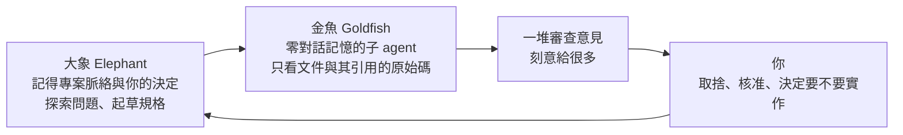
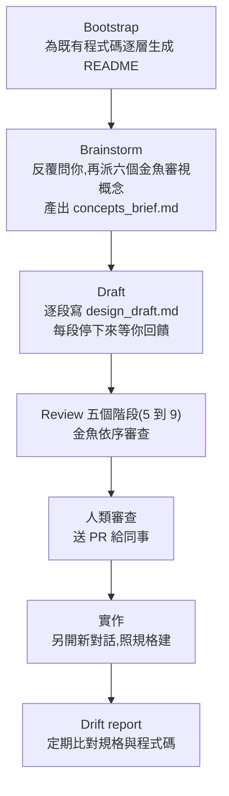

# Elephant-Goldfish Model(EGM):大象寫規格,金魚在「零記憶」下挑毛病

> 整理自 YouTube 頻道 **AI LABS**〈[EGM: Google's New Way To Use Claude Code Is Insane](https://www.youtube.com/watch?v=xxf6D9jynFw)〉(2026-10-25,約 16 分鐘,英文自動字幕 `en-orig`)。
>
> ⚠️ **立場揭露**:影片含 **Hedra 業配**(約 05:00,說明欄附 `AILABS50` 折扣碼);片尾與說明欄另推廣自家**付費社群 AI Labs Pro** 與「簡化版」付費素材、外包服務 Autometa、電子報。本筆記不收錄這些內容。
>
> ✅ **已 `git clone --depth 1` 讀 [google/elephant-goldfish-model](https://github.com/google/elephant-goldfish-model) 的 README、docs、skills、agents 與設計文件模板**(GitHub API:Apache-2.0、約 4,362 星、2026-09-13 建立、2026-10-28 仍有更新;v0.1.0)。⭐ 影片的**安裝方式與 CLAUDE.md 那段插曲和現行官方做法不同**,見第四節。

---

## 一句話總結

先把**規格寫完整、讓一批「沒看過你聊天內容」的審查 agent 挑毛病**,再開始寫程式。三個角色:**大象(Elephant)** 記得整個專案、負責跟你討論並起草規格;**金魚(Goldfish)** 是零記憶的子 agent,只看規格與程式碼,不會被你說過的話說服;**你**負責取捨與最後拍板。事後還能用 **drift report** 檢查程式碼和規格有沒有越來越不一樣。Google 自己的說法也很克制:**小而明確的修正不要用它。**

---

## 一、三個角色

| 角色 | 看得到什麼 | 負責什麼 |
|---|---|---|
| **Elephant** | 你的專案、需求、先前的決定 | 探索問題、起草規格 |
| **Goldfish** | 文件**加上它引用的原始碼**,**看不到先前的對話** | 找出沒說明的假設、不清楚的需求、實作風險 |
| **你** | 目標與限制 | 解決取捨、核准設計、決定要建什麼 |

**為什麼要「零記憶」**:同一個對話裡的 agent 已經知道你討論過什麼,審查自己的計畫時**等於跟自己點頭**。影片轉述 Google 的說法:模型容易堅持自己的錯誤想法、順著你要的方向附和,所以金魚不能看到對話。⭐ 官方硬性規定:**如果你的 agent 無法建立全新的子 agent context,EGM 會停止審查**,因為「在同一個 context 裡審查不算金魚審查」。

**審查意見多是刻意的**:官方文件寫「這會提供非常多的回饋。覺得有關的就拿,其餘忽略。」

---

## 二、完整工作流

| 步驟 | 指令(Claude Code) | 產出 |
|---|---|---|
| Bootstrap | `/egm:egm-bootstrap <路徑>` | 各資料夾的 `README.md` 階層 |
| Brainstorm | `/egm:egm-brainstorm <想法>` | `concepts_brief.md` |
| Draft | `/egm:egm-draft` | `design_draft.md` → 核准後存到 `docs/designs/<功能名>.md` |
| Review | `/egm:egm-review design_draft.md` | 每階段一份報告 + 彙整報告 |
| Drift | `/egm:egm-drift-report <設計資料夾>` | `{YYYY-MM-DD}_DRIFT_REPORT.md` |

官方強調這**不是硬性流程**:七個技能可以亂序用,而且如果你認為簡單 bug 一次就能解決,不要硬走設計先行流程(`docs/getting_started.md` 大意)。

### 三份實際交付物(官方 FAQ)

1. **設計文件**:經同儕審查的技術規格,記錄意圖、系統不變量與策略方向。
2. **實作檢查清單**:要新增或修改哪些檔案、預計改什麼、怎麼驗證。
3. **豐富的上下文迴圈**:與程式碼放在一起的 Markdown 文件(如 README 階層),給之後的開發使用。

---

## 三、各步驟細節

### 1. Bootstrap:先讓大象認識你的 app

- 對既有專案**由下往上**遞迴:葉子資料夾先寫 README(說明用途與每個檔案的功能)→ 父資料夾彙整子資料夾 README → 根目錄寫整個系統的高階地圖。
- **資料夾超過 15 個會先問你要不要做**(✅ 與 SKILL 一致),因為要派很多子 agent。影片的 demo 產生 28 份 README,並更新主 README。
- 沒有程式碼的資料夾(例如放舊規格的 `specs/`)不寫。
- 官方提醒:人要審這些輸出;**如果你的設計文件已經引用了所有程式碼,README 可能是多餘的**。

**影片指出的坑:** README 是寫給人看的,agent 不會主動讀。三個補救:①在每個 README 旁放一個 `CLAUDE.md`(Codex 用 `AGENTS.md`)叫它去讀;②重跑 bootstrap 並加設定一開始就產生這些檔;③在主 `CLAUDE.md` 加一行規則。影片作者選了第一種。

### 2. Brainstorm:先釐清、再讓六個金魚圍攻

- 不會一個回答就開跑,而是**多輪**追問,直到問題、限制與目標行為都清楚。
- 然後派六個金魚各從一個鏡頭審視:

| 鏡頭 | 核心問題 |
|---|---|
| **Contrarian / YAGNI** | 這功能為什麼要存在?現成套件、API 或服務能解決九成嗎? |
| **成本、配額與 token 經濟** | 尖峰 QPS、記憶體、資料庫負載、LLM token 預算?會撞到配額上限嗎? |
| **使用者與開發者體驗** | API / CLI 直覺嗎?符合生態慣例嗎?錯誤訊息能照著做嗎? |
| **遷移與向後相容** | 既有客戶端與資料怎麼遷?會不會破壞序列化格式?遷到一半怎麼回滾? |
| **可觀測性與 SRE 除錯性** | 關鍵操作能追蹤嗎?凌晨三點值班的人怎麼分診? |
| **長期技術債** | 會不會引入兩年後難維護的緊耦合或脆弱狀態機? |

- 結果寫成 `concepts_brief.md`:功能、調查結果、阻礙、待辦。你可以要求任意修改。
- 影片的 demo:它發現已經有一份舊規格,先指出舊規格的問題再問問題。

### 3. Draft:逐段寫、逐段核准

設計文件模板(`skills/egm-draft/references/design_doc.md`)的章節:Overview、The Problem、Goals、Non-Goals、Open Questions、**Critical User Journeys (CUJs)**、**Technical Plan**、**Alternatives Considered**、Non-Functional Requirements、**Detailed Implementation Plan**(要新增/修改的檔案清單)、**Verification Plan**。

- 每寫完一段就停下來等你,讓你在下一段建在它上面之前先導正。
- **「備選方案」是硬性規定**(官方規格標準):只提一條路、卻沒證明其他可行設計已被考慮並以具體理由排除,**審查就不通過**。

### 4. Review:五個階段,必須依序

| 階段 | 審查者(金魚) | 關注 | 報告檔 |
|---|---|---|---|
| **5 初步 Zoom Out** | `egm-zoom-out`(懷疑論架構師) | 有沒有更簡單的做法?app 裡是不是已有現成東西?極簡、YAGNI、重用 | `zoom_out_report.md` |
| **6 理解測試** | `egm-comprehension`(新來的讀者) | 假設零專案知識,有沒有未定義的術語、縮寫、理解缺口 | `comprehension_report.md` |
| **7 批評審查** | `egm-design` + `egm-structural` + `egm-style` | 系統架構、規模化與成本、未緩解風險;文件結構與模板;用字精簡 | `critic_report.md` |
| **8 中間 Zoom Out** | `egm-zoom-out` | 修完前面的問題後,再看一次整體是否變複雜 | `intermediate_zoom_out_report.md` |
| **9 實作就緒** | `egm-implementation-readiness` + `egm-codebase-details` + `egm-style` | 計畫是否清楚到實作者**不必自己做設計決定**;文件是否與實際程式碼吻合 | `implementation_readiness_report.md` |

- **階段 5 → 6 → 7 → 8 → 9 必須依序**,只有同一階段內的審查者可以平行。「不中斷模式」也只是跳過人類檢查點,不會跳過階段相依。
- 一個 **synthesizer 子 agent** 負責啟動同階段的其他審查者、去重、依嚴重度(🔴 Blocker、🟡 Major、🟢 Nit)彙整成**單一報告**,這樣主 agent 的 context 不會被一堆報告撐爆,你只需審那一份。
- 每階段結束你可以選擇繼續或要求修改;全部結束後彙整成 `consolidated_review_report.md`。
- 四種預設模式:互動式全流程、不中斷全流程、**只審功能規格**(階段 5 到 8)、**只審實作計畫**(直接階段 9)。

⭐ **反諂媚設定**:review 技能對主 agent 也寫了硬規定,包括「預設要壓力測試」「不准用 great、brilliant、perfect 這類評價形容詞」「被糾正時不要道歉、直接講修正後的技術邏輯」「每個策略都要列出最強的反論」。這是跟「金魚不被你說服」同一套思路的另一半:讓大象也不要順著你說。

### 5. 實作與人類審查

- 官方流程把「**把設計送 PR 給另一個人**」列為獨立步驟:EGM **不取代**人類審查,而是鼓勵它。
- 實作:**另開新對話**,叫 agent 照 `docs/designs/` 裡的檔案建。小錯自己改或叫它點修;偏很多就**改設計文件再試一次**。
- 各團隊的實作期技能(風格指南、效能分析、測試策略)EGM 不管,自己加進實作計畫。

### 6. Drift report:規格與程式碼會慢慢分家

- 掃描設計資料夾與其引用的程式碼,**只報差異**:缺少的功能、不完整的資料模型、寫死的值(原本計畫動態)、架構偏離(用了不同的模式或套件)。完全吻合就寫 "No drift detected"。
- 差異出來後**由人選要改文件還是改程式碼**。
- 官方建議**每週跑一次**,可納入固定維護輪值。
- 影片的 demo 抓到真實 bug:規則寫「賣出過的商品只能下架、不能刪除」,但程式碼讓店主可以刪除已售商品。

---

## 四、安裝:影片的做法 vs 現行官方做法

| | 影片 | 現行官方 README(v0.1.0) |
|---|---|---|
| 做法 | 把「install + repo 連結」貼給 agent,它自己下載並設定 | `claude plugin marketplace add google/elephant-goldfish-model` 然後 `claude plugin install egm@egm` |
| 檔案位置 | 專案的 `.claude/` 底下出現 `agents/`、`EGM/`(整個 repo 副本)、`skills/` | 作為**外掛**安裝,人格與標準放在外掛快取,**不在專案裡** |
| 指令前綴 | `EGM brainstorm` | `/egm:egm-brainstorm`(Codex 從技能選單選) |
| Antigravity / Codex | 「每個 agent 各有安裝指令」 | `agy plugin install <repo>`;`codex plugin marketplace add …` 再 `codex plugin add egm@egm` |

### 影片的 CLAUDE.md 插曲

安裝時 Claude 自己寫了一份 `CLAUDE.md`,其中有一行說「**Claude Code 的子 agent 不能再啟動子 agent**」。作者發現:**新版 Claude Code 其實可以**,所以請 Claude 實測後把那行改掉,審查才能照 Google 的設計跑。Claude 自述那份 `CLAUDE.md` 是自己憑記憶寫的,repo 的步驟並沒有要它寫。

**核對現行官方文件:**

- `docs/harnesses.md` 明列 Claude Code 的子 agent **可巢狀、預設最多 3 層**;**Claude Cowork 的子 agent 不能再啟動子 agent**,所以要由主 context 直接派審查者(不經 synthesizer)。
- 官方做法是走外掛安裝,**不需要在專案 `CLAUDE.md` 寫任何關於巢狀的說明**,所以影片遇到的矛盾在官方安裝路徑上不會出現。影片的結論「檢查你的 `CLAUDE.md`,看到這種行就請 Claude 改掉」,在你用「貼 install 連結」的方式安裝時仍然有效。

⭐ **版本要求(影片沒講):** Claude Code **2.1.271 以上**才有 `omitClaudeMd` 支援。官方明說**舊版不能當作已驗證的金魚隔離環境**。我的推測是:金魚應該看不到你的 `CLAUDE.md`,否則你寫的偏好也會滲進審查(官方文件只說明有這項設定,沒有明講理由)。repo 的審查者設定了 `omitClaudeMd: true` 且只給 `Read`、`Grep`、`Glob` 三個唯讀工具。

**權限提醒:** EGM 不安裝權限核准 hook。審查者要讀外掛快取裡的 `agents/`、`docs/`、`resources/`、`skills/`,無頭模式要自己在 `/permissions` 加唯讀規則(只開這四個資料夾,**不要**關掉權限檢查或開放所有外掛)。Windows 路徑要寫成 `//c/Users/<你>/…` 或原生路徑;寫成 `//C:/Users/…` **不會匹配**。

---

## 五、什麼時候用、什麼時候不用

**適合:** 大型功能、做錯代價高的變更。影片:它比其他計畫方式更深入檢查邊界情況與各種可能。

**不適合:** 小修正。Google 自己說**單次就能做完的小修正不值得**,規劃與審查只會拖慢你。

**和一般 plan mode 的差別(影片的主張):**

| | 一般 plan mode | EGM |
|---|---|---|
| 規劃在哪裡 | 同一個對話 | 起草在大象,審查在零記憶金魚 |
| 審查者 | 同一個 agent(容易附和自己) | 多個不同鏡頭、看不到對話的子 agent |
| 找問題的人 | 你自己去發現 | 金魚替你找 |
| 事後 | 通常沒有 | drift report 可回頭檢查整個 app 與規格是否還一致 |

⭐ **官方 FAQ 的誠實話(影片沒轉述):**

- 「**完成 EGM 流程本身不能證明生產力提升**」,要比較你自己任務上的總時間、有用的發現與返工量。
- 「設計文件要寫到零 context 的 agent 都看得懂,現實嗎?」:**有時可以,不一定**,LLM 仍有不確定性;偏一點就調整,偏很多就回去改設計。
- 文件變多可能變成**人類審查的瓶頸**,所以建議聚焦「現在最重要的」,不要所有東西都走一遍。
- **「這不是 Google 官方支援的產品」**(README 與 plugin.json 都這樣寫)。「數千名 Google 工程師使用」是 README 自述,無法獨立查證。
- 一份審查**不取代測試或人的判斷**。

---

## 六、應用案例

### 案例 1:替「賣家尺寸補貨頁」走一遍(影片 demo 的簡化版)

> ⚠️ 下表的追問、審查意見與 drift 結果是依流程**示意**,不是影片 demo 的實際輸出;只有「28 份 README」與「已售商品可被刪除」兩點來自影片。

| 步驟 | 你做什麼 | 得到什麼 |
|---|---|---|
| Bootstrap | 專案超過 15 個資料夾,確認要全部寫 | 28 份 README + 更新主 README |
| Brainstorm | `/egm:egm-brainstorm 新增一頁,顯示每個賣家各尺寸的銷量、售罄與建議補貨時間` | 它指出既有舊規格的問題,再問你:補貨時間怎麼算?資料多久更新?沒有銷售紀錄的新品怎麼辦? |
| 六個金魚 | 選「用金魚審查」 | `concepts_brief.md` |
| Draft | `/egm:egm-draft`,每段核准 | `docs/designs/size-restock.md`,含 CUJ、技術計畫、備選方案、檔案清單、驗證計畫 |
| Review | `/egm:egm-review docs/designs/size-restock.md` | 階段 5 可能問:「現有庫存頁已有銷量欄,是否直接擴充就好?」階段 9 指出:「計畫沒說補貨門檻存在哪個設定檔」 |
| 實作 | **新開對話**:「照 `docs/designs/size-restock.md` 實作」 | — |
| 一週後 | `/egm:egm-drift-report docs/designs` | 抓到「規格說已售商品只能下架,程式碼卻允許刪除」 |

### 案例 2:判斷這次值不值得走 EGM

| 變更 | 走 EGM? | 原因 |
|---|---|---|
| 修一個 off-by-one 錯誤 | ❌ | 一次能做完,審查只會拖慢 |
| 新增「付款失敗自動重試 + 通知」 | ✅ | 要決定重試策略、冪等性、通知頻率,做錯代價高 |
| 把資料表欄位改名 | ⚠️ 看影響 | 若牽涉多個服務與遷移,用 brainstorm 的「遷移與向後相容」鏡頭至少走一輪 |
| 實驗性小原型 | ❌ | 先做完再決定要不要寫規格 |

### 案例 3:用 drift report 做每週維護

1. 把 `docs/designs/` 與主要 README 當作「規格來源」。
2. 每週一固定跑 `/egm:egm-drift-report docs/designs`。
3. 對每一項差異問一個問題:**是文件過時,還是程式碼偏離?** 由你決定改哪邊,並在規格裡補上被刪的原因。
4. 把重複出現的偏離類型(例如總是少做某個非功能需求)回頭加進設計文件模板或 PR 檢查表。

---

## 七、核實與補正

**✅ 已讀 repo 核實:**

- 角色分工、零 context 隔離、「不能建立新子 agent 就停止審查」。
- Brainstorm 六個鏡頭;產出 `concepts_brief.md`;Draft 逐段停下來;模板含 CUJs、Technical Plan、Alternatives Considered、Detailed Implementation Plan、Verification Plan。
- Review 五階段編號 **5 到 9**(影片「從五到九」正確)、synthesizer 彙整機制、報告檔名。
- Bootstrap 超過 **15** 個資料夾需先確認;drift report 只報差異並輸出日期命名的報告檔。

**⚠️ 需補正 / 與影片不同:**

- **安裝與檔案位置**:現行官方是外掛安裝,不是複製到專案 `.claude/`;指令前綴是 `/egm:egm-*`。
- **CLAUDE.md 巢狀行**:官方文件寫明 Claude Code 可巢狀(預設 3 層),Cowork 不行;官方路徑不需要那行。
- **Claude Code 版本**:需 2.1.271 以上才算驗證過的金魚隔離。

**⚠️ 未能核實:**

- 影片說規劃完成後計畫狀態會從「in review」改為「proposed」:repo 的 SKILL 與文件標準裡沒找到這組狀態字樣,可能是特定版本的行為。
- 影片說「只有另一種做法也這麼做」:AI Labs 自己比較過的其他 workflow,本筆記沒有那份比較。
- Dave Rensin 原文〈Elephants, Goldfish, and the New Golden Age of Software Engineering〉(Medium)沒有讀到,「模型堅持自己的想法、順著你」是影片轉述 Google 的說法。
- 「數千名 Google 工程師使用」為 README 自述。
- 影片 demo 的具體數字(28 份 README、五輪審查、六個金魚)是他們那個 demo app 的結果,不代表一般專案。

**字幕還原**(英文自動字幕,依說明欄與 repo 還原,無需另外詢問):「claw.md / claw code」→ CLAUDE.md / Claude Code、「Hydra」→ Hedra(說明欄為 Hedra)、「Bootstrap」「zoom out」維持原文。

---

## 相關筆記

- [[shopify-helix-checkpoints-and-gates]]:同頻道另一篇——檢查點與關卡把「確認」放進流程。
- [[claude-code-team-code-review-seven-layers]]:實作完成後的程式碼審查流水線,可接在 EGM 的實作步驟之後。
- [[ai-native-sdlc-landing-checklist]]:把 AI 放進軟體開發生命週期的落地清單。
- [[agent-skill-three-layer-run-do-verify]]:技能的「跑 / 做 / 驗」三層,EGM 的金魚審查屬於「驗」。
- [[harness-loop-graph-troubleshooting-map]]:agent 出問題時的排障地圖。

---

## 來源

- YouTube:AI LABS〈EGM: Google's New Way To Use Claude Code Is Insane〉 https://www.youtube.com/watch?v=xxf6D9jynFw (2026-10-25,英文自動字幕;含 Hedra 業配與付費社群推廣)
- google/elephant-goldfish-model(已 clone 讀原始碼與文件;Apache-2.0): https://github.com/google/elephant-goldfish-model
- EGM 官方網站: https://egm.dev
- Dave Rensin,〈Elephants, Goldfish, and the New Golden Age of Software Engineering〉(本筆記未能讀取原文): https://medium.com/@drensin/elephants-goldfish-and-the-new-golden-age-of-software-engineering-c33641a48874
