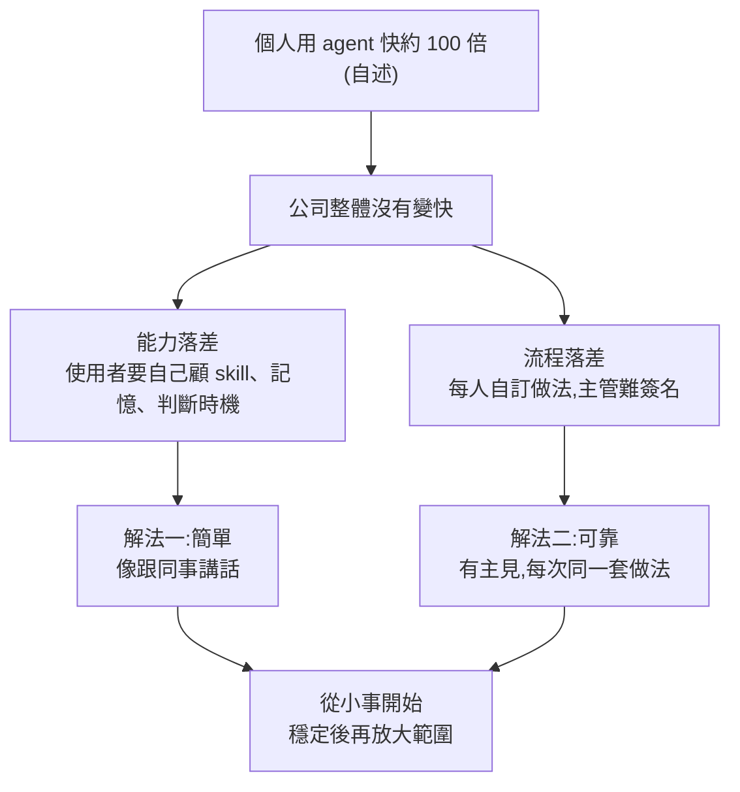

# 個人用 AI 快 100 倍、公司卻沒感覺:能力落差與流程落差,以及原演講沒被摘要的後半(AI懶人報 × Basis Mitch)

> **來源:** AI懶人報 EP466〈個人用 AI 快了 100 倍,公司卻沒感覺?企業導入 AI 卡關的 2 個原因〉(2026-11-09,約 14 分)——這是 Basis 共同創辦人 Mitch 在 AI Engineer 研討會演講〈Why AI Makes You 100x Faster but Not Your Company〉的**中文摘要**。
> **整理方式:** 摘要影片官方有繁中字幕(用其帶時間字幕);**原始演講無字幕**,我用 Whisper large-v3-turbo 轉錄英文原稿(約 19 分),讀完全文後才整理。摘要影片涵蓋原演講的論點(前半加結尾的 PR 兩軸與 AlphaGo),但**中段 9:00–17:00 的 behavior spec、forking、simulations 完全沒被摘要**,本篇補上。
> ⚠️ **利益揭露:** Mitch 是賣「企業會計 AI agent」的新創 Basis 共同創辦人,演講立場同時是產品定位;摘要影片結尾也提醒了這點。「100 倍」是他自己的估計,沒有計算方法。

## 一、核心論點(一句話)

AI 進公司卡住有兩個原因:**能力落差**(agent 把複雜度丟給使用者:要自己管 skill、記憶、判斷何時用、猜它怎麼做)和**流程落差**(每人各用各的 AI,等於每人自己發明工作方法,主管難以放心簽名)。解法是 **簡單 + 可靠**:對使用者像跟同事講話;對公司則「有主見」(opinionated)——事先替 agent 規定好怎麼做,再從小事開始累積信任。

## 二、摘要影片涵蓋的部分(原演講約 0:00–9:00 與結尾)

### 1. 公司靠「流程」信任員工(摘要 [2:34](https://youtu.be/PEUs59xg-uo?t=144);原演講 [2:00](https://youtu.be/JGtkTjn4120?t=110))
- 人不是確定性系統,事務所負責人看不到基層每天怎麼做,卻信得過結果,靠的是**大家照同一套流程**,不是每個人都不出錯。
- 連最小步驟也有流程:銀行對帳先要把對帳單數字抓出來,流程可能簡單到只是「用公司核准的軟體來抓」(原演講 [2:54](https://youtu.be/JGtkTjn4120?t=164))。不會放任任何人自己 Google「extract pdf」隨便挑工具。
- 摘要補了台灣情境:報帳要貼發票、主管簽、會計審,老闆不看每張計程車收據,因為每步都有人照規定看。

### 2. 原因一:能力落差(摘要 [4:16](https://youtu.be/PEUs59xg-uo?t=246);原演講 [3:51](https://youtu.be/JGtkTjn4120?t=221))
原話重點:這類「寫碼風格 agent」(Cowork、ChatGPT、Codex、Claude Code)**把複雜度外包給使用者**:要管 skill 與記憶、判斷何時該用 agent、還要對它有「心智理論」(猜它接下來怎麼做);工程師覺得還行,但對絕大多數知識工作者「根本不知道怎麼做」。
- 摘要舉例:公司開了 Copilot/ChatGPT 企業版帳號卻沒安排用法,只有會寫指令的一兩個人越用越快,其餘人問兩句就不再開——個人省下的時間不等於公司效率。

### 3. 原因二:流程落差(摘要 [5:44](https://youtu.be/PEUs59xg-uo?t=334);原演講 [4:27](https://youtu.be/JGtkTjn4120?t=257))
「這是你的 agent,想怎麼用就怎麼用」讓工作方式由每個使用者決定,**與組織變大的方式相反**:流程應由上而下訂定。原演講類比:就算回到 2018 年沒有 AI,每個員工各自找軟體去抓銀行對帳單數字,結果也不會好。

**應用案例(摘要的台灣情境):** 同一份業績月報,A 丟 ChatGPT 摘要、B 寫一套指令叫 Claude 整理、C 自己算;三人沒講好用哪版資料、退貨扣不扣、總額怎麼核對,主管拿到三份錯在不同地方的報告只能逐份重看——「AI 省下的時間被主管審核吃掉」。

### 4. 解法:簡單 + 可靠 + 有主見(摘要 [7:17](https://youtu.be/PEUs59xg-uo?t=427);原演講 [5:13](https://youtu.be/JGtkTjn4120?t=303))
- **簡單:** 使用者甚至不必有 agent 的感覺,「像跟同事講話」。
- **可靠 ≠ 完美:** 人也不完美,要的是 reliability、consistency、trustworthiness。原話:「做不到沒關係,但要**每次都**做不到」;時好時壞才不可靠(原演講 [6:24](https://youtu.be/JGtkTjn4120?t=374))。
- **有主見:** 不是 AI 有想法,而是**事先替它決定好做法**。讀 PDF 的選項近乎無限:丟給 VLM、寫 Python 用開源 OCR、用 OCR 專用供應商、OCR 後讓 VLM 檢查、5 個 VLM 檢查、100 個 VLM 取最佳(原演講 [6:51](https://youtu.be/JGtkTjn4120?t=401));只下「extract PDF」可能得到好結果,但**不可靠,原因不是做法差而是沒有主見**。
- **主見來源:** 專業經驗(報稅 agent 先讀一手來源再回報更準;做 PowerPoint 的 agent 回覆前先截圖就比較不會有明顯排版問題,不必靠 eval 證明)。**主見也含取捨:** 截圖檢查會增加延遲,若排版錯誤只有 1/100 且可接受就不必——重點不在主見是什麼,而是要有。
- 摘要補一句:規則寫下去不代表 AI 一定照做,要回頭看實際有沒有照做(這正是下一節的原演講後半)。

### 5. AlphaGo 第 37 手:為什麼不讓 AI 自由發揮(摘要 [10:49](https://youtu.be/PEUs59xg-uo?t=639);原演講 [18:05](https://youtu.be/JGtkTjn4120?t=1085))
原演講結尾 Mitch 預設的質疑:「讓 agent 自己做,不會找到更好的方法嗎?會不會對你的工作『下出第 37 手』?」答:可能會,但那不是擴大產出的方式,「**沒有人希望 agent 對自己的報稅單下第 37 手**」,人要的是可信賴、團隊知道怎麼配合。
- ✅ **已核實(DeepMind AlphaGo 頁):** 2016 年首爾對李世石,第 37 手「1 in 10,000 chance of being used」,頁面稱它「helped AlphaGo win the game」。摘要影片說「萬分之一、幫 AlphaGo 贏下那一局」與此一致。
- ⚠️ 摘要把第 37 手放在中段並加註「第二局」,這是主持人的補充;原演講只拿它做隱喻、沒講細節。(第二局這點:DeepMind 頁面沒單獨標第二局,我是依通行記載,未在該頁確認。)

### 6. 從小事開始,像帶新人(摘要 [11:48](https://youtu.be/PEUs59xg-uo?t=698);原演講 [17:35](https://youtu.be/JGtkTjn4120?t=1045))
看同事送來的 PR(程式修改)時看**兩軸**:影響範圍(blast radius)和你對那人能力的觀感。最不熟的新人改核心服務要逐行看;最資深的人改內部文件掃一眼就好。人與 agent 合作同理:**agent 先做影響小、看得出對錯的工作,穩定交付幾次後再擴大**。摘要對應的辦公室例子:新同事動客戶合約逐字看,資深同事改會議紀錄掃一眼。

## 三、摘要沒講的原演講後半(原演講約 9:00–17:00)

### 7. 為什麼只靠「結果型 eval」不夠(原演講 [9:02](https://youtu.be/JGtkTjn4120?t=532))
結果型 eval(有標準答案/評分表)通常只有百來到上千個案例,但上線後是**數十萬種情境**,而且長軌跡(long-horizon)的決策數隨 agent 能力呈指數成長。你無法證明每條軌跡都對、也沒有每條的標準答案;但可以**檢查軌跡中是否展現了你期望的「行為」**,若有,就較可能泛化到線上。「不完美,但至少有主見。」

### 8. 行為由什麼決定?把 context 當「執行期訓練資料」(原演講 [10:54](https://youtu.be/JGtkTjn4120?t=644))
- 行為不是在 system prompt 寫兩句話就生效(窄小 agent 也許可以),大型 agent 的行為是 **system prompt + 漸進揭露(progressive disclosure)+ 工具說明 + 模型訓練** 等的總和。
- ⭐ 原話建議:把 agent 執行時會看到的 context 當成「**run-time training data**」。「prompt 這個詞有點把它看輕了」,agent 等於在執行期被這些資料「實質訓練」,所以每個 token 都要在意。這與 [[ai-harness-explained]] 的三工程(提示詞/上下文/harness)看法相通。

### 9. Behavior Spec(行為規格)(原演講 [12:03](https://youtu.be/JGtkTjn4120?t=713))
Basis 發展的概念:**改 context 之前,先寫下「我們要什麼」**,可視為「agent 時代的產品規格」。
- 不要把每個細節都寫進去,只寫**最重要的主見**,否則會重複很多狀態。
- 兩用:① 對齊團隊;② 當**評分表**——對任何沒有標準答案的軌跡問:agent 有沒有進入此行為相關的情境?有的話,有沒有做出該行為?
- 好處:行為監督的訊號量,能比「增加結果型 eval/標準答案/評分表」擴張得快得多(後者重要但擴張不了那麼快)。
- 原演講的會計例子(原演講 [10:20](https://youtu.be/JGtkTjn4120?t=610)):銀行對帳出現差額時,**不要自動過一筆分錄把差額「塞平」(plug),而要解釋差異**。他強調這是主觀偏好,有人可能想反過來,重點是「同一個客戶不能這次得到一種處理、下次得到另一種」。

### 10. Forking(分叉)(原演講 [13:28](https://youtu.be/JGtkTjn4120?t=798))
像 Claude Code/Codex 網頁版訊息下方的分叉鈕:複製一個 agent 的當下狀態。流程:一條軌跡(eval 集、測試或線上)在行為檢查失敗 → 找到 agent 做出違反行為決定的**前一刻** → 分叉 → 直接問它「你為什麼這樣做」,或改它的 context 看行為是否改善。比起只看結果型 eval 的失敗(一次五小時、可能上千次推論的軌跡,不知道為何失敗),這能把訊號變成改 harness 的依據。Mitch 說在雲端完美重建資料庫環境與提示詞的分叉系統很難做。

### 11. Simulations(模擬)(原演講 [15:15](https://youtu.be/JGtkTjn4120?t=905))
他「最喜歡」的工具,聽起來傻但很有效:在用 coding agent 時,**叫它建一個子代理扮演你的線上 agent**(要明講「不准作弊」),把 system prompt 與 skills 完整提供,餵入你在 eval 或線上看到的情境,看能否重現;重現後調整 context,看子代理行為是否隨之改變。他承認「遠不如 forking」,但**便宜、快**,不需建任何東西就能做;他在做出內部 forking 之前這樣做了一年半以上。

### 12. 收尾(原演講 [18:42](https://youtu.be/JGtkTjn4120?t=1112))
agent 要擴散必須簡單,團隊要信任必須可靠;做法是對 agent 行為有主見,主見讓你建立額外訊號、**閉環**,最終在線上達到「自我改進的 agent」。

## 四、查證與批判

| 項目 | 結論 |
|---|---|
| AlphaGo 第 37 手「1/10,000」、2016、幫助獲勝 | ✅ 已核實(DeepMind AlphaGo 頁) |
| Basis 做會計 agent、長時間自主、關鍵決策詢問會計師、交付審核 | ✅ 已核實(getbasis.ai/about 的描述) |
| 紐約、兩位共同創辦人 | 紐約與「兩位共同創辦人之一」出自 Mitch 本人演講;**Basis 官網頁面未列出創辦人或地址,未能獨立核實** |
| Mitch 的名字全名、是否在 Basis 擔任共同創辦人 | 摘要說明欄與演講自述一致;官網頁面未印證,**未能核實** |
| 「個人快 100 倍」「企業沒有 10 倍」 | **未能核實**,是他自己的估計,無計算方法(摘要也標明) |
| 摘要影片「兩個原因」的框架 | 忠實於原演講(competency gap / process gap) |
| 摘要與原演講差異 | 摘要補了台灣情境與 AlphaGo 細節;**省略了原演講後半(behavior spec / forking / simulations)**,而這恰是 Basis「如何落地」的核心 |

**批判:**
1. **利益衝突:** 結論「公司先定好做法、簡單又可靠的 agent」正是 Basis 在賣的;但「公司靠流程建立信任」與產品無關,對任何工具成立(摘要已提醒)。
2. **「規定死做法」的代價:** 主見若寫太死,可能擋掉更好的方法;原演講承認取捨(延遲 vs 準確),也承認 agent「可能」找到更好方法,只是主張在企業場景優先可預期性。
3. **評估證據薄:** 演講沒提供任何可驗證數據(沒有「行為評分提升多少」),forking/behavior spec 的效果都是自述。
4. **領域限定:** 會計是高度流程化、可審核的領域;對創意或探索型工作,「先規定做法」未必適用。

## 五、應用案例

- **團隊導入 Copilot/ChatGPT 企業版:** 別只辦教育訓練。選一個高頻、窄範圍的任務(例如業績月報),由資深同事寫成一份共用「做法」(用哪版資料、退貨怎麼算、怎麼核對),全組都照這份執行,主管就只需審一種格式。
- **寫 behavior spec 的小範本:** 「情境:對帳有差額;期望行為:列出差異原因,不新增平帳分錄;檢查方式:抽查 20 條軌跡,看有進入此情境者有沒有照做。」再依 Mitch 的兩軸決定要抽多少:新上線的 agent 抽多,穩定半年的少抽。
- **用模擬法低成本除錯:** agent 在某案例做錯時,開一個 coding agent,叫它「扮演」線上 agent(給完整 system prompt 與 skills,明講不准作弊),餵同一情境重現,再改 context 看有沒有改善——不必先建 forking 系統。可搭配 [[loop-engineering-when-and-how-gary-chen]] 與 [[harness-engineering-evolution]] 的脈絡理解。
- **新手 agent 的放權順序:** 先給「改內部文件」這種低 blast radius 的工作,連續穩定幾次後才給「改對外合約」的權限。

## 六、轉錄注意

原演講 Whisper 稿有幾處混入中文與破句(如 4:20、14:00、17:18 附近,以及 18:15 之後原本整段亂碼),我用 `--clip` 加提示詞重轉 18:00–18:50,結果通順(「won't they move 37 your work?」「Nobody wants their agent to move 37 their tax return」)。其餘亂碼處不影響引用的句子。專有名詞「Cloud Code」皆為 Claude Code 的聽寫誤差。

## 七、來源

- 影片:AI懶人報〈EP466 - 個人用 AI 快了 100 倍,公司卻沒感覺?企業導入 AI 卡關的 2 個原因〉<https://www.youtube.com/watch?v=PEUs59xg-uo>(官方繁中字幕)
- 原演講:AI Engineer〈Why AI Makes You 100x Faster but Not Your Company – Mitchell Troyanovsky, Basis〉<https://www.youtube.com/watch?v=JGtkTjn4120>(無字幕,逐字稿以 CPU 版 faster-whisper large-v3-turbo 轉錄取得,非官方字幕)
- Basis 官網 <https://www.getbasis.ai>、About <https://www.getbasis.ai/about>(僅能讀到產品描述)
- Google DeepMind AlphaGo <https://deepmind.google/research/alphago/>
