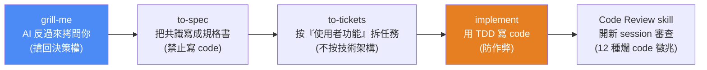
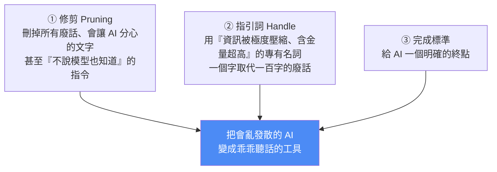
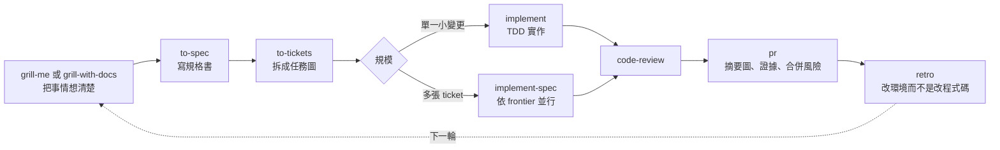

# Matt Pocock 的 AI 開發 skills 全拆解:最紅的 skill 只有五行字,強在哪?

> Gary Chen(@garytalksstuff)拆解 TypeScript 大神 **Matt Pocock** 開源的 AI 開發工作流(GitHub 16 萬+ 星、700 萬次下載;2026-10 已約 29.5 萬星)。核心洞察:**這套 skill 真正開源的不是幾個 prompt,而是「如何用你在專業領域積累的思維與語言,去駕馭 AI 這個黑盒子」。** 延伸自 [[building-claude-skills]]、[[top-skills-for-agents]]、[[ai-brownfield-codebase-five-steps]]。
>
> **2026-10-18 增補 §九:** Gary 第二支影片拆解 v1.3 新增的 `implement-spec`、`pr`、`retro`。已 clone repo 對照 SKILL.md 與官方文件,補上影片沒講的 integration branch 機制、worktree 衝突與測試跳過的坑,以及 `CONTEXT.md` 改名 `GLOSSARY.md` 的破壞性變更。

---

## 一、命題:AI 開發真正難的不是寫 code 的速度,是「控制 AI 的隨機性」

Matt Pocock 這一年幾乎把重心整個搬到 AI。大量依賴 AI 開發後他發現:**比起寫 code 的速度,更難的是怎麼控制 AI**——因為 AI 本質是一個充滿隨機性的黑盒子。這套工具的終極目標,就是**控制這種隨機性**。

**與其他框架(Spec-Kit、Superpowers、Get Shit Done)的根本差異:** Matt 認為那些大框架的毛病是「想把你整個開發流程接管過去」——把寫規格、做計畫、實作全綁成**一條又重又硬的固定流程**,只要前面一步定歪,錯誤就順著整條線傳染到後面,想改往往整條重跑。

> **Matt 走完全相反的路:每個 skill 刻意做得很小、很好改、還能自由拼裝。這個「小 + 模組化」的理念,是他後面所有東西的底層邏輯。**

---

## 二、主生產線:五個 skill 怎麼接力

### ① grill-me —— 讓 AI 反過來拷問你(只有五行字)

被幾百萬人下載的 skill,打開來**只有五行字**:
1. 在對接下來的計畫**沒達成共識前,把我往死裡問**;
2. 像畫心智圖一樣**順著你的思路延伸**,把每個決定背後的連鎖反應一個個抓出來問到底;
3. **每次只能問一個問題,且必須附上建議答案**;
4. **共識達成前,絕對不准偷偷跑去寫程式**。

**為什麼大神要特地寫這五行?** 因為**寫程式的本質是連續做出幾百個微觀決定**(防呆怎麼做?斷線怎麼辦?極端資料怎麼處理?)。如果你把模糊想法直接丟給 AI 憑感覺做(Vibe Coding),等於**把這幾百個決策權全外包給黑盒子**;而 AI 為了討好你,通常會**瞎掰出一套最難維護的架構**——這是生產級軟體的噩夢。

> 🔑 **這五行字的唯一目的:把決策權搶回人類手裡。** Matt 知道要人類面對空白螢幕從零寫出涵蓋所有極端狀況的完美企劃書太痛苦,所以**用 AI 順著決策樹無情挖出你的盲點,但 AI 只負責給選項、拍板永遠是人類**——這樣人類才能穩坐架構師位置。

### ② to-spec —— 把共識寫成規格書(禁止寫 code)

一關掉對話 AI 就失憶,所以趕快用 to-spec 把共識存成規格書。**但 Matt 完全禁止 AI 在寫 spec 時引用或寫任何程式碼。**

> **為什麼這麼極端?** 因為軟體工程界最大的痛是「**文件永遠跟不上程式碼更新的速度**」。程式碼是最容易變動的;若讓 AI 把 code 寫進規格,未來 code 一改就跟規格對不上,下次請 AI 照規格改功能,它會被規格裡**過期錯誤的舊 code 搞混,越改越亂**。所以直接封殺——確保規格書永遠只專注在「**這功能到底要解決什麼問題**」。

### ③ to-tickets —— 按「使用者功能」拆任務(不按技術架構)

專治「AI 規劃任務總是很爛」。**AI 天生壞習慣:喜歡按技術架構分工。** 例如做電商,它會先把全部資料庫建好 → 再把後端邏輯全寫完 → 最後才畫前端。

> **最可怕的盲點:在最後一步畫面出來前,你完全沒辦法測試任何東西。** 第一步資料庫建錯,要等做前端時才發現,前面全毀。

to-tickets 強制改用**使用者功能**拆:同樣電商切成「①會員登入(含專屬登入的資料庫+邏輯+畫面)②加入購物車(同樣完整三層)」。好處:**第一個任務做完就能立刻打開瀏覽器測試**,不是蒙眼寫幾千行才開始審核。附帶還會排好任務順序,**互不干擾的任務可同時發包給多個 AI 平行處理**,速度翻倍。

### ④ implement —— 用 TDD 寫 code(防 AI 作弊)

下實作指令,它照任務清單寫 code、自動用 **TDD(測試驅動開發)** 引導、寫完自己呼叫 Code Review。

> **為什麼 TDD 對 AI 開發這麼重要?因為 AI 骨子裡是個作弊仔。** 若讓 AI 先寫算錢程式再補測試,萬一它把「滿 1000 扣 100」寫成扣 200,它為了交差**會直接生一個假測試**說「滿 1000 必須扣 200,檢查通過!」——拿自己寫錯的邏輯配一個絕對會過的測試,你根本抓不出 bug。

**TDD 防作弊的順序:** 寫任何一行程式前,AI 必須先把測試**定死**(「滿 1000 就是只能扣 100」)→ 這時程式還沒寫,測試一跑絕對失敗亮**紅燈** → 紅燈出現才准 AI 寫真正的算錢程式 → 直到紅燈變**綠燈**。用「先寫測試、再寫程式」徹底鎖死 AI 亂寫交差的空間。

### ⑤ Code Review skill —— 開新 session 審查(12 種爛 code 徵兆)

**開一個全新 session 做 Code Review**,讓 AI 在最乾淨、最聰明的狀態下檢查,避免被寫程式時的記憶干擾。它不是空泛地說「幫我看有沒有 bug」,而是**把軟體工程界幾十年公認的爛 code 症狀寫成具體檢查清單**(取自經典名著《Refactoring》的 12 種)。三個新手最容易踩的:

| 症狀(指引詞) | 白話 | Code Review 要求 |
|---|---|---|
| **Shotgun Surgery** | 改一個按鈕顏色卻要打開十幾個檔案改(散彈槍手術) | 把它們重新集中起來 |
| **Feature Envy** | 處理訂單的 code 老跑去管庫存的檔案拿資料算 | 這段邏輯放錯位置,搬去訂單那邊 |
| **Data Clumps** | 買家姓名/電話/地址總是同時出現、散著傳來傳去 | 打包成一個「聯絡人」物件 |

---

## 三、為什麼他的 skill 這麼短又這麼強?——`writing-great-skills`

Matt 每個 skill 都非常短、非常精鍊,秘密藏在 `writing-great-skills`。核心理念:**在 AI 面前,你多寫一句廢話,AI 就多一分分心的可能。** 三個原則:

- **修剪(pruning):** 這就是為什麼 grill-me 只用五行字——**確保每一句指令都有實際作用**。
- **指引詞:** 像 `Data Clumps` 這種**深植在 AI 訓練資料裡的經典專有名詞**——你對 AI 說這個字,等於說了「請檢查有沒有總是綁在一起出現的變數,有的話打包成獨立物件」。Matt 大量運用這種術語,**用一個字取代一百字的廢話解釋**。

> 🔑 **這正是本庫 [[gpt-5-6-prompting-guide-openai]] 講的「先做減法」與 [[defining-tasks-not-prompts]] 的實作典範**——精鍊不是省字,是把領域知識壓進 AI 聽得懂的術語。

---

## 四、隱形炸彈:淺模組 vs 深模組(整套系統最有料的一段)

即便把 AI 訓練成頂級工程師,專案仍有一顆隱形炸彈:**邏輯過度碎片化**。AI 寫 code 太快但**天生沒有大局觀**,每次只盯著眼前幾個檔案,為了方便交差最愛寫**淺模組**。

> 🔎 **房子比喻:** 淺模組像一棟房子,廚房/客廳/臥室分得很乾淨,**但這棟房子沒有大門**——進廚房要爬窗、進客廳要爬煙囪。溝通成本極高,你要進房子卻得記住五個房間的獨立密碼跟路線。

**AI 寫購物車結帳最愛蓋這種房子:** 切成 `計算折扣`/`驗證信用卡`/`建立訂單`/`扣除庫存`/`寄信` 五個小房間,**卻沒蓋統一大門隱藏細節** → 主程式必須親自處理五間房的資料傳遞。**對 AI 尤其致命**:因為 Context Window 有限,結帳出 bug 時 AI 要在五個房間瘋狂跳轉才能看懂流程,一旦超過記憶範圍就**開始瞎猜,把原本正常的 code 也改壞**。

**深模組才是能讓 AI 發揮全力的好架構:** 不是把一萬行塞同一個大房間,而是**蓋一扇極簡的大門、把複雜房間藏在裡面**。結帳對外只提供一個 `processCheckout` 大門,折扣怎麼算、信用卡怎麼驗全藏在背後,主程式敲一次門事情就辦妥。**深模組具備極強的局部性**——AI 修 bug 只要專注讀這一個模組,所有來龍去脈都在眼前視野裡,不需去別處找線索,能精準打擊。

> **一句話:淺模組讓 AI 迷路並瞎猜,深模組讓 AI 專注並精準打擊。**

### `improve-codebase-architecture` —— 用「刪除測試」揪出淺模組

對抗淺模組危機的大掃除 skill。它不看語法,而是對每個模組做**殘酷的刪除測試**——在腦中想像「如果把這個模組拔掉、讓主程式自己處理,會發生什麼事?」:

- 拔掉後**天下大亂**(隱藏的複雜邏輯全炸回主程式)→ 這是**有在做事的深模組**,留著;
- 拔掉後**程式碼反而變清爽**(原本要跳兩個檔案,現在集中在一處)→ 這模組**沒隱藏任何細節、是多餘空殼**,清掉。

**日常用法:** 每隔幾天在終端機叫 AI 跑一次,它會掃描整個專案、**在你電腦上生成一份 HTML 診斷報告**畫出前後架構對比圖。你連 code 都不用看,挑一個最急迫的建議說「就照這個方案重構」即可。

---

## 五、跟 Superpowers 比一比:你適合哪一種?

| | **Superpowers** | **Matt Pocock skills** |
|---|---|---|
| 哲學 | 完整定義工作流、**寫死九個步驟**逼你想清楚才動工 | **極簡 + 模組化**,一個 skill 只解決一個問題 |
| 比喻 | 已組好的**自動化生產線**(品質穩定) | 一盒**隨插即用的樂高積木** |
| 適合的模型 | 模型還笨、容易偏題時,保母級防呆非常管用 | GPT-5.6 / Fable 5 這種**理解力極強**的模型 |
| 彈性 | 希望你乖乖從頭走完,產出的文件為它下一步量身打造、**別人難接手** | 手上有份規格(自己寫/主管給/別的 AI 產),**直接丟給 to-tickets 拆**,從哪步開始/結束你決定 |

> **Gary 的判斷:** 過去模型笨時,Superpowers 的自動化生產線確保品質穩定;但**模型越來越聰明的現在,Superpowers 的死規矩反而變累贅**,Matt 這盒樂高積木**把工作主導權交還到我們手上**,更適合現在的生態。(呼應 [[bitter-lesson-cut-old-patterns]]:模型變強後,該砍掉為笨模型設計的重流程。)

---

## 六、應用案例

1. **設計前先被 AI 拷問:** 面對一個模糊需求,先跑 grill-me——不是叫 AI 做,而是叫它一題一題(附建議答案)把你沒想清楚的盲點挖出來,你只做「拍板」。這比直接 Vibe Coding 省下後面幾百個決策被亂做的重工。
2. **接手別人的規格直接拆任務:** 主管給你一份 spec,不必走完整流程,直接 `to-tickets` 按使用者功能拆成可獨立測試的 ticket,還能平行發包給多個 agent。
3. **用 TDD 綁死 AI 的算錢/計費邏輯:** 任何「有明確對錯」的功能(金額、權限、狀態機),先讓 AI 寫定測試看到紅燈,再讓它寫實作到綠燈——防止 AI 生假測試交差。
4. **每週跑一次架構大掃除:** 對 vibe code 出來、逐漸碎片化的專案跑 `improve-codebase-architecture`,看 HTML 診斷圖挑最急迫的深/淺模組問題重構——對抗 [[ai-brownfield-codebase-five-steps]] 講的「Greenfield 退化成 Brownfield」。
5. **把你的領域術語當 prompt:** 你若懂某個領域的專有名詞(不只軟體),直接把術語丟給 AI,勝過寫一百字白話解釋——前提是**你得真的是那個領域的專家**。

---

## 七、核心啟示:成為專家,才能真正控制 AI

Matt 靠深厚的軟體工程底子,把它用在兩個地方:
- **用在架構上:** 把幾十年證明有效的老方法(深模組、爛 code 徵兆)融入 skill 架構來規範 AI 行為;
- **用在與 AI 溝通上:** 把軟體工程專有名詞當 prompt 的一部分,「一位快退休的老教練給球員的一句話,聽起來簡單,裡面蘊含幾十年經驗」。

> **這打破一個迷思:很多人以為有了 AI 就不需要在自己領域精進了。但 Matt 證明——只有成為專業領域的專家,你才能真正控制好 AI。** 他真正開源給我們的從來不是幾個 skill,而是「在 AI 時代,該怎麼用你在專業領域積累的思維和語言,去駕馭 AI 這個黑盒子」。

---

## 八、重點回顧(TL;DR)

- Matt Pocock 開源 AI 開發工作流(16 萬星),核心是**控制 AI 的隨機性**,走「小 + 模組化」路線(反 Spec-Kit/Superpowers 的重流程)。
- **主生產線五 skill**:grill-me(AI 拷問你、搶回決策權)→ to-spec(禁寫 code 的規格書)→ to-tickets(按使用者功能拆、可即時測試 + 平行)→ implement(TDD 防作弊)→ Code Review(新 session、12 種爛 code 徵兆)。
- **skill 為何短又強**:`writing-great-skills` 三原則——修剪廢話、用「指引詞」(如 Data Clumps)壓縮領域知識、給明確完成標準。
- **深模組 vs 淺模組**:淺模組(沒大門的房子)讓 AI 迷路瞎猜、超出 context 就改壞;深模組(一扇簡單大門藏複雜細節)讓 AI 專注精準;用 `improve-codebase-architecture` 的「刪除測試」揪出淺模組。
- **vs Superpowers**:生產線 vs 樂高;模型越聰明,Matt 的模組化越適合。
- **終極啟示**:成為專家,才能真正控制 AI。
- (影片未盡:grill-me 進化版 `grill-with-docs`、三個 AI 寫作 skill——在 Matt 的 repo 與 Gary 的 Patreon。)

---

## 九、2026-10 更新:v1.3 新增 implement-spec、pr、retro,把流水線接成閉環

> **來源:** Gary Chen 第二支拆解〈28 萬星的 Matt Pocock skill 更新拆解!〉(2026-10-17,官方 zh-TW 字幕)。
>
> **核對方式:** 本節已 `git clone` [mattpocock/skills](https://github.com/mattpocock/skills) 讀三個 SKILL.md、`docs/engineering/*.md` 與 CHANGELOG。
> - 2026-10-18 查核:⭐ 約 29.5 萬、MIT、目前版本 **1.3.1**。三個 skill 在 1.3.0 由 PR #1120「畢業」進 Engineering 類別。
> - 本篇開頭寫的「16 萬星」是 2026-07 的數字。
>
> **立場揭露:** Gary 在說明欄推廣自家 Skool 社群;他改寫的「白話版 PR / Retro skill」放在付費的「Gary AI 實戰營」,本節不轉述。

### 9.1 新流程全貌

v1.3 之前,流程跑到 code-review 就結束。v1.3 在後面接上 pr 與 retro,讓下一輪開發可以變得更好。依 CHANGELOG,`ask-matt` 路由器把 retro 定為「主流程最後一步」。

### 9.2 `implement-spec`:把整份 spec 一次並行做完

**痛點:** 一份 spec 常拆出七、八張甚至十幾張 ticket。用 `implement` 時你得一張一張叫 Agent 做、等它跑完、檢查、清空 context、再下一張。Gary 說這等於「人肉版的 loop」;他更新前就自己寫過一個 `implement-tickets` skill 來解決。

**用法:** 清空 context 後輸入 `/implement-spec #87`(issue 編號或檔案路徑)。假設 #87 下面有 #88–#97 十張 ticket,Agent 會全部處理完。

**SKILL.md 原文的關鍵設計(40 行):**

- **ticket 不是步驟清單,是任務圖。** 依阻塞關係,永遠有一個「現在就能做」的 **frontier**。這個詞與 [[to-tickets-spec-to-agent-workunits]] 產出的並行調度信號是同一套。
- **每張 ticket 交給一個 implementer 子 agent**,各自在自己的 worktree、自己的 branch 上做。每個子 agent:
  1. 先確認 worktree 是從 integration branch 長出來的
  2. 用 `tdd` skill 實作
  3. 回報完成前,先把 integration branch 最新進度併進自己的 branch,讓之後的合併都是 fast-forward
- **由 merger 子 agent 負責合併**到 integration branch。合併後 frontier 有變,就再派新的 implementer。
- **全部完成後**,對 integration branch 跑 `code-review`,所有問題交給**單一** implementer 一次修完,最後清掉所有 worktree。
- **溝通要精簡:** 子 agent 之間主要傳 **context pointer**(指向 spec、ticket、研究筆記、先前的 commit),不重複貼已經查得到的資訊。
- **可選的探索子 agent:** 先把要讀的程式碼與外部文件整理成筆記,存在 **repo 以外**的目錄給後續子 agent 共用。

**影片沒講、但官方文件有的重點:**

| 重點 | 官方說法 |
|---|---|
| 目標是 integration branch,不是 PR | 只有 issue tracker 靠 PR 關單、或你要求時,才在**第一次合併後**開 draft PR(沒有任何 commit 的 branch 開不了 PR) |
| 需要支援背景子 agent 的 harness | 子 agent 只能一個一個跑的 harness 上,它「只是比較慢的 `implement`」 |
| worktree 只是把衝突延後 | 兩張 ticket 看似改不同地方,仍可能共用訊息字典、設定註冊表或型別。官方實例:web 與 mobile 兩張 ticket 對同一字串各自取名 `blockedSince` 與 `blockedOn`。解法是加阻塞邊讓它們依序跑,或在探索筆記裡先定好名稱 |
| 測試在 worktree 裡可能悄悄跳過 | worktree 只有 git 追蹤的檔案。依賴 gitignore 的 fixture、本機資料庫、憑證的測試會靜默 skip 卻回報綠燈,這類 ticket 要在主 checkout 跑 |
| 不取代 Sandcastle | 真正 AFK 的工作,用確定性迴圈(Sandcastle、shell script、CI job)更快、更便宜、更可靠,因為不需要 agent 做調度決策。`implement-spec` 的優點是在單一 session 內、不需基礎設施、可以邊看邊調整 |

> 影片提到 Gary 私訊 Matt 問「會不會開 worktree 多線並行」,Matt 回覆用 Claude Code 或 Sandcastle。官方 FAQ 的「Does this replace Sandcastle?」正好回答了這個關係。

**沒用 Matt 的 skill 也能套用:** 在 prompt 裡要求先把任務拆成細項、標出每項的依賴關係,再交給不同的 subagent 並行。

### 9.3 `pr`:讓人能在幾十秒內審完 AI 的產出

**Matt 的判斷:** 有了 AI,幾分鐘就能吐出一大包改動,**開發瓶頸變成人類審 PR 的速度**。瓶頸在哪,AI 就該在哪施力。Claude Code 這類工具內建的 PR 範本很陽春:一段說明加一份 Test Plan,而 Test Plan 常常只是還沒打勾的待辦清單。

**範本三段(SKILL.md 原文):**

| 段落 | 要求 |
|---|---|
| **Summary** | 用**最小的圖**講清楚改了什麼:演算法用虛擬碼、執行流程用呼叫樹、UI 用元件樹、大範圍重構用淺層檔案樹、互動與資料流用 Mermaid,改動點用 `diff` 標示。不要前言、少寫散文,並沿用 `GLOSSARY.md` 的領域用語 |
| **Evidence** | 前後對比的證據。**截圖是 S 級**(畫面類改動、環境支援時);**測試結果、console 輸出是 A 級**,要寫出那個「之前失敗、現在通過」的測試 |
| **Merge Danger** | **Door:** 單向門(破壞性遷移、移除公開 API 等難回頭的決定)或雙向門(可以低成本退回)。**Blast Radius:** 用一個詞描述出事時的影響範圍,例如版面跑位、API 使用者壞掉、手機版跑版 |

- **怎麼用風險評估:** 官方文件的核心句是把「這能合併嗎?」從直覺變成**審查者可以反駁的明確主張**。雙向門加上小影響範圍就快速瀏覽;單向門才放慢細看。
- **補正:** 影片說要「用一張最小的圖」,SKILL.md 實際上提供六種視覺形式,並明說「你可以用一種或幾種,不太可能全用到」。
- **出處:** Summary 的視覺化做法改編自 HumanLayer 的 Dex Horthy 的 `show-me` skill,在 `CREDITS.md` 標注。
- **觸發方式:** `pr` 是 **model-invoked**,寫 PR 內文時 Agent 會自己套用。另外兩個(`implement-spec`、`retro`)都設了 `disable-model-invocation: true`,只能由使用者手動呼叫。

**Gary 的客製化:** 他幫團隊改了一個「給技術小白的白話版」,要求用生活化的比喻寫 PR,讓只懂一點架構的讀者看得懂,也能慢慢累積 know-how。

### 9.4 `retro`:找出 Agent 沒告訴你的 token 殺手

**問題:** AI 很擅長默默把長任務做完,但過程中它可能一直硬撐重試、浪費大量 token、踩到沒人知道的坑。不挖出來,下次開新對話會再犯一次。這是 Matt 這次最喜歡的 skill。

**做法:** 翻閱指定 session 的日誌與對話(預設是當前 session),依嚴重度提出「**改環境,不改程式碼**」的建議。SKILL.md 列了七類:

| 類別 | 什麼時候提 |
|---|---|
| **Navigation** 導航 | Agent 花很久才找到檔案 ⇒ 加一條 **navigation pointer**(指向關鍵檔案的路徑提示) |
| **Automated checks** 自動檢查 | Agent 犯了工具抓得到的錯。⭐ 先讀 repo 既有的 lint/check 指令與 CI,「有檢查但沒接上或悄悄壞了」本身就是發現;**完全沒有 pre-commit hook 也沒有 CI 跑 lint/型別/測試**,也算一項發現 |
| **Coding standards** 程式碼規範 | 審查 agent 漏抓錯誤時。先分類:**機械性**違規(禁用的 API、import 形狀、檔案位置)一律做成確定性檢查(自訂 lint 規則、pre-commit hook、CI job);只有**需要判斷**的(跨檔一致性、「跟周圍風格一致」)才寫進 `CODING_STANDARDS.md` |
| **Global AGENTS.md** | AGENTS.md 特別大時,把裡面的指令移到 coding standards 或自動檢查 |
| **Tool economy** 工具經濟 | Agent 做了昂貴的工具呼叫,或某個自製 CLI / MCP 特別吃 token |
| **No-ops** 無效指令 | steering 檔裡寫了、但根本沒改變 Agent 行為的指令 |
| **Information access** 資訊取得 | 關鍵資訊 Agent 拿不到 ⇒ 例如把 dev server log 導出來、給第三方服務唯讀權限 |

**背後的設計原則:** 規範歸**審查者**,不歸實作者。

- 實作 agent 要探索、寫程式、除錯,**context 壓力最大**;審查 agent 只收到 diff,壓力最小。所以規則放在審查那一關才有空間執行。
- 官方文件也說,規則**絕不要放進 AGENTS.md**。它每個 session 都會載入、會稀釋檔案裡其他內容,還會隨程式碼過時。AGENTS.md 和 CLAUDE.md 只放 navigation pointer。
- `CODING_STANDARDS.md` 在審查時才讀;超過 1,000 行就改用 pointer 指向 docs。

**不要全自動化(影片與官方文件一致):**

- `retro` **只提案,不動手**:不手改檔案、不自動裝 hook,要你挑了才改。
- 官方 FAQ 引用一位使用者「被會擋掉好改動的自動 hook 燒過」的經驗。
- 順利的 session 沒什麼可學,每次都跑大多只會產生沒人需要的規則。
- 它**沒有 dry-run 模式**;提出的檢查也是程式碼,讓它擋合併前先對 repo 實測。
- Gary 的提醒:讓 AI 天天自己反思容易**吹毛求疵**,把專案帶歪。每一份提案都要自己審,確認它改哪個檔案、會怎麼影響 Agent 行為。

> `retro` **也不是記憶系統**:它不儲存發生過什麼,而是改變環境讓錯誤不會再發生。這和本庫 [[claude-code-loop-types-official]] 的驗證回路、[[agent-skill-three-layer-run-do-verify]] 的「驗證層」是同一種思路:把一次性的教訓變成永久的檢查。

### 9.5 升級前要知道的兩個破壞性變更(影片沒提)

1. **`CONTEXT.md` / `CONTEXT-MAP.md` 全面改名為 `GLOSSARY.md` / `GLOSSARY-MAP.md`。** 舊專案要自己 `git mv`,否則 skill 從此**找不到**你的領域詞彙檔。受影響的有 `domain-modeling`、`grill-with-docs`、`tdd`、`pr` 等 11 個 skill。
2. **移除 `resolving-merge-conflicts`**,沒有替代品。Agent 直接處理合併或 rebase 衝突,舊文件頁標為封存。

### 9.6 應用案例

1. **一個「設定頁改版」spec 拆出 6 張 ticket:** 跑 `/implement-spec #120`。
   - 開跑前先檢查 ticket 間的阻塞邊:「新增設定欄位」和「設定頁 i18n」都會動到同一份語系檔,就加一條阻塞邊讓它們依序跑,避免兩個子 agent 各取一個 key 名。
   - 依賴本機資料庫的整合測試 ticket,指定在主 checkout 跑。
2. **讓 AI 開的 PR 一眼能審:** 在 repo 的 skill 目錄放入 `pr`。之後 Agent 開 PR 會附一段 `diff` 形式的元件樹、修 bug 前後的測試輸出,以及「Door: two-way / Blast Radius: settings-page」。審查者先看 Door:雙向門快速放行;碰到「Door: one-way」(例如刪資料表欄位的 migration)才約人一起看。
3. **每週一次 retro 健檢,而不是每個 session:** 挑一個這週明顯卡很久的 session 跑 `/retro`。假設發現 Agent 三次把元件放錯資料夾:
   - 依規則這是**機械性**錯誤,所以做成一條自訂 lint 規則,而不是在 CLAUDE.md 加一句「元件請放 src/components」。
   - 同時刪掉 CLAUDE.md 裡兩條從沒影響行為的 no-op 指令。
4. **不用 Matt 的 skill,也能借用這三招:**
   - 在 prompt 裡要求先畫任務依賴圖再並行。
   - PR 模板加一欄「單向門 / 雙向門」。
   - 每週固定花十分鐘看一次最卡的 session 日誌。

---

## 來源

- 影片:[17 萬星的 Matt Pocock skills,到底強在哪?skills 全拆解(Gary Chen @garytalksstuff,2026-07-22,官方 zh-TW 字幕)](https://www.youtube.com/watch?v=aR97E7aKEgg)
- 影片:[28 萬星的 Matt Pocock skill 更新拆解!(Gary Chen @garychenai,2026-10-17,官方 zh-TW 字幕)](https://www.youtube.com/watch?v=QqhyqMvdx5Q)——§九來源
- Repo:<https://github.com/mattpocock/skills>(2026-10-18 clone,v1.3.1):[implement-spec SKILL.md](https://github.com/mattpocock/skills/blob/main/skills/engineering/implement-spec/SKILL.md)、[pr SKILL.md](https://github.com/mattpocock/skills/blob/main/skills/engineering/pr/SKILL.md)、[retro SKILL.md](https://github.com/mattpocock/skills/blob/main/skills/engineering/retro/SKILL.md)、[CHANGELOG](https://github.com/mattpocock/skills/blob/main/CHANGELOG.md)、[docs/engineering/implement-spec.md](https://github.com/mattpocock/skills/blob/main/docs/engineering/implement-spec.md)、[docs/engineering/pr.md](https://github.com/mattpocock/skills/blob/main/docs/engineering/pr.md)、[docs/engineering/retro.md](https://github.com/mattpocock/skills/blob/main/docs/engineering/retro.md)
- Dex Horthy `show-me` skill(pr 的視覺化出處):<https://github.com/humanlayer/skills/blob/main/plugins/show-me/skills/show-me/SKILL.md>
- Gary 的 Skool 社群(付費內容未轉述):<https://www.skool.com/gary-chen>
- 延伸(本庫):[模型越強,Superpowers vs Matt Skills 該刪誰(專講「寫計畫」勝負手)](./superpowers-vs-matt-skills-strong-model.md)、[Skill 實戰:從製作到維護](./building-claude-skills.md)、[4 組頂級 Agent Skill(含 Matt Pocock/Superpowers)](./top-skills-for-agents.md)、[AI 安全接手舊專案五步驟](../../ai-productivity/ai-brownfield-codebase-five-steps.md)、[OpenAI GPT-5.6 官方提示指南(先做減法)](../foundations/gpt-5-6-prompting-guide-openai.md)、[Bitter Lesson:模型變強後砍舊 prompt](../foundations/bitter-lesson-cut-old-patterns.md)
