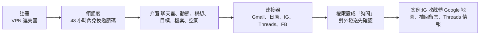

# Meta Muse 新手教學:免費個人 Agent、Soul/Memory 檔案、Instagram 與 Threads 連接器,以及「很主動」的代價

**主題分類:** 科技 / AI Agent 應用 — 消費級個人 Agent 的註冊、介面、連接器與權限
**來源:** YouTube〈Meta Muse 新手教學,社群功能最強的 AI Agent〉(Gary Chen @garychenai,2026-11-24,約 18 分 31 秒;**依官方繁中字幕整理**)
**整理日期:** 2026-11-25

> ⚠️ **立場揭露:** 作者在說明欄推廣自己的 Skool 付費社群(「完整文章與提示詞模板」放在社群內),片尾也推廣自家「AI 實戰營」。**本文不轉述付費內容**。說明欄另附作者自己的 Muse 邀請碼,作者與被邀請者**雙方各得 token**,所以作者在推薦註冊上有利益。作者在 [11:59](https://www.youtube.com/watch?v=UrFrDJ-G6h8&t=709s) 自述「這支影片沒有贊助商」。
> ⚠️ **性質說明:** 這是個人實測示範(作者在台灣、用 VPN 註冊)。**定價與額度是會變的**,見下方核實表,影片說的月費與官方報導不一致。
> 📎 同一產品的產業面(為何爆紅、成本、誰會贏)見 [[personal-agent-muse-meta-google-race]];同類產品比較見 [[always-on-agent-grok-bot-lee-robinson]]。

---

## 1. 一句話

Muse 是 Meta 的個人 Agent:有自己的雲端電腦與瀏覽器、可長期記憶、會**主動推**事情給你,最特別的是可用 Meta Accounts Center 一鍵連到 Instagram、Threads、Facebook(作者說其他 Agent 沒有)。作者結論:寫程式交給 Claude Code / Codex,日常雜務交給 Grok Bot,**社群與生活交給 Muse**。

## 2. 註冊與額度(影片 1:00–3:10)

| 項目 | 影片說法 | 時間 |
|---|---|---|
| 地區 | 主要在美國、加拿大等少數地區;台灣要用「大牌」VPN 連美國(免費 VPN 註冊失敗) | [0:53](https://www.youtube.com/watch?v=UrFrDJ-G6h8&t=43s)、[1:06](https://www.youtube.com/watch?v=UrFrDJ-G6h8&t=56s) |
| 註冊 | muse.ai → 手機或 Email → 生日 → 綁信用卡(作者稱不會扣款) | [1:13](https://www.youtube.com/watch?v=UrFrDJ-G6h8&t=63s) |
| 替代法 | 舊的 Gemini Spark 雲端電腦對話還在的話,可從那台雲端電腦的瀏覽器註冊(作者自稱小眾) | [1:22](https://www.youtube.com/watch?v=UrFrDJ-G6h8&t=72s) |
| 免費額度 | 每週一億 token | [2:07](https://www.youtube.com/watch?v=UrFrDJ-G6h8&t=117s) |
| 邀請碼 | 註冊後 **48 小時內**輸入,雙方各得 10 億 token,「永久有效」 | [2:13](https://www.youtube.com/watch?v=UrFrDJ-G6h8&t=123s) |
| 付費版 | 每月 16 美金;每週 5 億 token;升級到 Muse Wonder;專屬 muse.ai 信箱;美國境內可代打電話給商家 | [2:41](https://www.youtube.com/watch?v=UrFrDJ-G6h8&t=151s) |

⚠️ 影片說免費版跑 Muse Spark 模型,付費才升級 Muse Wonder。

## 3. 介面七區(影片 3:10–8:16)

| 區塊 | 功能(依影片) | 值得注意 |
|---|---|---|
| 主聊天室 | 與同一個 Agent 一對一從頭聊;可開副聊天室分主題 | 不像 Claude Code 按專案/資料夾分,也不像 Grok Bot 開多個 bot |
| 動態消息 | 長得像 Threads/Facebook 動態,推你可能要的東西;每則可看「為什麼推這則」 | 例:發現使用者在整理台北餐廳,推新開幕餐廳;連上信箱後巡檢出 GitHub CI 失敗,做成卡片附「現在就開始」鈕 |
| 構想 | 把生活拆成人際、購物、生產力、健身、財務等維度,主動提出可交辦的事 | 新用戶會先看到「把其他 AI 的記憶搬過來」:給你一段 prompt 貼到 ChatGPT/Claude,再把結果貼回 Muse,寫入 Soul 與 Memory |
| 目標 | 長期目標(健康、人際、財務…)影響之後的動態與提醒 | 一次性任務在聊天室、長期追蹤在目標面板 |
| 檔案 | 文件、照片、影音;可建每日 Podcast;「系統檔案」放 Soul、Memory、AGENTS.md | 見 [7:24](https://www.youtube.com/watch?v=UrFrDJ-G6h8&t=434s):這些檔案**攤開可編輯**,作者認為比 Grok Bot 的黑盒記憶透明 |
| 空間 | 把任務/專案變成常駐側邊欄的 Dashboard 或小網頁,可發布成公開網頁 | 例:「退款追蹤」空間,列出已追回金額與監控中的商品 |
| 連接器 | Gmail、Google 日曆,以及 Instagram、Facebook、Threads | 透過 Meta Accounts Center「按繼續、選帳號、按確認」三步綁定 |

## 4. 三個案例(影片 9:19–15:42)

1. **IG 收藏 → Google 地圖清單**:Muse 讀 Instagram 收藏夾,用自己的雲端瀏覽器逐筆搜尋並存進 Google 地圖(Google 地圖無官方連接器,所以走瀏覽器操作;遇登入會暫停讓使用者接管,常用網站帳密可放 Vault)。再存成 skill + routine 讓它定期巡邏朋友分享的資料夾;接著可用「空間」做成可篩選的餐廳網頁。
2. **補回留言與私訊**:列出貼文下未回覆的留言、一次補回、再私訊感興趣的人、兩天沒回就跟進。作者定位為 ManyChat 這類每月十幾美元工具的免費替代。**防誤發:** 到設定的權限頁把「回覆留言」「傳送訊息」設成「詢問」,每次對外發送先跳確認卡讓你改文案([13:22](https://www.youtube.com/watch?v=UrFrDJ-G6h8&t=792s))。
3. **Threads**:用對話調整推薦演算法偏好、每日排程掃描關注主題整理靈感、挑熱門討論寫留言。作者說以前自己接 Threads 自動化要去 Meta 後台申請金鑰,所以覺得這個連接器省事([14:32](https://www.youtube.com/watch?v=UrFrDJ-G6h8&t=862s))。另外:WhatsApp 可一對一聊 Muse,實測**不能拉進群組**([14:52](https://www.youtube.com/watch?v=UrFrDJ-G6h8&t=882s))。

## 5. 作者的判讀:好用,但「主動」是雙面刃

- 「它非常、非常、非常主動」([16:19](https://www.youtube.com/watch?v=UrFrDJ-G6h8&t=969s)):每天打開就有一串待批准的推送。
- 作者自己點出:Meta 把「搶奪注意力與時間」那套原封不動放進 Muse;用 Claude Code 是你想任務,用 Muse 是你被動點選([16:36](https://www.youtube.com/watch?v=UrFrDJ-G6h8&t=986s)),對個人成長好壞「取決於用法」。
- 護城河論:「用戶原本在用的 App 與資料是最大的護城河」,OpenAI/Anthropic 拿不到你的 Instagram 資料。
- 作者的分工:Claude Code/Codex 寫程式;Grok Bot 當 daily driver;Muse 管社群與生活。

## 6. 延伸查證(對照公開報導;Meta 官方說明頁未能直接讀到)

> 查證方式:官方 `muse.ai/join` 頁只有「Try Muse」三個入口、沒有定價內容;Meta 開發者頁 `dev.meta.ai/models/muse-wonder` 已讀;其餘為媒體與第三方整理(CNBC 已讀、ALM Corp 與 AI Agent Index 已讀)。**因此下列定價項目屬「次級來源核對」,不是讀到 Meta 官方定價頁。**

| 影片說法 | 結果 | 說明 |
|---|---|---|
| 免費每週一億 token | 已核實(次級) | ALM Corp 稱出自祖克柏發布日貼文:每週最多 1 億 token;AI Agent Index 則寫「免費,有隨時間刷新的用量上限」 |
| 付費「每月 16 美金、每週 5 億 token」 | **需修正** | CNBC(2026-10-12):Muse app 用戶需訂閱「月費 20 或 100 美元」;AI Agent Index:Power 每月 20 美元、每週 5 億 token;Maximum 每月 100 美元、每週 30 億 token。**5 億 token 吻合,但月費是 20 美元不是 16 美元** |
| 付費版升級 Muse Wonder | 部分核實 | CNBC:Wonder 是「最強模型系列」、Meta 稱之後會用它驅動更多 Muse,先給訂閱者;AI Agent Index:2026-10-12 Meta 說 Wonder「即將」驅動更多 Muse。**較強的 Wonder Full 只在 Muse Code(開發者方案 50/200 美元)**,與消費版 Muse 是不同產品 |
| 邀請碼雙方各得 10 億 token | 未能核實(僅搜尋摘要) | 搜尋結果顯示 Alexandr Wang 在 X 發文稱邀請碼讓雙方各得 10 億 token、最多 20 位朋友;但該貼文網頁讀取回 HTTP 402,**我沒讀到全文**。「48 小時內兌換」只見第三方教學 |
| 只在美國、加拿大等少數地區 | 需更新 | AI Agent Index:美國、加拿大、日本、新加坡;日本 2026-10-23 上線(次級) |
| Instagram/Threads/Facebook 用 Accounts Center 一鍵連接 | 已核實(次級) | ALM Corp:三者透過 Accounts Center 連接,不需分別設定 |
| 權限可設「詢問」、對外發送前出確認卡 | 已核實(次級) | ALM Corp:不可逆動作(傳訊息、下單)需批准,使用者可調預設;AI Agent Index:可「允許一次、永遠允許、拒絕」 |
| Soul / Memory / AGENTS.md 可編輯 | 未能核實 | 兩份次級來源都沒提到這三個檔案,只能依影片畫面;建議自己開 App 確認 |
| 能在 Instagram 發文/排程 | 未能核實 | 搜尋整理指出沒有 Meta 頁面描述 Muse 能發布或排程貼文;影片示範的是回留言、私訊與 Threads 互動,**發文能力我沒找到出處** |

**影片沒提的限制/風險:**
- **代價是資料權限。** 綁定 IG、Gmail 後 Agent 讀得到你的私訊與信件;ALM Corp 指出有「用於訓練」的開關(來自記者看 App 設定,非 Meta 直接說明),註冊後先去關。
- **Agent 代發私訊與留言是你的名義。** 即使設「詢問」,確認卡上的文案要自己讀;自動跟進(兩天沒回再追)更要先設硬上限。
- **成本不透明。** 本庫另篇引大摩估算每位用戶每月成本約 3–130 美元,免費額度可能收緊,見 [[personal-agent-muse-meta-google-race]]。
- 註冊要綁信用卡與 VPN 規避地區限制,可能違反服務條款,自行評估帳號風險。

## 7. 應用案例

1. **整理朋友傳的餐廳 Reels**:授權 IG 後叫 Muse 把收藏轉成 Google 地圖共享清單,再做成可「抽一間」的網頁。風險低,可先試讀取型任務。
2. **小店補回漏掉的留言**:先在權限把「回覆留言」設為詢問,每次看確認卡;確定語氣沒問題再放寬。
3. **Threads 創作者每日靈感**:設每日排程只做「掃描整理」,不要一開始就開「自動發文」。
4. **把舊 AI 記憶搬家**:用「構想」的搬記憶卡,把 ChatGPT/Claude 對你的認識整理後貼進 Soul/Memory,之後可手動編輯。
5. **台灣用戶決策**:先評估是否真有 IG/Threads 重度需求;沒有的話,[[always-on-agent-grok-bot-lee-robinson]] 這類工作導向的 Agent 更合適。

## 相關筆記

- [[personal-agent-muse-meta-google-race]] — Muse 為何爆紅、成本與誰會贏(投資角度)
- [[always-on-agent-grok-bot-lee-robinson]] — 同類常駐 Agent Grok Bot 的運作與新手教學
- [[agent-paid-api-cost-guardrails-mcp]] — 讓 Agent 花錢/代發之前要設的護欄
- [[chatgpt-browser-extension-agent]] — 借用已登入瀏覽器做事的權限與 prompt injection 風險

## 來源

- Gary Chen(@garychenai):〈Meta Muse 新手教學,社群功能最強的 AI Agent〉 https://www.youtube.com/watch?v=UrFrDJ-G6h8 (2026-11-24,官方 zh-Hans/zh-TW 字幕;作者推廣 Skool 與邀請碼)
- Muse 官方入口(僅「Try Muse」,無定價內容) https://muse.ai/join
- Meta 開發者頁:Muse Wonder 模型(Model API 與 Muse Code) https://dev.meta.ai/models/muse-wonder
- CNBC:Meta debuts Muse Wonder AI model(2026-10-12) https://www.cnbc.com/2026/10/12/meta-muse-wonder-ai-model-agent.html
- ALM Corp:Meta Muse 完整指南(2026-09-23,次級整理) https://almcorp.com/meta-muse-complete-guide-personal-ai-agent/
- The AI Agent Index:Meta Muse(2026-11-03 核對,次級整理) https://theaiagentindex.com/agents/meta-muse
- Alexandr Wang 邀請碼貼文(僅見搜尋摘要,內文未讀到) https://x.com/alexandr_wang/status/2100256876072210517
