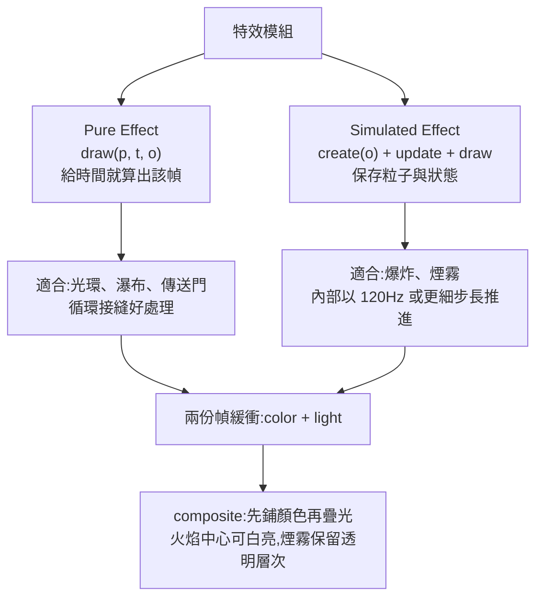

# PixelFX:244 個純程式碼像素特效,與「讓 Agent 看自己的輸出」的視覺回饋迴圈

> 整理自 YouTube「為什麼叫 QQ(Why QQ)」〈PixelFX:244個代碼遊戲特效,AI自我迭代優化〉(2026-11-02 上傳,約 9.6 分鐘,影片 ID `kpvZVBwQGlI`;官方簡中字幕)。
>
> **立場聲明:** 無業配或付費導流;片尾僅一般的關注、三連呼籲。影片自述畫面為本期實測、資料來自官方文件與像素特效開發者 Hugo Duprez 的公開文章。以下數字與機制已 `git clone --depth 1` 讀過原始碼核對(2026-11-03),差異列在「核實紀錄」。

---

## 一句話總結

pixelfx 把「很主觀的特效製作」變成程式碼:**顏色、方向、隨機種子全是參數,每一幀能重現、能檢查**;它附的 Claude Code Skill 更重要的價值,是給 Agent 一條 **「寫草稿 → 渲染成圖 → 看圖找問題 → 只修一類問題 → 再渲染」** 的流水線——**程式能編譯只證明能執行,畫面過不過關要看輸出**。

---

## 1. 專案是什麼

- 倉庫:`patch-gg/pixelfx`,MIT 授權,`package.json` 版本 **0.3.0**,Node 18 以上、純 ESM、只有一個 devDependency(esbuild)。
- 244 個特效(`node tools/list.mjs` 實際輸出 `244 effects`),分成火焰、冰、爆炸、天氣、UI、近戰等約 20 個類別,每類約 12 個。
- 沒有任何序列幀圖檔:每個特效是一個 JS 模組,執行時現場算出像素。
- 可直接 `import` 用在 Canvas / Phaser / PixiJS 等瀏覽器專案;也可用 `tools/render.mjs` 輸出透明 Sprite Sheet + Aseprite 風格 JSON(幀矩形、時長、fps、循環、錨點),給 Godot、Unity、GameMaker 走一般素材匯入。

## 2. 設計重點(對照原始碼)

| 機制 | 影片說法 | 原始碼印證 |
|---|---|---|
| 模擬步長 | 內部 120Hz 或更細,渲染幀率變了粒子運動一致 | `src/core/fx.js`:`Math.ceil(dt * 120 - 1e-9)`,註解寫明「不論呼叫者幀率都以 120Hz 或更細步進」 ✅ |
| 固定種子 | 第 40 幀每次都能重現 | `tools/check.mjs` 檢查「未播種的隨機數」 ✅ |
| 雙緩衝 | color 裝顏色、light 裝疊加輝光 | `createFrame` / `composite`,README 與 SKILL.md 皆如此描述 ✅ |
| 角色動作 | `createAct`,61 個帶角色的特效、12 個完整招式 | `src/core/act.js` 有 `createAct`、`hits`、`poses`;README 寫「61 effects with a character, and the 12 whole moves」✅(見核實段的措辭差) |
| 骨架 | 固定長度 3D 骨骼 + IK,再依深度遮擋、壓成灰階與輪廓 | `src/core/rig.js`(約 500 行)、`poses.js` 存在;姿勢以 12fps 階梯跳動、粒子可更高更新率,註明改編自 Hollow Crown ✅ |

**「動作時間與特效時間放在同一份資料」**是對遊戲工程最有用的點:`act` 內的 `hits` 記錄命中點、停幀(freeze)、震屏(shake)、推力(push),`poses` 記錄關鍵姿勢。戰鬥系統可以把這份時間表當成「畫面」和「傷害判定」共同讀取的介面,而不是在程式各處補 `setTimeout`。

## 3. Agent 視覺迭代流水線(Skill 的核心)

`skills/pixelfx/SKILL.md` 規定的流程:

1. 先寫一句明確的畫面目標。
2. 用 `node tools/list.mjs <關鍵字>` 找庫內最接近的兩三個特效當參考。
3. 做幾版草稿,**渲染成 contact sheet(GIF 或 MP4 也可)**。
4. **Agent 要打開結果看**構圖、顏色、運動,修最顯眼的問題,再渲染。SKILL.md 寫「**至少三輪**,代表作要更多」。
5. 三輪的分工(影片說法,與 SKILL.md 精神一致):第一輪看大形與節奏;第二輪修最礙眼的問題(例如冰環太厚、粒子全擠在中心);第三輪核對消散、循環、角色動作。

**自動檢查不能取代看圖:** `tools/check.mjs` 檢查缺 meta、畫到畫布外(留 24px 邊界)、單發特效是否乾淨結束、循環接縫、未播種隨機數、慢幀,以及 act 資料(姿勢欄位、手臂是否夠不到)。程式碼最後 `process.exit(fails ? 1 : 0)`,所以**放進 CI 在技術上可行**。影片的歸納很好用:**檢查管合約、渲染管體驗**——溢出為零不代表主體清楚,能無縫循環不代表好看。

> 方法源頭是像素特效開發者 Hugo Duprez,影片概括成「程式碼可塑、相信眼睛、餵好參考」;`NOTICE.md` 與 `LICENSE` 都列了 Hugo Duprez(`src/core/sim.js` 改編自他的 Sprite Fusion 開源特效)。

## 4. 影片的實測:接進 480×270 小遊戲

作者把 pixelfx 0.3.0 接進一個 Canvas 2D 小遊戲:內部解析度 480×270 再像素化放大;邏輯固定 60Hz,特效照常 update/draw;每幀先清緩衝,依「背景特效 → 角色 → 前景特效」畫完再 composite;三波敵人(史萊姆、蝙蝠、幽靈、會分裂的 Boss);WASD 移動、滑鼠瞄準、Space 揮劍、K 冰霜、L/Shift 衝刺。**小遊戲本身不在 pixelfx 倉庫裡,以下無法獨立核實,只轉述。**

工程教訓:

- 實戰最容易穿幫的是「**特效和規則各玩各的**」——劍光出現了、傷害晚半拍,手感就飄。所以輸入、冷卻、傷害、特效觸發放進同一個狀態更新。
- 作者自述踩到「顏色通道寫反、角色幾乎透明」,**看截圖比看日誌快**。
- 劍擊與衝刺共用體力、冰霜耗法力並減速擊退——規則也在約束畫面。

## 5. 把方法搬到日常開發

| 情境 | 照做的步驟 |
|---|---|
| 資料視覺化 | 先用幾組真實資料渲染出圖,再看標籤有沒有互相壓住 |
| UI 動效 | 錄下互動過程,檢查遮擋與等待感 |
| 網頁前端 | 別只讀 DOM 與測試報告,直接截不同視窗尺寸的圖看 |
| 任何視覺任務 | 給 Agent 一個「渲染入口」+ 可查看的結果 + 一組自動檢查,讓它一輪一輪拿證據改;輸出看不到就先補一個最小渲染器 |

### 應用案例

> 你要請 Agent 做一個「獲得道具」的閃光動畫。**差的做法:** 一次要求「做得炫」,拿到編譯成功的程式就收工,結果粒子全擠在中心。**照本篇做法:** ①先寫目標「0.6 秒、金色、向外散開、結尾乾淨消失」;②讓 Agent 先 `list` 找 `pickups/` 類最接近的兩個當參考;③渲染 contact sheet,第一輪只改整體大小與節奏;④第二輪只修「粒子擠中心」;⑤第三輪 `check.mjs` 驗證沒有溢出、種子固定、結尾無殘影。你只需要在最後決定「這個金色要不要更暖」。

## 6. 授權與風險(影片也有提)

- 程式碼與特效 **MIT**(版權列 Patch 與 Hugo Duprez)。
- `NOTICE.md` 有改編來源說明:`sim.js` 改編自 Sprite Fusion(Hugo Duprez, MIT);`act.js` 改編自 Hollow Crown(rehan-remade, MIT)。**商用請讀 NOTICE。**
- **`gallery/fonts` 的 Patch Pixel 字體不在 MIT 範圍內**(`NOTICE.md` 明寫「not covered by this repository's MIT license」)。別把字體檔隨手打包進發行版。
- 專案很年輕,介面可能變動,**依賴時鎖版本**;目標裝置要自己壓測,並核對素材尺寸、物件回收與引擎相容性。
- 選型:要「執行期可程式化」(換色、鏡像、旋轉)用 JS 模組;要「管線穩定、版本管理直觀、執行開銷好估」就先烘焙成 Sprite Sheet。影片的建議:**原型先跑程式碼,跨引擎交付再烘焙。**

---

## 核實紀錄(2026-11-03)

**已核實**
- 244 個特效、版本 0.3.0、MIT、Node 18 以上:`tools/list.mjs` 輸出與 `package.json`。
- 模擬步長 120Hz 以上:`src/core/fx.js`。
- 61 個帶角色的特效:README 原文。
- `tools/check.mjs` 的檢查項(溢出、循環接縫、未播種隨機數、慢幀、act 資料)與失敗時非零退出。
- 字體不在 MIT 範圍內、改編來源 Hugo Duprez / Hollow Crown:`NOTICE.md`。
- SKILL.md 要求至少三輪渲染迭代。

**需修正 / 補充**
- 影片說「12 個完整連招」。README 原文是「**Twelve whole moves** chain the effects into attacks from wind-up to recovery」,也就是 `moves/` 類別的 12 個完整招式(其中 `sword-combo` 才是三連擊),**不是 12 套連招**;意思接近但措辭有差。
- 影片說「官方建議至少三輪」——SKILL.md 寫的是「三輪起跳,代表作更多」,與影片一致;但「第一輪大形、第二輪最礙眼、第三輪消散循環動作」的分法是影片的整理,我在 SKILL.md 沒看到逐字相同的條文,**視為影片自己的歸納**。

**未能核實**
- 「2026-10-30 開源」:shallow clone 只看得到最新提交(2026-10-31),無法獨立確認首次公開日。
- 小遊戲的規格與操作(480×270、三波敵人、按鍵配置)——小遊戲不在倉庫內。
- Hugo Duprez 的原始文章(影片資料來源之一)未另行搜尋。

## 來源

- 為什麼叫 QQ(Why QQ):〈PixelFX:244個代碼遊戲特效,AI自我迭代優化〉 https://www.youtube.com/watch?v=kpvZVBwQGlI (官方簡中字幕)
- pixelfx 倉庫(已 clone 讀碼:`src/core/fx.js`、`act.js`、`rig.js`、`tools/check.mjs`、`skills/pixelfx/SKILL.md`、`NOTICE.md`):https://github.com/patch-gg/pixelfx
- 方法源頭與改編來源:Sprite Fusion pixel art VFX(Hugo Duprez)https://www.spritefusion.com/pixel-art-vfx ;Hollow Crown https://github.com/rehan-remade/hollow-crown

相關閱讀:[[agent-verification-before-scale-lauren-tan-reaction]](先給 Agent 驗證手段再談規模)、[[anatomy-skill-object-is-the-explanation]](視覺類 skill 的另一個例子)。
